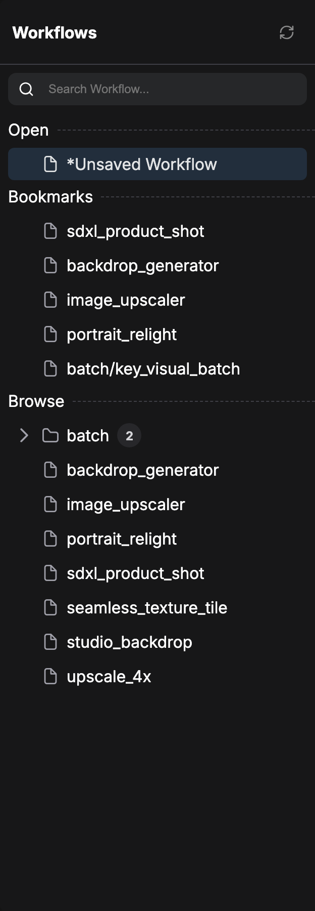

Пункт **Workflows** на левой боковой панели перечисляет рабочие процессы, сохранённые в этой установке, добавленные в избранное и (необязательно) графы, открытые в данный момент. Отсюда можно открыть граф, переименовать или удалить сохранённые файлы, добавить в избранное, вставить один рабочий процесс в другой и дублировать граф, не покидая редактор.

Шаблоны доступны в отдельном действии просмотра (`Browse Templates` в меню View или элемент Templates на боковой панели). См. [Шаблоны](/ru/interface/features/template). Упакованные рабочие процессы приложений (файлы с расширением `.app.json`) также отображаются в разделе [Приложения](/ru/interface/apps).

## Открыть панель рабочих процессов

Нажмите на иконку **Workflows** в левой боковой панели (сочетание клавиш по умолчанию: `w`). Заголовок панели: **Workflows**. Используйте кнопку Обновить в заголовке панели, чтобы повторно синхронизировать список сохранённых рабочих процессов с диска.

## Разделы панели

Когда вы не выполняете поиск, панель разделена на разделы:

### Открытые

Отображается только когда для параметра **Положение открытых рабочих процессов** (`Comfy.Workflow.WorkflowTabsPosition`) выбрано значение **Боковая панель**. В нём перечислены все рабочие процессы, открытые в редакторе, в виде плоского списка. У изменённых или несохранённых графов перед именем отображается `*`. Нажмите кнопку закрытия в строке, чтобы закрыть соответствующую вкладку. Удерживайте `Shift` при закрытии, чтобы пропустить предупреждение о несохранённых изменениях (при удержании Shift кнопка закрытия переключается на стиль опасного действия).

Когда для параметра выбрано значение **Верхняя панель** (по умолчанию), открытые рабочие процессы остаются на верхней полосе вкладок, а этот раздел скрыт. Если выбрано значение **Боковая панель**, на иконке боковой панели также отображается счётчик с количеством открытых рабочих процессов, если это количество больше нуля.

### Избранное

Плоский список рабочих процессов, добавленных в избранное. Используйте иконку закладки на листе в разделе **Просмотреть** (или здесь), чтобы переключить состояние закладки. Раздел скрыт, если у вас нет закладок.

### Просмотреть

Ваши сохранённые рабочие процессы в виде дерева папок по пути хранения рабочих процессов для данной установки. Нажмите на лист, чтобы открыть его. В пустых библиотеках отображается сообщение о пустой библиотеке.

## Поиск

Поисковая строка фильтрует все рабочие процессы (не только «Просмотреть») по пути. Пока запрос активен, панель переключается на единое дерево результатов поиска.

## Действия с рабочим процессом

В листе рабочего процесса доступны следующие действия:

- **Открыть**: нажмите на лист, чтобы загрузить его как активный граф.
- **Переименовать**: переименуйте на месте. Файл на диске будет переименован с правильным суффиксом рабочего процесса (`.json` или `.app.json`).
- **Удалить**: удалите сохранённый рабочий процесс (временные графы удалить этим способом нельзя).
- **Закладка**: включите или отключите закладку кнопкой действия на листе.
- **Перетаскивание**: листы рабочего процесса можно перетаскивать в цели, которые их принимают.
- **Контекстное меню**:
  - **Вставить**: вставьте рабочий процесс в текущий граф (в режиме приложения недоступно).
  - **Дублировать**: создайте копию рабочего процесса.

## Как это связано с верхней панелью вкладок

Верхние вкладки рабочих процессов и этот список на боковой панели показывают одни и те же открытые графы, когда вкладки находятся в верхней панели. Переключение **Opened workflows position** между **Topbar** и **Sidebar** меняет только то, где отображается список открытых файлов, но не то, где хранятся файлы.

Пути различаются в зависимости от типа установки (данные пользователя приложения Desktop, пользовательский каталог портативной или самостоятельно размещённой версии, хранилище рабочего пространства Cloud), но разделы и действия панели одинаковы.

## Связанные страницы

- [Обзор интерфейса](/ru/interface/overview)
- [Шаблоны](/ru/interface/features/template)
- [Приложения](/ru/interface/apps)
- [Поделиться рабочим процессом](/ru/cloud/share-workflow) (Cloud)
- [Режим приложения](/ru/interface/app-mode)
