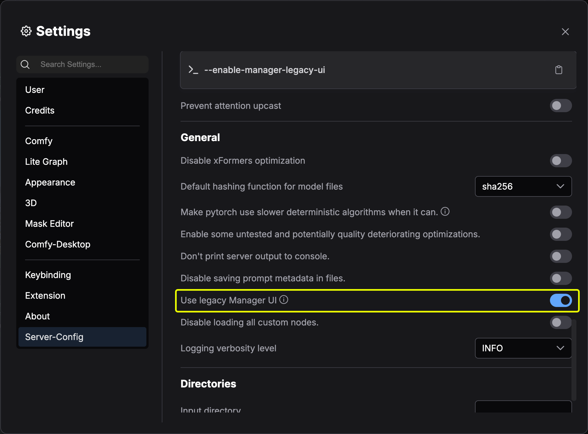

## Пользователи десктопной версии

Comfy Desktop устанавливает ComfyUI-Manager вместе с каждой установкой ComfyUI и запускает его с флагом `--enable-manager`, поэтому вам не нужно ничего устанавливать. Менеджер настраивается отдельно для каждой установки прямо в приложении:

<Steps>
  <Step title="Открыть панель Manage для установки">
  В Comfy Desktop откройте установку, перейдите в **Manage panel** и переключитесь на вкладку **Startup Args**.
  </Step>
  <Step title="Задать параметры Менеджера">
  - **Manager Security Level** определяет, какие пакеты узлов Менеджер может устанавливать: **Strict**, **Standard** (рекомендуется), **Relaxed** или **Permissive**. Более строгие уровни особенно важны, когда ComfyUI доступен в вашей сети через `--listen`
  - **Manager Network Mode** определяет, как Менеджер обращается к реестру узлов: **Public** (по умолчанию), **Private**, **Offline** или **Personal cloud** (только для машины, которую вы контролируете)

  Оба параметра вступают в силу при следующем запуске установки.
  </Step>
  <Step title="Изменить флаги запуска Менеджера (необязательно)">
  **Startup Arguments** на той же вкладке управляет флагами, с которыми запускается установка. Удалите `--enable-manager`, чтобы запускать ComfyUI без Менеджера, или оставьте его и добавьте `--disable-manager-ui`, чтобы скрыть интерфейс Менеджера, пока его фоновые задачи продолжают выполняться.
  </Step>
</Steps>

Остальные настройки для отдельной установки описаны на [вкладке Startup Args](/ru/installation/desktop/usage/manage#startup-args-tab), а флаги Менеджера перечислены в [справочнике по флагам запуска](/ru/development/comfyui-server/startup-flags).

## Пользователи портативной версии

Если вы используете версию [Windows Portable](/ru/installation/comfyui_portable_windows), новый ComfyUI-Manager встроен в ядро ComfyUI, но его нужно включить.

1. Установите зависимости менеджера:
   ```bash
   .\python_embeded\python.exe -m pip install -r ComfyUI\manager_requirements.txt
   ```

2. Запустите ComfyUI с включённым менеджером:
   ```bash
   .\python_embeded\python.exe -s ComfyUI\main.py --windows-standalone-build --enable-manager
   pause
   ```

## Пользователи ручной установки

Для пользователей с [ручной установкой](/ru/installation/manual_install) новый ComfyUI-Manager встроен в ядро ComfyUI, но его нужно включить.

1. Активируйте ваше виртуальное окружение:
   ```bash
   # Windows
   venv\Scripts\activate
   
   # Linux/macOS
   source venv/bin/activate
   ```

2. Установите зависимости менеджера:
   ```bash
   pip install -r manager_requirements.txt
   ```

3. Включите менеджер флагом `--enable-manager` при запуске ComfyUI:
   ```bash
   python main.py --enable-manager
   ```

### Параметры командной строки

| Флаг | Описание |
|------|-------------|
| `--enable-manager` | Включить ComfyUI-Manager |
| `--enable-manager-legacy-ui` | Использовать классический интерфейс менеджера вместо нового (требует `--enable-manager`) |
| `--disable-manager-ui` | Отключить интерфейс и эндпоинты менеджера, сохранив фоновые функции (требует `--enable-manager`) |

### Переключение между новым и классическим интерфейсом

Указанные ниже обновления версий поддерживаются только для установок через pip. Версии, установленные как пользовательские узлы, не поддерживают переключение на новый интерфейс.

<Tabs>
<Tab title="Пользователи без Desktop">
Чтобы использовать новый интерфейс:
```bash
python main.py --enable-manager
```

Чтобы использовать классический интерфейс:
```bash
python main.py --enable-manager --enable-manager-legacy-ui
```

</Tab>
<Tab title="Пользователи Desktop">
Пользователи Desktop могут переключиться на классический интерфейс в **Server Settings → UI Settings → Use legacy manager interface**

</Tab>
</Tabs>

## Обновить ComfyUI-Manager

ComfyUI-Manager поставляется как отдельный Python-пакет, а ядро ComfyUI фиксирует совместимую версию в `manager_requirements.txt`. Способ обновления Менеджера зависит от того, как установлен ComfyUI:

<Tabs>
<Tab title="Desktop">
Desktop включает Менеджер и обновляет его вместе с Comfy Desktop. Обновите движок ComfyUI на [панели управления](/ru/installation/desktop/usage/manage#update-tab).
</Tab>
<Tab title="Portable и ручная установка">
Обновление ComfyUI может не затронуть установленный пакет Менеджера. Установите требования менеджера в окружении, из которого вы запускаете ComfyUI, затем перезапустите ComfyUI с `--enable-manager`:

```bash
# Portable (Windows)
.\python_embeded\python.exe -m pip install -r ComfyUI\manager_requirements.txt
.\python_embeded\python.exe -s ComfyUI\main.py --windows-standalone-build --enable-manager

# Manual install
pip install -r manager_requirements.txt
python main.py --enable-manager
```
</Tab>
<Tab title="Git clone">
Если вы сами клонировали Менеджер в `custom_nodes`:

```bash
cd ComfyUI/custom_nodes/comfyui-manager
git pull
```

Затем перезапустите ComfyUI.
</Tab>
</Tabs>

## Классические методы установки

<Accordion title="Метод 1: клонирование Git (общая установка)">
Чтобы установить ComfyUI-Manager в дополнение к уже установленному ComfyUI:

1. Перейдите в каталог `ComfyUI/custom_nodes` в терминале
2. Клонируйте репозиторий:
   ```bash
   git clone https://github.com/Comfy-Org/ComfyUI-Manager comfyui-manager
   ```
3. Установите зависимости менеджера:
   ```bash
   cd comfyui-manager
   pip install -r requirements.txt
   ```
4. Перезапустите ComfyUI
</Accordion>

<Accordion title="Метод 2: портативная версия (Windows)">
1. Установите [Git for Windows](https://git-scm.com/download/win) (автономная версия, выберите «use windows default console window»)
2. Скачайте [install-manager-for-portable-version.bat](https://github.com/Comfy-Org/ComfyUI-Manager/raw/main/scripts/install-manager-for-portable-version.bat) в каталог `ComfyUI_windows_portable`
3. Дважды щёлкните по пакетному файлу, чтобы установить
</Accordion>

<Accordion title="Метод 3: comfy-cli (рекомендуется для новых установок)">
comfy-cli предоставляет различные возможности для управления ComfyUI из CLI.

**Требования**: Python 3, Git

**Windows:**
```bash
python -m venv venv
venv\Scripts\activate
pip install comfy-cli
comfy install
```

**Linux/macOS:**
```bash
python -m venv venv
. venv/bin/activate
pip install comfy-cli
comfy install
```

См. также: [документация comfy-cli](/comfy-cli/getting-started)
</Accordion>

<Accordion title="Метод 4: Linux + venv">
**Требования**: python-is-python3, python3-venv, git

1. Скачайте [install-comfyui-venv-linux.sh](https://github.com/comfy-org/ComfyUI-Manager/raw/main/scripts/install-comfyui-venv-linux.sh) в пустой каталог установки
2. Выполните:
   ```bash
   chmod +x install-comfyui-venv-linux.sh
   ./install-comfyui-venv-linux.sh
   ```
3. Запустите ComfyUI с помощью `./run_gpu.sh` или `./run_cpu.sh`
</Accordion>

<Warning>
**Меры предосторожности при установке:**
- Файлы ComfyUI-Manager должны находиться строго по пути `ComfyUI/custom_nodes/comfyui-manager`
- Не распаковывайте архив напрямую в `ComfyUI/custom_nodes` (такие файлы, как `__init__.py`, не должны находиться в этом каталоге)
- Не устанавливайте в пути вида `ComfyUI/custom_nodes/ComfyUI-Manager/ComfyUI-Manager` или `ComfyUI/custom_nodes/ComfyUI-Manager-main`
</Warning>
