## Управление пользовательскими узлами ComfyUI
Узнайте, как устанавливать пользовательские узлы через менеджер

### Установить узлы

<Steps>
    <Step title="Нажмите кнопку Manager в интерфейсе ComfyUI">
    Нажмите кнопку **Manager** в главном меню (верхняя панель).
    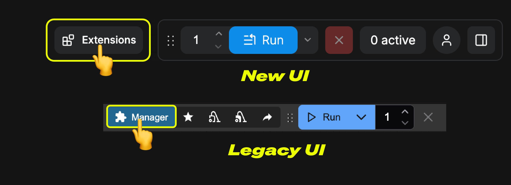
    </Step>
    <Step title="Выберите Install Nodes">
    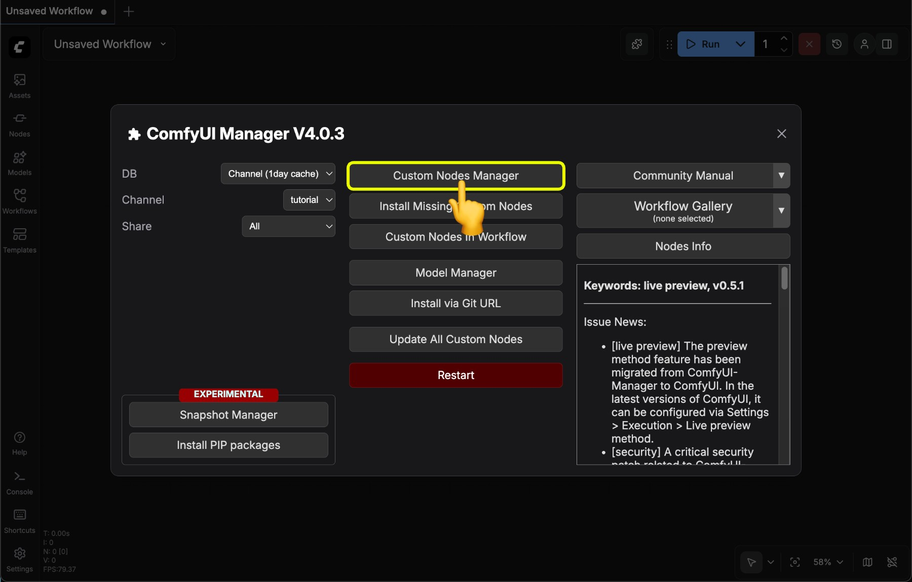
    </Step>
    <Step title="Просмотрите список или найдите узел, который хотите установить">
    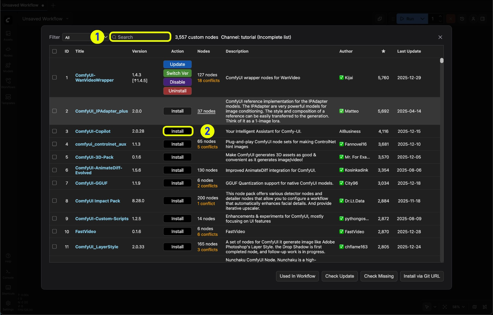
    </Step>
    <Step title="Нажмите **Install**, чтобы установить узел">
    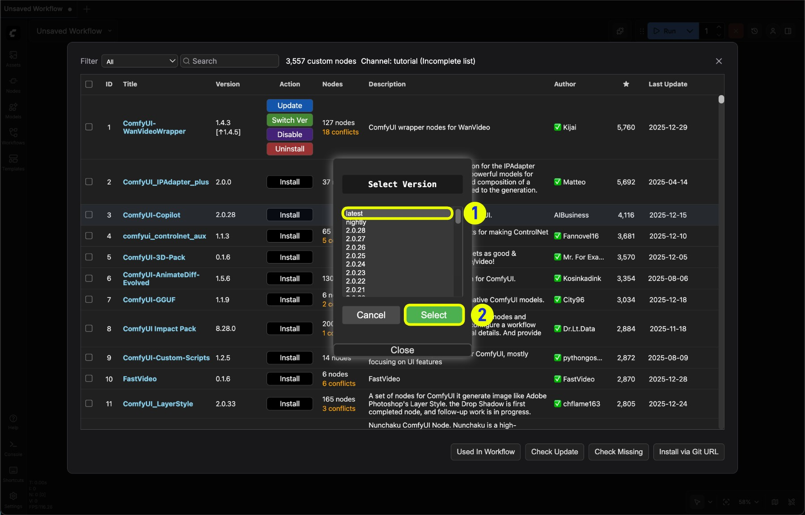
    1. Отдавайте предпочтение версии **latest**, если она доступна
    2. Нажмите **Select**, чтобы установить узел
    <Note>
    - Версии с цифрами в номере публикуют авторы в [реестре](https://registry.comfy.org/), они соответствуют стабильным релизам
    - nightly это последняя версия, которую авторы обновляют на GitHub; она соответствует версии для разработки, обычно не проходит проверку безопасности и содержит нестабильные изменения

    Настройки безопасности ComfyUI по умолчанию не позволяют напрямую устанавливать версии **nightly**. Подробнее см. в разделе [Политика безопасности](/ru/manager/troubleshooting#политика-безопасности)
    </Note>
    </Step>
    <Step title="Дождитесь завершения установки зависимостей, затем перезапустите ComfyUI">
      После нажатия кнопки установки менеджер автоматически установит зависимости и по завершении установки предложит перезапустить ComfyUI
      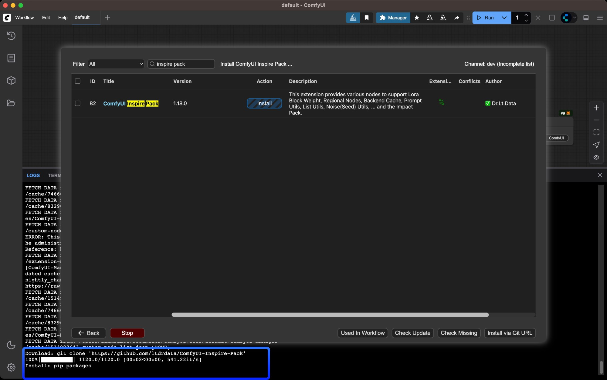
      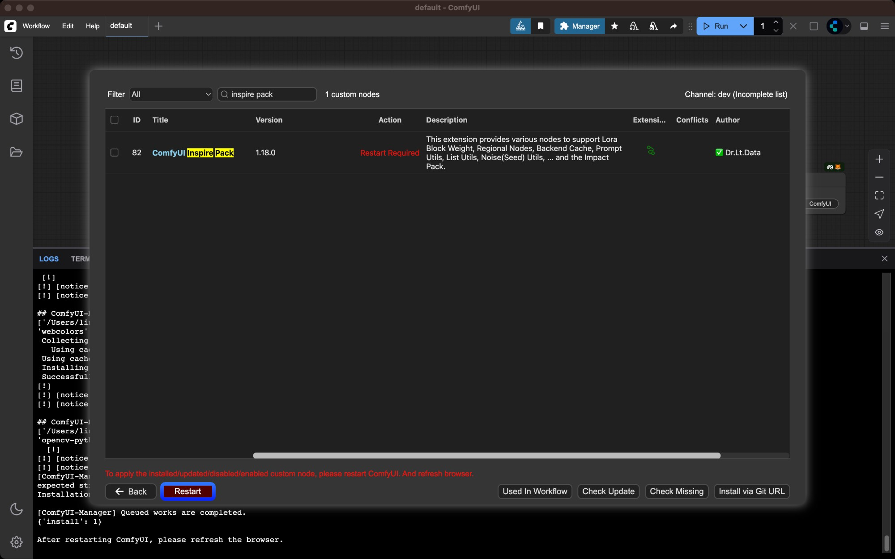
    </Step>
    <Step title="Проверьте, успешно ли установлен плагин">
    После перезапуска проверьте в ComfyUI Manager, успешно ли установлен соответствующий плагин и нет ли сообщений об ошибке `import failed`
      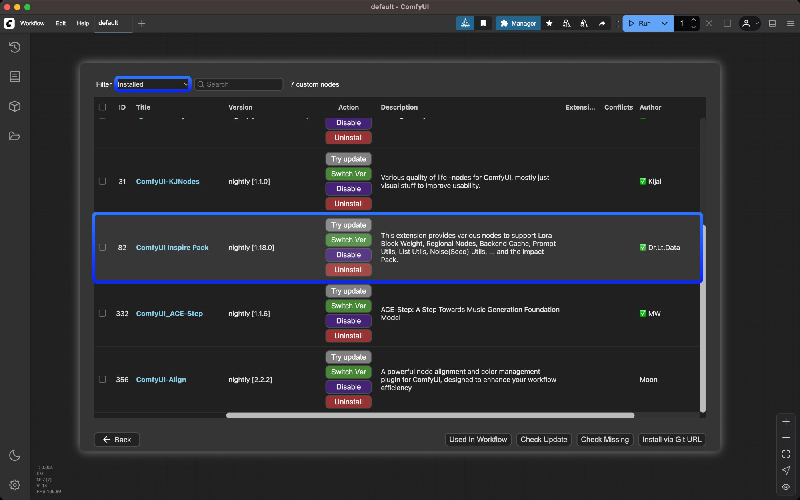
    </Step>
</Steps>

### Установить отсутствующие узлы

Отсутствующие узлы часто встречаются при загрузке рабочих процессов. Обычно бывает два типа отсутствующих узлов:
1. Отсутствует базовый узел: версия ComfyUI не является последней, обновите ComfyUI согласно разделу [Обновить ComfyUI](/ru/installation/update_comfyui)
2. Отсутствует пользовательский узел: не хватает сторонних пользовательских узлов, установить их можно по этому руководству

После установки ComfyUI-Manager, если при импорте рабочих процессов обнаруживаются отсутствующие пользовательские узлы, вы получите предупреждение с информацией об этих узлах

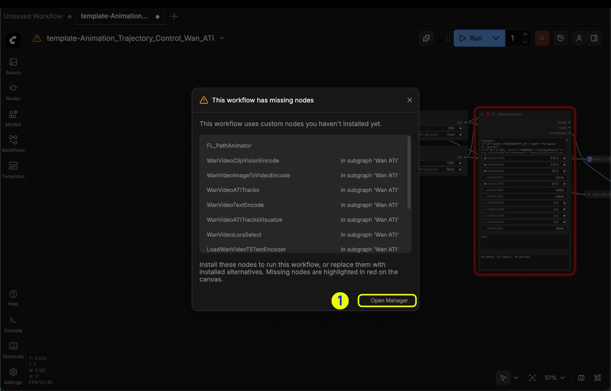
1. Нажмите **Open Manager**, чтобы активировать соответствующий пункт

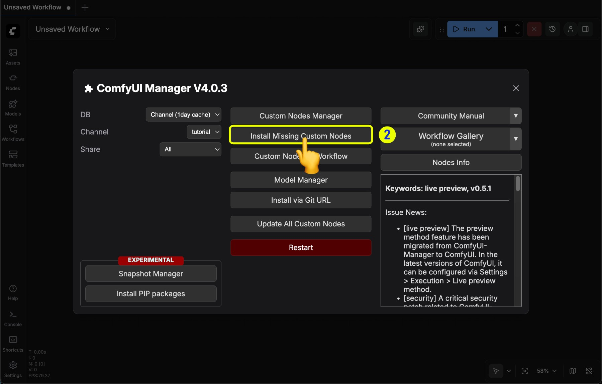
2. Нажмите **Install Missing Custom Nodes** в меню менеджера, чтобы открыть список отсутствующих узлов

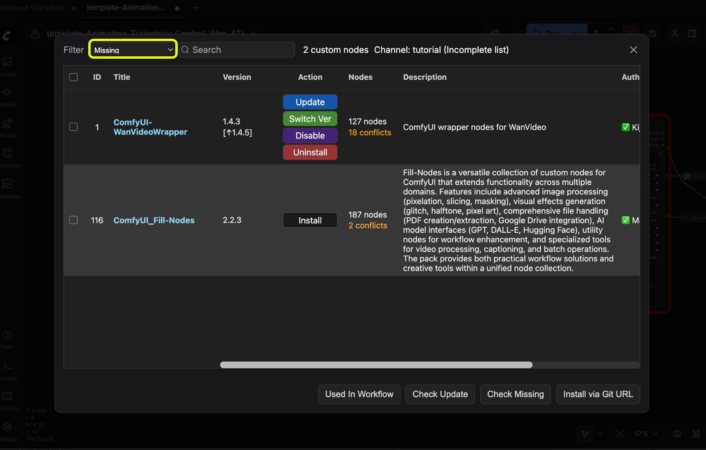
3. Просмотрите список узлов и установите нужные узлы

<Note>
Если в списке отсутствующих узлов не удаётся найти нужный узел, обычно это связано с несколькими причинами:
1. Автор узла не отправил и не зарегистрировал пользовательский узел в [реестре](/ru/registry/overview)
2. Соответствующий узел не имеет открытого исходного кода, это может быть ограниченный узел от определённых авторов или платформ
3. Автор оригинала изменил версию и удалил соответствующий узел
</Note>

### Обновить узлы
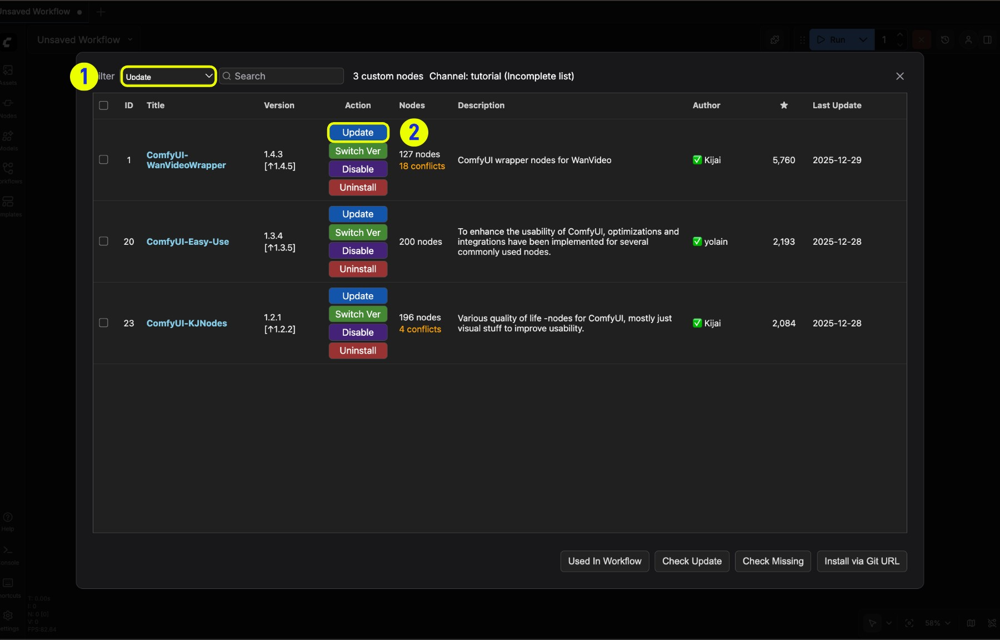
1. Переключите фильтр на **Update**, чтобы в текущем списке узлов отобразить только те узлы, которые можно обновить
2. Нажмите кнопку **Update**, чтобы обновить узел

### Удалить узлы

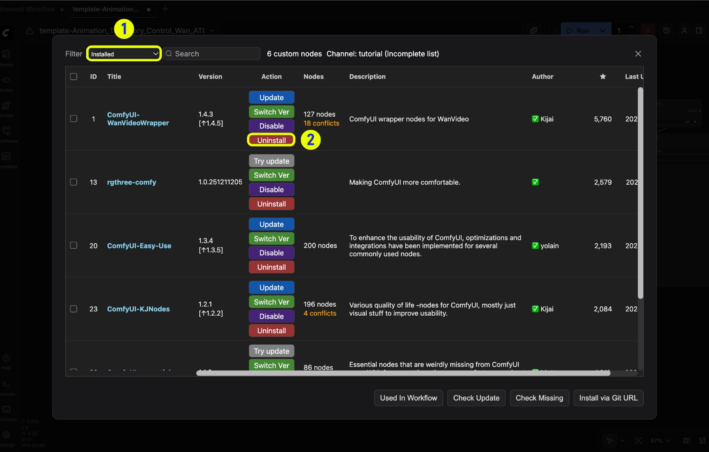
1. Выберите фильтр «Installed» в списке узлов, чтобы отобразить только установленные узлы
2. Щёлкните нужный узел правой кнопкой мыши и выберите **Uninstall**, чтобы удалить его

> При удалении соответствующего узла его зависимости не удаляются

О других способах установки плагинов читайте в статье ниже

<Card
    title="Установить пользовательские узлы"
    icon="download"
    href="/ru/installation/install_custom_node"
>
    Узнайте, как установить пользовательские узлы вручную
</Card>

## Менеджер снимков

Снимки сохраняют текущее состояние установки и позволяют восстановить предыдущее состояние.

Снимки сохраняются автоматически при нажатии **Save snapshot** или использовании **Update All**. Файлы снимков хранятся в: `<USER_DIRECTORY>/default/ComfyUI-Manager/snapshots`

Чтобы восстановить: откройте Snapshot Manager, выберите снимок и нажмите **Restore**.

<Note>
Восстановление вступает в силу при следующем запуске ComfyUI. Для пользовательских узлов, не управляемых через Git, поддержка снимков неполная.
</Note>
