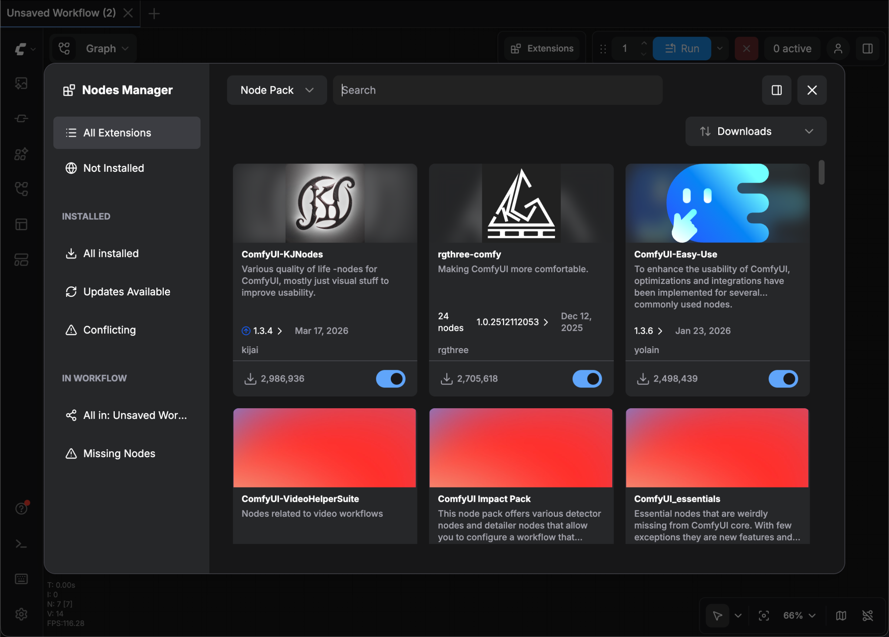

**ComfyUI-Manager** — это расширение, предназначенное для повышения удобства работы с [ComfyUI](https://github.com/Comfy-Org/ComfyUI). Оно предоставляет функции управления для **установки, удаления, отключения и включения** различных пользовательских узлов ComfyUI. Кроме того, это расширение предлагает функцию хаба и удобные средства доступа к широкому спектру информации внутри ComfyUI.

## Ключевые возможности

- **Управление пользовательскими узлами**: установка, обновление, удаление и отключение пользовательских узлов
- **Управление моделями**: скачивание и управление моделями из различных источников
- **Управление снимками**: сохранение и восстановление состояний установки
- **Детекция отсутствующих узлов**: автоматическое обнаружение и установка отсутствующих узлов из рабочих процессов

## Дальнейшие шаги

<CardGroup cols={2}>
  <Card title="Установка" icon="download" href="/ru/manager/install">
    Установите ComfyUI-Manager для своей конфигурации
  </Card>
  <Card title="Новый интерфейс" icon="puzzle-piece" href="/ru/manager/pack-management">
    Управляйте пользовательскими узлами и моделями в новом интерфейсе
  </Card>
  <Card title="Классический интерфейс" icon="puzzle-piece" href="/ru/manager/legacy-ui">
    Управляйте пользовательскими узлами и моделями в классическом интерфейсе
  </Card>
  <Card title="Конфигурация" icon="gear" href="/ru/manager/configuration">
    Настройте параметры и опции
  </Card>
  <Card title="Решение проблем" icon="bug" href="/ru/manager/troubleshooting">
    Устраните типичные проблемы
  </Card>
</CardGroup>