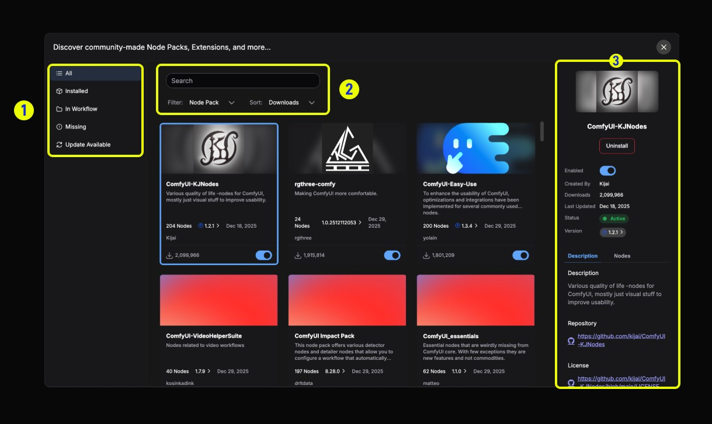
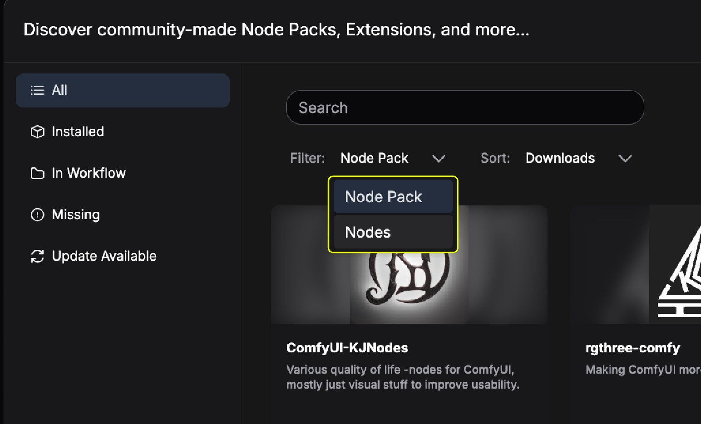
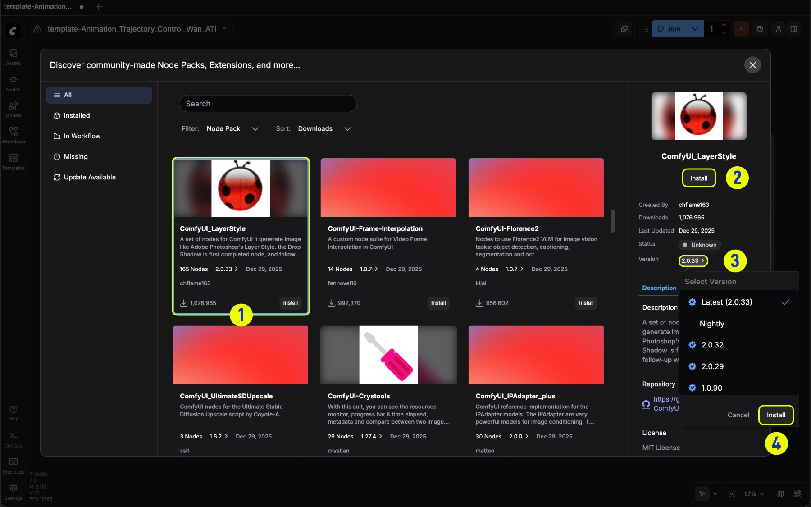
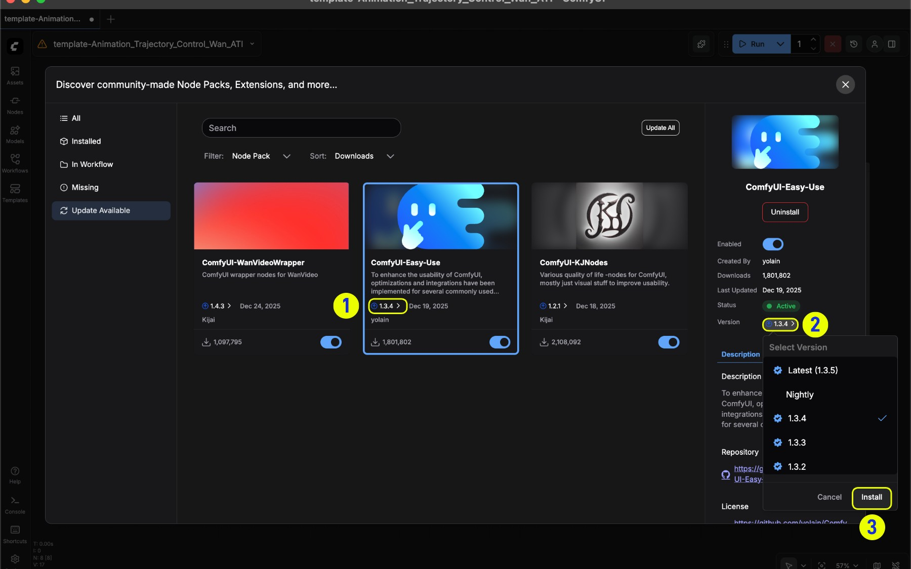
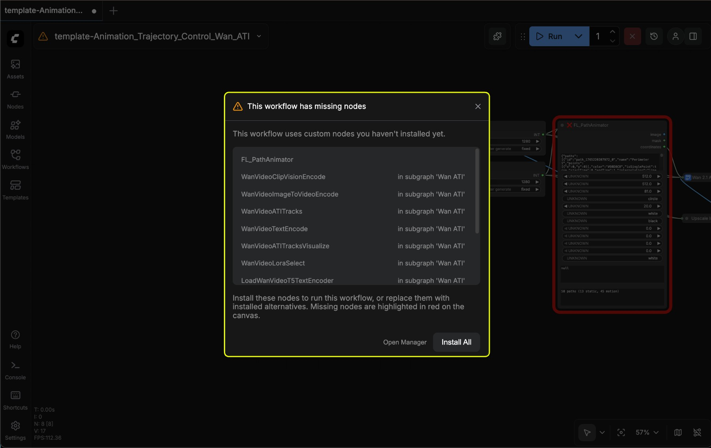
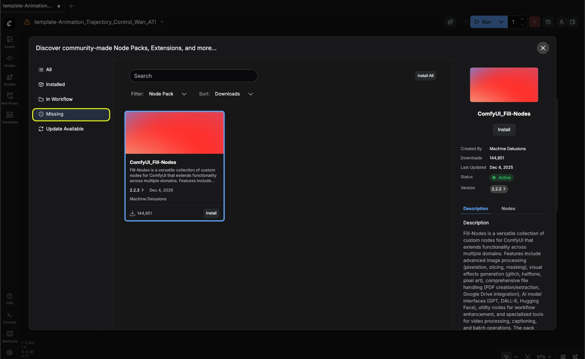
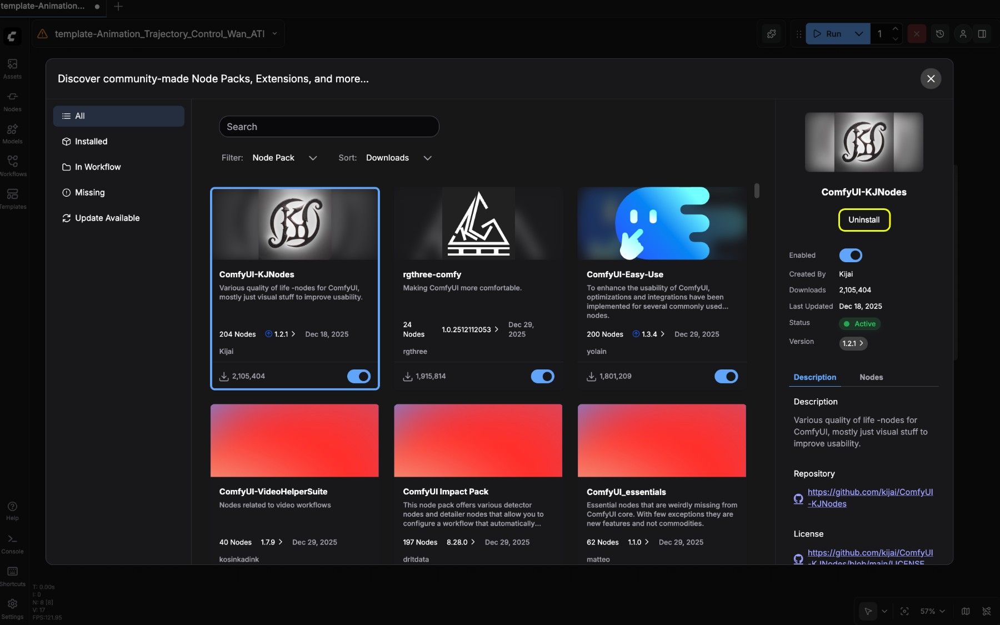

<Note>
Если вы используете не новый интерфейс, обратитесь к разделу [Переключение между новым и классическим интерфейсом](/ru/manager/install), чтобы узнать, как переключиться.
</Note>

## Обзор нового интерфейса

1. **Левая боковая панель (Фильтры)**: фильтрация установленных узлов, узлов в рабочем процессе, отсутствующих узлов, обновляемых узлов и т. д.
2. **Верхняя строка поиска**: поиск пакетов узлов (Node Pack) или отдельных узлов (Node); тип поиска переключается в выпадающем списке Filter
3. **Правая панель деталей**: нажмите на узел, чтобы отобразить подробную информацию, включая описание, статус включения, сведения о версии и т. д. Вкладка Description содержит информацию о репозитории, а вкладка Nodes показывает предпросмотр всех узлов

## Управление узлами

Узнайте, как управлять пользовательскими узлами в новом ComfyUI Manager

### Поиск узлов

Менеджер поддерживает отдельный поиск пакетов узлов и отдельных узлов. Как показано выше, тип поиска можно переключить с помощью фильтра.
- Node Pack: полный пакет пользовательских узлов
- Отдельный узел: поиск отдельных узлов внутри пакетов узлов

### Установка узлов

1. Выберите соответствующую карточку узла
2. Нажмите **Install** в развёрнутой информации об узле
3. Или выберите конкретную версию в поле **Version** для установки

### Обновление узлов
В фильтре **Доступно обновление** можно отобрать узлы, для которых в текущем списке узлов есть обновления

1. У обновляемых узлов отображается индикатор в виде стрелки обновления
2. Выберите конкретную версию в поле **Version**
3. После выбора версии нажмите кнопку **Update**, чтобы обновить

### Поиск отсутствующих узлов

Если ComfyUI Manager установлен правильно, при загрузке рабочего процесса с отсутствующими узлами появится запрос
1. Можно выбрать **Install All**, чтобы установить все узлы сразу
2. Или выбрать **Open Manager**, чтобы открыть менеджер и просмотреть детали перед установкой

Чтобы найти отсутствующие узлы в рабочем процессе, выберите соответствующий узел и нажмите кнопку **Missing** на панели предпросмотра.

### Удаление узлов

Чтобы удалить установленный узел, выберите соответствующий узел и нажмите кнопку **Uninstall** на панели предпросмотра.

## Частые вопросы
1. Почему я не могу найти нужный узел?
Новый менеджер поддерживает установку узлов только из [реестра](/registry/overview). Если ваш узел не зарегистрирован в реестре, сначала зарегистрируйте его в менеджере.

2. Почему я не могу найти вариант установки через git?
Из соображений безопасности и стабильности системы пользователей ComfyUI новый интерфейс не поддерживает установку узлов через git. Обратитесь к разделу [Ручная установка пользовательских узлов](/ru/installation/install_custom_node), чтобы узнать, как устанавливать пользовательские узлы вручную.