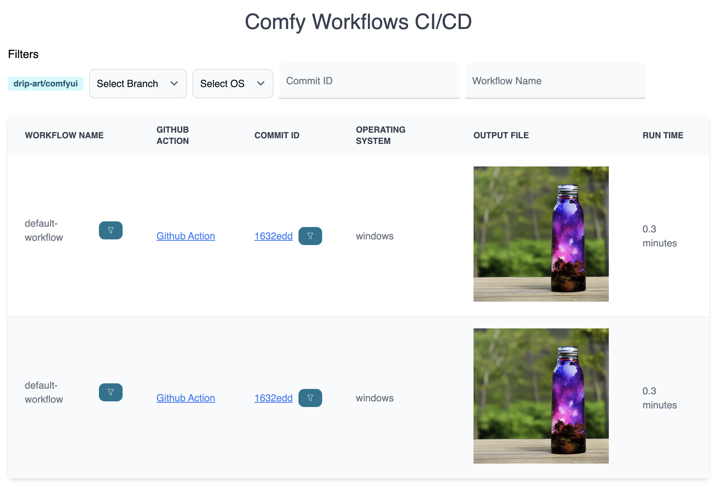

## Введение

При внесении изменений в пользовательские узлы нередко что-то ломается в Comfy или в других пользовательских узлах. Проверять всё на каждой операционной системе и при разных конфигурациях Pytorch зачастую нереально.

### Запуск рабочих процессов Comfy с помощью Github Actions

[Comfy-Action](https://github.com/Comfy-Org/comfy-action) позволяет запускать файл workflow.json Comfy в Github Actions. Он поддерживает загрузку моделей, пользовательских узлов и работает в Linux/Mac/Windows.

### Результаты

Выходные файлы загружаются на [панель CI/CD](https://ci.comfy.org/), и их можно просмотреть как последний шаг перед коммитом новых изменений или публикацией новых версий пользовательского узла.



### Публикация версий из GitHub Actions

[Publish Node Action](https://github.com/Comfy-Org/node-publish-action) публикует версию из вашего `pyproject.toml` в Registry, поэтому для релиза достаточно поднять версию. Добавьте свой токен доступа к Registry как секрет репозитория с именем `REGISTRY_ACCESS_TOKEN` в разделе **Настройки** > **Секреты и переменные** > **Действия**, затем добавьте этот рабочий процесс:

```yaml
name: Publish to Comfy registry
on:
  workflow_dispatch:
  push:
    branches:
      - main
    paths:
      - "pyproject.toml"

jobs:
  publish-node:
    name: Publish Custom Node to registry
    runs-on: ubuntu-latest
    steps:
      - name: Check out code
        uses: actions/checkout@v4
      - name: Publish Custom Node
        uses: Comfy-Org/publish-node-action@main
        with:
          personal_access_token: ${{ secrets.REGISTRY_ACCESS_TOKEN }}
```

<Note>
Публикуется та версия, которая указана в поле `version` в `pyproject.toml`. Обновите её до запуска рабочего процесса.
</Note>