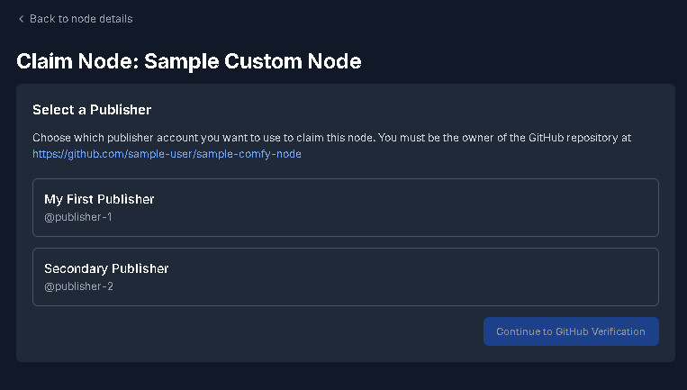
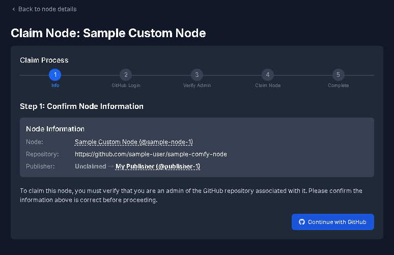

## Обзор

Функция **Claim My Node** позволяет разработчикам заявлять права на пользовательские узлы в ComfyUI Registry. Эта система гарантирует, что только законные авторы могут управлять своими опубликованными узлами и обновлять их, обеспечивая безопасность и подотчётность в сообществе.

## Что такое узлы без владельца?

По мере миграции с ComfyUI Manager на Comfy Registry с новыми стандартами многие пользовательские узлы, которые ранее были указаны в классической системе ComfyUI Manager, теперь отображаются в реестре как «unclaimed». Это узлы, которые:

- Изначально были опубликованы в классической системе ComfyUI Manager
- Были мигрированы в Comfy Registry, чтобы соответствовать последним стандартам
- Ожидают, когда их оригинальные авторы заявят права владения

Мы предоставляем разработчикам простой способ заявить права на эти мигрированные узлы, обеспечивая плавный переход от классической системы к новому стандарту реестра при сохранении надлежащего владения и контроля.

## Начало работы

Чтобы заявить права на свои узлы:

1. **Перейдите на страницу своего узла без владельца**: откройте страницу узла, на который ещё не заявлены права, и нажмите кнопку «Claim my node!».

2. **Создайте издателя (если его ещё нет)**:
   - Если вы ещё не создали издателя, вам будет предложено это сделать. Издатель необходим для заявки прав на узлы и эффективного управления ими.

3. **Выберите издателя**: выберите издателя, под которым хотите заявить права на узел. Этот шаг перенаправит вас на страницу заявки.

Чтобы заявить права на узел под выбранным издателем, выполните следующие шаги:

1. **Проверьте информацию об узле:**
   - Просмотрите детали узла, включая имя, ссылку на репозиторий и статус издателя, как показано на экране.

2. **Аутентификация через GitHub:**
   - Нажмите кнопку «Continue with GitHub», чтобы начать процесс аутентификации. Убедитесь, что вы вошли в правильный аккаунт GitHub с правами администратора на репозиторий.

3. **Проверьте права администратора:**
   - После входа система проверит, есть ли у вас права администратора для указанного репозитория GitHub. Этот шаг важен для подтверждения необходимых разрешений.

4. **Заявите права на узел:**
   - Если проверка прошла успешно, нажмите «Claim», чтобы заявить права на узел. Статус издателя изменится, что будет означать владение.

5. **Готово!:**
   - После успешной заявки прав на узел вы можете перейти к [публикации](./publishing) и управлению узлом как его законный владелец.

## Часто задаваемые вопросы

<AccordionGroup>

  <Accordion title="Кто может заявлять права на узлы?">
    Любой пользователь GitHub может отправить запрос на заявление прав, но заявления проверяются по оригинальному репозиторию узла и информации об авторе.
  </Accordion>

  <Accordion title="Сколько времени занимает процесс заявления прав?">
    Заявления одобряются автоматически, как только подтверждены права администратора GitHub на репозиторий. Это происходит мгновенно при отправке заявления.
  </Accordion>

  <Accordion title="Что происходит после одобрения моего заявления?">
    После одобрения вы получаете полный контроль над управлением узлом, включая публикацию версий, обновление метаданных, снятие с публикации и настройки политик.
  </Accordion>

  <Accordion title="Могу ли я заявить права на узлы, которые я не создавал?">
    Нет, заявления автоматически проверяются по правам администратора репозитория GitHub. Успешно заявить права на узлы могут только пользователи с правами администратора оригинального репозитория.
  </Accordion>

  <Accordion title="Что делать, если в моём заявлении отказано?">
    Заявления обрабатываются автоматически на основе прав администратора GitHub. Если у вас нет прав администратора на репозиторий, в заявлении будет автоматически отказано. Обратитесь к владельцу репозитория, чтобы запросить права администратора, если вы считаете, что должны обладать правами владения.
  </Accordion>
</AccordionGroup>
