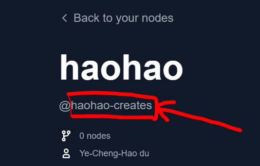
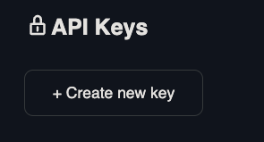

## Настроить аккаунт в реестре

Следуйте приведённым ниже шагам, чтобы настроить аккаунт в реестре и опубликовать свой первый узел.

### Посмотреть учебник

<iframe height="415" src="https://www.youtube.com/embed/WhOZZOgBggU?si=6TyvhJJadmQ65uXC" title="YouTube video player" frameborder="0" allow="accelerometer; autoplay; clipboard-write; encrypted-media; gyroscope; picture-in-picture; web-share" referrerpolicy="strict-origin-when-cross-origin" allowfullscreen style={{ width: "100%", borderRadius: "0.5rem" }}></iframe>

### Создать издателя

Издатель представляет собой идентичность, которая может публиковать пользовательские узлы в реестре. Каждый пользовательский узел должен включать идентификатор издателя в [файле]() pyproject.toml.

Перейдите на [Comfy Registry](https://registry.comfy.org) и создайте аккаунт издателя. ID издателя глобально уникален, и его нельзя изменить позже, поскольку он используется в URL вашего пользовательского узла.

ID издателя указан после символа `@` на странице вашего профиля.



### Создать API-ключ для публикации в реестре

<Note>
  **Важно:** Этот API-ключ предназначен специально для **публикации пользовательских узлов в реестре и ComfyUI-Manager**. Если вместо этого вы хотите использовать платные партнёрские узлы в своих рабочих процессах, см. [Обзор партнёрских узлов](/ru/tutorials/partner-nodes/overview).
</Note>

Перейдите [сюда](https://registry.comfy.org/nodes) и нажмите на издателя, для которого хотите создать API-ключ. Этот ключ будет использоваться для публикации пользовательских узлов в реестре (который обеспечивает работу ComfyUI-Manager) через CLI или GitHub Actions.



Присвойте API-ключу имя и сохраните его в надёжном месте. Если вы его потеряете, придётся создать новый ключ.


### Добавить метаданные

<Tip>Вы установили comfy-cli? [Сначала установите его](/ru/comfy-cli/getting-started).</Tip>

```bash
comfy node init
```

Эта команда создаст следующие метаданные:

```toml
# pyproject.toml
[project]
name = "" # Уникальный идентификатор вашего узла. Неизменяемый после создания.
description = ""
version = "1.0.0" # Версия пользовательского узла. Должна соответствовать семантическому версионированию.
license = { file = "LICENSE.txt" }
dependencies  = [] # Заполняется из requirements.txt

[project.urls]
Repository = "https://github.com/..."

[tool.comfy]
PublisherId = "" # TODO (укажите ID издателя с сайта Comfy Registry).
DisplayName = "" # Отображаемое имя пользовательского узла. Можно изменить позже.
Icon = "https://example.com/icon.png" # SVG, PNG, JPG или GIF (МАКС. 800x400px)
```

Добавьте этот файл в свой репозиторий. Ознакомьтесь со [спецификациями](/ru/registry/specifications), чтобы узнать больше о файле pyproject.toml.

### Исключить файлы с помощью `.comfyignore`

По умолчанию `comfy node publish` упаковывает каждый файл, отслеживаемый `git`. Чтобы файлы, предназначенные только для разработки (тесты, дизайн-ассеты, большие примеры), не попадали в публикуемый архив, добавьте файл `.comfyignore` в корень вашего репозитория. Синтаксис совпадает с [`.gitignore`](https://git-scm.com/docs/gitignore):

```gitignore
# Ассеты только для разработки
docs/
tests/
*.psd
.vscode/
```

<Note>

- `.comfyignore` дополняет `.gitignore`: файлы, не отслеживаемые git, уже исключены. Используйте `.comfyignore`, чтобы исключить файлы, которые вы *храните* в git, но не хотите включать в архив реестра.
- Каталоги, перечисленные в [`[tool.comfy].includes`](/ru/registry/specifications), принудительно включаются, даже если они соответствуют шаблону `.comfyignore` (полезно, когда собранная папка `dist/` игнорируется git, но должна попасть в архив).
- Зафиксируйте `.comfyignore` в своём репозитории, чтобы локальные запуски и CI создавали одинаковый архив.

</Note>

## Опубликовать в реестре

### Вариант 1: Comfy CLI

Выполните команду ниже, чтобы вручную опубликовать узел в реестре.

```bash
comfy node publish
```

Система запросит API-ключ.

```bash
API Key for publisher '<publisher id>': ****************************************************

...Version 1.0.0 Published. 
See it here: https://registry.comfy.org/publisherId/your-node
```

<Warning>
  Учтите, что по умолчанию API-ключ скрыт.
</Warning>
<Warning>
  При копировании и вставке через CTRL+V (в Windows) в конце API-ключа может появиться дополнительный символ \x16, например: ************************************************\x16.

  РЕКОМЕНДУЕТСЯ вставлять API-ключ через правую кнопку мыши.
</Warning>


### Вариант 2: Github Actions

Публикуйте узел автоматически через Github Actions.

<Steps>
<Step title="Настроить Github Secret">

Перейдите в Settings -> Secrets and Variables -> Actions, затем на вкладке Secrets в разделе Repository secrets выберите New Repository Secret.

Создайте секрет с именем `REGISTRY_ACCESS_TOKEN` и укажите в качестве значения ваш API-ключ.

</Step>
<Step title="Создать Github Action">
Скопируйте код ниже и вставьте его в файл `/.github/workflows/publish_action.yml`

```bash
name: Publish to Comfy registry
on:
  workflow_dispatch:
  push:
    branches:
      - main
    paths:
      - "pyproject.toml"

jobs:
  publish-node:
    name: Publish Custom Node to registry
    runs-on: ubuntu-latest
    steps:
      - name: Check out code
        uses: actions/checkout@v7
      - name: Publish Custom Node
        uses: Comfy-Org/publish-node-action@main
        with:
          personal_access_token: ${{ secrets.REGISTRY_ACCESS_TOKEN }} ## Добавьте свой личный токен доступа в секреты репозитория Github и укажите ссылку на него здесь.
```

<Warning>Если ваша рабочая ветвь называется не `main`, например `master`, добавьте её имя в раздел branches.</Warning>
</Step>
<Step title="Проверить Github Action">

Отправьте обновление номера версии в `pyproject.toml`. Обновлённый узел должен появиться в реестре.

<Tip>Github Action будет автоматически запускаться каждый раз, когда вы отправляете обновление файла `pyproject.toml`</Tip>

</Step>


</Steps>
