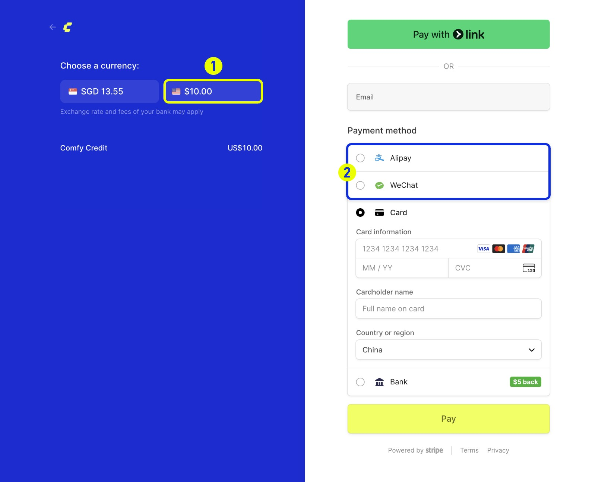

Способы оплаты, которые вы видите при оформлении, зависят от вашего местоположения и валюты. Comfy Organization Inc обрабатывает платежи через Stripe.

## Кредитные и дебетовые карты

Мы принимаем следующие основные кредитные и дебетовые карты:

- Visa
- Mastercard
- American Express

## Цифровые кошельки

Вы также можете оплатить через сервисы цифровых кошельков:

- Google Pay
- Link

## Альтернативные способы оплаты

Эти способы доступны только при оплате в **USD**:

- **Alipay**: локальные кредиты API и подписки Comfy Cloud
- **WeChat Pay**: только локальные кредиты API

<Note>
WeChat Pay и Alipay доступны только в отдельных регионах. Проверьте раздел `Business locations` в документации Stripe, чтобы убедиться в доступности в вашей стране:
- [Документация Stripe по WeChat Pay](https://docs.stripe.com/payments/wechat-pay#get-started)
- [Документация Stripe по Alipay](https://docs.stripe.com/payments/alipay)
</Note>

Чтобы использовать Alipay или WeChat Pay, выберите **USD** в качестве валюты платежа при оформлении. Тогда эти варианты появятся в списке способов оплаты, если они доступны в вашем регионе.

## Требования

Чтобы платёж прошёл успешно:

- На вашей карте должно быть достаточно средств или доступного кредитного лимита
- Платёжный адрес должен совпадать с адресом, который указан у эмитента вашей карты
- Международные карты принимаются, но могут облагаться комиссией за конвертацию валюты со стороны вашего банка

## Безопасность

Stripe является провайдером услуг PCI уровня 1, это самый строгий уровень сертификации в платёжной индустрии. Вся платёжная информация обрабатывается безопасно с использованием шифрования, принятого в отрасли. Comfy Organization Inc не хранит полные данные вашей карты на наших серверах.

## Обработка платежей

Платежи обрабатываются сразу при оформлении подписки или её продлении. Вы получите письмо с подтверждением, когда ваш платёж будет успешно обработан.

Если у вас возникли проблемы с обработкой платежа, обратитесь в нашу [команду поддержки](https://support.comfy.org/) за помощью.