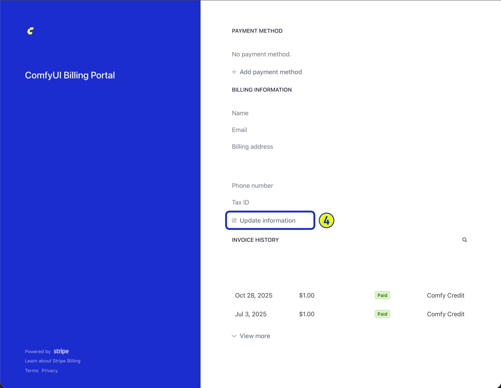

Вы можете обновить платёжные данные подписки Comfy Cloud в разделе **Plan & Credits**. Счета и способы оплаты по-прежнему управляются в портале Stripe.

## Как изменить платёжную информацию Comfy Cloud

1. Откройте [cloud.comfy.org](https://cloud.comfy.org/?utm_source=docs) и войдите в аккаунт.
2. Откройте меню профиля и нажмите **Manage plan**.
3. В разделе **Plan & Credits** нажмите **Billing & invoices**. Откроется портал Stripe.
4. Нажмите **Update information** и измените платёжные данные или данные для выставления счетов.
5. Сохраните изменения в Stripe.

Если платёж не прошёл, можно также нажать **Update payment** на баннере **Payment failed**. Откроется тот же портал Stripe.

## Что можно обновить

Вы можете изменить следующие платёжные данные:

- Номер кредитной или дебетовой карты
- Срок действия карточки
- CVV/код безопасности
- Платёжный адрес
- Тип способа оплаты (переключение между карточкой и цифровым кошельком)

## Когда изменения вступают в силу

- Изменения способа оплаты вступают в силу сразу же
- В следующем платёжном цикле будут использоваться обновлённые платёжные данные
- Изменения платёжных данных (имя, адрес, налоговый номер) применяются только к будущим счетам. Существующие счета изменить нельзя.
- Активные подписки не будут прерваны при обновлении платёжных данных

## Важные примечания

- Чтобы сохранить подписку, у вас должен быть активный способ оплаты
- Если вы удаляете способ оплаты, добавьте новый до следующей даты списания
- Если счета нужны вам для отчётности, сохраните их копии до внесения изменений
- Обновление платёжной информации не меняет дату списания и тариф подписки

## Решение проблем

Если у вас возникли проблемы при обновлении платёжной информации:

- Убедитесь, что все данные введены правильно
- Проверьте, что срок действия карточки не истёк
- Убедитесь, что платёжный адрес совпадает с данными банка-эмитента карточки
- Попробуйте использовать другой браузер или очистите кэш
- Если проблемы сохраняются, обратитесь в [службу поддержки](https://support.comfy.org/)