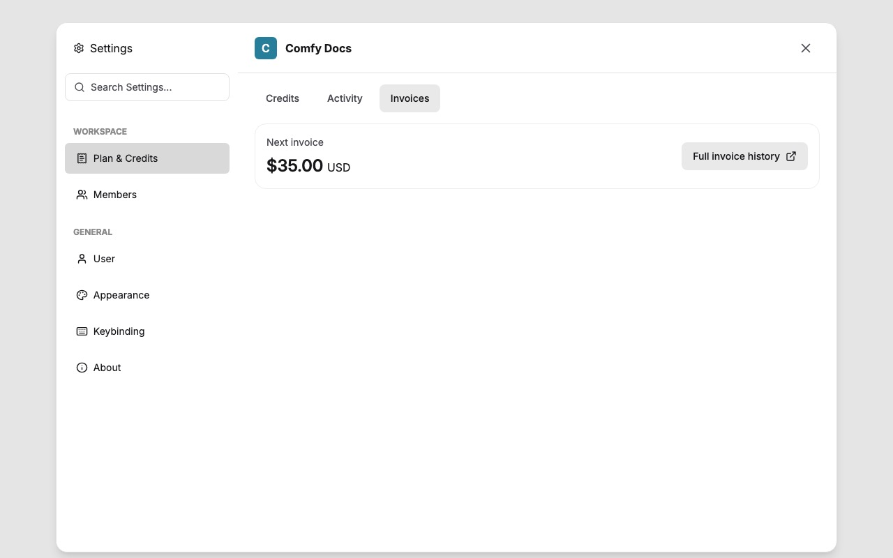

Ваш счёт формируется на основе платёжных данных, которые вы указываете при оформлении заказа. Эти данные отображаются в последующих счетах в портале выставления счетов Stripe.

<Card title="Обновить платёжную информацию" icon="credit-card" href="/ru/support/payment/editing-payment-information">
  Узнайте, как обновить платёжные данные и информацию об оплате
</Card>

## Почему счета выставляет Stripe

Подписки Comfy Cloud и покупка кредитов обрабатываются через Stripe, поэтому счета и квитанции выставляются через портал выставления счетов Stripe, а не напрямую Comfy. Чтобы найти или скачать прошлый счёт, см. [Просмотр истории платежей Comfy Cloud](/ru/support/payment/payment-history).

## Проверить следующий счёт

Вкладка **Invoices** в разделе **Plan & Credits** показывает сумму **Next invoice** в долларах США для вашего текущего тарифа. Откройте её из меню профиля: **Manage plan** → **Plan & Credits** → **Invoices**.

Пока подписка приостановлена, предстоящих списаний нет, поэтому сумма скрыта и остаётся только ссылка на историю. Если данные об оплате не удаётся загрузить, на вкладке можно повторить попытку.

История счетов и скачивание отдельных счетов доступны в портале выставления счетов Stripe. Нажмите **Full invoice history**, чтобы открыть его. Вкладку **Invoices** видят только участники рабочего пространства, у которых есть право управлять оплатой.

## Важные замечания

- Изменения платёжной информации применяются только к **будущим счетам**
- Мы не можем изменить счета, которые уже были выставлены
- Указывайте при оформлении заказа те платёжные данные, которые хотите видеть в счёте