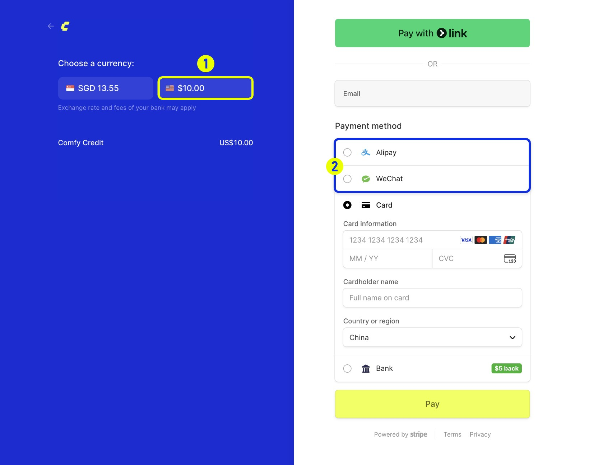

Comfy Organization Inc принимает платежи в нескольких валютах. Цены на подписки по умолчанию указаны в **долларах США (USD)**.

## Доступность способов оплаты

### Alipay и WeChat Pay

- **Alipay** поддерживается как для кредитов локального API, так и для подписок Comfy Cloud
- **WeChat Pay** сейчас доступен только для кредитов локального API

Оба способа требуют оплаты в **USD**. См. [Принимаемые способы оплаты Comfy Cloud](/ru/support/payment/accepted-payment-methods).

## Выбор валюты

Валюта оплаты обычно определяется:

- местоположением вашей учётной записи
- вашим платёжным адресом
- валютой по умолчанию вашего способа оплаты

При оформлении заказа выберите **USD**, если хотите, чтобы появились Alipay или WeChat Pay.

## Конвертация валюты

### Автоматическая конвертация

Если валюта вашей карточки отличается от валюты выставления счетов:

- ваш банк или эмитент карточки автоматически конвертирует сумму
- курсы конвертации устанавливает ваша финансовая организация
- могут взиматься дополнительные комиссии за конвертацию валюты

### Комиссии за конвертацию

- комиссии за конвертацию валюты взимает ваш банк, а не Comfy Organization Inc
- обычно эти комиссии составляют от 1 до 3% от суммы транзакции
- уточните в своём банке конкретные ставки комиссии за конвертацию

## Посмотреть суммы списаний в вашей валюте

Чтобы увидеть приблизительную сумму списания в местной валюте:

1. Проверьте выписку по банковскому счёту или карточке
2. Воспользуйтесь конвертером валюты вашего банка
3. Учтите, что курсы обмена меняются ежедневно

## Изменить валюту выставления счетов

Чтобы изменить валюту выставления счетов для существующей подписки, свяжитесь с нашей [командой поддержки](https://support.comfy.org/), указав предпочитаемую валюту. Изменение валюты может повлиять на сумму списания из-за курсов обмена.

## Различия цен по регионам

Цены на подписки могут немного различаться по регионам из-за:

- местных налоговых требований
- курсов обмена валют
- региональных корректировок цен

## Налоги и НДС

В зависимости от вашего местоположения могут применяться дополнительные сборы:

- налог с продаж (клиенты в США)
- НДС (клиенты в Европе)
- GST (Австралия, Канада и другие применимые регионы)

Эти налоги рассчитываются на основе вашего платёжного адреса и добавляются к итоговой сумме.