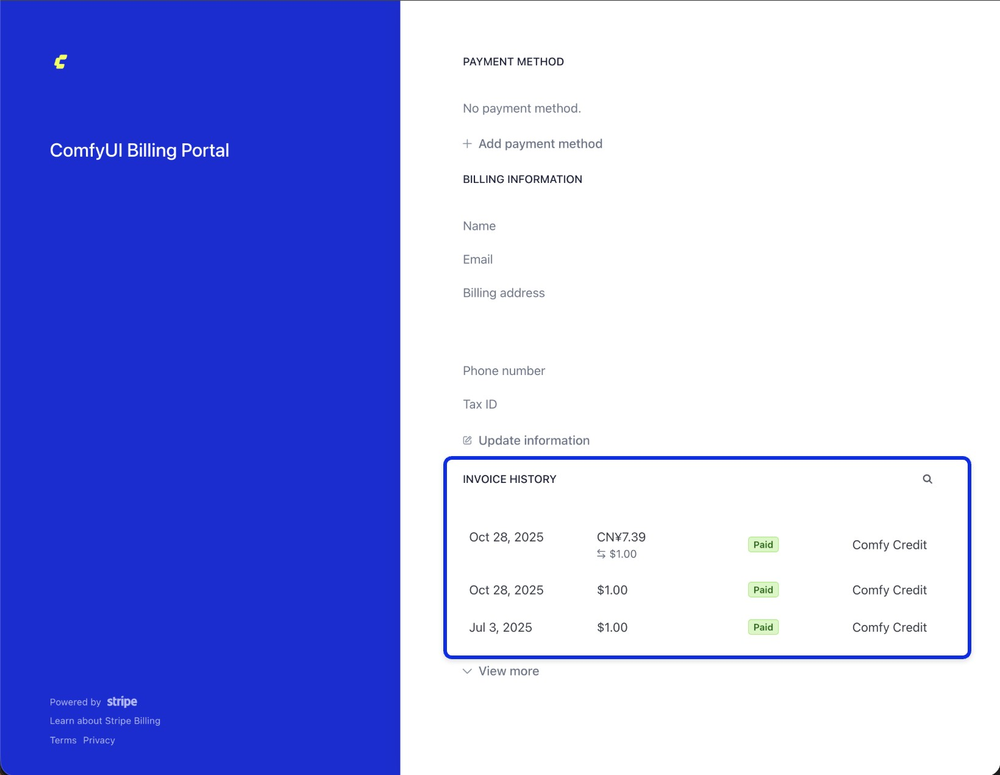
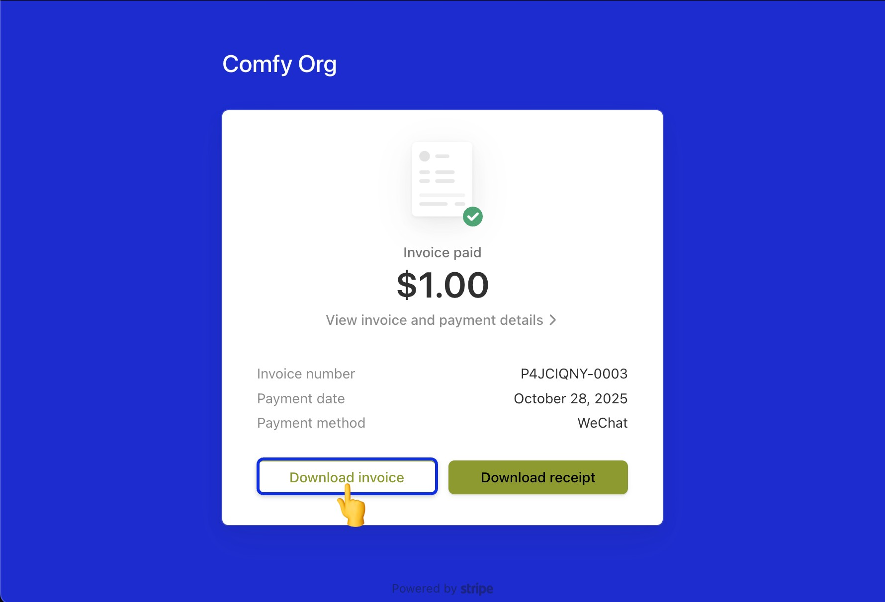

Просмотреть счета Comfy Cloud можно в разделе **План и кредиты**. Кнопка **Оплата и счета** открывает портал выставления счетов Stripe, где находится список счетов и доступны загрузки PDF.

## Открыть историю платежей Comfy Cloud

1. Перейдите на [cloud.comfy.org](https://cloud.comfy.org/?utm_source=docs) и войдите в аккаунт.
2. Откройте меню профиля и нажмите **Управление планом**.
3. В разделе **План и кредиты** нажмите **Оплата и счета**. Откроется портал выставления счетов Stripe.
4. Откройте счёт в Stripe, чтобы просмотреть детали или скачать PDF.

Убедитесь, что ваши платёжные данные верны, до того как будут сформированы новые счета. Обновить их можно на странице [Изменить платёжные данные Comfy Cloud](/ru/support/payment/editing-payment-information).

## Когда появляются счета

Comfy Cloud выставляет счёт при каждом успешном платеже, например при продлении подписки или покупке кредитов. Счета отображаются в портале выставления счетов Stripe вместе с другими вашими списаниями.

## Связанные страницы об оплате

<CardGroup cols={3}>
  <Card title="Информация о счёте" icon="book-open" href="/ru/support/payment/invoice-information">
    Узнайте, какие платёжные данные отображаются в счёте.
  </Card>
  <Card title="Изменить платёжные данные" icon="credit-card" href="/ru/support/payment/editing-payment-information">
    Обновите карточку и платёжные данные для будущих списаний.
  </Card>
  <Card title="Исправить ошибку платежа" icon="life-ring" href="/ru/support/payment/unsuccessful-payments">
    Обновите способ оплаты до приостановки подписки.
  </Card>
</CardGroup>