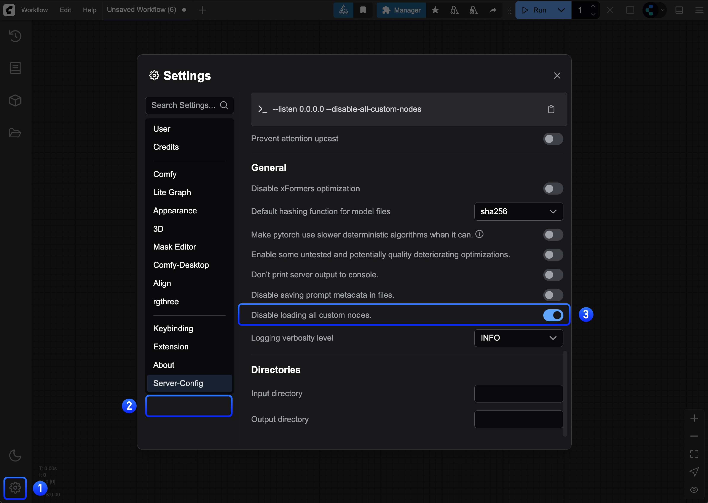
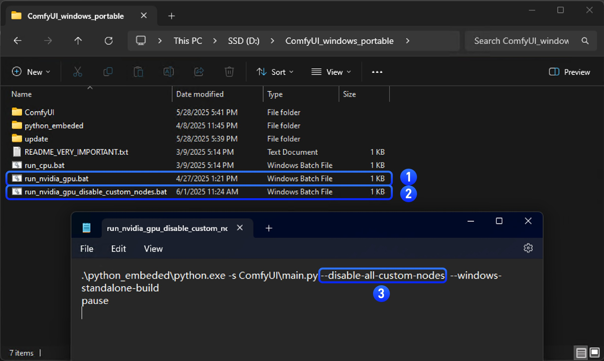
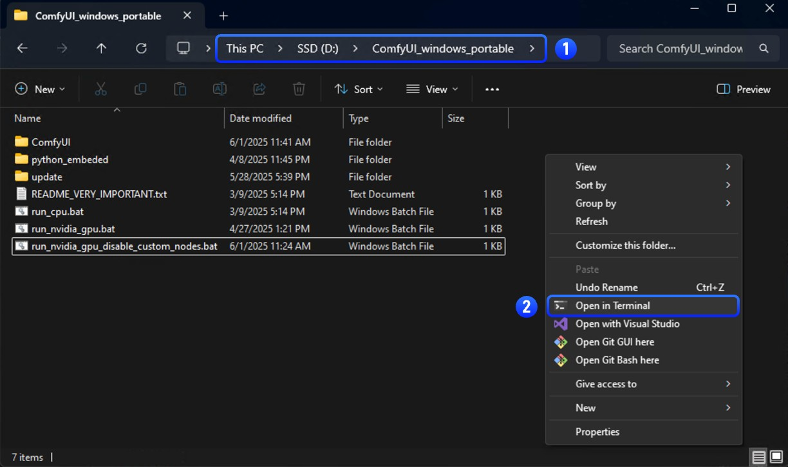
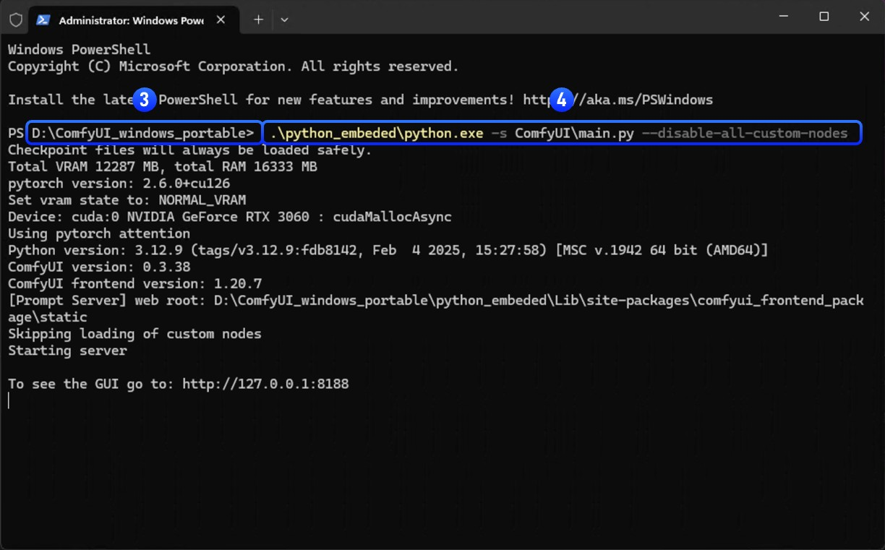
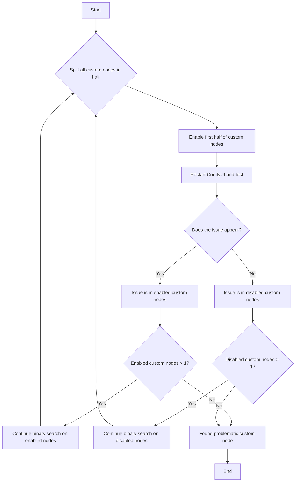
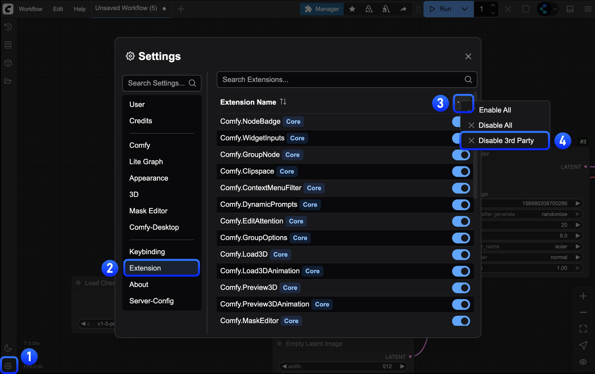
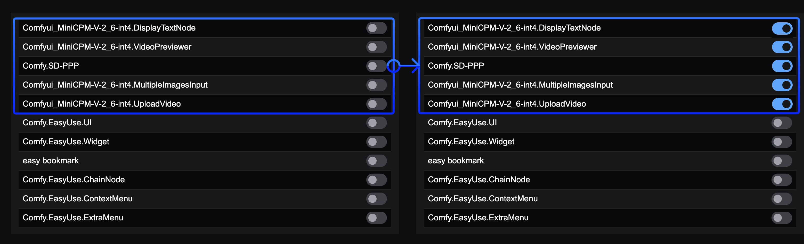

Вот общий подход к диагностике проблем с пользовательскими узлами:

 ```mermaid
 flowchart TD
    A[Issue Encountered] --> B{Does the issue disappear after <a href="#how-to-disable-all-custom-nodes%3F">disabling all custom nodes</a>?}
    B -- Yes --> C[Issue caused by custom nodes]
    B -- No --> D[Issue not caused by custom nodes, refer to other troubleshooting docs]
    C --> E{<a href="#1-troubleshooting-the-custom-nodes’-frontend-extensions">Check frontend extensions first</a>?}
    E -- Yes --> F[<a href="#1-troubleshooting-the-custom-nodes’-frontend-extensions">Troubleshoot in ComfyUI frontend</a><br/><li>Only need reload the frontend</li>]
    E -- No --> G[<a href="#2-general-custom-node-troubleshooting">Use general binary search method</a><li>Need to restart ComfyUI multiple times</li>]
    F --> H[Use binary search to locate problematic node]
    G --> H
    H --> I[<a href="#how-to-fix-the-issue">Fix, replace, report or remove problematic node</a>]
    I --> J[Issue solved]
```
## Как отключить все пользовательские узлы?

<Tabs>
<Tab title="Desktop Users">
Запустите Comfy Desktop с отключёнными пользовательскими узлами через меню настроек

или запустите сервер вручную:
```bash
cd path/to/your/comfyui
python main.py --disable-all-custom-nodes
```
</Tab>
<Tab title="Manual Install">
```bash
cd ComfyUI
python main.py --disable-all-custom-nodes
```
</Tab>
<Tab title="Portable">
<Tabs>
   <Tab title="Modify `.bat` file">
   Откройте папку, где находится портативная версия, и найдите файл `run_nvidia_gpu.bat` или `run_cpu.bat`
   
   1. Скопируйте файл `run_nvidia_gpu.bat` или `run_cpu.bat` и переименуйте его в `run_nvidia_gpu_disable_custom_nodes.bat`
   2. Откройте скопированный файл в Notepad
   3. Добавьте параметр `--disable-all-custom-nodes` в файл или скопируйте параметры ниже в файл `.txt` и переименуйте файл в `run_nvidia_gpu_disable_custom_nodes.bat`
   ```bash
   .\python_embeded\python.exe -s ComfyUI\main.py --disable-all-custom-nodes  --windows-standalone-build
   pause
   ```
   4. Сохраните файл и закройте его
   5. Дважды щёлкните по файлу, чтобы запустить его. Если всё в порядке, вы должны увидеть, что ComfyUI запускается, а пользовательские узлы отключены
   </Tab>
   <Tab title="Through Command Line">
   
   1. Перейдите в папку, где находится портативная версия
   2. Откройте терминал, выбрав в контекстном меню пункт Open terminal
   
   3. Убедитесь, что текущим каталогом является папка портативной версии
   4. Введите следующую команду, чтобы запустить ComfyUI через портативный Python и отключить пользовательские узлы
   ```
   .\python_embeded\python.exe -s ComfyUI\main.py --disable-all-custom-nodes
   ```
   </Tab>
</Tabs>
</Tab>
</Tabs>

**Результаты:**
- ✅ **Проблема исчезает**: пользовательский узел вызывает проблему → Перейдите к шагу 2
- ❌ **Проблема сохраняется**: это не проблема пользовательского узла → [Сообщите о проблеме](#reporting-issues)
## Что такое бинарный поиск?

В этом документе мы рассмотрим подход бинарного поиска для диагностики проблем с пользовательскими узлами: он заключается в проверке половины пользовательских узлов за раз, пока мы не найдём проблемный узел.

Обратитесь к блок-схеме ниже, чтобы узнать конкретный порядок действий: каждый раз включайте половину отключённых в данный момент узлов и проверяйте, появляется ли проблема, пока не определите, какой пользовательский узел вызывает проблему


## Два метода диагностики неполадок

В этом документе мы разделяем пользовательские узлы на два типа для диагностики неполадок:


- A: Пользовательские узлы с расширениями фронтенда
- B: Обычные пользовательские узлы

Сначала рассмотрим потенциальные проблемы и их причины для разных типов пользовательских узлов:

<Tabs>
   <Tab title="Пользовательские узлы с расширениями фронтенда">
   Для пользовательских узлов можно в первую очередь диагностировать те, что имеют расширения фронтенда, поскольку они вызывают больше всего проблем. Их основные конфликты возникают из-за несовместимости с обновлениями версии фронтенда ComfyUI.
   
   Типичные проблемы:
   - Рабочие процессы не выполняются
   - Некоторые узлы не могут отображать изображения предпросмотра (например, узел Save Image)
   - Неправильное выравнивание элементов интерфейса
   - Невозможно получить доступ к фронтенду ComfyUI
   - Полностью сломанный интерфейс или пустой экран
   - Невозможно нормально взаимодействовать с бэкендом ComfyUI
   - Соединения между узлами не работают должным образом
   - И другое
   
   Типичные причины этих проблем:
   - Изменения фронтенда при обновлениях, к которым пользовательские узлы ещё не адаптированы
   - Пользователи обновляют ComfyUI, не обновляя одновременно пользовательские узлы, хотя авторы уже выпустили совместимые версии
   - Авторы прекращают поддержку, что приводит к несовместимости расширений пользовательских узлов с фронтендом ComfyUI
      
   </Tab>
   <Tab title="Обычные пользовательские узлы">
   Если проблема не вызвана расширениями фронтенда пользовательских узлов, то она часто связана с зависимостями. Типичные проблемы:
   - Ошибки «Failed to import» в консоли или журналах
   - Отсутствующие узлы по-прежнему отображаются как отсутствующие после установки и перезапуска
   - ComfyUI аварийно завершает работу или не запускается
   - И другое

   Типичные причины этих ошибок:
   - Пользовательские узлы требуют дополнительных wheel-пакетов, таких как ComfyUI-Nunchaku
   - Пользовательские узлы используют строгие версии зависимостей (например, `torch==2.4.1`), тогда как другие плагины используют другие версии (например, `torch>=2.4.2`), что вызывает конфликты после установки
   - Проблемы с сетью, из-за которых не удаётся успешно установить зависимости

   Когда проблемы связаны с взаимозависимостями и версиями в среде Python, диагностика усложняется и требует знаний об управлении средой Python, включая понимание того, как устанавливать и удалять зависимости
   </Tab>
</Tabs>
## Использование бинарного поиска для устранения неполадок

Среди этих двух разных типов проблем с пользовательскими узлами чаще встречаются конфликты между фронтенд-расширениями пользовательских узлов и ComfyUI. Сначала мы уделим приоритетное внимание устранению неполадок этих узлов. Ниже описан общий подход к устранению неполадок:

### 1. Устранение неполадок фронтенд-расширений пользовательских узлов

<Steps>
   <Step title="Disable All Third-Party Frontend Extensions">
   
   После запуска ComfyUI найдите меню `Extensions` в настройках и выполните шаги, показанные на изображении, чтобы отключить все сторонние расширения
   <Tip>
      Если вы не можете войти в интерфейс ComfyUI, просто пропустите раздел устранения неполадок фронтенд-расширений и перейдите к [Общему подходу к устранению неполадок пользовательских узлов](#2-general-custom-node-troubleshooting)
   </Tip>
   </Step>
   <Step title="Restart ComfyUI">
   После первого отключения фронтенд-расширений рекомендуется перезапустить ComfyUI, чтобы все фронтенд-расширения были корректно отключены
   - Если проблема исчезла, значит, её вызвали фронтенд-расширения пользовательских узлов, и можно перейти к устранению неполадок с помощью бинарного поиска
   - Если проблема сохраняется, значит, её причина не во фронтенд-расширениях. Обратитесь к другим подходам к устранению неполадок, описанным в этом документе
   </Step>
   <Step title="Use Binary Search to Locate Problem Nodes">
   Используйте метод, описанный в начале этого документа, включая половину пользовательских узлов за раз, пока не найдёте проблемный узел
   
   Ориентируясь на изображение, включите половину фронтенд-расширений. Обратите внимание: если названия расширений похожи, скорее всего, они относятся к фронтенд-расширениям одного и того же пользовательского узла
   </Step>
   <Step title="Follow-up Actions">
   Если вы нашли проблемный пользовательский узел, обратитесь к разделу об исправлении проблем в этом документе, чтобы решить проблемы с пользовательским узлом
   </Step>
</Steps>

Используя этот метод, вам не нужно перезапускать ComfyUI несколько раз: достаточно перезагрузить ComfyUI после включения или отключения фронтенд-расширений пользовательских узлов. Кроме того, область диагностики ограничивается узлами с фронтенд-расширениями, что значительно сужает диапазон поиска.

### 2. Общий подход к устранению неполадок пользовательских узлов {#2-general-custom-node-troubleshooting}


<Steps>
  <Step title="Use Binary Search to Locate Custom Nodes">
      Для локализации с помощью бинарного поиска, помимо ручного поиска, также доступен автоматизированный бинарный поиск с использованием comfy-cli, как подробно описано ниже:

      <Tabs>
         <Tab title="Using Comfy CLI (Recommended)">
         Использование Comfy CLI требует некоторого опыта работы с командной строкой. Если вам это неудобно, используйте вместо этого ручной бинарный поиск.
         
         Если у вас установлен [Comfy CLI](/ru/comfy-cli/getting-started), вы можете использовать автоматизированный инструмент bisect для поиска проблемного узла:

         ```bash
         # Начните сеанс bisect
         comfy-cli node bisect start

         # Следуйте подсказкам:
         # - Проверьте ComfyUI с текущим набором включённых узлов
         # - Отметьте как 'good', если проблема исчезла: comfy-cli node bisect good
         # - Отметьте как 'bad', если проблема сохраняется: comfy-cli node bisect bad
         # - Повторяйте, пока проблемный узел не будет найден

         # Сбросьте состояние после завершения
         comfy-cli node bisect reset
         ```
         Инструмент бисекции автоматически включает и отключает узлы, а также сопровождает вас в этом процессе.

         </Tab>
         <Tab title="Manual Binary Search">
            <Warning>
            Перед началом обязательно **создайте резервную копию** папки custom_nodes на случай, если что-то пойдёт не так.
            </Warning>

         Если вы предпочитаете выполнять процесс вручную или у вас не установлен Comfy CLI, выполните шаги ниже:

         <Steps>
            <Step title="Create Temporary Folders">
            Перед началом перейдите в папку `<YOUR_COMFYUI_FOLDER>\ComfyUI\`
                  <Tabs>
                     <Tab title="Windows">
                     - **Создайте резервную копию всех пользовательских узлов**: скопируйте и переименуйте `custom_nodes` в `custom_nodes_backup`
                     - **Создайте временную папку**: создайте папку с именем `custom_nodes_temp`
                     
                     Или используйте следующую командную строку для создания резервной копии:
      
                     ```bash
                     # Создать резервную копию и временную папку
                     mkdir "%USERPROFILE%\custom_nodes_backup"
                     mkdir "%USERPROFILE%\custom_nodes_temp"

                     # Скопировать всё содержимое
                     xcopy "custom_nodes\*" "%USERPROFILE%\custom_nodes_backup\" /E /H /Y
                     ```
                     </Tab>
                     <Tab title="macOS/Linux">
                     Вручную создайте резервную копию папки custom_nodes
                     Или используйте следующую командную строку для создания резервной копии:
                     ```bash
                     # Создать резервную копию и временную папку
                     mkdir ~/custom_nodes_backup
                     mkdir ~/custom_nodes_temp

                     # Скопировать всё содержимое
                     cp -r custom_nodes/* ~/custom_nodes_backup/
                     ```
                     </Tab>
                     <Tab title="Cloud/Colab">
                     ```bash
                     # Создать резервную копию и временную папку
                     mkdir /content/custom_nodes_backup
                     mkdir /content/custom_nodes_temp

                     # Скопировать всё содержимое
                     cp -r /content/ComfyUI/custom_nodes/* /content/custom_nodes_backup/
                     ```
                     </Tab>
                  </Tabs>
               </Step>
               <Step title="List all custom nodes">
                   <Tabs>
                     <Tab title="Windows">
                     Поскольку в Windows есть графический интерфейс, этот шаг можно пропустить, если вы не используете только командную строку
                     ```bash
                     dir custom_nodes
                     ```
                     </Tab>
                     <Tab title="macOS/Linux">
                     ```bash
                     ls custom_nodes/
                     ```
                     </Tab>
                     <Tab title="Cloud/Colab">
                     ```bash
                     ls /content/ComfyUI/custom_nodes/
                     ```
                     </Tab>
                  </Tabs>
               </Step>
               <Step title="Split nodes in half">
               Предположим, у вас есть 8 пользовательских узлов. Переместите первую половину во временное хранилище:
                  <Tabs>
                  <Tab title="Windows">
                  ```bash
                  # Переместить первую половину (узлы 1-4) во временную папку
                  move "custom_nodes\node1" "%USERPROFILE%\custom_nodes_temp\"
                  move "custom_nodes\node2" "%USERPROFILE%\custom_nodes_temp\"
                  move "custom_nodes\node3" "%USERPROFILE%\custom_nodes_temp\"
                  move "custom_nodes\node4" "%USERPROFILE%\custom_nodes_temp\"
                  ```
                  </Tab>
                  <Tab title="macOS/Linux">
                  ```bash
                  # Переместить первую половину (узлы 1-4) во временную папку
                  mv custom_nodes/node1 ~/custom_nodes_temp/
                  mv custom_nodes/node2 ~/custom_nodes_temp/
                  mv custom_nodes/node3 ~/custom_nodes_temp/
                  mv custom_nodes/node4 ~/custom_nodes_temp/
                  ```
                  </Tab>
                  <Tab title="Cloud/Colab">
                  ```bash
                  # Переместить первую половину (узлы 1-4) во временную папку
                  mv /content/ComfyUI/custom_nodes/node1 /content/custom_nodes_temp/
                  mv /content/ComfyUI/custom_nodes/node2 /content/custom_nodes_temp/
                  mv /content/ComfyUI/custom_nodes/node3 /content/custom_nodes_temp/
                  mv /content/ComfyUI/custom_nodes/node4 /content/custom_nodes_temp/
                  ```
                  </Tab>
                  </Tabs>
               </Step>
               <Step title="Test ComfyUI">
               Запустите ComfyUI обычным способом
                  ```bash
                  python main.py
                  ```
               </Step>
               <Step title="Interpret results">
                  - **Проблема сохраняется**: проблема в оставшихся узлах (5-8)
                  - **Проблема исчезает**: проблема была в перемещённых узлах (1-4)
               </Step>
               <Step title="Narrow it down">
                  - Если проблема сохраняется: переместите половину оставшихся узлов (например, узлы 7-8) во временную папку
                  - Если проблема исчезла: переместите половину узлов из временной папки (например, узлы 3-4) обратно в custom_nodes
               </Step>
               <Step title="Repeat until you find the single problematic node">
                  - Повторяйте, пока не найдёте единственный проблемный узел
               </Step>
            </Steps>
         </Tab>
      </Tabs>
   </Step>
</Steps>
## Как исправить проблему {#how-to-fix-the-issue}

После того как вы определили проблемный пользовательский узел:

### Вариант 1: Обновить узел
1. Проверьте, доступно ли обновление в ComfyUI Manager
2. Обновите узел и проверьте снова

### Вариант 2: Заменить узел
1. Поищите альтернативные пользовательские узлы с похожей функциональностью
2. Проверьте [ComfyUI Registry](https://registry.comfy.org) на наличие альтернатив

### Вариант 3: Сообщить о проблеме
Свяжитесь с разработчиком пользовательского узла:
1. Найдите репозиторий узла на GitHub
2. Создайте issue с:
   - Ваша версия ComfyUI
   - Сообщения об ошибках/логи
   - Шаги для воспроизведения
   - Ваша операционная система

### Вариант 4: Удалить или отключить узел
Если исправление недоступно и функциональность вам не нужна:
1. Удалите проблемный узел из `custom_nodes/` или отключите его в интерфейсе ComfyUI Manager
2. Перезапустите ComfyUI
## Сообщение о проблемах {#reporting-issues}

Если проблема не вызвана пользовательскими узлами, обратитесь к общему [обзору устранения неполадок](/ru/troubleshooting/overview) для других распространённых проблем.

### Проблемы, связанные с пользовательскими узлами
Свяжитесь с разработчиком пользовательского узла:
- Найдите репозиторий узла на GitHub  
- Создайте issue с указанием версии ComfyUI, сообщений об ошибках, шагов воспроизведения и ОС
- Проверьте документацию узла и страницу Issues на предмет известных проблем

### Проблемы ядра ComfyUI
- **GitHub**: [ComfyUI Issues](https://github.com/Comfy-Org/ComfyUI/issues)
- **Форум**: [Официальный форум ComfyUI](https://forum.comfy.org/)

### Проблемы десктопного приложения  
- **GitHub**: [Comfy Desktop Issues](https://github.com/Comfy-Org/Comfy-Desktop/issues)

### Проблемы фронтенда
- **GitHub**: [ComfyUI Frontend Issues](https://github.com/Comfy-Org/ComfyUI_frontend/issues)

<Note>
По общим вопросам установки, моделей или производительности смотрите наши страницы [обзор устранения неполадок](/ru/troubleshooting/overview) и [проблемы с моделями](/ru/troubleshooting/model-issues).
</Note>