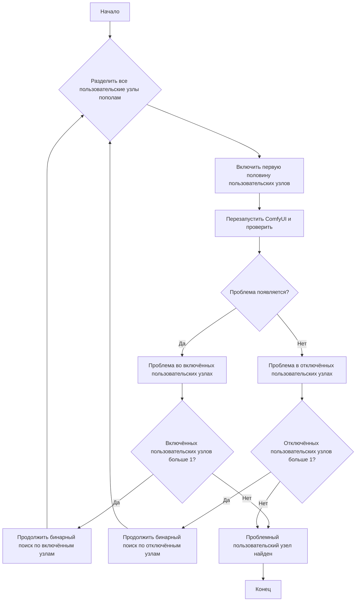

Общий подход к диагностике проблем с пользовательскими узлами показан ниже:

 ```mermaid
 flowchart TD
    A[Возникла проблема] --> B{<a href="#how-to-disable-all-custom-nodes">Проблема исчезает после отключения всех пользовательских узлов</a>?}
    B -- Да --> C[Проблема вызвана пользовательскими узлами]
    B -- Нет --> D[Проблема не вызвана пользовательскими узлами, см. другие документы по диагностике]
    C --> E{<a href="#1-troubleshooting-the-custom-nodes-frontend-extensions">Сначала проверить фронтенд-расширения</a>?}
    E -- Да --> F[<a href="#1-troubleshooting-the-custom-nodes-frontend-extensions">Диагностика во фронтенде ComfyUI</a><br/><li>Нужно только перезагрузить фронтенд</li>]
    E -- Нет --> G[<a href="#2-general-custom-node-troubleshooting">Использовать общий метод бинарного поиска</a><li>Нужно несколько раз перезапустить ComfyUI</li>]
    F --> H[Найти проблемный узел бинарным поиском]
    G --> H
    H --> I[<a href="#how-to-fix-the-issue">Исправить, заменить, сообщить об ошибке или удалить проблемный узел</a>]
    I --> J[Проблема решена]
```

## Как отключить все пользовательские узлы? {#how-to-disable-all-custom-nodes}

<Tabs>
<Tab title="Пользователи Desktop">
Запустите Comfy Desktop с отключёнными пользовательскими узлами через меню настроек

или запустите сервер вручную:
```bash
cd path/to/your/comfyui
python main.py --disable-all-custom-nodes
```
</Tab>
<Tab title="Ручная установка">
```bash
cd ComfyUI
python main.py --disable-all-custom-nodes
```
</Tab>
<Tab title="Портативная версия">
<Tabs>
   <Tab title="Изменить файл `.bat`">
   Откройте папку, в которой находится портативная версия, и найдите файл `run_nvidia_gpu.bat` или `run_cpu.bat`
   
   1. Скопируйте файл `run_nvidia_gpu.bat` или `run_cpu.bat` и переименуйте его в `run_nvidia_gpu_disable_custom_nodes.bat`
   2. Откройте скопированный файл в Блокноте
   3. Добавьте параметр `--disable-all-custom-nodes` в файл или скопируйте параметры ниже в файл `.txt` и переименуйте файл в `run_nvidia_gpu_disable_custom_nodes.bat`
   ```bash
   .\python_embeded\python.exe -s ComfyUI\main.py --disable-all-custom-nodes  --windows-standalone-build
   pause
   ```
   4. Сохраните файл и закройте его
   5. Дважды щёлкните файл, чтобы запустить его. Если всё в порядке, вы увидите, что ComfyUI запустился, а пользовательские узлы отключены
   </Tab>
   <Tab title="Через командную строку">
   
   1. Перейдите в папку, в которой находится портативная версия
   2. Откройте терминал, щёлкнув правой кнопкой мыши по меню → Open terminal
   
   3. Убедитесь, что в качестве текущего каталога указана папка портативной версии
   4. Введите следующую команду, чтобы запустить ComfyUI через портативный Python и отключить пользовательские узлы
   ```
   .\python_embeded\python.exe -s ComfyUI\main.py --disable-all-custom-nodes
   ```
   </Tab>
</Tabs>
</Tab>
</Tabs>

**Результаты:**
- ✅ **Проблема исчезает**: проблема вызвана пользовательским узлом → Перейдите к шагу 2
- ❌ **Проблема сохраняется**: проблема не связана с пользовательским узлом → [Сообщить о проблеме](#сообщить-о-проблеме)

## Что такое бинарный поиск?

В этом документе описан метод бинарного поиска для диагностики проблем с пользовательскими узлами: вы проверяете половину пользовательских узлов за раз, пока не найдёте проблемный узел.

Конкретный порядок действий показан на схеме ниже: включайте половину отключённых узлов за раз и проверяйте, появляется ли проблема, пока не определите, какой пользовательский узел её вызывает.


## Два метода диагностики

В этом документе мы разделяем пользовательские узлы на два типа для диагностики:


- A: Пользовательские узлы с расширениями фронтенда
- B: Обычные пользовательские узлы

Сначала рассмотрим возможные проблемы и их причины для разных типов пользовательских узлов:

<Tabs>
   <Tab title="Пользовательские узлы с расширениями фронтенда">
   Для пользовательских узлов в первую очередь стоит проверять узлы с расширениями фронтенда, так как они вызывают больше всего проблем. Основные конфликты возникают из-за несовместимости с обновлениями версии фронтенда ComfyUI.
   
   К распространённым проблемам относятся:
   - рабочие процессы не выполняются
   - некоторые узлы не могут показывать изображения предпросмотра (например, узел `Save Image`)
   - элементы интерфейса смещены
   - не удаётся получить доступ к фронтенду ComfyUI
   - полностью сломанный интерфейс или пустой экран
   - не удаётся нормально взаимодействовать с бэкендом ComfyUI
   - соединения между узлами не работают должным образом
   - и т. д.
   
   Распространённые причины этих проблем:
   - изменения фронтенда при обновлениях, к которым пользовательские узлы ещё не адаптированы
   - пользователи обновляют ComfyUI, но не обновляют вместе с ним пользовательские узлы, хотя авторы уже выпустили совместимые версии
   - авторы прекращают обслуживание, из-за чего расширения пользовательских узлов становятся несовместимы с фронтендом ComfyUI
      
   </Tab>
   <Tab title="Обычные пользовательские узлы">
   Если проблема вызвана не расширениями фронтенда пользовательских узлов, то она часто связана с зависимостями. К распространённым проблемам относятся:
   - ошибки «Failed to import» в консоли/логах
   - отсутствующие узлы по-прежнему отображаются как отсутствующие после установки и перезапуска
   - ComfyUI аварийно завершается или не запускается
   - и т. д.

   Распространённые причины этих ошибок:
   - пользовательские узлы, требующие дополнительных wheel-пакетов, например ComfyUI-Nunchaku
   - пользовательские узлы используют строгие версии зависимостей (например, `torch==2.4.1`), а другие плагины используют другие версии (например, `torch>=2.4.2`), что приводит к конфликтам после установки
   - проблемы с сетью, из-за которых не удаётся установить зависимости

   Когда проблемы связаны с взаимозависимостями и версиями в среде Python, диагностика усложняется и требует знаний об управлении средой Python, включая установку и удаление зависимостей
   </Tab>
</Tabs>

## Использовать двоичный поиск для устранения неполадок

Из этих двух разных типов проблем с пользовательскими узлами конфликты между расширениями фронтенда пользовательских узлов и ComfyUI встречаются чаще. Сначала мы займёмся устранением неполадок этих узлов. Вот общий подход к устранению неполадок:

### 1. Устранение неполадок в расширениях фронтенда пользовательских узлов {#1-troubleshooting-the-custom-nodes-frontend-extensions}

<Steps>
   <Step title="Отключить все сторонние расширения фронтенда">
   
   После запуска ComfyUI найдите меню `Extensions` в настройках и выполните шаги, показанные на изображении, чтобы отключить все сторонние расширения.
   <Tip>
      Если вы не можете открыть интерфейс ComfyUI, просто пропустите раздел об устранении неполадок расширений фронтенда и перейдите к [общему подходу к устранению неполадок пользовательских узлов](#2-общее-устранение-неполадок-пользовательских-узлов).
   </Tip>
   </Step>
   <Step title="Перезапустить ComfyUI">
   После первого отключения расширений фронтенда рекомендуется перезапустить ComfyUI, чтобы убедиться, что все расширения фронтенда отключены должным образом.
   - Если проблема исчезла, значит, её вызвали расширения фронтенда пользовательских узлов, и можно переходить к поиску неполадок с помощью двоичного поиска.
   - Если проблема сохраняется, значит, дело не в расширениях фронтенда. Обратитесь к другим подходам к устранению неполадок, описанным в этом документе.
   </Step>
   <Step title="Найти проблемные узлы с помощью двоичного поиска">
   Используйте метод, описанный в начале этого документа: включайте половину пользовательских узлов за раз, пока не найдёте проблемный узел.
   
   Ориентируясь на изображение, включите половину расширений фронтенда. Учтите: если названия расширений похожи, скорее всего, они относятся к расширениям фронтенда одного и того же пользовательского узла.
   </Step>
   <Step title="Дальнейшие действия">
   Если вы нашли проблемный пользовательский узел, обратитесь к разделу об исправлении проблем в этом документе, чтобы устранить проблемы с пользовательским узлом.
   </Step>
</Steps>

При использовании этого метода вам не нужно перезапускать ComfyUI несколько раз: достаточно перезагрузить ComfyUI после включения или отключения расширений фронтенда пользовательских узлов. Кроме того, область устранения неполадок ограничена узлами с расширениями фронтенда, что значительно сужает диапазон поиска.

### 2. Общее устранение неполадок пользовательских узлов {#2-general-custom-node-troubleshooting}


<Steps>
  <Step title="Найти пользовательские узлы с помощью двоичного поиска">
      Помимо ручного поиска, для метода локализации с помощью двоичного поиска у нас также есть автоматический двоичный поиск с использованием `comfy-cli`, как подробно описано ниже:

      <Tabs><Tab title="Использование Comfy CLI (рекомендуется)">
         Для работы с Comfy CLI нужен некоторый опыт работы с командной строкой. Если вам это неудобно, воспользуйтесь ручным бинарным поиском.
         
         Если у вас установлен [Comfy CLI](/ru/comfy-cli/getting-started), вы можете использовать автоматизированный инструмент bisect, чтобы найти проблемный узел:

         ```bash
         # Начать сессию bisect
         comfy-cli node bisect start

         # Следуйте подсказкам:
         # - Проверьте ComfyUI с текущим набором включённых узлов
         # - Отметьте как 'good', если проблема исчезла: comfy-cli node bisect good
         # - Отметьте как 'bad', если проблема сохраняется: comfy-cli node bisect bad
         # - Повторяйте, пока проблемный узел не будет найден

         # Сброс по завершении
         comfy-cli node bisect reset
         ```

         Инструмент bisect автоматически включает и отключает узлы и ведёт вас по этому процессу.

         </Tab><Tab title="Ручной двоичный поиск">
            <Warning>
            Перед началом обязательно **создайте резервную копию** папки `custom_nodes` на случай, если что-то пойдёт не так.
            </Warning>

         Если вы предпочитаете выполнять процесс вручную или у вас не установлен Comfy CLI, выполните следующие шаги:

         <Steps>
            <Step title="Создать временные папки">
            Перед началом перейдите в папку `<YOUR_COMFYUI_FOLDER>\ComfyUI\`
                  <Tabs>
                     <Tab title="Windows">
                     - **Создайте резервную копию всех пользовательских узлов**: скопируйте папку `custom_nodes` и переименуйте копию в `custom_nodes_backup`
                     - **Создайте временную папку**: создайте папку с именем `custom_nodes_temp`
                     
                     Или воспользуйтесь следующей командной строкой для создания резервной копии:
      
                     ```bash
                     # Создать резервную копию и временную папку
                     mkdir "%USERPROFILE%\custom_nodes_backup"
                     mkdir "%USERPROFILE%\custom_nodes_temp"

                     # Скопировать всё содержимое
                     xcopy "custom_nodes\*" "%USERPROFILE%\custom_nodes_backup\" /E /H /Y
                     ```
                     </Tab><Tab title="macOS/Linux">
                     Вручную создайте резервную копию папки custom_nodes
                     Или используйте следующую команду для создания резервной копии:
                     ```bash
                     # Создать резервную копию и временную папку
                     mkdir ~/custom_nodes_backup
                     mkdir ~/custom_nodes_temp

                     # Скопировать всё содержимое
                     cp -r custom_nodes/* ~/custom_nodes_backup/
                     ```
                     </Tab><Tab title="Cloud/Colab">
                     ```bash
                     # Создать резервную копию и временную папку
                     mkdir /content/custom_nodes_backup
                     mkdir /content/custom_nodes_temp

                     # Создать резервную копию всего содержимого
                     cp -r /content/ComfyUI/custom_nodes/* /content/custom_nodes_backup/
                     ```
                     </Tab>
                  </Tabs>
               </Step>
               <Step title="Перечислить все пользовательские узлы">
                   <Tabs>
                     <Tab title="Windows">
                     Поскольку в Windows есть графический интерфейс, этот шаг можно пропустить, если вы не работаете исключительно в командной строке
                     ```bash
                     dir custom_nodes
                     ```
                     </Tab>
                     <Tab title="macOS/Linux">
                     ```bash
                     ls custom_nodes/
                     ```
                     </Tab>
                     <Tab title="Cloud/Colab">
                     ```bash
                     ls /content/ComfyUI/custom_nodes/
                     ```
                     </Tab>
                  </Tabs>
               </Step>
               <Step title="Разделить узлы пополам">
               Предположим, что у вас есть 8 пользовательских узлов. Переместите первую половину во временное хранилище:
                  <Tabs>
                  <Tab title="Windows">
                  ```bash
                  # Переместить первую половину (узлы 1-4) во временную папку
                  move "custom_nodes\node1" "%USERPROFILE%\custom_nodes_temp\"
                  move "custom_nodes\node2" "%USERPROFILE%\custom_nodes_temp\"
                  move "custom_nodes\node3" "%USERPROFILE%\custom_nodes_temp\"
                  move "custom_nodes\node4" "%USERPROFILE%\custom_nodes_temp\"
                  ```
                  </Tab>
                  <Tab title="macOS/Linux">
                  ```bash
                  # Переместить первую половину (узлы 1-4) во временную папку
                  mv custom_nodes/node1 ~/custom_nodes_temp/
                  mv custom_nodes/node2 ~/custom_nodes_temp/
                  mv custom_nodes/node3 ~/custom_nodes_temp/
                  mv custom_nodes/node4 ~/custom_nodes_temp/
                  ```
                  </Tab>
                  <Tab title="Cloud/Colab">
                  ```bash
                  # Переместить первую половину (узлы 1-4) во временную папку
                  mv /content/ComfyUI/custom_nodes/node1 /content/custom_nodes_temp/
                  mv /content/ComfyUI/custom_nodes/node2 /content/custom_nodes_temp/
                  mv /content/ComfyUI/custom_nodes/node3 /content/custom_nodes_temp/
                  mv /content/ComfyUI/custom_nodes/node4 /content/custom_nodes_temp/
                  ```
                  </Tab>
                  </Tabs>
               </Step>
               <Step title="Проверить ComfyUI">
               Запустите ComfyUI как обычно
                  ```bash
                  python main.py
                  ```
               </Step>
               <Step title="Интерпретировать результаты">
                  - **Проблема сохраняется**: проблема в оставшихся узлах (5-8)
                  - **Проблема исчезает**: проблема была в перемещённых узлах (1-4)
               </Step>
               <Step title="Сузить диапазон поиска">
                  - Если проблема сохраняется: переместите половину оставшихся узлов (например, узлы 7-8) во временную папку
                  - Если проблема исчезла: переместите половину узлов из временной папки (например, узлы 3-4) обратно в custom_nodes
               </Step>
               <Step title="Повторять, пока не будет найден единственный проблемный узел">
                  - Повторяйте, пока не найдёте единственный проблемный узел
               </Step>
            </Steps>
         </Tab>
      </Tabs>
   </Step>
</Steps>

## Как исправить проблему {#how-to-fix-the-issue}

Когда проблемный пользовательский узел определён:

### Вариант 1: Обновить узел
1. Проверьте, доступно ли обновление в ComfyUI Manager
2. Обновите узел и проверьте снова

### Вариант 2: Заменить узел
1. Поищите альтернативные пользовательские узлы с похожим функционалом
2. Проверьте [ComfyUI Registry](https://registry.comfy.org) на наличие альтернатив

### Вариант 3: Сообщить о проблеме
Свяжитесь с разработчиком пользовательского узла:
1. Найдите репозиторий узла на GitHub
2. Создайте issue, указав:
   - вашу версию ComfyUI
   - сообщения об ошибках и логи
   - шаги для воспроизведения
   - вашу операционную систему

### Вариант 4: Удалить или отключить узел
Если исправления нет, а функционал вам не нужен:
1. Удалите проблемный узел из `custom_nodes/` или отключите его в интерфейсе ComfyUI Manager
2. Перезапустите ComfyUI

## Сообщить о проблеме

Если проблема вызвана не пользовательскими узлами, обратитесь к общему [обзору устранения неполадок](/ru/troubleshooting/overview), где описаны другие распространённые проблемы.

### Если проблема связана с конкретным пользовательским узлом

Обратитесь к разработчику пользовательского узла:
- Найдите репозиторий узла на GitHub
- Создайте issue с указанием версии ComfyUI, сообщений об ошибках, шагов воспроизведения и ОС
- Проверьте документацию узла и страницу Issues на наличие известных проблем

### Проблемы ядра ComfyUI
- **GitHub**: [Проблемы ComfyUI](https://github.com/Comfy-Org/ComfyUI/issues)
- **Форум**: [Официальный форум ComfyUI](https://forum.comfy.org/)

### Проблемы десктопного приложения
- **GitHub**: [Проблемы Comfy Desktop](https://github.com/Comfy-Org/Comfy-Desktop/issues)

### Проблемы фронтенда
- **GitHub**: [Проблемы фронтенда ComfyUI](https://github.com/Comfy-Org/ComfyUI_frontend/issues)

<Note>
По общим вопросам установки, моделей или производительности см. страницы [обзор устранения неполадок](/ru/troubleshooting/overview) и [проблемы с моделями](/ru/troubleshooting/model-issues).
</Note>
