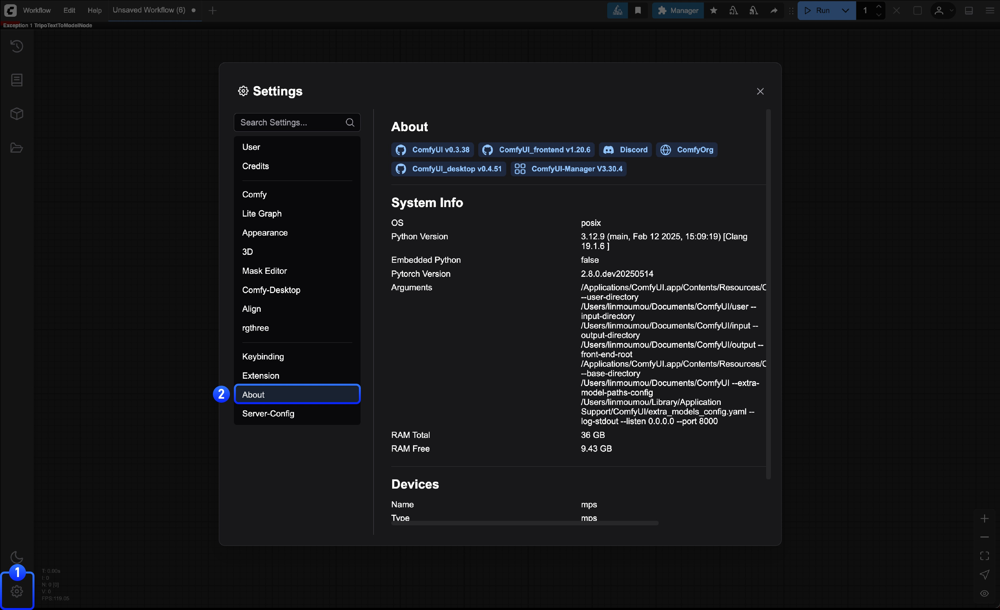

import DockerNotice from "/snippets/ru/install/docker-notice.mdx"

<Tip>
   Мы получаем много сообщений о проблемах и видим, что большинство из них связано с пользовательскими узлами. Поэтому, прежде чем отправлять отчёт об ошибке, обязательно прочитайте [руководство по устранению неполадок пользовательских узлов](/ru/troubleshooting/custom-node-issues), чтобы убедиться, что проблема не вызвана самим ядром ComfyUI.
</Tip>

<Card title="Руководство по устранению неполадок пользовательских узлов" icon="puzzle-piece" href="/ru/troubleshooting/custom-node-issues">
  Узнайте, как устранять неполадки, вызванные пользовательскими узлами.
</Card>

## Распространённые проблемы и быстрые решения

Прежде чем переходить к подробной диагностике, попробуйте эти типичные решения:

### ComfyUI не запускается

**Симптомы:** приложение падает при запуске, показывает чёрный экран или не загружается

**Быстрые решения:**
1. **Проверьте системные требования** — убедитесь, что система соответствует [минимальным требованиям](/ru/installation/system_requirements)
2. **Обновите драйверы GPU** — скачайте актуальные драйверы у NVIDIA/AMD/Intel

### Генерация завершается ошибкой

**Симптомы:** диалог «Prompt execution failed» с кнопкой «Show report», выполнение рабочего процесса останавливается

**Быстрые решения:**
1. **Нажмите «Show report»** — прочитайте подробное сообщение об ошибке, чтобы определить конкретную причину
2. **Проверьте, не связана ли проблема с пользовательским узлом** — [следуйте руководству по диагностике пользовательских узлов](/ru/troubleshooting/custom-node-issues)
3. **Проверьте файлы моделей** — см. [документацию по моделям](/ru/basic-concepts/models) для настройки моделей
4. **Проверьте использование VRAM** — закройте другие приложения, занимающие память GPU

### Низкая производительность

**Симптомы:** очень медленная генерация, зависание системы, ошибки нехватки памяти

**Быстрые решения:**
1. **Уменьшите разрешение или размер пакета** — сократите размер изображения или количество изображений
2. **Используйте флаги оптимизации памяти** — см. раздел об оптимизации производительности ниже
3. **Закройте лишние приложения** — освободите RAM и VRAM
4. **Проверьте нагрузку CPU/GPU** — используйте диспетчер задач, чтобы найти узкие места

**Команды оптимизации производительности:**

Для систем с небольшим объёмом VRAM:
```bash
# Режим низкого VRAM (текстовый энкодер работает на CPU)
python main.py --lowvram

# Режим CPU (очень медленно, но работает на любом оборудовании, только как крайняя мера)
python main.py --cpu
```

Для повышения производительности:
```bash
# Отключить предпросмотры (экономит VRAM и время обработки)
python main.py --preview-method none

# Использовать оптимизированные механизмы внимания
python main.py --use-pytorch-cross-attention
python main.py --use-flash-attention

# Асинхронная выгрузка весов
python main.py --async-offload
```

Для управления памятью:
```bash
# Зарезервировать часть VRAM для ОС (в ГБ)
python main.py --reserve-vram 2

# Отключить умное управление памятью
python main.py --disable-smart-memory

# Использовать другие стратегии кеширования
python main.py --cache-none      # Меньше RAM, но медленнее
python main.py --cache-lru 10    # Кешировать 10 результатов, быстрее
python main.py --cache-classic   # Старое агрессивное кеширование.
```
## Проблемы, связанные со способом установки

### Проблемы приложения Desktop

Полное руководство по диагностике установки Desktop см. в [руководстве по установке Desktop](/ru/installation/desktop/overview#install-comfy-desktop-for-your-os).

<Tabs>
<Tab title="Windows">
- **Неподдерживаемое устройство**: Comfy Desktop для Windows поддерживает только GPU NVIDIA с CUDA. Для других GPU используйте [ComfyUI Portable](/ru/installation/comfyui_portable_windows) или [ручную установку](/ru/installation/manual_install)
- **Установка завершается ошибкой**: запустите установщик от имени администратора и убедитесь, что на диске не меньше 15 ГБ свободного места
- **Страница обслуживания**: если загрузки не работают, проверьте [настройки зеркала](/ru/installation/desktop/usage/settings#advanced)
- **Отсутствующие модели**: при переносе модели не копируются, а только связываются. Проверьте пути к моделям
</Tab>
<Tab title="macOS">
- **«Приложение повреждено»**: разрешите приложение в настройках «Безопасность и конфиденциальность»
- **Проблемы с производительностью**: предоставьте полный доступ к диску в настройках конфиденциальности
- **Падения**: проверьте отчёты о сбоях в приложении Console
</Tab>
<Tab title="Linux">
- **Отсутствующие библиотеки**: установите зависимости через менеджер пакетов
- **Ошибки LD_LIBRARY_PATH**: проблемы с путями к библиотекам PyTorch (см. ниже)
</Tab>
</Tabs>

### Проблемы ручной установки

<Note>
Документация может быть немного устаревшей. Если возникла проблема, вручную проверьте, не вышла ли более новая стабильная версия PyTorch или какой-либо из перечисленных библиотек. Обратитесь к таким ресурсам, как [матрица установки PyTorch](https://pytorch.org/get-started/locally/) или [сайт ROCm](https://rocm.docs.amd.com/projects/install-on-linux/en/develop/install/3rd-party/pytorch-install.html#using-a-wheels-package).
</Note>

**Конфликты версий Python:**
```bash
# Проверьте версию Python (требуется 3.9+, рекомендуется 3.12)
python --version

# Используйте виртуальное окружение (рекомендуется)
python -m venv comfyui_env
source comfyui_env/bin/activate  # Linux/Mac
comfyui_env\Scripts\activate     # Windows
```

**Ошибки установки пакетов:**
```bash
# Сначала обновите pip
python -m pip install --upgrade pip

# Установите зависимости
pip install -r requirements.txt

# Для GPU NVIDIA (CUDA 13.0)
pip install torch torchvision torchaudio --extra-index-url https://download.pytorch.org/whl/cu130

# Для GPU AMD (только Linux — ROCm 7.2)
pip install torch torchvision torchaudio --index-url https://download.pytorch.org/whl/rocm7.2
```

### Проблемы, специфичные для Linux

**Ошибки LD_LIBRARY_PATH:**

Типичные симптомы:
- "libcuda.so.1: cannot open shared object file"
- "libnccl.so: cannot open shared object file" 
- "ImportError: libnvinfer.so.X: cannot open shared object file"

**Решения:**

1. **Современные установки PyTorch (самый частый случай):**
```bash
# Для виртуальных окружений с пакетами NVIDIA
export LD_LIBRARY_PATH=$VIRTUAL_ENV/lib/python3.12/site-packages/nvidia/nvjitlink/lib:$LD_LIBRARY_PATH

# Для окружений conda
export LD_LIBRARY_PATH=$CONDA_PREFIX/lib/python3.12/site-packages/nvidia/nvjitlink/lib:$LD_LIBRARY_PATH

# Либо найдите свой site-packages автоматически
PYTHON_PATH=$(python -c "import site; print(site.getsitepackages()[0])")
export LD_LIBRARY_PATH=$PYTHON_PATH/nvidia/nvjitlink/lib:$LD_LIBRARY_PATH

# Могут понадобиться и другие библиотеки NVIDIA
export LD_LIBRARY_PATH=$PYTHON_PATH/nvidia/cuda_runtime/lib:$LD_LIBRARY_PATH
export LD_LIBRARY_PATH=$PYTHON_PATH/nvidia/cublas/lib:$LD_LIBRARY_PATH
```

2. **Узнайте, какие библиотеки у вас есть:**
```bash
# Проверьте установленные пакеты NVIDIA
python -c "import site; import os; nvidia_path=os.path.join(site.getsitepackages()[0], 'nvidia'); print('NVIDIA libs:', [d for d in os.listdir(nvidia_path) if os.path.isdir(os.path.join(nvidia_path, d))] if os.path.exists(nvidia_path) else 'Not found')"

# Найдите отсутствующие библиотеки, которые нужны PyTorch
python -c "import torch; print(torch.__file__)"
ldd $(python -c "import torch; print(torch.__file__.replace('__init__.py', 'lib/libtorch_cuda.so'))")
```

3. **Задайте переменную постоянно для своего окружения:**
```bash
# Для виртуальных окружений добавьте в скрипт активации
echo 'export LD_LIBRARY_PATH=$VIRTUAL_ENV/lib/python*/site-packages/nvidia/nvjitlink/lib:$LD_LIBRARY_PATH' >> $VIRTUAL_ENV/bin/activate

# Для окружений conda
conda env config vars set LD_LIBRARY_PATH=$CONDA_PREFIX/lib/python*/site-packages/nvidia/nvjitlink/lib:$LD_LIBRARY_PATH

# Для глобального bashrc (при необходимости измените версию Python)
echo 'export LD_LIBRARY_PATH=$(python -c "import site; print(site.getsitepackages()[0])")/nvidia/nvjitlink/lib:$LD_LIBRARY_PATH' >> ~/.bashrc
```

4. **Альтернатива: используйте ldconfig:**
```bash
# Проверьте текущий кеш библиотек
ldconfig -p | grep cuda
ldconfig -p | grep nccl

# Если библиотек нет, добавьте пути к ним (нужны права root)
sudo echo "/usr/local/cuda/lib64" > /etc/ld.so.conf.d/cuda.conf
sudo ldconfig
```

5. **Отладка загрузки библиотек:**
```bash
# Подробный вывод загрузки библиотек, чтобы увидеть, чего не хватает
LD_DEBUG=libs python main.py 2>&1 | grep "looking for"

# Проверьте доступность CUDA в PyTorch
python -c "import torch; print('CUDA available:', torch.cuda.is_available()); print('CUDA version:', torch.version.cuda)"
```
## Проблемы с моделями

Для комплексной диагностики проблем с моделями, включая несоответствия архитектуры, отсутствующие модели и ошибки загрузки, см. отдельную страницу [Проблемы с моделями](/ru/troubleshooting/model-issues).

## Проблемы с сетью и API

### Партнёрские узлы не работают

**Симптомы:** сбои вызовов API, ошибки тайм-аута, превышение квоты

**Решения:**
1. **Проверьте действительность API-ключа**: проверьте ключи в [настройках пользователя](/ru/interface/user)
2. **Проверьте кредиты аккаунта**: убедитесь, что [кредитов API](/ru/interface/credits) достаточно
3. **Проверьте подключение к интернету**: протестируйте работу с другими онлайн-сервисами
4. **Проверьте статус сервиса**: возможно, у провайдера наблюдаются сбои

### Проблемы с подключением

**Симптомы:** «Failed to connect to server», ошибки тайм-аута

**Решения:**
1. **Проверьте настройки брандмауэра**: разрешите ComfyUI в брандмауэре
2. **Попробуйте другой порт**: по умолчанию используется 8188, попробуйте 8189 или 8190
3. **Временно отключите VPN**: VPN может блокировать подключения
4. **Проверьте настройки прокси**: отключите прокси, если он не нужен

### Проблемы с интерфейсом

**«Frontend or Templates Package Not Updated»:**
```bash
# После обновления ComfyUI через Git обновите зависимости интерфейса
pip install -r requirements.txt
```

**«Can't Find Custom Node»:**
- Отключите валидацию узлов в настройках ComfyUI

**«Error Toast About Workflow Failing Validation»:**
- Временно отключите проверку workflow в настройках
- Сообщите о проблеме команде ComfyUI

**Проблемы со входом при работе не на localhost:**
- Обычный вход работает только при доступе с localhost
- Для доступа по локальной сети или удалённо: сгенерируйте API-ключ на странице [platform.comfy.org/login](https://platform.comfy.org/login)
- Используйте API-ключ в диалоге входа или через аргумент командной строки `--api-key`

## Проблемы, связанные с оборудованием

### Проблемы с GPU NVIDIA

**Ошибка "Torch not compiled with CUDA enabled":**
```bash
# Сначала удалите torch
pip uninstall torch

# Установите стабильный PyTorch с CUDA 13.0
pip install torch torchvision torchaudio --extra-index-url https://download.pytorch.org/whl/cu130

# Для ночных сборок (могут включать улучшения производительности)
pip install --pre torch torchvision torchaudio --index-url https://download.pytorch.org/whl/nightly/cu132

# Проверьте поддержку CUDA
python -c "import torch; print(torch.cuda.is_available())"
```

**GPU не обнаруживается:**
```bash
# Проверьте, видна ли GPU
nvidia-smi

# Проверьте версию драйвера и совместимость с CUDA
nvidia-smi --query-gpu=driver_version --format=csv
```

**GPU Blackwell (`sm_103`): генерация падает на первом слое внимания:**

На GPU NVIDIA поколения Blackwell стандартное для PyTorch масштабированное скалярное произведение внимания (SDPA) может выбрать бэкенд cuDNN, у которого нет корректного плана для этой архитектуры:

```
cuDNN Frontend error: No valid execution plans built
```

С FLUX это происходит на самом первом блоке внимания в UNet, поэтому изображение вообще не создаётся.

```bash
# Используйте ручную реализацию внимания, которая обходит SDPA и cuDNN
python main.py --use-split-cross-attention

# Blackwell также требует сборку PyTorch с CUDA 12.8 или новее;
# сборки под cu121 на этих картах не запустятся вообще
```

<Note>
Программное отключение бэкенда cuDNN SDPA до запуска, например вызов
`torch.backends.cuda.enable_cudnn_sdp(False)` из `sitecustomize.py`, не помогает, потому что
флаг не сохраняется при инициализации CUDA. Надёжное решение — флаг запуска.
</Note>

*Этот пункт добавлен в [PR #1491](https://github.com/Comfy-Org/docs/pull/1491).*

### Проблемы с GPU AMD

**Поддержка ROCm (только Linux):**
```bash
# Установите стабильный PyTorch с ROCm (на момент написания — 7.2)
pip install torch torchvision torchaudio --index-url https://download.pytorch.org/whl/rocm7.2

# Для ночных сборок (на момент написания ROCm 7.2, могут включать улучшения производительности)
pip install --pre torch torchvision torchaudio --index-url https://download.pytorch.org/whl/nightly/rocm7.2
```

**Неподдерживаемые GPU AMD:**
```bash
# Для RDNA2 и старше (6700, 6600)
HSA_OVERRIDE_GFX_VERSION=10.3.0 python main.py

# Для карт RDNA3 (7600)
HSA_OVERRIDE_GFX_VERSION=11.0.0 python main.py
```

**Оптимизация производительности:**
```bash
# Включите экспериментальное экономное по памяти внимание (с PyTorch 2.4 больше не нужно)
TORCH_ROCM_AOTRITON_ENABLE_EXPERIMENTAL=1 python main.py --use-pytorch-cross-attention

# Включите настраиваемые операции (первый запуск медленный, последующие быстрее)
PYTORCH_TUNABLEOP_ENABLED=1 python main.py
```


### Проблемы с Apple Silicon (M1/M2/M3)

<Note>
Шаги из этого раздела относятся к ручной установке или установке из исходников, когда ComfyUI работает в созданном вами окружении Python. Поддерживаемые версии Python см. в разделе [Системные требования](/ru/installation/system_requirements), шаги настройки — в разделе [Ручная установка](/ru/installation/manual_install).

**Comfy Desktop** на Apple Silicon не требует отдельной установки Python: приложение само управляет окружением Python для каждого экземпляра. См. [Comfy Desktop для macOS](/ru/installation/desktop/overview#install-comfy-desktop-for-your-os).
</Note>

**Настройка бэкенда MPS:**
```bash
# Установите ночную сборку PyTorch для Apple Silicon
# Следуйте инструкции Apple: https://developer.apple.com/metal/pytorch/

# Проверьте доступность MPS
python -c "import torch; print(torch.backends.mps.is_available())"

# Запустите ComfyUI
python main.py
```

**Если MPS вызывает проблемы:**
```bash
# Принудительный режим CPU
python main.py --cpu

# С оптимизацией памяти
python main.py --force-fp16 --cpu
```

### Проблемы с GPU Intel

**Ошибка "Torch not compiled with CUDA enabled":**

На GPU Intel эта ошибка означает, что ComfyUI попытался использовать CUDA, поскольку бэкенд XPU был недоступен. Не выполняйте описанные выше шаги переустановки NVIDIA CUDA. GPU Intel используют XPU, а не CUDA.

Проверьте, видит ли PyTorch GPU Intel:

```bash
python -c "import torch; print('XPU available:', hasattr(torch, 'xpu') and torch.xpu.is_available())"
```

Если команда выводит `True`, ComfyUI автоматически использует бэкенд XPU.

Если выводится `False`:

1. Убедитесь, что у вас поддерживаемая GPU Intel Arc (Arc A-Series, Arc B-Series или процессор Core Ultra с графикой Arc).
2. Установите или обновите [драйвер GPU Intel](https://www.intel.com/content/www/us/en/developer/articles/tool/pytorch-prerequisites-for-intel-gpu.html).
3. Установите сборку PyTorch с поддержкой XPU одним из вариантов ниже. Не устанавливайте пакет CUDA.

**Вариант 1: встроенная поддержка XPU в PyTorch (Windows/Linux):**
```bash
# Стабильные пакеты XPU (рекомендуется)
pip install torch torchvision torchaudio --index-url https://download.pytorch.org/whl/xpu

# Ночные пакеты XPU (могут включать улучшения производительности)
pip install --pre torch torchvision torchaudio --index-url https://download.pytorch.org/whl/nightly/xpu

# Запустите ComfyUI
python main.py
```

**Вариант 2: Intel Extension for PyTorch (IPEX):**
```bash
# Для графики Intel Arc A-Series
conda install libuv
pip install torch==2.3.1.post0+cxx11.abi torchvision==0.18.1.post0+cxx11.abi torchaudio==2.3.1.post0+cxx11.abi intel-extension-for-pytorch==2.3.110.post0+xpu --extra-index-url https://pytorch-extension.intel.com/release-whl/stable/xpu/us/
```
## Часто задаваемые вопросы

### Как запустить ComfyUI с помощью Docker?

<DockerNotice />

Если вы устанавливаете ComfyUI локально в Linux, воспользуйтесь [руководством по ручной установке](/ru/installation/manual_install). Для работы в облаке см. [Comfy Cloud](/ru/get_started/cloud).

## Получение помощи и сообщение об ошибках

### Перед сообщением об ошибке

1. **Проверьте, известна ли проблема:**
   - Поищите в [GitHub Issues](https://github.com/Comfy-Org/ComfyUI/issues)
   - Проверьте [Форум ComfyUI](https://forum.comfy.org/)
   - Просмотрите [обсуждения в Discord](https://discord.com/invite/comfyorg)

2. **Попробуйте базовую диагностику:**
   - Проверьте работу с [рабочим процессом по умолчанию](/ru/get_started/first_generation)
   - Отключите все пользовательские узлы (см. [диагностика пользовательских узлов](/ru/troubleshooting/custom-node-issues))
   - Проверьте консоль или терминал на наличие сообщений об ошибках
   - Если вы используете comfy-cli, попробуйте обновить: `comfy node update all`

### Как эффективно сообщать об ошибках

#### Для проблем ядра ComfyUI
**Куда сообщать:** [GitHub Issues](https://github.com/Comfy-Org/ComfyUI/issues)

#### Для проблем десктопного приложения
**Куда сообщать:** [GitHub Issues десктопного приложения](https://github.com/Comfy-Org/Comfy-Desktop/issues)

#### Для проблем фронтенда
**Куда сообщать:** [GitHub Issues фронтенда](https://github.com/Comfy-Org/ComfyUI_frontend/issues)

#### Для проблем пользовательских узлов
**Куда сообщать:** обратитесь к разработчику соответствующего пользовательского узла

### Необходимая информация

При сообщении о любой проблеме указывайте:

<Steps>
<Step title="Информация о системе">

<Tabs>
<Tab title="Из интерфейса ComfyUI">
**Информация о системе (её можно найти на странице «О программе» в настройках):**
- Операционная система (Windows 11, macOS 14.1, Ubuntu 22.04 и т. д.)
- Версия ComfyUI (см. страницу «О программе» в настройках)
- Версия Python: `python --version`
- Версия PyTorch: `python -c "import torch; print(torch.__version__)"`
- Модель GPU и версия драйвера
- Метод установки (Desktop, Portable, Manual, comfy-cli)


</Tab>
<Tab title="Из командной строки">
   <Tabs>
      <Tab title="Windows">
      ```bash
      # Информация о системе
      systeminfo | findstr /C:"OS Name" /C:"OS Version"

      # Информация о GPU
      wmic path win32_VideoController get name

      # Информация о Python и PyTorch
      python --version
      python -c "import torch; print(f'PyTorch: {torch.__version__}')"
      python -c "import torch; print(f'CUDA Available: {torch.cuda.is_available()}')"
      ```
      </Tab>
      <Tab title="macOS/Linux">
      ```bash
      # Информация о системе
      uname -a

      # Информация о GPU (Linux)
      lspci | grep VGA

      # Информация о Python и PyTorch
      python --version
      python -c "import torch; print(f'PyTorch: {torch.__version__}')"
      python -c "import torch; print(f'CUDA Available: {torch.cuda.is_available()}')"
      ```
      </Tab>
   </Tabs>
</Tab>
</Tabs>
</Step>

<Step title="Проблемы десктопного приложения">
**Для проблем десктопного приложения также укажите:**
- Файлы логов из: `C:\Users\<username>\AppData\Roaming\ComfyUI\logs` (Windows)
- Файлы конфигурации из: `C:\Users\<username>\AppData\Roaming\ComfyUI` (Windows)
</Step>

<Step title="Детали проблемы">
**Детали проблемы:**
- Чёткое описание проблемы
- Шаги воспроизведения проблемы
- Ожидаемое и фактическое поведение
- Скриншоты или видео, если применимо

**Сообщения об ошибках:**
- Полный текст ошибки из консоли или терминала
- Ошибки консоли браузера (F12 → вкладка Console)
- Любые логи сбоев или диалоги с ошибками
</Step>

<Step title="Дополнительный контекст">
**Дополнительный контекст:**
- Список установленных пользовательских узлов
- Файл рабочего процесса (.json), воспроизводящий проблему
- Недавние изменения (новые установки, обновления и т. д.)
</Step>
</Steps>

## Ресурсы сообщества

- **Официальный форум:** [forum.comfy.org](https://forum.comfy.org/)
- **Discord:** [Сервер Discord ComfyUI](https://discord.com/invite/comfyorg)
- **Reddit:** [r/comfyui](https://reddit.com/r/comfyui)
- **YouTube:** [Учебники по ComfyUI](https://www.youtube.com/@comfyorg)
