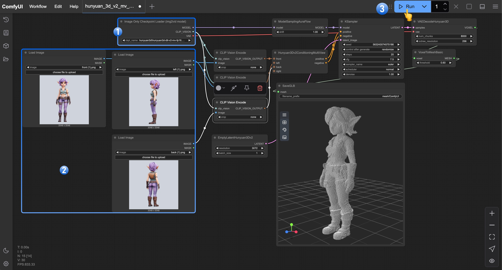
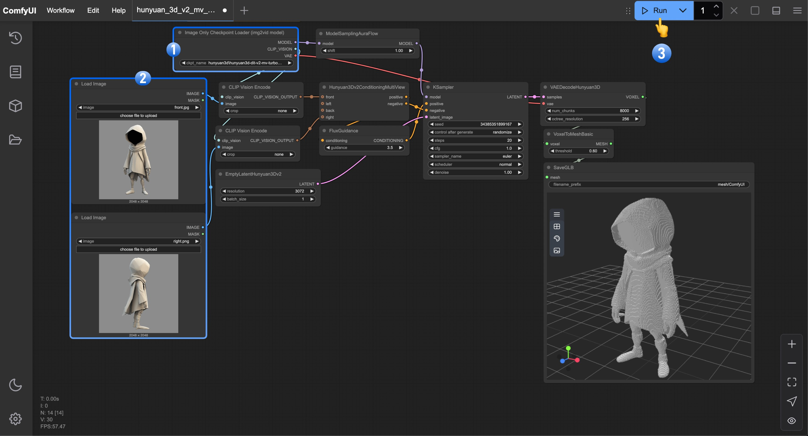
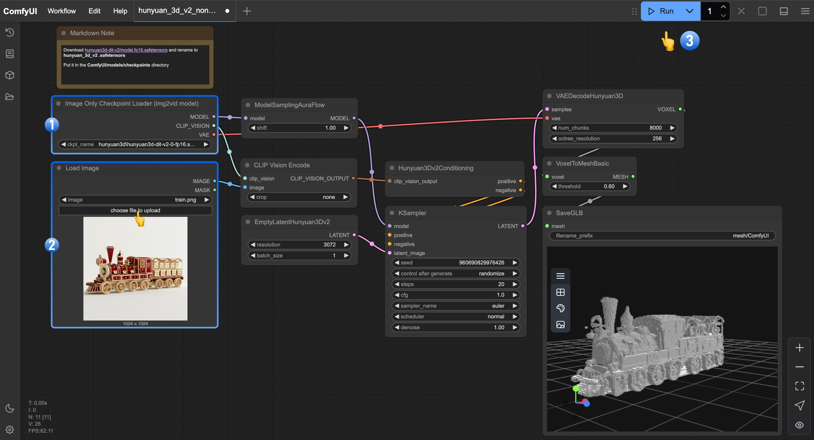

import UpdateReminder from "/snippets/ru/tutorials/update-reminder.mdx"

# Введение в Hunyuan3D 2.0


[Hunyuan3D 2.0](https://github.com/Tencent/Hunyuan3D-2) представляет собой открытую модель генерации 3D-ассетов, выпущенную Tencent, способную создавать высокодетализированные 3D-модели с картами текстур высокого разрешения по тексту или изображению.

Hunyuan3D 2.0 использует двухэтапный подход: сначала генерируется геометрическая модель без текстур, затем синтезируются карты текстур высокого разрешения. Это позволяет эффективно разделить сложность генерации формы и текстуры. Ниже приведены два ключевых компонента Hunyuan3D 2.0:

1. **Модель генерации геометрии (Hunyuan3D-DiT)**: основана на архитектуре flow diffusion Transformer и генерирует геометрические модели без текстур, точно соответствующие входным условиям.
2. **Модель генерации текстур (Hunyuan3D-Paint)**: объединяет геометрические условия и методы multi-view diffusion, чтобы добавить моделям текстуры высокого разрешения, и поддерживает PBR-материалы.

**Ключевые преимущества**

- **Высокая точность генерации**: чёткие геометрические структуры, насыщенные цвета текстур, поддержка генерации PBR-материалов, почти реалистичные эффекты освещения.
- **Разнообразные способы использования**: вызовы из кода, плагин для Blender, приложения Gradio и онлайн-демонстрация на официальном сайте, что подходит для разных задач пользователей.
- **Лёгкость и совместимость**: модели Hunyuan3D-2mini требуется всего 5 ГБ видеопамяти, стандартной версии для генерации формы нужно 6 ГБ видеопамяти, а полный процесс (форма + текстура) требует всего 12 ГБ видеопамяти.

Недавно (18 марта 2025 года) в Hunyuan3D 2.0 также появилась модель генерации формы по нескольким видам (Hunyuan3D-2mv), которая поддерживает создание более детализированных геометрических структур по входным данным с разных ракурсов.

В этот пример входят четыре рабочих процесса:
- Использование Hunyuan3D-2mv с несколькими входными видами для генерации 3D-моделей
- Использование Hunyuan3D-2mv-turbo с несколькими входными видами для генерации 3D-моделей
- Использование Hunyuan3D-2 с одним входным видом для генерации 3D-моделей
- Использование Hunyuan3D 2.1 с одним входным видом для генерации 3D-моделей

<Tip>
ComfyUI теперь нативно поддерживает Hunyuan3D-2mv, но пока не поддерживает генерацию текстур и материалов. Перед началом убедитесь, что вы обновились до последней версии [ComfyUI](https://github.com/Comfy-Org/ComfyUI).

PNG-изображения с примерами рабочих процессов в этом руководстве содержат JSON рабочего процесса в своих метаданных:
- Их можно перетащить напрямую в ComfyUI
- Или использовать меню `Workflows` -> `Open (ctrl+o)`

Загрузится соответствующий рабочий процесс, и вам будет предложено скачать необходимые модели. Сгенерированные модели в формате `.glb` будут сохранены в папку `ComfyUI/output/mesh`.
</Tip>

## Пример рабочего процесса ComfyUI Hunyuan3D-2mv

В рабочем процессе Hunyuan3D-2mv мы используем изображения с нескольких ракурсов, чтобы сгенерировать 3D-модель. Обратите внимание, что несколько изображений ракурсов не обязательны: для генерации 3D-модели можно использовать только изображение ракурса `front`.

<UpdateReminder/>

### HY 3D 2.0 MV {#3d_hunyuan3d_multiview_to_model}

Генерируйте 3D-модели по нескольким ракурсам с помощью Hunyuan3D 2.0 MV.


<CardGroup cols={2}>
  <Card title="Запустить в Comfy Cloud" icon="cloud" href="https://cloud.comfy.org/?template=3d_hunyuan3d_multiview_to_model&utm_source=docs&utm_medium=referral&utm_campaign=hunyuan3D-2">
    Запустите этот рабочий процесс сразу в Comfy Cloud
  </Card>
  <Card title="Скачать рабочий процесс" icon="download" href="https://github.com/Comfy-Org/workflow_templates/blob/main/templates/3d_hunyuan3d_multiview_to_model.json">
    Скачайте JSON или найдите «HY 3D 2.0 MV» в библиотеке шаблонов
  </Card>
</CardGroup>

**Входные материалы**

Загрузите эти файлы в соответствующие узлы `LoadImage`:

<CardGroup cols={2}>
  <Card title="3d_hunyuan3d_multiview_to_model_front_image.png" icon="image" href="https://raw.githubusercontent.com/Comfy-Org/workflow_templates/main/input/3d_hunyuan3d_multiview_to_model_front_image.png">
    Узел `LoadImage` 56 · вид спереди
  </Card>
  <Card title="3d_hunyuan3d_multiview_to_model_left_image.png" icon="image" href="https://raw.githubusercontent.com/Comfy-Org/workflow_templates/main/input/3d_hunyuan3d_multiview_to_model_left_image.png">
    Узел `LoadImage` 78 · вид слева
  </Card>
  <Card title="3d_hunyuan3d_multiview_to_model_back_image.png" icon="image" href="https://raw.githubusercontent.com/Comfy-Org/workflow_templates/main/input/3d_hunyuan3d_multiview_to_model_back_image.png">
    Узел `LoadImage` 80 · вид сзади
  </Card>
  <Card title="3d_hunyuan3d_multiview_to_model_right_image.png" icon="image" href="https://raw.githubusercontent.com/Comfy-Org/workflow_templates/main/input/3d_hunyuan3d_multiview_to_model_right_image.png">
    Узел `LoadImage` 87 · вид справа
  </Card>
</CardGroup>

### 1. Рабочий процесс

Скачайте изображения ниже и перетащите их в ComfyUI, чтобы загрузить рабочий процесс.


Скачайте изображения ниже, мы будем использовать их как входные изображения.


<Tip>
В этом примере входные изображения уже предварительно обработаны для удаления лишнего фона. В реальном использовании вы можете применять пользовательские узлы, например [ComfyUI_essentials](https://github.com/cubiq/ComfyUI_essentials), чтобы автоматически удалять лишний фон.
</Tip>

### 2. Ручная установка модели

Скачайте модель ниже и сохраните её в соответствующую папку ComfyUI

- hunyuan3d-dit-v2-mv: [model.fp16.safetensors](https://huggingface.co/tencent/Hunyuan3D-2mv/blob/main/hunyuan3d-dit-v2-mv/model.fp16.safetensors?download=true) - после загрузки можно переименовать файл в `hunyuan3d-dit-v2-mv.safetensors`

```
ComfyUI/
├── models/
│   ├── checkpoints/
│   │   └── hunyuan3d-dit-v2-mv.safetensors  // переименованный файл
```

### 3. Шаги запуска рабочего процесса



1. Убедитесь, что Image Only Checkpoint Loader(img2vid model) загрузил нашу скачанную и переименованную модель `hunyuan3d-dit-v2-mv.safetensors`
2. Загрузите соответствующие изображения ракурсов в каждый узел `Load Image`
3. Нажмите кнопку `Queue` или используйте сочетание клавиш `Ctrl(cmd) + Enter`, чтобы запустить рабочий процесс

Если вам нужно добавить больше ракурсов, загрузите другие изображения ракурсов в узел `Hunyuan3Dv2ConditioningMultiView` и убедитесь, что в узлы `Load Image` загружены соответствующие изображения ракурсов.

## Рабочий процесс Hunyuan3D-2mv-turbo

В рабочем процессе Hunyuan3D-2mv-turbo мы будем использовать модель Hunyuan3D-2mv-turbo для генерации 3D-моделей. Эта модель представляет собой версию Hunyuan3D-2mv с пошаговой дистилляцией, что позволяет быстрее генерировать 3D-модели. В этой версии рабочего процесса мы задаём `cfg` равным 1.0 и добавляем узел `flux guidance` для управления генерацией `distilled cfg`.

### HY 3D 2.0 MV Turbo {#3d_hunyuan3d_multiview_to_model_turbo}

Генерировать 3D-модели по нескольким видам с помощью Hunyuan3D 2.0 MV Turbo.


<CardGroup cols={2}>
  <Card title="Запустить в Comfy Cloud" icon="cloud" href="https://cloud.comfy.org/?template=3d_hunyuan3d_multiview_to_model_turbo&utm_source=docs&utm_medium=referral&utm_campaign=hunyuan3D-2">
    Запустите этот рабочий процесс сразу в Comfy Cloud
  </Card>
  <Card title="Скачать рабочий процесс" icon="download" href="https://github.com/Comfy-Org/workflow_templates/blob/main/templates/3d_hunyuan3d_multiview_to_model_turbo.json">
    Скачайте JSON или найдите &quot;HY 3D 2.0 MV Turbo&quot; в библиотеке шаблонов
  </Card>
</CardGroup>

**Входные материалы**

Загрузите эти файлы в соответствующие узлы `LoadImage`:

<CardGroup cols={2}>
  <Card title="3d_hunyuan3d_multiview_to_model_turbo_front_view.png" icon="image" href="https://raw.githubusercontent.com/Comfy-Org/workflow_templates/main/input/3d_hunyuan3d_multiview_to_model_turbo_front_view.png">
    узел `LoadImage` 56 · вид спереди
  </Card>
  <Card title="3d_hunyuan3d_multiview_to_model_turbo_back_view.png" icon="image" href="https://raw.githubusercontent.com/Comfy-Org/workflow_templates/main/input/3d_hunyuan3d_multiview_to_model_turbo_back_view.png">
    узел `LoadImage` 82 · вид сзади
  </Card>
  <Card title="3d_hunyuan3d_multiview_to_model_turbo_left_view.png" icon="image" href="https://raw.githubusercontent.com/Comfy-Org/workflow_templates/main/input/3d_hunyuan3d_multiview_to_model_turbo_left_view.png">
    узел `LoadImage` 85 · вид слева
  </Card>
  <Card title="3d_hunyuan3d_multiview_to_model_turbo_right_view.png" icon="image" href="https://raw.githubusercontent.com/Comfy-Org/workflow_templates/main/input/3d_hunyuan3d_multiview_to_model_turbo_right_view.png">
    узел `LoadImage` 87 · вид справа
  </Card>
</CardGroup>

### 1. Рабочий процесс

Скачайте изображения ниже и перетащите их в ComfyUI, чтобы загрузить рабочий процесс.


Скачайте изображения ниже: мы будем использовать их как входные изображения.


### 2. Ручная установка модели

Скачайте модель ниже и сохраните её в соответствующую папку ComfyUI

- hunyuan3d-dit-v2-mv-turbo: [model.fp16.safetensors](https://huggingface.co/tencent/Hunyuan3D-2mv/blob/main/hunyuan3d-dit-v2-mv-turbo/model.fp16.safetensors?download=true) - после загрузки вы можете переименовать его в `hunyuan3d-dit-v2-mv-turbo.safetensors`

```
ComfyUI/
├── models/
│   ├── checkpoints/
│   │   └── hunyuan3d-dit-v2-mv-turbo.safetensors  // переименованный файл
```

### 3. Запустить рабочий процесс



1. Убедитесь, что узел `Image Only Checkpoint Loader(img2vid model)` загрузил нашу переименованную модель `hunyuan3d-dit-v2-mv-turbo.safetensors`
2. Загрузите соответствующие изображения видов в каждый из узлов `Load Image`
3. Нажмите кнопку `Queue` или используйте сочетание клавиш `Ctrl(cmd) + Enter`, чтобы запустить рабочий процесс

## Рабочий процесс Hunyuan3D-2 для одного вида

В рабочем процессе Hunyuan3D-2 мы используем модель Hunyuan3D-2 для генерации 3D-моделей. Эта модель не является моделью с несколькими видами. В этом рабочем процессе мы используем узел `Hunyuan3Dv2Conditioning` вместо узла `Hunyuan3Dv2ConditioningMultiView`.

### HY 3D 2.0 {#3d_hunyuan3d_image_to_model}

Генерируйте 3D-модели из одиночных изображений с помощью Hunyuan3D 2.0.


<CardGroup cols={2}>
  <Card title="Запустить в Comfy Cloud" icon="cloud" href="https://cloud.comfy.org/?template=3d_hunyuan3d_image_to_model&utm_source=docs&utm_medium=referral&utm_campaign=hunyuan3D-2">
    Запустите этот рабочий процесс мгновенно в Comfy Cloud
  </Card>
  <Card title="Скачать рабочий процесс" icon="download" href="https://github.com/Comfy-Org/workflow_templates/blob/main/templates/3d_hunyuan3d_image_to_model.json">
    Скачайте JSON или найдите «HY 3D 2.0» в библиотеке шаблонов
  </Card>
</CardGroup>

**Входные материалы**

Загрузите этот файл в соответствующий узел `LoadImage`:

<CardGroup cols={2}>
  <Card title="3d_hunyuan3d_image_to_model_input_image.png" icon="image" href="https://raw.githubusercontent.com/Comfy-Org/workflow_templates/main/input/3d_hunyuan3d_image_to_model_input_image.png">
    Узел `LoadImage` 56 · `3d_hunyuan3d_image_to_model_input_image.png`
  </Card>
</CardGroup>

### 1. Рабочий процесс

Скачайте изображение ниже и перетащите его в ComfyUI, чтобы загрузить рабочий процесс.


Скачайте изображение ниже: мы будем использовать его как входное изображение.


### 2. Ручная установка модели

Скачайте модель ниже и сохраните её в соответствующую папку ComfyUI

- hunyuan3d-dit-v2-0: [model.fp16.safetensors](https://huggingface.co/tencent/Hunyuan3D-2/blob/main/hunyuan3d-dit-v2-0/model.fp16.safetensors?download=true) - после загрузки вы можете переименовать его в `hunyuan3d-dit-v2.safetensors`

```
ComfyUI/
├── models/
│   ├── checkpoints/
│   │   └── hunyuan3d-dit-v2.safetensors  // переименованный файл
```

### 3. Шаги запуска рабочего процесса



1. Убедитесь, что узел `Image Only Checkpoint Loader(img2vid model)` загрузил наш переименованный файл модели `hunyuan3d-dit-v2.safetensors`
2. Загрузите изображение в узле `Load Image`
3. Нажмите кнопку `Queue` или используйте сочетание клавиш `Ctrl(cmd) + Enter`, чтобы запустить рабочий процесс

## Рабочий процесс Hunyuan3D 2.1 для одного ракурса

Hunyuan3D 2.1 представляет собой обновлённую модель формы от Tencent, выпущенную в июне 2025 года. Она улучшает качество геометрии Hunyuan3D 2.0, а чекпойнт для ComfyUI объединяет весь конвейер формы в один файл, поэтому в этом рабочем процессе достаточно скачать одну модель вместо отдельных файлов DiT и VAE. Как и другие рабочие процессы на этой странице, он выдаёт сетку без текстур.

### HY 3D 2.1 {#3d_hunyuan3d-v2.1}

Генерируйте 3D-сетку из одного изображения с помощью Hunyuan3D 2.1.


<CardGroup cols={2}>
  <Card title="Запустить в Comfy Cloud" icon="cloud" href="https://cloud.comfy.org/?template=3d_hunyuan3d-v2.1&utm_source=docs&utm_medium=referral&utm_campaign=hunyuan3D-2">
    Запустите этот рабочий процесс сразу в Comfy Cloud
  </Card>
  <Card title="Скачать рабочий процесс" icon="download" href="https://github.com/Comfy-Org/workflow_templates/blob/main/templates/3d_hunyuan3d-v2.1.json">
    Скачайте JSON или найдите «HY 3D 2.1» в Библиотеке шаблонов
  </Card>
</CardGroup>

**Входные материалы**

Загрузите этот файл в соответствующий узел `LoadImage`:

<CardGroup cols={2}>
  <Card title="3d_hunyuan3d-v2.1_input_image.png" icon="image" href="https://raw.githubusercontent.com/Comfy-Org/workflow_templates/main/input/3d_hunyuan3d-v2.1_input_image.png">
    Узел `LoadImage` 2 · `3d_hunyuan3d-v2.1_input_image.png`
  </Card>
</CardGroup>

### 1. Установить модель вручную

Скачайте чекпойнт ниже и сохраните его в папку `checkpoints`:

<CardGroup cols={2}>
  <Card title="hunyuan_3d_v2.1.safetensors" icon="download" href="https://huggingface.co/Comfy-Org/hunyuan3D_2.1_repackaged/blob/main/hunyuan_3d_v2.1.safetensors">
    Поместите в <code>ComfyUI/models/checkpoints/</code>
  </Card>
</CardGroup>

```
📂 ComfyUI/
├── 📂 models/
│   └── 📂 checkpoints/
│       └── hunyuan_3d_v2.1.safetensors
```

Размер файла составляет около 7.4 ГБ.

### 2. Запустить рабочий процесс

1. Убедитесь, что узел `Image Only Checkpoint Loader(img2vid model)` загрузил `hunyuan_3d_v2.1.safetensors`
2. Загрузите референсное изображение в узел `Load Image`
3. Нажмите кнопку `Queue` или используйте сочетание клавиш `Ctrl(cmd) + Enter`, чтобы запустить рабочий процесс

Сгенерированная сетка `.glb` сохраняется в `ComfyUI/output/mesh/`.

## Ресурсы сообщества

Ниже приведены ресурсы сообщества ComfyUI, связанные с Hunyuan3D-2:
- [ComfyUI-Hunyuan3DWrapper](https://github.com/kijai/ComfyUI-Hunyuan3DWrapper)
- [Kijai/Hunyuan3D-2_safetensors](https://huggingface.co/Kijai/Hunyuan3D-2_safetensors/tree/main)
- [ComfyUI-3D-Pack](https://github.com/MrForExample/ComfyUI-3D-Pack)

## Открытая серия моделей Hunyuan3D 2.0

В настоящее время Hunyuan3D 2.0 открыла исходный код нескольких моделей, охватывающих полный процесс 3D-генерации. Подробнее можно узнать на странице [Hunyuan3D-2](https://github.com/Tencent/Hunyuan3D-2).

**Серия Hunyuan3D-2mini**

| Модель                | Описание                               | Дата       | Параметры | Huggingface                                                                                |
|-----------------------|----------------------------------------|------------|-----------|--------------------------------------------------------------------------------------------|
| Hunyuan3D-DiT-v2-mini | Мини-модель преобразования изображения в форму | 2025-03-18 | 0.6B       | [Перейти](https://huggingface.co/tencent/Hunyuan3D-2mini/tree/main/hunyuan3d-dit-v2-mini)    |

**Серия Hunyuan3D-2mv**

| Модель                   | Описание                                                                                                 | Дата       | Параметры | Huggingface                                                                              |
|--------------------------|-------------------------------------------------------------------------------------------------------------|------------|------------|------------------------------------------------------------------------------------------|
| Hunyuan3D-DiT-v2-mv-Fast | Версия с дистилляцией направления, вдвое сокращает время вывода DIT                                                 | 2025-03-18 | 1.1B       | [Перейти](https://huggingface.co/tencent/Hunyuan3D-2mv/tree/main/hunyuan3d-dit-v2-mv-fast) |
| Hunyuan3D-DiT-v2-mv      | Модель преобразования многоракурсного изображения в форму, подходит для 3D-создания, требующего нескольких углов для понимания сцены | 2025-03-18 | 1.1B       | [Перейти](https://huggingface.co/tencent/Hunyuan3D-2mv/tree/main/hunyuan3d-dit-v2-mv)      |

**Серия Hunyuan3D-2**

| Модель                  | Описание                              | Дата       | Параметры | Huggingface                                                                           |
|-------------------------|---------------------------------------------|------------|------------|---------------------------------------------------------------------------------------|
| Hunyuan3D-DiT-v2-0-Fast | Модель с дистилляцией направления | 2025-02-03 | 1.1B       | [Перейти](https://huggingface.co/tencent/Hunyuan3D-2/tree/main/hunyuan3d-dit-v2-0-fast) |
| Hunyuan3D-DiT-v2-0      | Модель преобразования изображения в форму        | 2025-01-21 | 1.1B       | [Перейти](https://huggingface.co/tencent/Hunyuan3D-2/tree/main/hunyuan3d-dit-v2-0)      |
| Hunyuan3D-Paint-v2-0    | Модель генерации текстуры    | 2025-01-21 | 1.3B       | [Перейти](https://huggingface.co/tencent/Hunyuan3D-2/tree/main/hunyuan3d-paint-v2-0)    |
| Hunyuan3D-Delight-v2-0  | Модель удаления освещения с изображения         | 2025-01-21 | 1.3B       | [Перейти](https://huggingface.co/tencent/Hunyuan3D-2/tree/main/hunyuan3d-delight-v2-0)  |
