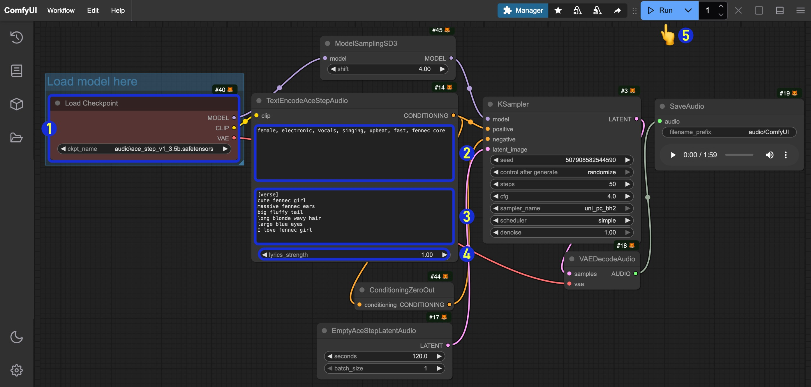
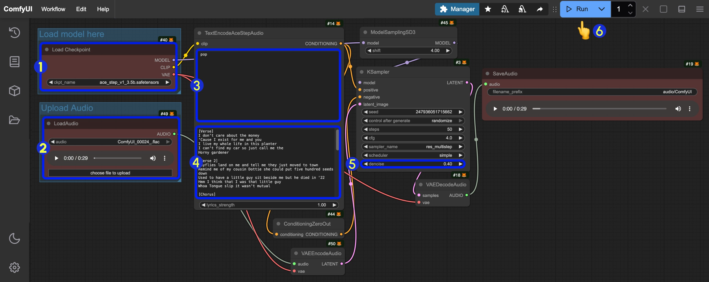

import UpdateReminder from "/snippets/ru/tutorials/update-reminder.mdx";

ACE-Step представляет собой открытую фундаментальную модель генерации музыки, совместно разработанную китайской командой StepFun и ACE Studio. Она призвана дать музыкальным создателям эффективные, гибкие и качественные инструменты генерации и редактирования музыки.

Модель распространяется по лицензии [Apache-2.0](https://github.com/ace-step/ACE-Step?tab=readme-ov-file#-license) и бесплатна для коммерческого использования.

Будучи мощной основой для генерации музыки, ACE-Step обеспечивает богатую расширяемость. С помощью методов тонкой настройки, таких как LoRA и ControlNet, разработчики могут настроить модель в соответствии со своими реальными потребностями.
Будь то редактирование аудио, синтез вокала, создание аккомпанемента, клонирование голоса или перенос стиля, ACE-Step обеспечивает стабильную и надёжную техническую поддержку.
Такая гибкая архитектура значительно упрощает процесс разработки приложений на основе музыкального ИИ, позволяя большему числу создателей быстро применять технологии ИИ в создании музыки.

В настоящее время ACE-Step опубликовала соответствующий код обучения, включая обучение моделей LoRA, а соответствующий код обучения ControlNet будет выпущен в будущем.
Вы можете посетить их [Github](https://github.com/ace-step/ACE-Step?tab=readme-ov-file#-roadmap), чтобы узнать больше деталей.

<UpdateReminder/>

## Пример рабочего процесса генерации аудио из текста ACE-Step в ComfyUI

### 1. Скачать рабочий процесс и связанные модели

Нажмите кнопку ниже, чтобы скачать соответствующий файл рабочего процесса. Перетащите его в ComfyUI, чтобы загрузить информацию о рабочем процессе. Рабочий процесс содержит информацию о загрузке моделей.

<a className="prose"  target='_blank' href="https://raw.githubusercontent.com/Comfy-Org/example_workflows/main/audio/ace-step/ace_step_1_t2m.json" style={{ display: 'inline-block', backgroundColor: '#0078D6', color: '#ffffff', padding: '10px 20px', borderRadius: '8px', borderColor: "transparent", textDecoration: 'none', fontWeight: 'bold'}}>
    <p className="prose" style={{ margin: 0, fontSize: "0.8rem" }}>Скачать файл рабочего процесса в формате JSON</p>
</a>

Вы также можете вручную скачать [ace_step_v1_3.5b.safetensors](https://huggingface.co/Comfy-Org/ACE-Step_ComfyUI_repackaged/blob/main/all_in_one/ace_step_v1_3.5b.safetensors) и сохранить его в папку `ComfyUI/models/checkpoints`.

### 2. Выполнить рабочий процесс по шагам


1. Убедитесь, что в узле `Load Checkpoints` загружена модель `ace_step_v1_3.5b.safetensors`.
2. (Необязательно) В узле `EmptyAceStepLatentAudio` можно задать длительность генерируемой музыки.
3. (Необязательно) В узле `LatentOperationTonemapReinhard` можно настроить `multiplier`, чтобы управлять громкостью вокала (чем больше значение, тем более выраженным будет вокал).
4. (Необязательно) Введите соответствующие музыкальные стили и т. п. в поле `tags` узла `TextEncodeAceStepAudio`.
5. (Необязательно) Введите соответствующий текст песни в поле `lyrics` узла `TextEncodeAceStepAudio`.
6. Нажмите кнопку `Run` или используйте сочетание клавиш `Ctrl(cmd) + Enter`, чтобы выполнить генерацию аудио.
7. После завершения рабочего процесса вы можете прослушать сгенерированное аудио в узле `Save Audio`. Нажмите, чтобы воспроизвести и прослушать его; аудио также будет сохранено в `ComfyUI/output/audio` (подкаталог определяется узлом `Save Audio`).

## Рабочий процесс ACE-Step аудио в аудио в ComfyUI

Подобно рабочим процессам «изображение в изображение», вы можете подать на вход музыкальный фрагмент и с помощью рабочего процесса ниже пересэмплировать и сгенерировать музыку. Также можно регулировать степень отличия от исходного аудио, управляя параметром `denoise` в `Ksampler`.

### 1. Скачать файл рабочего процесса

Нажмите кнопку ниже, чтобы скачать соответствующий файл рабочего процесса. Перетащите его в ComfyUI, чтобы загрузить информацию о рабочем процессе.

<a className="prose"  target='_blank' href="https://raw.githubusercontent.com/Comfy-Org/example_workflows/main/audio/ace-step/ace_step_1_m2m_editing.json" style={{ display: 'inline-block', backgroundColor: '#0078D6', color: '#ffffff', padding: '10px 20px', borderRadius: '8px', borderColor: "transparent", textDecoration: 'none', fontWeight: 'bold'}}>
    <p className="prose" style={{ margin: 0, fontSize: "0.8rem" }}>Скачать файл рабочего процесса в формате Json</p>
</a>

Скачайте следующий аудиофайл, который будет использоваться как входное аудио:

<a className="prose"   target='_blank' href="https://github.com/Comfy-Org/example_workflows/raw/refs/heads/main/audio/ace-step/input.mp3" style={{ display: 'inline-block', backgroundColor: '#0078D6', color: '#ffffff', padding: '10px 20px', borderRadius: '8px', borderColor: "transparent", textDecoration: 'none', fontWeight: 'bold'}}>
    <p className="prose" style={{ margin: 0, fontSize: "0.8rem" }}>Скачать пример аудиофайла для входа</p>
</a>

### 2. Выполнить рабочий процесс шаг за шагом



1. Убедитесь, что узел `Load Checkpoints` загрузил модель `ace_step_v1_3.5b.safetensors`.
2. Загрузите предоставленный аудиофайл в узел `LoadAudio`.
3. (Необязательно) Введите соответствующие музыкальные стили и текст песни в поля `tags` и `lyrics` узла `TextEncodeAceStepAudio`. Указание текста песни очень важно для редактирования аудио.
4. (Необязательно) Измените параметр `denoise` в узле `Ksampler`, чтобы настроить шум, добавляемый при выборке, и тем самым контролировать сходство с исходным аудио (меньшие значения дают большее сходство с исходным аудио; значение `1.00` примерно эквивалентно отсутствию аудио на входе).
5. Нажмите кнопку `Run` или используйте сочетание клавиш `Ctrl(cmd) + Enter`, чтобы выполнить генерацию аудио.
6. После завершения рабочего процесса вы можете предварительно прослушать сгенерированное аудио в узле `Save Audio`. Нажмите, чтобы воспроизвести его и прослушать; аудио также будет сохранено в `ComfyUI/output/audio` (подкаталог определяется узлом `Save Audio`).

Также можно реализовать функциональность изменения и редактирования текста песни со страницы проекта ACE-Step, изменяя исходный текст песни, чтобы менять звучание аудио.

### 3. Дополнительные примечания к рабочему процессу

1. В примере рабочего процесса вы можете изменить `tags` в `TextEncodeAceStepAudio` с `male voice` на `female voice`, чтобы генерировать женский вокал.
2. Также можно изменить `lyrics` в `TextEncodeAceStepAudio`, чтобы изменить текст песни и вместе с ним сгенерированное аудио. Подробнее см. примеры на странице проекта ACE-Step.

## Руководство по промптам ACE-Step

В ACE сейчас используются два типа промптов: `tags` и `lyrics`.

- `tags`: в основном описывают музыкальные стили, сцены и т. д. Как и промпты для других генераций, они прежде всего описывают общий стиль и требования к аудио и разделяются английскими запятыми.
- `lyrics`: в основном описывают текст песни и поддерживают структурные теги, такие как [verse], [chorus] и [bridge], которые позволяют размечать разные части текста. Для чисто инструментальной музыки можно также ввести названия инструментов.

Богатые примеры `tags` и `lyrics` вы найдёте на [главной странице модели ACE-Step](https://ace-step.github.io/). Ориентируясь на эти примеры, можно пробовать соответствующие промпты. Руководство по промптам в этом документе составлено на основе проекта, чтобы вы могли быстро перебирать комбинации и добиваться нужного результата.

### Теги (промпт)

#### Популярные музыкальные стили

Используйте короткие комбинации тегов, чтобы получать конкретные музыкальные стили

- electronic
- rock
- pop
- funk
- soul
- cyberpunk
- Acid jazz
- electro
- em (electronic music)
- soft electric drums
- melodic

#### Типы сцен

Комбинируйте конкретные сценарии использования и атмосферу, чтобы получать музыку, соответствующую нужному настроению
- background music for parties
- radio broadcasts
- workout playlists

#### Инструментальные элементы

- saxophone
- jazz
- piano, violin

#### Типы вокала

- female voice
- male voice
- clean vocals

#### Профессиональные термины
Используйте профессиональные термины, принятые в музыке, чтобы точно управлять звучанием
- 110 bpm (beats per minute is 110)
- fast tempo
- slow tempo

- loops
- fills
- acoustic guitar
- electric bass

{/* - Управление вариативностью:
  - variance=0.3 (управляет степенью отличия сгенерированной музыки от исходного стиля) */}

{/* - Редактирование текста:
  - edit lyrics: 'When I was young' -> 'When you were kid' (пример редактирования текста) */}

### Текст песни

#### Структурные теги текста

- [outro]
- [verse]
- [chorus]
- [bridge]

#### Многоязычная поддержка

- ACE-Step V1 поддерживает несколько языков. При использовании ACE-Step преобразует разные языки в английские буквы, а затем генерирует музыку.
- В ComfyUI мы ещё не полностью реализовали преобразование всех языков в английские буквы. Сейчас реализованы только [символы японской хираганы и катаканы](https://github.com/Comfy-Org/ComfyUI/commit/5d3cc85e13833aeb6ef9242cdae243083e30c6fc).
Поэтому, если вам нужно генерировать музыку на нескольких языках, сначала преобразуйте соответствующий язык в английские буквы, а затем укажите в начале `lyrics` код языка, например для китайского `[zh]`, для корейского `[ko]` и т. д.

Например:

```
[verse]

[zh]wo3zou3guo4shen1ye4de5jie1dao4
[zh]leng3feng1chui1luan4si1nian4de5piao4liang4wai4tao4
[zh]ni3de5wei1xiao4xiang4xing1guang1hen3xuan4yao4
[zh]zhao4liang4le5wo3gu1du2de5mei3fen1mei3miao3

[chorus]

[verse]​
[ko]hamkke si-kkeuleo-un sesang-ui sodong-eul pihae​
[ko]honja ogsang-eseo dalbich-ui eolyeompus-ileul balaboda​
[ko]niga salang-eun lideum-i ganghan eum-ag gatdago malhaess-eo​
[ko]han ta han tamada ma-eum-ui ondoga eolmana heojeonhanji ijge hae

[bridge]
[es]cantar mi anhelo por ti sin ocultar
[es]como poesía y pintura, lleno de anhelo indescifrable
[es]tu sombra es tan terca como el viento, inborrable
[es]persiguiéndote en vuelo, brilla como cruzar una mar de nubes

[chorus]
[fr]que tu sois le vent qui souffle sur ma main
[fr]un contact chaud comme la douce pluie printanière
[fr]que tu sois le vent qui s'entoure de mon corps
[fr]un amour profond qui ne s'éloignera jamais
```

Сейчас ACE-Step поддерживает 19 языков, но следующие десять языков поддерживаются лучше:
- Английский
- Китайский: [zh]
- Русский: [ru]
- Испанский: [es]
- Японский: [ja]
- Немецкий: [de]
- Французский: [fr]
- Португальский: [pt]
- Итальянский: [it]
- Корейский: [ko]

<Note>
На момент написания этой документации языковые теги выше не были полностью протестированы. Если какой-либо языковой тег указан неверно, [создайте issue в репозитории документации](https://github.com/Comfy-Org/docs/issues), и мы своевременно внесём исправления.
</Note>

## Связанные ресурсы ACE-Step

- [Страница проекта](https://ace-step.github.io/)
- [Hugging Face](https://huggingface.co/ACE-Step/ACE-Step-v1-3.5B)
- [GitHub](https://github.com/ace-step/ACE-Step)
- [Скрипты обучения](https://github.com/ace-step/ACE-Step?tab=readme-ov-file#-train)
