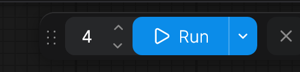
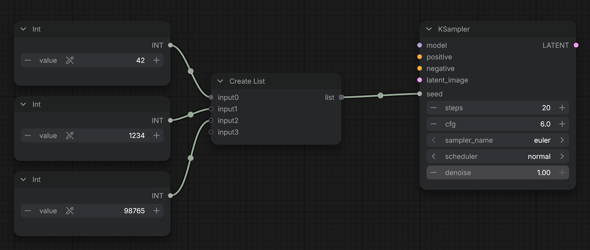
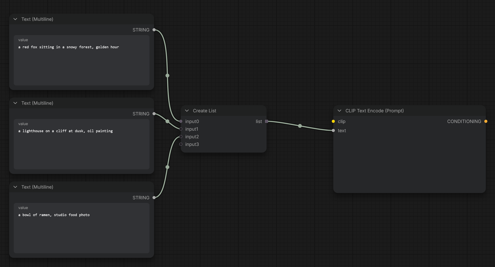
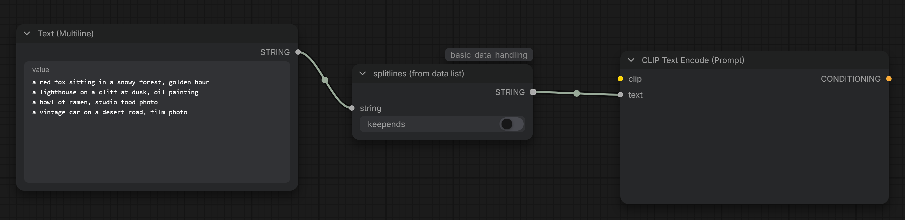
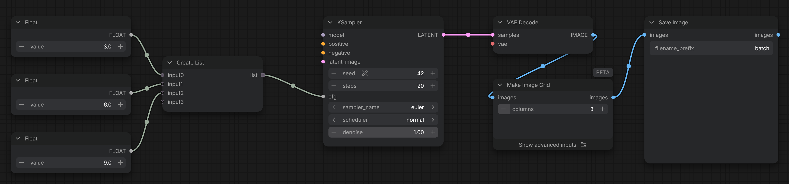
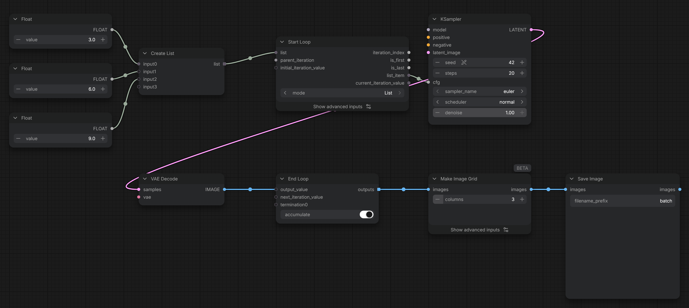
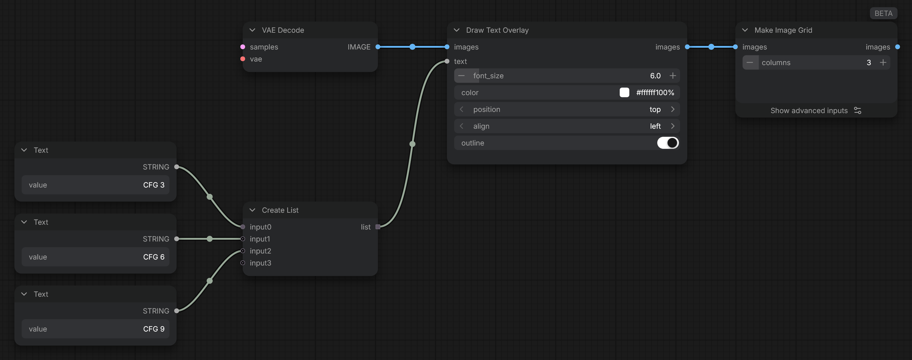

**Пакетная генерация** это многократный запуск одного рабочего процесса с изменением чего-либо между запусками: seed, промпта, CFG, сэмплера, модели или сразу нескольких из них. **Сетка настроек** представляет собой один из вариантов такого применения: один и тот же промпт и seed, но в каждой ячейке изменены одна или две настройки, чтобы вы могли увидеть, на что влияет каждая из них.

Это руководство начинается с самого простого случая и добавляет по одному шагу за раз:

1. [Пакетная генерация по seed](#batch-seeds): множество вариаций одного промпта
2. [Пакетная генерация по промптам](#batch-prompts): один запуск на каждый промпт
3. [Пакетная генерация по любой настройке](#batch-any-setting): один запуск на каждое значение CFG, шагов или любого другого входа
4. [Циклы](#loops): Start Loop и End Loop
5. [Сетки настроек](#settings-grids): пересечение двух или более настроек с раскладкой результатов
6. [Скрипты с Comfy API](#scripting-with-the-comfy-api): любые комбинации в любом масштабе


| Метод | Что меняется между запусками | Раздел |
|--------|---------------------------|---------|
| Количество пакетов | Seed или любой виджет со значением `increment` или `randomize` | [Пакетная генерация по seed](#batch-seeds) |
| `batch_size` | Шум каждого изображения за один проход выборки | [Пакетная генерация по seed](#batch-seeds) |
| Списки | Любой вход, который вы подаёте из списка: seed, промпт, CFG, шаги | [Пакетная генерация по промптам](#batch-prompts), [Пакетная генерация по любой настройке](#batch-any-setting) |
| Start Loop / End Loop | Любой вход, по одной итерации за раз | [Циклы](#loops) |
| Узел XY plot | Две или три настройки сэмплера, пересечённые между собой | [Сетки настроек](#settings-grids) |
| Скрипт | Что угодно, во всех комбинациях | [Скрипты](#scripting-with-the-comfy-api) |

<Tip>
Нужна только простая сетка настроек или хотите увидеть, что она показывает, прежде чем строить свою? На страницах открытых моделей для текст в изображение на [Comfy Hub](https://comfy.org/hub/workflows) есть вкладка **Grid**, где CFG, шаги, сэмплер и scheduler показаны рядом при одном seed, без какой-либо настройки. Попробуйте [вкладку Grid для MOSS-Image](https://comfy.org/hub/workflows/moss-image-text-to-image/). Подробнее см. в разделе [Сетки настроек](#settings-grids).
</Tip>

<Note>
Некоторые шаги используют пользовательские узлы. Каждый пользовательский узел, упомянутый на этой странице, установлен на [Comfy Cloud](https://cloud.comfy.org), где пользовательские узлы проверяются перед добавлением. В своём ComfyUI сначала [установите пакет узлов](/ru/installation/install_custom_node).
</Note>

## Сиды в пакетном режиме {#batch-seeds}

Сид определяет стартовый шум, поэтому новый сид даёт новую композицию того же промпта. Смена сида это простейший пакет.

### Количество в пакете

**Количество пакетов** находится на панели запуска рядом с кнопкой **Run**. Оно задаёт, сколько раз рабочий процесс ставится в очередь за один клик. Где находится эта панель, см. в разделе [панель запуска](/ru/interface/overview).

1. Установите для сида `KSampler` параметр `control after generate` в значение `randomize` или `increment`.
2. Установите **Количество пакетов** равным нужному числу изображений.
3. Нажмите **Run**. Каждый запуск в очереди получает следующий сид.



`control after generate` работает с любым числовым виджетом, у которого он есть, а не только с сидом. Если для всех виджетов задано `fixed`, каждый запуск в очереди идентичен и даёт одно и то же изображение.

### batch_size в латенте

`batch_size` в узле `Empty Latent Image` создаёт несколько латентов сразу, а `KSampler` выполняет их денойзинг вместе за один проход. Каждое изображение в пакете получает свой шум.

1. В узле `Empty Latent Image` задайте `batch_size` равным числу изображений, например `4`.
2. Нажмите **Run**. `Save Image` сохранит все изображения.

Больший пакет расходует больше видеопамяти, так как все изображения сэмплируются одновременно.

### Заданные сиды

Чтобы повторить запуск понравившихся сидов, например для сравнения их с новой настройкой, передайте сид из списка:

1. Добавьте узел [Int](/built-in-nodes/PrimitiveInt) для каждого сида.
2. Добавьте узел [Create List](/built-in-nodes/CreateList) и подключите каждый `Int` к следующему свободному входу. Новые входы появляются по мере подключения.
3. Подключите выход `list` узла `Create List` ко входу `seed` узла `KSampler`.
4. Нажмите **Run**. `KSampler` выполняется по одному разу на каждый сид.



В следующем разделе объясняется, как работают списки.

## Пакетные промпты {#batch-prompts}

Когда узел получает **список**, ComfyUI выполняет его один раз для каждого элемента и передаёт каждый результат дальше по графу. Список промптов, подключённый к `CLIP Text Encode`, даёт одно изображение на каждый промпт.

### Один текстовый узел на промпт

1. Добавьте узел [Text (Multiline)](/built-in-nodes/PrimitiveStringMultiline) для каждого промпта.
2. Объедините их с помощью `Create List`.
3. Подключите выход `list` к входу `text` положительного `CLIP Text Encode`.
4. Нажмите **Run**. Каждый промпт кодируется и сэмплируется как отдельный запуск.



### Один промпт на строку

Если промптов больше, чем несколько, держите их в одном текстовом поле, по одному промпту на строку, и разделите их на список с помощью узла **splitlines (from data list)** из пакета [Basic data handling](https://github.com/StableLlama/ComfyUI-basic_data_handling).

1. Добавьте узел `Text (Multiline)` и запишите по одному промпту на строку.
2. Добавьте узел **splitlines (from data list)** (найдите `splitlines`) и подключите текст к его входу `string`. Оставьте `keepends` выключенным, чтобы переводы строк не попадали в промпты.
3. Подключите его выход к входу `text` положительного `CLIP Text Encode`.
4. Нажмите **Run**. Каждая строка становится отдельным запуском.



Так вы можете вставить в текстовое поле целый файл с промптами. Пустые строки становятся пустыми промптами, поэтому сначала удалите их.

## Пакетная обработка любого параметра {#batch-any-setting}

Список можно подать почти на любой вход, не только на seed и промпт. Чтобы подключить список к виджету, например `cfg`, перетащите соединение на виджет. Чтобы перебрать значения CFG:

1. Добавьте узел [Float](/built-in-nodes/PrimitiveFloat) для каждого значения CFG, например `3`, `6` и `9`.
2. Объедините их с помощью `Create List` и подключите список ко входу `cfg` узла `KSampler`.
3. Оставьте seed фиксированным: установите для `control after generate` у seed значение `fixed`.
4. Подключите `VAE Decode` к узлу [Make Image Grid](/built-in-nodes/ImageGrid), а затем к `Save Image`.
5. Нажмите **Run**. `KSampler` и `VAE Decode` выполняются по одному разу на каждое значение CFG, а `Make Image Grid` получает все изображения.



`steps`, `denoise`, размер изображения и сила LoRA работают так же, с узлами `Int` или `Float`.

<Warning>
Когда узел получает **больше одного списка**, ComfyUI сопоставляет элементы по позиции: первый с первым, второй со вторым, а последний элемент более короткого списка повторяется. Все комбинации он не создаёт. Три промпта и три seed дают три изображения, а не девять. Чтобы скрестить две настройки, см. [Settings grids](#settings-grids) или [Scripting](#scripting-with-the-comfy-api).
</Warning>

**Выпадающие списки.** `sampler_name`, `scheduler` и файлы моделей это выпадающие списки, в которые список текстовых значений нельзя подать напрямую. Чтобы сравнить несколько вариантов, скопируйте узлы `KSampler` и `VAE Decode` по одному разу на значение, подключите их к одной и той же модели, промптам и латенту, задайте каждую копию по-разному и соберите изображения с помощью `Make Image Grid`. Для сэмплеров и планировщиков узел XY-графика из раздела [Settings grids](#settings-grids) работает быстрее.

## Циклы {#loops}

Узлы [Начало цикла](/built-in-nodes/StartLoop) и [Конец цикла](/built-in-nodes/EndLoop) выполняют узлы между ними один раз за итерацию. У `Start Loop` есть три режима:

| Режим | Итерации |
|------|------------|
| `simple` | `num_iterations` раз, при этом `iteration_index` идёт от 0 |
| `For` | От `start_iteration_index` до (не включая) `max_iteration` с шагом `step` |
| `List` | По одному разу на каждый элемент прикреплённого `list`; текущий элемент выводится через `list_item` |

Чтобы пройти циклом по списку значений, например CFG:

1. Соберите список с помощью узлов `Float` и `Create List`, как показано выше. Список промптов или seed-значений работает так же.
2. Добавьте узел `Start Loop`, установите `mode` в `List` и подключите список к его входу `list`.
3. Подключите `list_item` из `Start Loop` к входу, который нужно изменять, здесь это вход `cfg` узла `KSampler`.
4. Добавьте узел `End Loop`. Подключите выход `IMAGE` узла `VAE Decode` к `output_value` и включите `accumulate`, чтобы `End Loop` возвращал изображение с каждой итерации, а не только с последней.
5. Подключите `outputs` узла `End Loop` к `Make Image Grid`, а затем к `Save Image`.
6. Нажмите **Run**.



Для одного списка цикл и обычный список дают одинаковые изображения. Цикл также позволяет одной итерации передать значение следующей (`next_iteration_value` в End Loop, `current_iteration_value` в Start Loop), а цикл можно вложить в другой, подключив `iteration_index` внешнего цикла к `parent_iteration` внутреннего.

<Note>
Start Loop и End Loop это недавние основные узлы. Если вы не можете их найти, [обновите ComfyUI](/ru/installation/update_comfyui). Comfy Cloud обновляется после каждого стабильного релиза ComfyUI.
</Note>

## Сетки настроек {#settings-grids}

В сетке настроек промпт, модель и seed остаются неизменными, а меняются только настройки сэмплера, поэтому любая разница между двумя ячейками объясняется настройкой, которую вы изменили. При случайном seed каждая ячейка получила бы ещё и другую композицию, и вы уже не смогли бы понять, чем вызвано изменение: настройкой или шумом.

Четыре настройки `KSampler`, которые сильнее всего меняют изображение помимо промпта и модели:

| Настройка | Что она меняет |
|---------|-----------------|
| `cfg` | Насколько строго модель следует промпту. Низкие значения выглядят свободнее и мягче; высокие выглядят насыщеннее и перерезче. |
| `steps` | Сколько шагов денойзинга выполняет сэмплер. Больше шагов добавляют детали до определённого момента, а затем только время. |
| `sampler_name` | Алгоритм, который удаляет шум на каждом шаге (`euler`, `dpmpp_2m` и так далее). |
| `scheduler` | Как уровень шума снижается от шага к шагу (`normal`, `karras`, `simple` и так далее). |

Полный перебор разрастается очень быстро: 4 значения CFG × 3 варианта числа шагов × 3 сэмплера × 2 варианта scheduler, то есть 72 изображения. Начните с одной или двух настроек, найдите диапазон, который выглядит хорошо, а затем сузьте его.

### Вкладка Grid на Comfy Hub

Если вам нужна только простая сетка настроек, её не обязательно строить самостоятельно. На страницах текст в изображение для открытых моделей на [Comfy Hub](https://comfy.org/hub/workflows) есть вкладка **Grid** с готовым перебором CFG × steps × sampler × scheduler при одном seed, например [MOSS-Image](https://comfy.org/hub/workflows/moss-image-text-to-image/).

- Выберите, какие настройки пойдут по столбцам и строкам, и нажмите на любую ячейку, чтобы увидеть её в полном размере.
- Введите свой промпт, выберите значения для сравнения и нажмите **Run**, чтобы запустить их пакетом на Comfy Cloud. Вкладка показывает, сколько получится изображений и сколько это стоит, ещё до запуска.
- **Download with workflow** сохраняет изображение, которое можно перетащить в ComfyUI, чтобы загрузить его точные настройки.


Если нужно больше настроек, другие модели или собственный рабочий процесс, постройте сетку сами, как описано ниже.

### Пересечение настроек с помощью узла XY Plot

Узел **FL KSampler XYZ Plot** из пакета [Fill-Nodes](https://github.com/filliptm/ComfyUI_Fill-Nodes) заменяет `KSampler` и перебирает за вас до трёх настроек. Он рендерит каждую комбинацию и возвращает одно изображение со значениями, подписанными по осям.

1. Замените `KSampler` на **FL KSampler XYZ Plot**. Подключите `model`, `positive`, `negative`, `latent_image` и `vae` из загрузчика чекпойнта.
2. Задайте seed и базовые значения для настроек, которые вы не меняете.
3. Задайте в `x_axis` и `y_axis` две из настроек `steps`, `cfg`, `denoise`, `sampler_name` и `scheduler`.
4. Введите значения для каждой оси в `x_values` и `y_values` через запятую, например `euler,dpmpp_2m` и `4,8`.
5. Чтобы перебрать третью настройку, задайте `z_axis` и `z_values`. Параметр `z_stack_mode` размещает дополнительные сетки друг под другом или рядом.
6. Подключите выход `IMAGE` к `Save Image` и нажмите **Run**.


Чтобы перебрать другие входы, например промпты × seed или сила LoRA × CFG, используйте [вложенные циклы](#loops) или [скрипт](#scripting-with-the-comfy-api).

### Собрать собственную сетку

Когда изображения приходят из списка или цикла, узел [Make Image Grid](/built-in-nodes/ImageGrid) раскладывает их по строкам слева направо и сверху вниз.

| Вход | Что он делает |
|-------|--------------|
| `columns` | Количество изображений в строке. Задайте число значений на вашей горизонтальной оси. |
| `cell_width`, `cell_height` | Размер, до которого масштабируется каждое изображение. |
| `padding` | Пиксели между ячейками. |

Чтобы подписать каждую ячейку, поставьте узел [Draw Text Overlay](/built-in-nodes/TextOverlay) между `VAE Decode` и `Make Image Grid`. Соберите второй список подписей, например `CFG 3`, `CFG 6` и `CFG 9`, из узлов `Text` и `Create List` и подключите его ко входу `text`. Поскольку изображения и подписи являются списками, каждое изображение получает подпись в той же позиции. Сетка в начале этой страницы сделана именно так.



## Написание скриптов с Comfy API {#scripting-with-the-comfy-api}

Если настроек больше двух-трёх или нужно перебирать промпты, сиды и модели, скрипт проще графа. Он строит все комбинации, отправляет каждую как отдельную задачу и сохраняет результаты вместе с записью о том, что изменилось в каждом запуске.

### 1. Экспортировать рабочий процесс в формате API

1. Соберите и протестируйте рабочий процесс для одного запуска в ComfyUI.
2. Откройте меню рабочего процесса и выберите **Export (API)**. Граф сохраняется в [формате API](/ru/development/api-development/workflow-api-format), где каждый узел имеет ключ, равный его ID.
3. Откройте JSON и запишите ID каждого узла, который нужно изменить. В рабочем процессе «текст в изображение» по умолчанию `KSampler` имеет ID `"3"`, а положительный `CLIP Text Encode` имеет ID `"6"`.

### 2. Поставить в очередь одно задание на комбинацию

[Comfy API v2](/api-reference/v2/overview) принимает граф в формате API по адресу `POST /api/v2/jobs` и возвращает задание, статус которого можно опрашивать через `GET /api/v2/jobs/{id}`. Тот же API работает в Comfy Cloud и, через [comfy-api-proxy](https://github.com/Comfy-Org/comfy-api-proxy), в вашей собственной установке ComfyUI, поэтому приведённый ниже скрипт работает в обоих случаях: достаточно изменить `BASE_URL`.

Comfy Cloud одновременно выполняет определённое количество заданий в зависимости от плана, а остальные держит в очереди:

| План | Заданий одновременно |
|------|------------------------|
| Standard | 1 |
| Creator | 3 |
| Pro | 5 |

В очереди может находиться до 100 заданий. Для одновременного выполнения более одного задания нужны API и платный план. Подробнее см. [Ограничения параллелизма в Cloud](/ru/development/deploy/cloud-usage#ограничения-параллельных-запусков).

В `AXES` каждый ключ имеет вид `<node ID>.<input name>`, а каждое значение это список значений для перебора. Скрипт выполняет все комбинации. Одновременно он отправляет не более `MAX_IN_FLIGHT` заданий, поэтому большой пакет никогда не заполняет очередь целиком, и делает паузу, когда сервер отвечает `429`. Требуются Python 3.9 или новее и `pip install requests`. Сначала задайте `COMFY_API_KEY` равным вашему [API-ключу](/ru/development/api-development/getting-an-api-key).

```python batch.py
import itertools, json, os, time
import requests

BASE_URL = "https://cloud.comfy.org"  # свой ComfyUI через comfy-api-proxy: "http://127.0.0.1:8189"
API_KEY = os.environ.get("COMFY_API_KEY", "")
HEADERS = {"Authorization": f"Bearer {API_KEY}"} if API_KEY else {}

WORKFLOW_FILE = "workflow_api.json"  # из Export (API)
MAX_IN_FLIGHT = 5                    # соответствует лимиту одновременных заданий вашего плана; не более 100
OUT_DIR = "batch"

# "<node ID>.<input name>": значения для перебора. Выполняются все комбинации.
AXES = {
    "3.seed": [42],
    "3.cfg": [3.0, 5.0, 7.0],
    "3.sampler_name": ["euler", "dpmpp_2m"],
    "6.text": ["a red fox in snow, photo", "a lighthouse at dusk, oil painting"],
}

def apply(graph, cell):
    for key, value in cell.items():
        node_id, name = key.split(".", 1)
        graph[node_id]["inputs"][name] = value

def submit(graph):
    while True:
        r = requests.post(f"{BASE_URL}/api/v2/jobs", headers=HEADERS, json={"workflow": graph})
        if r.status_code == 429:  # очередь заполнена или превышен лимит запросов: подождать и повторить
            time.sleep(int(r.headers.get("Retry-After", "10")))
            continue
        r.raise_for_status()
        return r.json()["id"]

def save_outputs(job, name):
    files = []
    for i, output in enumerate(o for o in job["outputs"] if o["type"] == "image"):
        data = requests.get(output["url"], headers=HEADERS).content  # следует за редиректом в хранилище
        ext = os.path.splitext(output["name"])[1] or ".png"
        path = os.path.join(OUT_DIR, f"{name}_{i}{ext}")
        with open(path, "wb") as f:
            f.write(data)
        files.append(path)
    return files

def main():
    os.makedirs(OUT_DIR, exist_ok=True)
    with open(WORKFLOW_FILE) as f:
        base = json.load(f)

    cells = [dict(zip(AXES, values)) for values in itertools.product(*AXES.values())]
    pending = [(f"{n:04d}", cell) for n, cell in enumerate(cells)]
    in_flight = {}  # ID задачи -> (name, cell)
    manifest = {}   # name -> что изменил этот запуск, и его файлы

    while pending or in_flight:
        while pending and len(in_flight) < MAX_IN_FLIGHT:
            name, cell = pending.pop(0)
            graph = json.loads(json.dumps(base))
            apply(graph, cell)
            in_flight[submit(graph)] = (name, cell)

        time.sleep(3)
        for job_id, (name, cell) in list(in_flight.items()):
            r = requests.get(f"{BASE_URL}/api/v2/jobs/{job_id}", headers=HEADERS)
            if r.status_code != 200:
                continue  # превышен лимит запросов или временная ошибка: проверить снова в следующем круге
            job = r.json()
            if job["status"] == "succeeded":
                manifest[name] = {"settings": cell, "files": save_outputs(job, name)}
                with open(os.path.join(OUT_DIR, "manifest.json"), "w", encoding="utf-8") as f:
                    json.dump(manifest, f, indent=2, ensure_ascii=False)
            elif job["status"] not in ("failed", "canceled", "expired"):
                continue  # всё ещё в очереди или выполняется
            else:
                print(f"{name} {cell}: {job['status']} {job.get('error')}")
            del in_flight[job_id]
            print(f"{len(cells) - len(pending) - len(in_flight)}/{len(cells)} done")

if __name__ == "__main__":
    main()
```

Файлы нумеруются (`0000_0.png`, `0001_0.png` и так далее), а `batch/manifest.json` хранит настройки каждого из них.

Несколько типичных записей `AXES`:

```python
"3.seed": list(range(1, 9)),             # восемь сидов
"3.seed": [42],                          # один фиксированный сид, для сетки настроек
"3.scheduler": ["normal", "karras"],     # любой выпадающий список, по имени опции
"6.text": [line.strip() for line in open("prompts.txt", encoding="utf-8") if line.strip()],  # один промпт на строку
```

<Tip>
[Comfy SDK](/ru/development/api-development/sdks) для Python и TypeScript оборачивают эти эндпоинты, включая загрузку файлов, ожидание заданий и повторную попытку при заполненной очереди.
</Tip>

### 3. Скомпоновать результаты

Чтобы превратить пакетный запуск скрипта в сетку, соберите сохранённые файлы с помощью нескольких строк [Pillow](https://pillow.readthedocs.io/) (`pip install pillow`). В этом примере одна настройка откладывается по столбцам, другая по строкам, остальные фиксируются, а значения подписываются по краям:

```python make_grid.py
import json
from PIL import Image, ImageDraw

COLS = ("3.cfg", [3.0, 5.0, 7.0])
ROWS = ("3.sampler_name", ["euler", "dpmpp_2m"])
FIXED = {"3.seed": 42, "6.text": "a red fox in snow, photo"}
CELL, LABEL = 384, 100

with open("batch/manifest.json", encoding="utf-8") as f:
    runs = list(json.load(f).values())

def path(col, row):
    want = {COLS[0]: col, ROWS[0]: row, **FIXED}
    for run in runs:
        if all(run["settings"].get(k) == v for k, v in want.items()):
            return run["files"][0]
    raise KeyError(f"no run with {want}")

sheet = Image.new("RGB", (LABEL + CELL * len(COLS[1]), LABEL + CELL * len(ROWS[1])), "white")
draw = ImageDraw.Draw(sheet)
for x, col in enumerate(COLS[1]):
    draw.text((LABEL + x * CELL + 8, 12), f"{COLS[0]} {col}", fill="black")
for y, row in enumerate(ROWS[1]):
    draw.text((6, LABEL + y * CELL + 8), f"{row}", fill="black")
    for x, col in enumerate(COLS[1]):
        img = Image.open(path(col, row)).convert("RGB").resize((CELL, CELL))
        sheet.paste(img, (LABEL + x * CELL, LABEL + y * CELL))
sheet.save("grid.png")
```

Сделайте по одному листу на каждую комбинацию оставшихся настроек, например отдельный лист CFG × сэмплер для каждого промпта.

## Попробуйте сами

1. Скачайте изображение-сетку в верхней части этой страницы и перетащите его в ComfyUI. Оно загрузит рабочий процесс перебора значений CFG (используется `sd_xl_base_1.0.safetensors`).
2. Замените узлы `Float` на узлы `Int` и подключите список к `seed` или замените их на узел **splitlines (from data list)** и подключите его к промпту.
3. Когда вам нужны все комбинации нескольких настроек, экспортируйте рабочий процесс с помощью **Export (API)** и запустите его скриптом.
