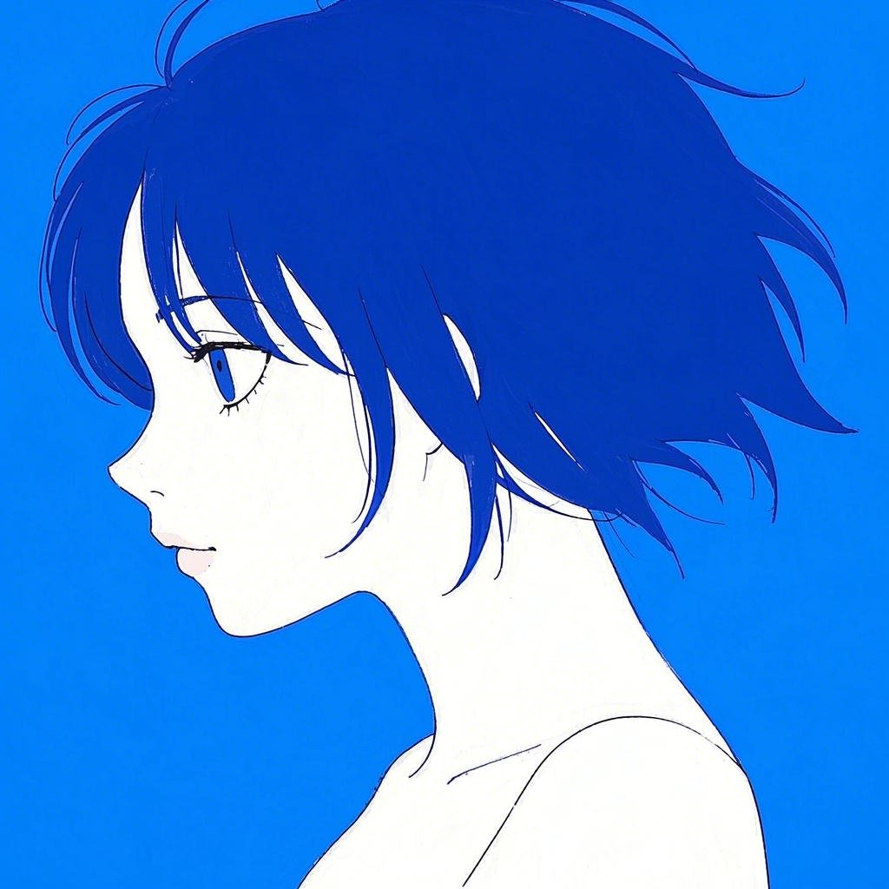
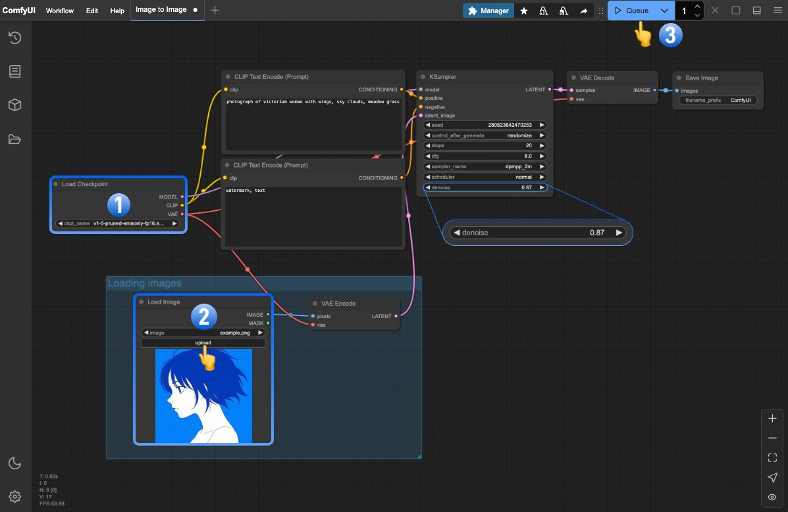

## Что такое «изображение в изображение» в ComfyUI? {#what-is-image-to-image}

Режим «изображение в изображение» представляет собой рабочий процесс в ComfyUI, который позволяет загрузить изображение и сгенерировать на его основе новое изображение.

«Изображение в изображение» можно использовать в таких сценариях:
- Преобразование стиля исходного изображения, например превращение реалистичных фотографий в художественные
- Преобразование линейного рисунка в реалистичное изображение
- Восстановление изображений
- Колоризация старых фотографий
- ... и другие сценарии

Объясним на аналогии:
Это как попросить художника создать конкретное произведение по вашему референсному изображению.

Если вы внимательно сравните этот учебник с учебником [Текст в изображение](/ru/tutorials/basic/text-to-image), вы заметите, что процесс «изображение в изображение» очень похож на процесс «текст в изображение», только с дополнительным входным референсным изображением в качестве условия. В режиме «текст в изображение» мы позволяем художнику (модели изображения) свободно создавать по нашим промптам, а в режиме «изображение в изображение» позволяем художнику создавать как по референсному изображению, так и по промптам.

## Руководство по примеру рабочего процесса «Изображение в изображение» в ComfyUI

### Установка модели

Скачайте файл [v1-5-pruned-emaonly-fp16.safetensors](https://huggingface.co/Comfy-Org/stable-diffusion-v1-5-archive/blob/main/v1-5-pruned-emaonly-fp16.safetensors) и поместите его в папку `ComfyUI/models/checkpoints`.

### Рабочий процесс «Изображение в изображение» и входное изображение

Скачайте изображение ниже и **перетащите его в ComfyUI**, чтобы загрузить рабочий процесс:

<Tip>
Изображения, содержащие JSON рабочего процесса в метаданных, можно напрямую перетащить в ComfyUI или загрузить через меню `Workflows` -> `Open (ctrl+o)`.
</Tip>

Скачайте изображение ниже, и мы используем его как входное изображение:

### Выполните рабочий процесс шаг за шагом

Следуйте шагам на схеме ниже, чтобы убедиться, что рабочий процесс выполняется правильно.

1. Убедитесь, что `Load Checkpoint` загружает **v1-5-pruned-emaonly-fp16.safetensors**
2. Загрузите входное изображение в узел `Load Image`
3. Нажмите `Queue` или нажмите `Ctrl/Cmd + Enter`, чтобы запустить генерацию

## Ключевые моменты рабочего процесса «Изображение в изображение»

Ключ к рабочему процессу «Изображение в изображение» заключается в параметре `denoise` узла `KSampler`, который должен быть **меньше 1**.

Если вы изменили параметр `denoise` и сгенерировали изображения, вы заметите:
- Чем меньше значение `denoise`, тем меньше разница между сгенерированным изображением и референсным изображением.
- Чем больше значение `denoise`, тем больше разница между сгенерированным изображением и референсным изображением.

Это связано с тем, что `denoise` определяет силу шума, добавляемого к латентному изображению после преобразования референсного изображения. Если `denoise` равен 1, латентное изображение станет полностью случайным шумом, таким же, как латент, созданный узлом `empty latent image`, и потеряет все характеристики референсного изображения.

<Note>
Низкое значение `denoise` не уменьшает количество шагов, выполняемых за один запуск; выборка полностью останавливается только при `denoise` 0. ComfyUI строит расписание на `steps / denoise` шагов (с округлением вниз) и оставляет только последние `steps + 1` сигм, поэтому при `steps` 20 и `denoise` 0.5 выполняются 20 шагов выборки на половине 40-шагового расписания, соответствующей низкому уровню шума, с плотностью шагов этого более длинного расписания. Чтобы сохранить плотность шагов полного запуска, выполняя выборку только части диапазона, задайте для `steps` значение, равное количеству шагов этого запуска, умноженному на `denoise`: при `denoise` 0.5 и `steps` 10 выбираются ровно те сигмы, которые 20-шаговый запуск использует во второй половине, при вдвое меньшем числе вычислений модели.
</Note>

Описание соответствующих принципов приведено в руководстве [«Текст в изображение»](/ru/tutorials/basic/text-to-image).

## Попробовать самостоятельно

1. Попробуйте изменить параметр `denoise` в узле **KSampler**, постепенно меняя его от 1 до 0, и понаблюдайте за изменениями в сгенерированных изображениях
2. Замените промпты и референсные изображения на свои, чтобы получить собственные эффекты на изображениях
