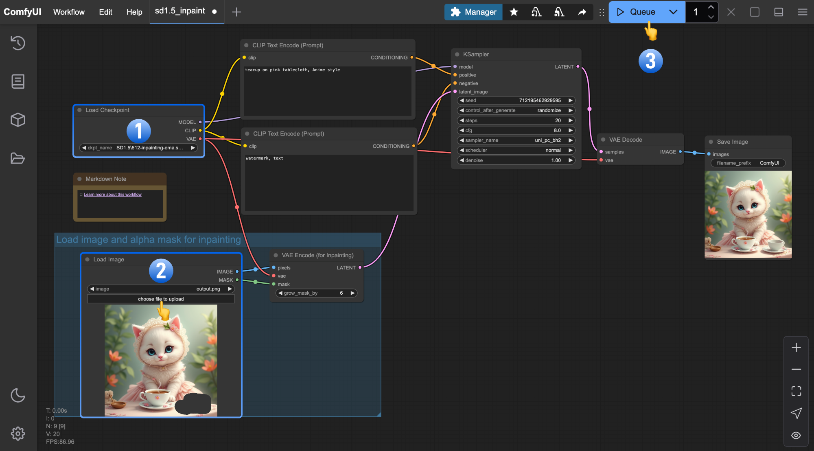
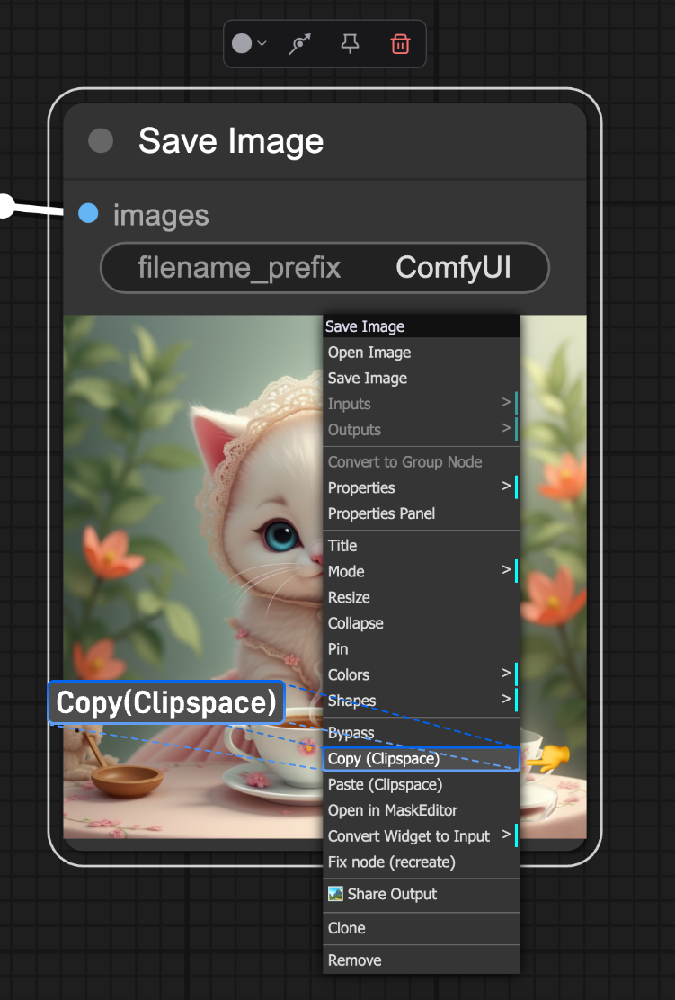
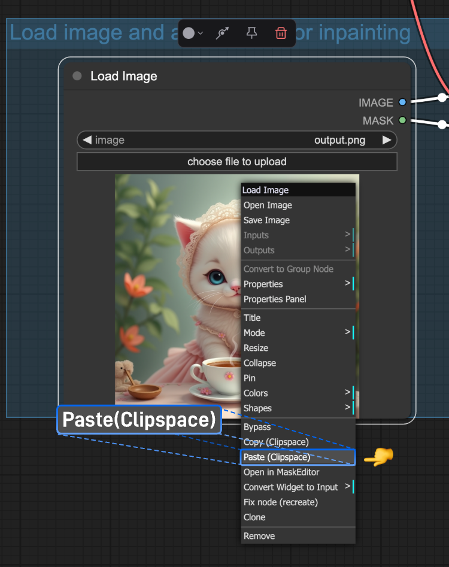
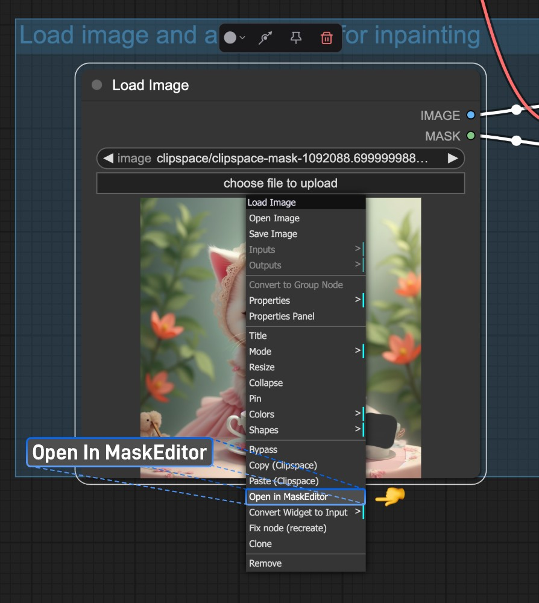
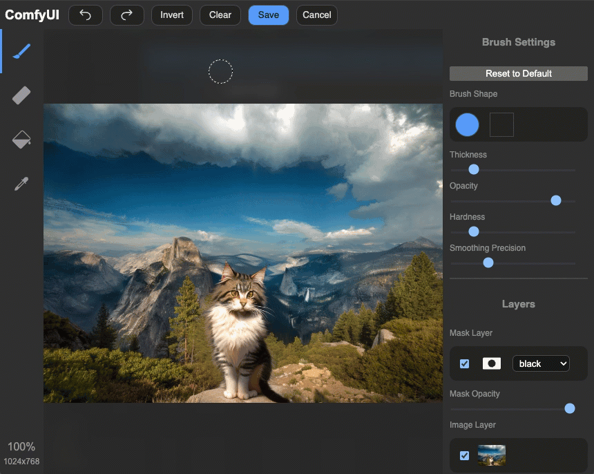
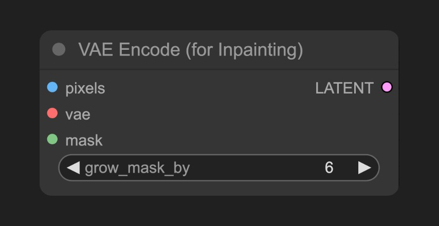

В этой статье мы познакомим вас с понятием инпейтинга в генерации изображений с помощью ИИ и покажем, как создать рабочий процесс инпейтинга в ComfyUI. Мы рассмотрим:
- Использование рабочих процессов инпейтинга для изменения изображений
- Использование редактора масок ComfyUI для рисования масок
- Узел `VAE Encoder (for Inpainting)`

## Об инпейтинге

При генерации изображений с помощью ИИ мы часто сталкиваемся с ситуациями, когда общее изображение нас устраивает, но есть элементы, которые нам не нужны или содержат ошибки. Простая повторная генерация может дать совершенно другое изображение, поэтому инпейтинг для исправления отдельных участков становится очень полезным.

Это похоже на то, как **художник (модель ИИ)** пишет картину, но конкретные детали нас всё ещё не устраивают. Нужно указать художнику, **какие области скорректировать (маска)**, а затем позволить ему **перерисовать (инпейтинг)** в соответствии с нашими требованиями.

Типичные сценарии инпейтинга:
- **Исправление дефектов:** удаление нежелательных объектов, исправление неправильно сгенерированных частей тела и т. д.
- **Оптимизация деталей:** точная настройка локальных элементов (например, изменение текстуры одежды, корректировка выражений лица)
- И другие сценарии

## Пример рабочего процесса инпейтинга в ComfyUI

### Подготовка моделей и ресурсов

#### 1. Установка модели

Скачайте файл [512-inpainting-ema.safetensors](https://huggingface.co/Comfy-Org/stable_diffusion_2.1_repackaged/blob/main/512-inpainting-ema.safetensors) и поместите его в папку `ComfyUI/models/checkpoints`:

#### 2. Ресурс для инпейтинга

Скачайте следующее изображение, которое мы будем использовать как вход:

<Note>Это изображение уже содержит альфа-канал (маску прозрачности), поэтому рисовать маску вручную не нужно. В этом руководстве также рассказано, как использовать Редактор масок для рисования масок.</Note>

#### 3. Рабочий процесс инпейтинга

Скачайте изображение ниже и **перетащите его в ComfyUI**, чтобы загрузить рабочий процесс:

<Tip>
Изображения, содержащие JSON рабочего процесса в метаданных, можно напрямую перетащить в ComfyUI или загрузить через меню `Workflows` -> `Open (ctrl+o)`.
</Tip>

### Разбор примера рабочего процесса инпейтинга в ComfyUI

Выполните шаги на схеме ниже, чтобы рабочий процесс отработал корректно.

1. Убедитесь, что `Load Checkpoint` загружает `512-inpainting-ema.safetensors`
2. Загрузите входное изображение в узел `Load Image`
3. Нажмите `Queue` или используйте `Ctrl + Enter`, чтобы генерировать

Для сравнения приведём результат с моделью [v1-5-pruned-emaonly-fp16.safetensors](https://huggingface.co/Comfy-Org/stable-diffusion-v1-5-archive/blob/main/v1-5-pruned-emaonly-fp16.safetensors):

Вы увидите, что результаты, сгенерированные моделью [512-inpainting-ema.safetensors](https://huggingface.co/Comfy-Org/stable_diffusion_2.1_repackaged/blob/main/512-inpainting-ema.safetensors), отличаются лучшим качеством инпейтинга и более естественными переходами.
Это связано с тем, что данная модель специально предназначена для инпейтинга, что помогает лучше контролировать область генерации и в итоге улучшает результат инпейтинга.

Помните аналогию, которую мы использовали? Разные модели похожи на художников с разными способностями, но у каждого художника есть свои пределы. Правильный выбор модели поможет вам получить лучшие результаты генерации.

Вы можете попробовать следующие подходы, чтобы добиться лучших результатов:

1. Измените позитивный и негативный промпты, добавив более конкретные описания
2. Попробуйте несколько запусков с разными seed в `KSampler`, чтобы получить разные результаты генерации
3. После знакомства с Редактором масок в этом руководстве вы сможете повторно выполнить инпейтинг полученных результатов, чтобы добиться желаемого итога.

Далее мы рассмотрим использование **Редактора масок**. Наше входное изображение уже содержит канал прозрачности `alpha` (ту область, которую мы хотим редактировать),
поэтому рисовать маску вручную не нужно, однако на практике вам часто придётся создавать маски с помощью Редактора масок.

### Использование Редактора масок

Сначала нажмите правой кнопкой мыши на узел `Save Image` и выберите `Copy(Clipspace)`:

Затем нажмите правой кнопкой мыши на узел **Load Image** и выберите `Paste(Clipspace)`:

Снова нажмите правой кнопкой мыши на узел **Load Image** и выберите `Open in MaskEditor`:

1. Настройте параметры кисти на правой панели
2. Используйте ластик, чтобы исправить ошибки
3. Нажмите `Save`, когда закончите

Нарисованное содержимое будет использовано как вход маски для узла VAE Encoder (for Inpainting) при кодировании

Затем попробуйте скорректировать промпты и сгенерировать изображение снова, пока не добьётесь удовлетворительных результатов.

## Узел VAE Encoder (for Inpainting)

Если сравнить этот рабочий процесс с [текст в изображение](/ru/tutorials/basic/text-to-image) и [изображение в изображение](/ru/tutorials/basic/image-to-image), можно заметить, что основные отличия находятся в условных входах раздела VAE.
В этом рабочем процессе используется узел **VAE Encoder (for Inpainting)**, специально предназначенный для инпейтинга: он помогает точнее контролировать область генерации и получать лучшие результаты.

**Входы**

| Название параметра | Функция                                                                                                                                              |
|----------------|-------------------------------------------------------------------------------------------------------------------------------------------------------|
| `pixels`       | Входное изображение, которое кодируется в латентное пространство.                                                                                     |
| `vae`          | Модель VAE, используемая для кодирования изображения из пиксельного пространства в латентное.                                                        |
| `mask`         | Маска изображения, задающая области, которые нужно изменить.                                                                                          |
| `grow_mask_by` | Значение в пикселях, на которое исходная маска расширяется наружу: вокруг маски появляется переходная зона, что позволяет избежать резких границ между областью инпейтинга и исходным изображением. |

**Выходы**

| Название параметра | Функция                                                                |
|----------------|-------------------------------------------------------------------------|
| `latent`       | Изображение, закодированное VAE в латентное пространство.              |
