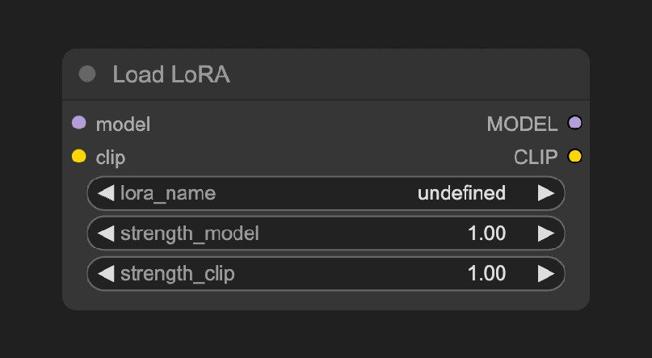
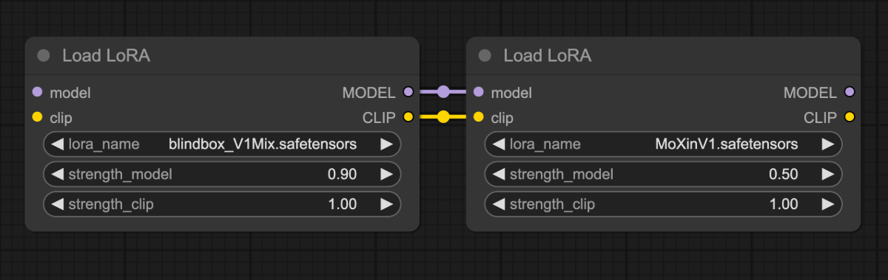

**LoRA (Low-Rank Adaptation)** — это эффективный метод дообучения больших генеративных моделей, таких как Stable Diffusion.
Он добавляет в предварительно обученную модель обучаемые матрицы низкого ранга, изменяя лишь часть параметров вместо полного переобучения модели,
что позволяет добиться оптимизации под конкретные задачи при меньших вычислительных затратах.
По сравнению с базовыми моделями, такими как SD1.5, модели LoRA меньше по размеру и проще в обучении.

На изображении выше сравнивается генерация с одними и теми же параметрами при использовании [dreamshaper_8](https://civitai.com/models/4384?modelVersionId=128713) напрямую и при использовании модели LoRA [blindbox_V1Mix](https://civitai.com/models/25995/blindbox).
Как видите, с помощью модели LoRA можно генерировать изображения в разных стилях, не изменяя базовую модель.

Мы покажем, как использовать модель LoRA. Все варианты LoRA: Lycoris, loha, lokr, locon и т. д. — применяются одинаково.

В этом примере мы научимся загружать и использовать модель LoRA в [ComfyUI](https://github.com/Comfy-Org/ComfyUI), рассмотрев следующие темы:

1. Установка модели LoRA
2. Генерация изображений с помощью модели LoRA
3. Краткое знакомство с узлом `Load LoRA`

## Установить необходимые модели

Скачайте файл [dreamshaper_8.safetensors](https://civitai.com/api/download/models/128713?type=Model&format=SafeTensor&size=pruned&fp=fp16) и поместите его в папку `ComfyUI/models/checkpoints`.

Скачайте файл [blindbox_V1Mix.safetensors](https://civitai.com/api/download/models/32988?type=Model&format=SafeTensor&size=full&fp=fp16) и поместите его в папку `ComfyUI/models/loras`.

## Файл рабочего процесса LoRA

Скачайте изображение ниже и **перетащите его в ComfyUI**, чтобы загрузить рабочий процесс.

<Tip>
Изображения, содержащие JSON рабочего процесса в метаданных, можно напрямую перетащить в ComfyUI или загрузить через меню `Workflows` -> `Open (ctrl+o)`.
</Tip>

## Выполнить рабочий процесс по шагам

Следуйте шагам на схеме ниже, чтобы убедиться, что рабочий процесс выполняется корректно.

1. Убедитесь, что `Load Checkpoint` загружает `dreamshaper_8.safetensors`
2. Убедитесь, что `Load LoRA` загружает `blindbox_V1Mix.safetensors`
3. Нажмите кнопку `Queue` или используйте сочетание клавиш `Ctrl(cmd) + Enter`, чтобы сгенерировать изображение

## Введение в узел Load LoRA

ComfyUI обнаруживает модели в папке `ComfyUI\models\loras`, и их можно загрузить с помощью этого узла.

### Входы

| Название параметра | Назначение |
|----------------------|------------|
| `model` | Подключение к базовой модели |
| `clip` | Подключение к модели CLIP |
| `lora_name` | Выбор модели LoRA для загрузки и использования |
| `strength_model` | Определяет, насколько сильно LoRA влияет на веса модели. Чем выше значение, тем сильнее стиль LoRA |
| `strength_clip` | Определяет, насколько сильно LoRA влияет на текстовые embedding-векторы CLIP |

### Выходы

| Название параметра | Назначение |
|----------------------|------------|
| `model` | Выводит модель с применёнными корректировками LoRA |
| `clip` | Выводит модель CLIP с применёнными корректировками LoRA |

Этот узел поддерживает цепочное подключение: несколько узлов `Load LoRA` можно соединить последовательно, чтобы применить несколько моделей LoRA. Подробнее см. в разделе [Пример использования нескольких LoRA в ComfyUI](/ru/tutorials/basic/multiple-loras).

## Попробовать самостоятельно

1. Попробуйте изменить промпт или настроить различные параметры узла `Load LoRA`, например `strength_model`, чтобы увидеть изменения в сгенерированных изображениях и лучше познакомиться с узлом `Load LoRA`.
2. Перейдите на [CivitAI](https://civitai.com/models), чтобы скачать другие виды моделей LoRA и попробовать их использовать.
