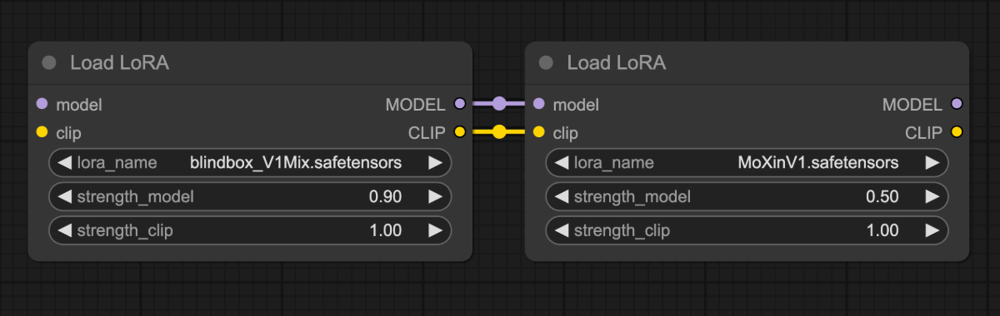
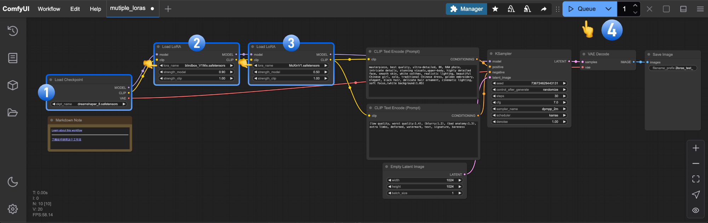

В [примере с LoRA в ComfyUI](/ru/tutorials/basic/lora) мы рассказали, как загрузить и использовать одну LoRA-модель, и упомянули возможность соединять узлы в цепочку.

В этом учебнике показано, как соединить несколько узлов `Load LoRA` в цепочку, чтобы применить две LoRA-модели одновременно: [blindbox_V1Mix](https://civitai.com/models/25995?modelVersionId=32988) и [MoXinV1](https://civitai.com/models/12597?modelVersionId=14856).

На сравнении ниже показано, как каждая из этих LoRA влияет по отдельности при одинаковых параметрах:

Соединяя несколько LoRA-моделей в цепочку, мы получаем смешанный стиль в итоговом результате:

## Установка моделей

Скачайте файл [dreamshaper_8.safetensors](https://civitai.com/api/download/models/128713?type=Model&format=SafeTensor&size=pruned&fp=fp16) и поместите его в папку `ComfyUI/models/checkpoints`.

Скачайте файл [blindbox_V1Mix.safetensors](https://civitai.com/api/download/models/32988?type=Model&format=SafeTensor&size=full&fp=fp16) и поместите его в папку `ComfyUI/models/loras`.

Скачайте файл [MoXinV1.safetensors](https://civitai.com/api/download/models/14856?type=Model&format=SafeTensor&size=full&fp=fp16) и поместите его в папку `ComfyUI/models/loras`.

## Рабочий процесс с несколькими LoRA

Скачайте изображение ниже и **перетащите его в ComfyUI**, чтобы загрузить рабочий процесс:

<Tip>
Изображения, содержащие JSON рабочего процесса в метаданных, можно напрямую перетащить в ComfyUI или загрузить через меню `Workflows` -> `Open (ctrl+o)`.
</Tip>

## Завершить рабочий процесс по шагам

Выполните шаги на схеме ниже, чтобы рабочий процесс запустился корректно.

1. Убедитесь, что `Load Checkpoint` загружает **dreamshaper_8.safetensors**
2. Убедитесь, что первый `Load LoRA` загружает **blindbox_V1Mix.safetensors**
3. Убедитесь, что второй `Load LoRA` загружает **MoXinV1.safetensors**
4. Нажмите `Queue` или `Ctrl/Cmd + Enter`, чтобы сгенерировать

## Попробуйте сами

1. Настройте значения `strength_model` в обоих узлах `Load LoRA`, чтобы управлять влиянием каждой LoRA
2. Поищите дополнительные LoRA на [CivitAI](https://civitai.com/models) и создавайте собственные комбинации