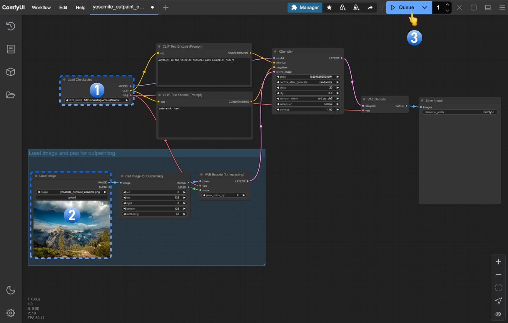
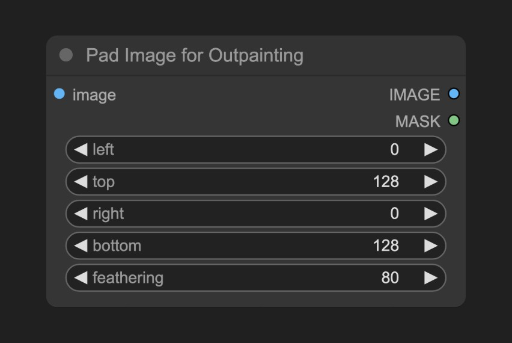
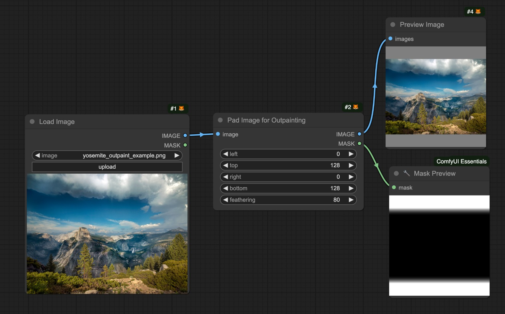

Это руководство познакомит вас с концепцией outpainting в генерации изображений с помощью ИИ и с тем, как создать рабочий процесс outpainting в ComfyUI. Мы рассмотрим:
- использование рабочего процесса outpainting для расширения изображения
- понимание и использование узлов, связанных с outpainting, в ComfyUI
- освоение базового процесса outpainting

## Об аутпейнтинге

В генерации изображений с помощью ИИ часто возникают ситуации, когда у существующего изображения хорошая композиция, но область холста слишком мала, и требуется расширить холст, чтобы получить более масштабную сцену. Здесь на помощь приходит аутпейнтинг.

В целом для него требуется содержимое, аналогичное [инпейтингу](/ru/tutorials/basic/inpaint), но мы используем другие узлы, чтобы **построить маску**.

Применения аутпейнтинга включают:
- **Расширение сцены:** расширение диапазона сцены исходного изображения, чтобы показать более полное окружение
- **Корректировка композиции:** оптимизация общей композиции за счёт расширения холста
- **Добавление содержимого:** добавление дополнительных связанных элементов сцены к исходному изображению

## Описание примера рабочего процесса outpainting в ComfyUI

### Подготовка

#### 1. Установка модели

Скачайте следующий файл модели и сохраните его в каталог `ComfyUI/models/checkpoints`:
- [512-inpainting-ema.safetensors](https://huggingface.co/Comfy-Org/stable_diffusion_2.1_repackaged/blob/main/512-inpainting-ema.safetensors)

#### 2. Входное изображение

Подготовьте изображение, которое хотите расширить. В этом примере мы будем использовать следующее изображение:

#### 3. Рабочий процесс outpainting

Скачайте изображение ниже и **перетащите его в ComfyUI**, чтобы загрузить рабочий процесс:

<Tip>
Изображения, содержащие JSON рабочего процесса в своих метаданных, можно напрямую перетащить в ComfyUI или загрузить через меню `Workflows` -> `Open (ctrl+o)`.
</Tip>

### Описание использования рабочего процесса outpainting

Ключевые шаги рабочего процесса outpainting:

1. Загрузите локально установленный файл модели в узле `Load Checkpoint`
2. Нажмите кнопку `Upload` в узле `Load Image`, чтобы загрузить ваше изображение
3. Нажмите кнопку `Queue` или используйте сочетание клавиш `Ctrl + Enter`, чтобы выполнить генерацию изображения

В этом рабочем процессе мы в основном используем узел `Pad Image for outpainting`, чтобы управлять направлением и диапазоном расширения изображения. Фактически это рабочий процесс [Inpaint](/ru/tutorials/basic/inpaint), но для построения маски мы используем другие узлы.

### Узел Pad Image for outpainting

Этот узел принимает входное изображение и выводит расширенное изображение с соответствующей маской, которая строится на основе параметров узла.

#### Входные параметры

| Название параметра | Функция                                                                                                                                |
| -------------- | ------------------------------------------------------------------------------------------------------------------------------------- |
| `image`        | Входное изображение                                                                                                                   |
| `left`         | Величина поля слева                                                                                                                   |
| `top`          | Величина поля сверху                                                                                                                  |
| `right`        | Величина поля справа                                                                                                                  |
| `bottom`       | Величина поля снизу                                                                                                                   |
| `feathering`   | Управляет плавностью перехода между исходным изображением и добавленными полями: чем выше значение, тем плавнее переход              |

#### Выходные параметры

| Название параметра | Функция                                                                   |
| -------------- | -------------------------------------------------------------------------- |
| `image`        | Выходной `image` представляет изображение с добавленными полями            |
| `mask`         | Выходная `mask` обозначает область исходного изображения и область добавленных полей |

#### Содержимое выходов узла

После обработки узлом `Pad Image for outpainting` выходное изображение и предпросмотр маски выглядят так:

Соответствующие результаты на выходах:
- Выход `Image`: расширенное изображение
- Выход `Mask`: маска, отмечающая области расширения
