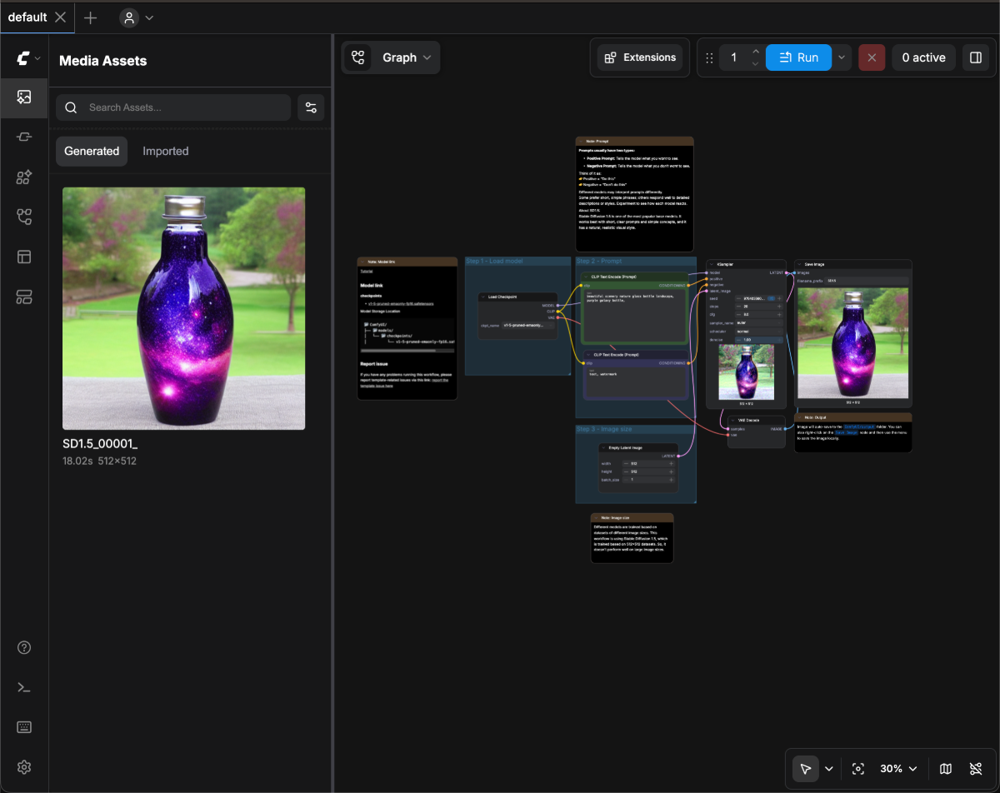
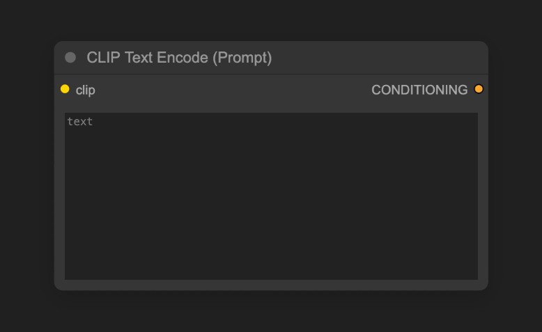
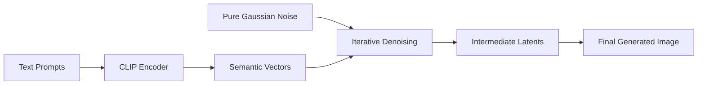
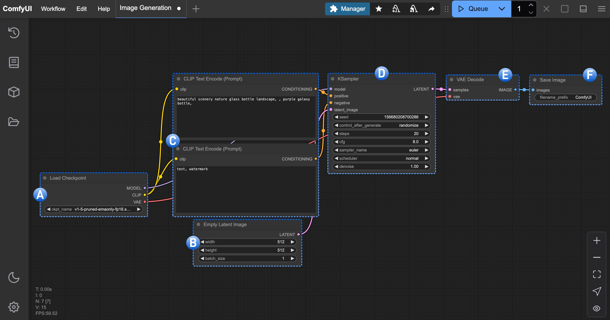
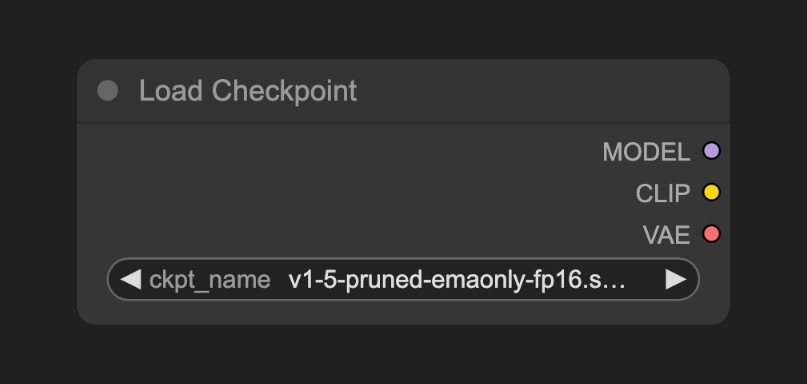
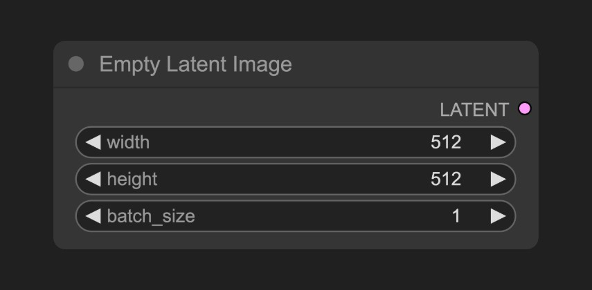
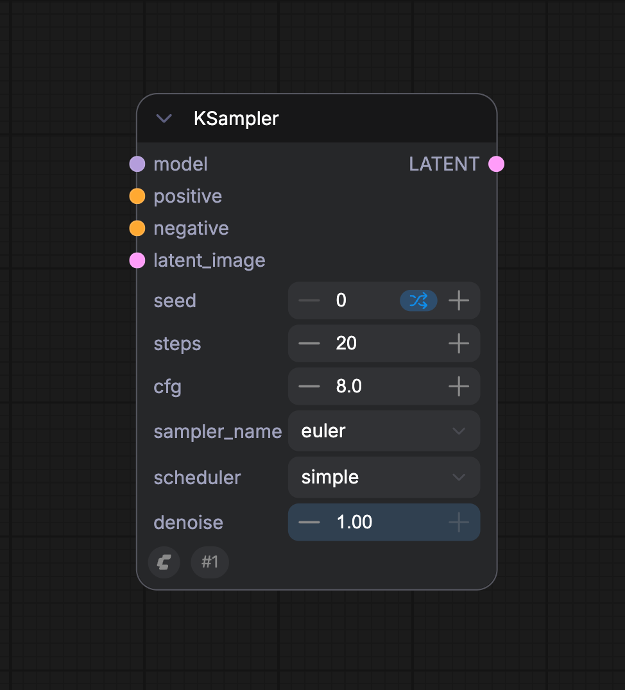
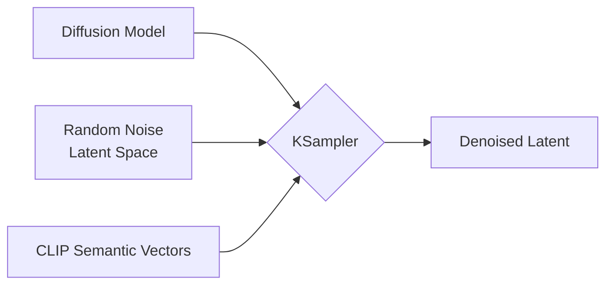
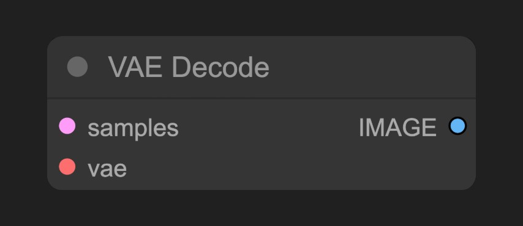
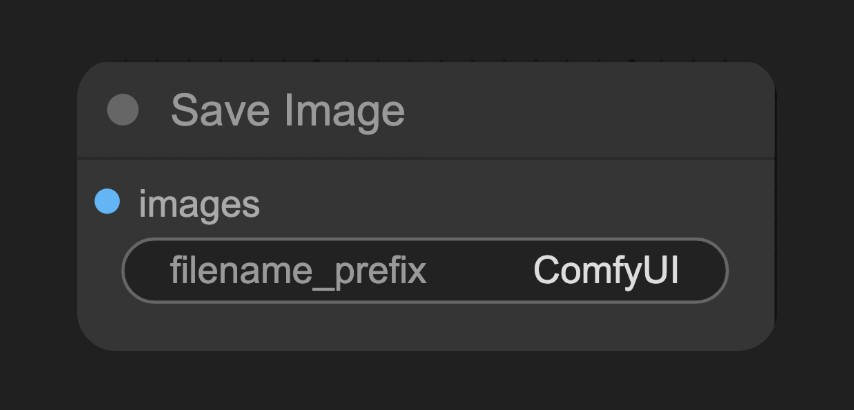

Это руководство познакомит вас с рабочим процессом «текст в изображение» в ComfyUI и поможет понять функциональность и использование различных узлов ComfyUI.

В этом документе мы:
- Выполним рабочий процесс «текст в изображение»
- Получим базовое представление о принципах диффузионных моделей
- Узнаем о функциях и ролях узлов рабочего процесса
- Получим начальное представление о модели SD1.5

Мы начнём с запуска рабочего процесса «текст в изображение», а затем объясним связанные концепции. Выберите подходящие разделы в зависимости от ваших потребностей.

## Что такое «текст в изображение» в ComfyUI? {#about-text-to-image}

**Текст в изображение** представляет собой базовый процесс в генерации ИИ-изображений, который создаёт изображения по текстовым описаниям, а в его основе лежат **модели diffusion**.

Процесс «текст в изображение» требует следующих элементов:
- **Художник:** модель генерации изображений
- **Холст:** латентное пространство
- **Требования к изображению (промпты):** включая позитивные промпты (элементы, которые вы хотите видеть на изображении) и негативные промпты (элементы, которых вы видеть не хотите)

Этот процесс генерации «текст в изображение» можно понимать просто как передачу своих требований (позитивных и негативных промптов) **художнику (модели изображений)**, который затем создаёт желаемое на основе этих требований.

## Пример рабочего процесса «Текст в изображение» в ComfyUI

### 1. Подготовка

Убедитесь, что в папке `ComfyUI/models/checkpoints` есть хотя бы одна модель SD1.5, например [v1-5-pruned-emaonly-fp16.safetensors](https://huggingface.co/Comfy-Org/stable-diffusion-v1-5-archive/blob/main/v1-5-pruned-emaonly-fp16.safetensors)

Если модель ещё не установлена, выполните шаги из раздела [Скачать модель](/ru/get_started/first_generation#download-the-model).

### 2. Загрузка рабочего процесса «Текст в изображение»

Скачайте изображение ниже и **перетащите его в ComfyUI**, чтобы загрузить рабочий процесс:


<Tip>
Изображения, в метаданных которых записан JSON рабочего процесса, можно перетаскивать в ComfyUI напрямую или открывать через меню `Workflows` -> `Open (ctrl+o)`.
</Tip>

### 3. Загрузка модели и генерация первого изображения

После установки модели изображения выполните шаги на рисунке ниже, чтобы загрузить модель и сгенерировать первое изображение


Выполняйте шаги в порядке номеров на рисунке:
1. В узле **Load Checkpoint** стрелками или щёлкнув по области текста убедитесь, что выбрана модель **v1-5-pruned-emaonly-fp16.safetensors**, а стрелки влево и вправо не показывают **null**
2. Нажмите кнопку `Queue` или используйте сочетание клавиш `Ctrl + Enter`, чтобы запустить генерацию изображения

Когда процесс завершится, результат появится в интерфейсе узла **Save Image**. Щёлкните по нему правой кнопкой мыши, чтобы сохранить изображение локально



<Tip>Если результат вас не устраивает, запустите генерацию несколько раз. При каждом запуске **KSampler** берёт новое случайное значение из параметра `seed`, поэтому результаты будут разными</Tip>

### 4. Начните экспериментировать

Попробуйте изменить текст в узле **CLIP Text Encoder**



Соединение `Positive` в узле KSampler передаёт положительный промпт, а соединение `Negative` передаёт отрицательный.

Основные принципы составления промптов для модели SD1.5:
- По возможности пишите на английском
- Разделяйте промпты запятыми `,`
- Используйте короткие фразы, а не длинные предложения
- Давайте конкретные описания
- Повышайте вес отдельных слов выражениями вида `(golden hour:1.2)`, чтобы они чаще попадали в изображение. Здесь `1.2` это вес, `golden hour` это ключевое слово
- Добавляйте ключевые слова вроде `masterpiece, best quality, 4k`, чтобы повысить качество генерации

Ниже несколько примеров промптов. Можете использовать их или написать свои:

**1. Аниме-стиль**

Положительный промпт:
```
anime style, 1girl with long pink hair, cherry blossom background, studio ghibli aesthetic, soft lighting, intricate details

masterpiece, best quality, 4k
```

Отрицательный промпт:
```
low quality, blurry, deformed hands, extra fingers
```

**2. Реалистичный стиль**

Положительный промпт:
```
(ultra realistic portrait:1.3), (elegant woman in crimson silk dress:1.2), 
full body, soft cinematic lighting, (golden hour:1.2), 
(fujifilm XT4:1.1), shallow depth of field, 
(skin texture details:1.3), (film grain:1.1), 
gentle wind flow, warm color grading, (perfect facial symmetry:1.3)
```

Отрицательный промпт:
```
(deformed, cartoon, anime, doll, plastic skin, overexposed, blurry, extra fingers)
```

**3. Стиль конкретного художника**

Положительный промпт:
```
fantasy elf, detailed character, glowing magic, vibrant colors, long flowing hair, elegant armor, ethereal beauty, mystical forest, magical aura, high detail, soft lighting, fantasy portrait, Artgerm style
```

Отрицательный промпт:
```
blurry, low detail, cartoonish, unrealistic anatomy, out of focus, cluttered, flat lighting
```

## Как работает «текст в изображение»? {#text-to-image-working-principles}

Весь процесс «текст в изображение» можно представить как **обратный процесс диффузии**. Скачанный файл [v1-5-pruned-emaonly-fp16.safetensors](https://huggingface.co/Comfy-Org/stable-diffusion-v1-5-archive/blob/main/v1-5-pruned-emaonly-fp16.safetensors) это предобученная модель, которая **создаёт целевое изображение из чистого гауссова шума**. Достаточно подать промпт, и модель построит изображение, последовательно убирая шум.



Нужно разобраться в двух понятиях:
1. **Латентное пространство (Latent Space)**: абстрактный способ представления данных в диффузионных моделях. Перевод изображения из пиксельного пространства в латентное уменьшает объём хранения, упрощает обучение модели и снижает сложность удаления шума. Это похоже на архитектора, который работает с чертежом (латентное пространство), а не проектирует прямо на здании (пиксельное пространство): структурные особенности сохраняются, а стоимость изменений резко падает
2. **Пиксельное пространство (Pixel Space)**: пространство хранения изображения, то есть итоговая картинка, которую мы видим; в нём хранятся значения пикселей.

Если хотите узнать о диффузионных моделях больше, прочитайте эти статьи:
- [Denoising Diffusion Probabilistic Models (DDPM)](https://arxiv.org/pdf/2006.11239)
- [Denoising Diffusion Implicit Models (DDIM)](https://arxiv.org/pdf/2010.02502)
- [High-Resolution Image Synthesis with Latent Diffusion Models](https://arxiv.org/pdf/2112.10752)

## Объяснение узлов рабочего процесса «Текст в изображение» в ComfyUI



### A. Узел Load Checkpoint



Этот узел обычно используется для загрузки модели генерации изображений. `checkpoint` обычно содержит три компонента: `MODEL (UNet)`, `CLIP` и `VAE`

- `MODEL (UNet)`: модель UNet, отвечающая за предсказание шума и генерацию изображения в процессе диффузии
- `CLIP`: текстовый энкодер, который преобразует ваши текстовые промпты в векторы, понятные модели, поскольку модель не может напрямую понимать текстовые промпты
- `VAE`: вариационный автокодировщик (Variational AutoEncoder), который переводит изображения между пиксельным и латентным пространством, поскольку диффузионные модели работают в латентном пространстве, а ваши изображения находятся в пиксельном пространстве

### B. Узел Empty Latent Image



Определяет латентное пространство, которое передаётся на вход узлу KSampler. Узел Empty Latent Image создаёт **латентное пространство чистого шума**

Можно представить его работу как определение размера холста, который задаёт размеры итогового сгенерированного изображения

### C. Узел CLIP Text Encoder


Используется для кодирования промптов, то есть ваших требований к изображению
- Вход условия `Positive`, прикреплённый к узлу KSampler, соответствует позитивному промпту (элементы, которые вы хотите видеть на изображении)
- Вход условия `Negative`, прикреплённый к узлу KSampler, соответствует негативному промпту (элементы, которых вы не хотите видеть на изображении)

Промпты кодируются в семантические векторы компонентом `CLIP` из узла `Load Checkpoint` и выводятся как условия для узла KSampler

### D. Узел KSampler



**KSampler** является ядром всего рабочего процесса: именно здесь происходит весь процесс удаления шума, в результате которого на выходе получается изображение в латентном пространстве



Ниже приведено объяснение параметров узла KSampler:

| Название параметра        | Описание                                                     | Функция                                                                                                     |
|---------------------------|--------------------------------------------------------------|-------------------------------------------------------------------------------------------------------------|
| **model**                 | Диффузионная модель, используемая для удаления шума          | Определяет стиль и качество сгенерированных изображений                                                     |
| **positive**              | Кодирование условия позитивного промпта                      | Направляет генерацию на включение указанных элементов                                                        |
| **negative**              | Кодирование условия негативного промпта                      | Подавляет нежелательное содержимое                                                                          |
| **latent_image**          | Изображение в латентном пространстве, из которого удаляется шум | Служит входным носителем для инициализации шума                                                            |
| **seed**                  | Случайное зерно для генерации шума                           | Управляет случайностью генерации                                                                            |
| **control_after_generate**| Режим управления seed после генерации                        | Определяет характер изменения seed при пакетной генерации                                                   |
| **steps**                 | Количество итераций удаления шума                            | Больше шагов означает более мелкие детали, но больше времени на обработку                                   |
| **cfg**                   | Масштаб направляющей без классификатора (classifier-free guidance) | Управляет силой привязки к промпту (слишком высокое значение приводит к переобучению)                 |
| **sampler_name**          | Название алгоритма сэмплирования                             | Определяет математический метод построения траектории удаления шума                                         |
| **scheduler**             | Тип планировщика                                             | Управляет скоростью затухания шума и распределением размера шага                                            |
| **denoise**               | Коэффициент силы удаления шума                               | Управляет силой шума, добавляемого в латентное пространство: 0.0 сохраняет исходные признаки входа, 1.0 означает полный шум |

В узле KSampler латентное пространство использует `seed` в качестве параметра инициализации для построения случайного шума, а семантические векторы `Positive` и `Negative` подаются как условия в диффузионную модель

Затем в соответствии с количеством шагов удаления шума, заданным параметром `steps`, выполняется удаление шума. На каждом шаге с помощью коэффициента силы удаления шума, заданного параметром `denoise`, из латентного пространства удаляется шум и генерируется новое изображение в латентном пространстве

### E. Узел VAE Decode



Преобразует изображение в латентном пространстве, полученное на выходе **KSampler**, в изображение в пиксельном пространстве

### F. Узел Save Image



Показывает предпросмотр и сохраняет декодированное изображение из латентного пространства в локальную папку `ComfyUI/output`

## Введение в модель SD1.5

**SD1.5 (Stable Diffusion 1.5)** это модель генерации изображений с помощью ИИ, разработанная [Stability AI](https://stability.ai/). Это базовая версия серии Stable Diffusion, обученная на изображениях разрешением **512×512**, поэтому она особенно хорошо генерирует изображения в этом разрешении. При размере около 4GB она плавно работает на **GPU потребительского класса (например, с 6GB VRAM)**. Сейчас у SD1.5 богатая экосистема: она поддерживает различные плагины (например, ControlNet, LoRA) и инструменты оптимизации.
Будучи знаковой моделью в генерации AI-искусства, SD1.5 остаётся лучшим выбором для старта благодаря открытому исходному коду, лёгкой архитектуре и богатой экосистеме. Хотя вышли более новые версии, такие как SDXL/SD3, её ценность для потребительского оборудования остаётся непревзойдённой.

### Основная информация
- **Дата выпуска**: октябрь 2022
- **Основная архитектура**: на основе Latent Diffusion Model (LDM)
- **Данные обучения**: набор данных LAION-Aesthetics v2.5 (примерно 590M шагов обучения)
- **Открытость исходного кода**: полностью открытые модель, код и данные обучения

### Преимущества и ограничения
Преимущества модели:
- Лёгкость: небольшой размер, всего около 4GB, плавно работает на потребительских GPU
- Низкий порог входа: поддерживает широкий набор плагинов и инструментов оптимизации
- Зрелая экосистема: широкая поддержка плагинов и инструментов
- Быстрая генерация: плавная работа на потребительских GPU

Ограничения модели:
- Проработка деталей: руки и сложное освещение склонны к искажениям
- Ограничения разрешения: качество снижается при прямой генерации в 1024x1024
- Зависимость от промпта: для управления требуются точные описания на английском
