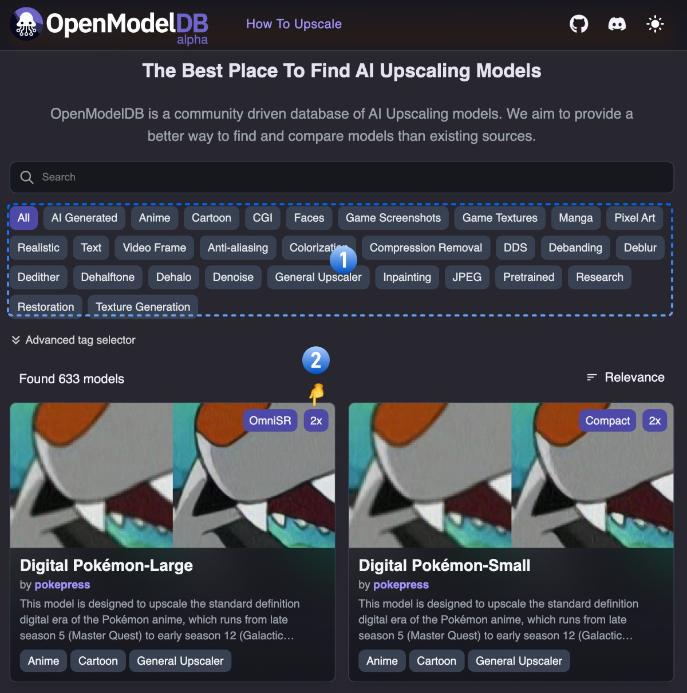
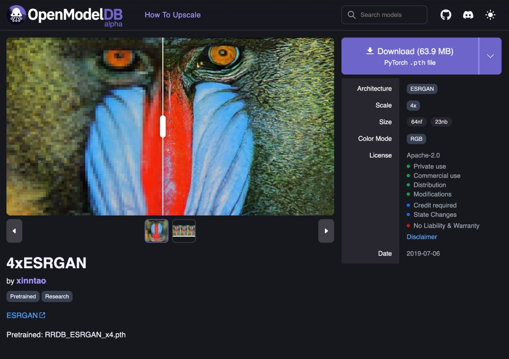
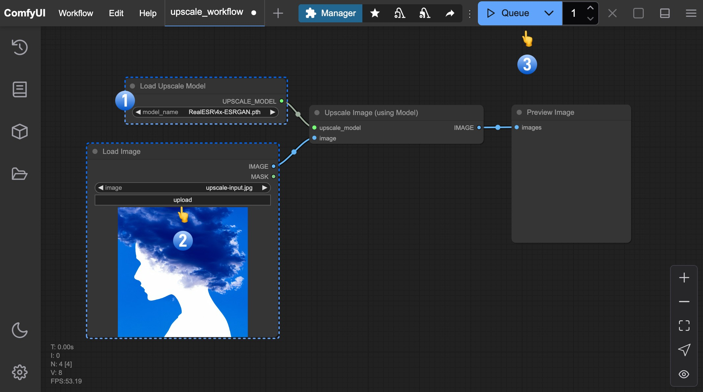
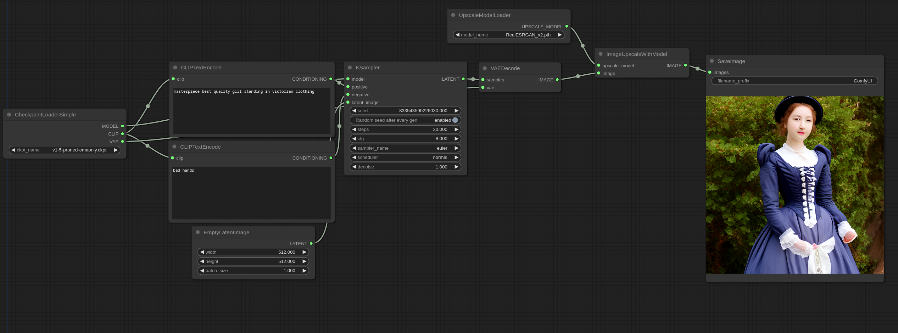

## Что такое увеличение разрешения изображений?

Увеличение разрешения изображений — это процесс преобразования изображений с низким разрешением в изображения с высоким разрешением с помощью алгоритмов.
В отличие от традиционных методов интерполяции, модели ИИ для увеличения разрешения (например, ESRGAN) умеют интеллектуально восстанавливать детали, сохраняя качество изображения.

Например, стандартная модель SD1.5 часто испытывает трудности при генерации изображений большого размера.
Чтобы получить результат в высоком разрешении, мы обычно сначала генерируем изображения меньшего размера, а затем применяем методы увеличения разрешения.

В этой статье рассматривается один из многих методов увеличения разрешения в ComfyUI. В этом учебнике мы расскажем, как:
1. Загрузить и установить модели увеличения разрешения
2. Выполнить базовое увеличение разрешения изображения
3. Объединить рабочие процессы «текст в изображение» с увеличением разрешения

<Note>
Ищете более продвинутые варианты увеличения разрешения? Ознакомьтесь с нашим подробным [руководством по увеличению разрешения изображений](/ru/tutorials/utility/image-upscale), в котором описаны различные модели и сценарии использования, включая улучшение портретов, предметную съёмку и многое другое.
</Note>

## Рабочий процесс увеличения разрешения

### Установить модели

Скачайте необходимые модели ESRGAN:
<Steps>
<Step title="Перейти на OpenModelDB">
Перейдите на [OpenModelDB](https://openmodeldb.info/), чтобы найти и скачать модели увеличения разрешения (например, RealESRGAN).

Как показано:
1. Отфильтруйте модели по типу изображения с помощью селектора категорий.
2. Коэффициент увеличения модели указан в правом верхнем углу (например, 2x на скриншоте).

В этом руководстве мы будем использовать модель [4x-ESRGAN](https://openmodeldb.info/models/4x-ESRGAN). Нажмите кнопку `Download` на странице модели.

</Step>
<Step title="Сохранить файлы модели в каталог">
Сохраните файл модели (.pth) в каталог `ComfyUI/models/upscale_models`.
</Step>
</Steps>

### Рабочий процесс и ассеты

Скачайте следующее изображение и перетащите его в ComfyUI, чтобы загрузить базовый рабочий процесс увеличения разрешения:

<Tip>
Изображения, содержащие JSON рабочего процесса в своих метаданных, можно напрямую перетащить в ComfyUI или загрузить через меню `Workflows` -> `Open (ctrl+o)`.
</Tip>

Используйте это изображение в уменьшенном размере в качестве входа:

### Выполнить рабочий процесс по шагам

Следуйте шагам на схеме ниже, чтобы рабочий процесс выполнялся правильно.

1. Убедитесь, что `Load Upscale Model` загружает `4x-ESRGAN.pth`.
2. Загрузите входное изображение в узел `Load Image`.
3. Нажмите кнопку `Queue` или используйте сочетание клавиш `Ctrl(cmd) + Enter`, чтобы сгенерировать изображение.

Основные компоненты: узлы `Load Upscale Model` и `Upscale Image (Using Model)`, которые получают входное изображение и увеличивают его разрешение с помощью выбранной модели.

## Объединённый рабочий процесс «текст в изображение»

После освоения базового увеличения разрешения вы можете объединить его с рабочим процессом [«текст в изображение»](/ru/tutorials/basic/text-to-image). Основы текста в изображение описаны в [учебнике по тексту в изображение](/ru/tutorials/basic/text-to-image).

Скачайте это изображение и перетащите его в ComfyUI, чтобы загрузить объединённый рабочий процесс:

Этот рабочий процесс напрямую подключает выходное изображение рабочего процесса «текст в изображение» к узлам увеличения разрешения для финальной обработки.

## Дополнительные советы

<Tip>
Характеристики моделей:
- **RealESRGAN**: универсальное увеличение разрешения
- **BSRGAN**: отлично справляется с текстом и чёткими краями
- **SwinIR**: сохраняет естественные текстуры, идеален для пейзажей
</Tip>

1. **Последовательное увеличение разрешения**: объедините несколько узлов увеличения (например, 2x → 4x) для сверхвысокого увеличения.
2. **Гибридный рабочий процесс**: подключайте узлы увеличения после генерации для конвейеров «генерация+улучшение».
3. **Сравнительное тестирование**: разные модели лучше работают с определёнными типами изображений. Тестируйте несколько вариантов.
