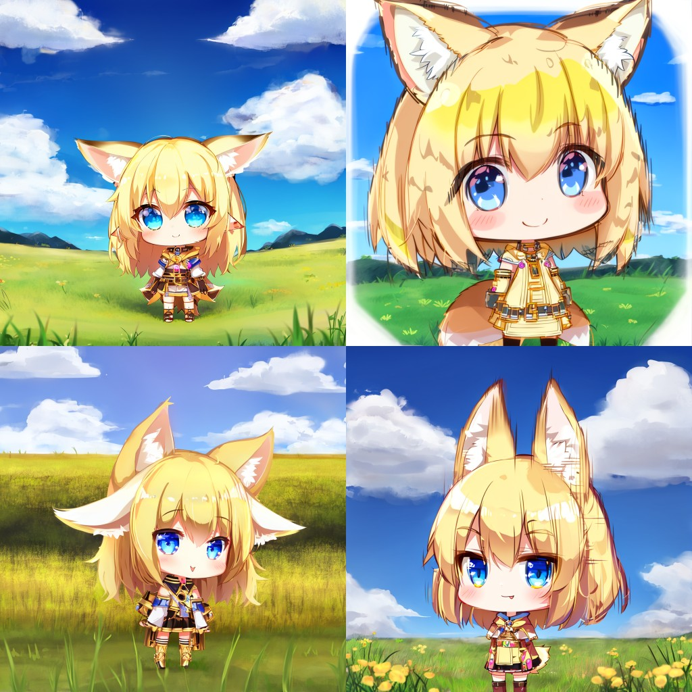
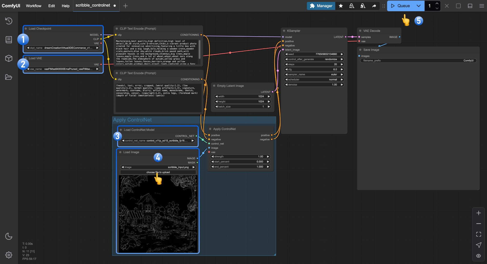
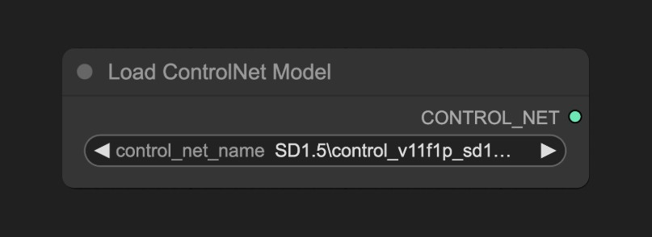
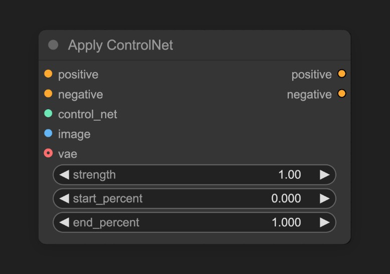
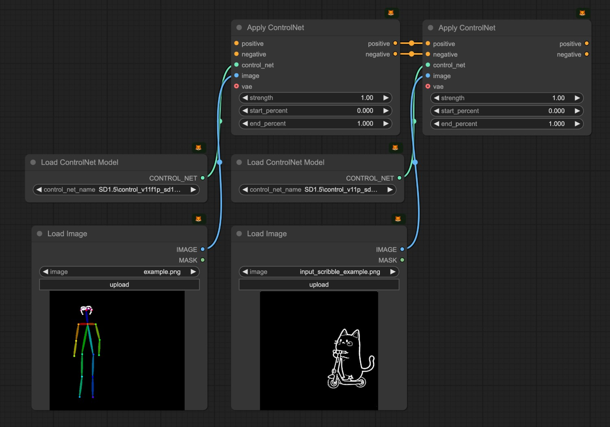
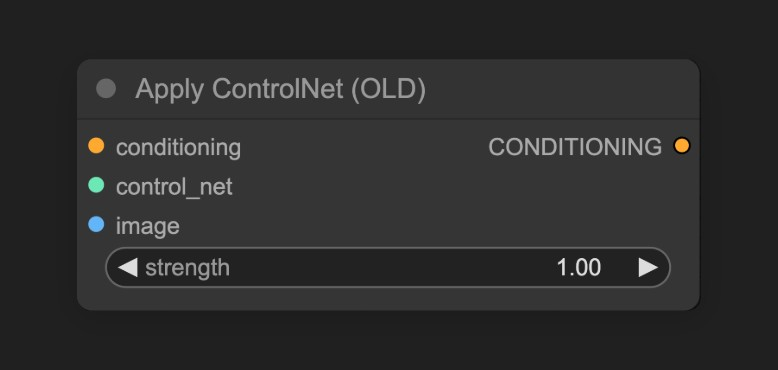

Добиться точного контроля над созданием изображений при генерации с помощью ИИ невозможно одним кликом.
Обычно требуется множество попыток генерации, чтобы получить удовлетворительное изображение. Однако появление **ControlNet** эффективно решило эту проблему.

ControlNet представляет собой модель условной управляемой генерации на основе диффузионных моделей (таких как Stable Diffusion), 
впервые предложенную [Lvmin Zhang](https://github.com/lllyasviel), Maneesh Agrawala и др. в 2023 году в статье [Adding Conditional Control to Text-to-Image Diffusion Models](https://arxiv.org/abs/2302.05543).

Модели ControlNet значительно повышают управляемость генерации изображений и способность воспроизводить детали, вводя мультимодальные входные условия,
такие как карты детекции краёв, карты глубины и ключевые точки позы.

Эти условия-ограничения делают генерацию изображений более управляемой, позволяя одновременно использовать несколько моделей ControlNet в процессе генерации для получения лучших результатов.

До появления ControlNet нам оставалось лишь полагаться на модель, которая будет генерировать изображения снова и снова, пока результат нас не устроит, а это вносило большую долю случайности.



С появлением ControlNet мы можем управлять генерацией изображений, добавляя дополнительные условия. 
Например, можно использовать простой эскиз, чтобы направлять процесс генерации изображения и получать изображения, точно соответствующие эскизу.


В этом примере мы покажем, как установить и использовать модели ControlNet в [ComfyUI](https://github.com/Comfy-Org/ComfyUI), и выполним пример генерации изображения по эскизу.


<Tip>
Рабочие процессы для других типов моделей ControlNet V1.1 аналогичны этому примеру. Вам нужно только выбрать подходящую модель и загрузить соответствующее референсное изображение в зависимости от ваших задач.
</Tip>

## Информация о предобработке изображений для ControlNet

Разные типы моделей ControlNet обычно требуют разные типы референсных изображений:


> Источник изображения: [ComfyUI ControlNet aux](https://github.com/Fannovel16/comfyui_controlnet_aux)

Поскольку текущие узлы **Comfy Core** не включают все типы **предобработчиков**, в примерах из этой документации мы будем использовать уже предобработанные изображения.
Однако на практике вам может потребоваться использовать пользовательские узлы для предобработки изображений, чтобы они соответствовали требованиям разных моделей ControlNet. Ниже приведены некоторые подходящие пользовательские узлы:

- [ComfyUI-Advanced-ControlNet](https://github.com/Kosinkadink/ComfyUI-Advanced-ControlNet)
- [ComfyUI ControlNet aux](https://github.com/Fannovel16/comfyui_controlnet_aux)

## Пример рабочего процесса ControlNet в ComfyUI

### 1. Ассеты рабочего процесса ControlNet

Скачайте изображение рабочего процесса ниже и перетащите его в ComfyUI, чтобы загрузить рабочий процесс:


<Tip>
Изображения, содержащие JSON рабочего процесса в метаданных, можно напрямую перетаскивать в ComfyUI или загружать через меню `Workflows` -> `Open (ctrl+o)`.
В этом изображении уже есть ссылки на скачивание соответствующих моделей, и при перетаскивании в ComfyUI автоматически появится запрос на скачивание.
</Tip>

Скачайте изображение ниже, которое мы будем использовать как вход:


### 2. Ручная установка моделей

<Note>
Если ваша сеть не позволяет успешно завершить автоматическое скачивание соответствующих моделей, попробуйте скачать модели ниже вручную и разместить их в указанных каталогах:
</Note>

- [dreamCreationVirtual3DECommerce_v10.safetensors](https://civitai.com/api/download/models/731340?type=Model&format=SafeTensor&size=full&fp=fp16)
- [vae-ft-mse-840000-ema-pruned.safetensors](https://huggingface.co/stabilityai/sd-vae-ft-mse-original/blob/main/vae-ft-mse-840000-ema-pruned.safetensors?download=true)
- [control_v11p_sd15_scribble_fp16.safetensors](https://huggingface.co/comfyanonymous/ControlNet-v1-1_fp16_safetensors/blob/main/control_v11p_sd15_scribble_fp16.safetensors?download=true)

```
ComfyUI/
├── models/
│   ├── checkpoints/
│   │   └── dreamCreationVirtual3DECommerce_v10.safetensors
│   ├── vae/
│   │   └── vae-ft-mse-840000-ema-pruned.safetensors
│   └── controlnet/
│       └── control_v11p_sd15_scribble_fp16.safetensors
```

<Note>
В этом примере можно также использовать VAE-модель, встроенную в dreamCreationVirtual3DECommerce_v10.safetensors, но мы следуем рекомендации автора модели использовать отдельную VAE-модель.
</Note>

### 3. Пошаговое выполнение рабочего процесса



1. Убедитесь, что `Load Checkpoint` может загрузить **dreamCreationVirtual3DECommerce_v10.safetensors**
2. Убедитесь, что `Load VAE` может загрузить **vae-ft-mse-840000-ema-pruned.safetensors**
3. Нажмите `Upload` в узле `Load Image`, чтобы загрузить входное изображение, приведённое ранее
4. Убедитесь, что `Load ControlNet` может загрузить **control_v11p_sd15_scribble_fp16.safetensors**
5. Нажмите кнопку `Queue` или используйте сочетание клавиш `Ctrl(cmd) + Enter`, чтобы выполнить генерацию изображения

## Пояснения к связанным узлам
### Пояснение к узлу Load ControlNet



Модели, расположенные в `ComfyUI\models\controlnet`, обнаруживаются ComfyUI и могут быть загружены через этот узел.

### Пояснение к узлу Apply ControlNet



Этот узел принимает модель ControlNet, загруженную узлом `load controlnet`, и формирует соответствующие условия управления на основе входного изображения.

**Типы входов**

| Название параметра | Функция                                                                                                                                                            |
|-----------------|--------------------------------------------------------------------------------------------------------------------------------------------------------------------|
| `positive`      | Положительное условие                                                                                                                                              |
| `negative`      | Отрицательное условие                                                                                                                                              |
| `control_net`   | Применяемая модель ControlNet                                                                                                                                    |
| `image`         | Предварительно обработанное изображение, используемое как опорное при применении ControlNet                                                                        |
| `vae`           | Вход модели VAE                                                                                                                                                    |
| `strength`      | Сила применения ControlNet; более высокие значения усиливают влияние ControlNet на сгенерированное изображение                                                     |
| `start_percent` | Определяет, когда начинать применение ControlNet, в процентах; например, 0.2 означает, что управление ControlNet начинается после завершения 20% diffusion        |
| `end_percent`   | Определяет, когда прекращать применение ControlNet, в процентах; например, 0.8 означает, что управление ControlNet прекращается после завершения 80% diffusion     |

**Типы выходов**

| Название параметра | Функция                                                   |
|----------------|------------------------------------------------------------|
| `positive`     | Данные положительного условия, обработанные ControlNet     |
| `negative`     | Данные отрицательного условия, обработанные ControlNet     |

Вы можете применять несколько моделей ControlNet, соединяя узлы в цепочку, как показано на изображении ниже. Также можно обратиться к руководству [Mixing ControlNet Models](/ru/tutorials/controlnet/mixing-controlnets), чтобы узнать больше о совместном использовании нескольких моделей ControlNet.


<Note>
В некоторых ранних рабочих процессах можно встретить узел `Apply ControlNet(Old)`: это ранняя версия узла ControlNet. Сейчас он устарел и по умолчанию не отображается в поиске и списках узлов.

Чтобы включить его, перейдите в **Settings** --> **comfy** --> **Node** и включите параметр `Show deprecated nodes in search`. Однако рекомендуется использовать новый узел.
</Note>

## Начать изучение

1. Попробуйте создавать похожие наброски или даже рисовать свои собственные и использовать модели ControlNet для генерации изображений, чтобы оценить преимущества ControlNet.
2. Настройте параметр `Control Strength` в узле Apply ControlNet, чтобы управлять влиянием модели ControlNet на сгенерированное изображение.
3. Перейдите в репозиторий [ControlNet-v1-1_fp16_safetensors](https://huggingface.co/comfyanonymous/ControlNet-v1-1_fp16_safetensors/tree/main), чтобы скачать другие типы моделей ControlNet и попробовать использовать их для генерации изображений.
