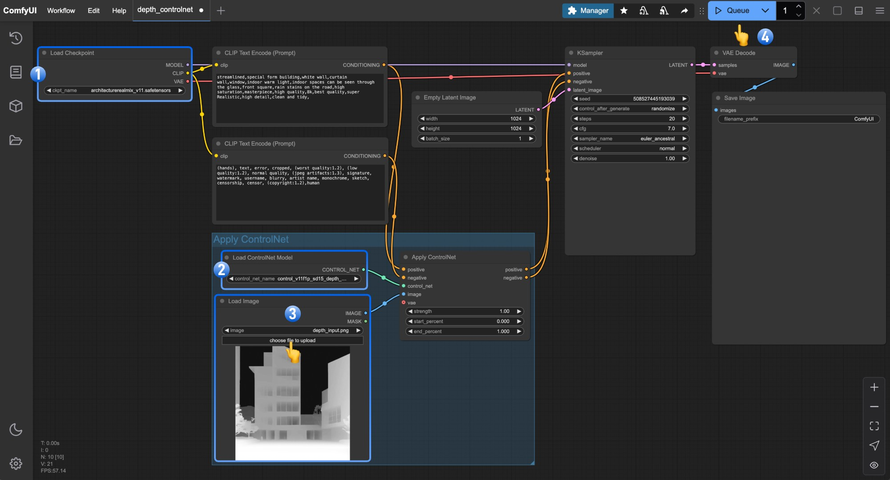

## Введение в карты глубины и Depth ControlNet

Карта глубины представляет собой особый тип изображения, в котором значения в оттенках серого обозначают расстояние между объектами сцены и наблюдателем или камерой. В карте глубины значение яркости обратно пропорционально расстоянию: более светлые области (ближе к белому) указывают на более близкие объекты, а более тёмные (ближе к чёрному) указывают на более удалённые.


Depth ControlNet представляет собой модель ControlNet, специально обученную понимать и использовать информацию карт глубины. Она помогает ИИ правильно интерпретировать пространственные отношения, благодаря чему сгенерированные изображения соответствуют пространственной структуре, заданной картой глубины, что позволяет точно управлять трёхмерной пространственной компоновкой.

### Сценарии применения карт глубины с ControlNet

Карты глубины находят множество применений в различных сценариях:

1. **Портретные сцены**: контролируйте пространственное соотношение между объектами и фоном, избегая искажений в таких важных областях, как лица.
2. **Пейзажные сцены**: контролируйте соотношение переднего, среднего и заднего планов.
3. **Архитектурные сцены**: контролируйте пространственную структуру и перспективу зданий.
4. **Презентация продукта**: контролируйте, как продукт отделён от фона и расположен в пространстве.

В этом примере мы будем использовать карту глубины для создания сцены архитектурной визуализации.

## Пример рабочего процесса ControlNet в ComfyUI

### 1. Ассеты рабочего процесса ControlNet

Скачайте изображение рабочего процесса ниже и перетащите его в ComfyUI, чтобы загрузить рабочий процесс:


<Tip>
Изображения, содержащие в метаданных JSON рабочего процесса, можно напрямую перетаскивать в ComfyUI или загружать через меню `Workflows` -> `Open (ctrl+o)`.
В это изображение уже включены ссылки для скачивания соответствующих моделей, и при перетаскивании в ComfyUI автоматически появится запрос на скачивание.
</Tip>

Скачайте изображение ниже, которое мы будем использовать в качестве входа:


### 2. Установка моделей

<Note>
Если ваша сеть не позволяет успешно завершить автоматическую загрузку соответствующих моделей, попробуйте скачать модели ниже вручную и поместить их в указанные каталоги:
</Note>

- [architecturerealmix_v11.safetensors](https://civitai.com/api/download/models/431755?type=Model&format=SafeTensor&size=full&fp=fp16)
- [control_v11f1p_sd15_depth_fp16.safetensors](https://huggingface.co/comfyanonymous/ControlNet-v1-1_fp16_safetensors/blob/main/control_v11f1p_sd15_depth_fp16.safetensors?download=true)

```
ComfyUI/
├── models/
│   ├── checkpoints/
│   │   └── architecturerealmix_v11.safetensors
│   └── controlnet/
│       └── control_v11f1p_sd15_depth_fp16.safetensors
```

### 3. Пошаговое выполнение рабочего процесса



1. Убедитесь, что `Load Checkpoint` может загрузить **architecturerealmix_v11.safetensors**
2. Убедитесь, что `Load ControlNet` может загрузить **control_v11f1p_sd15_depth_fp16.safetensors**
3. Нажмите `Upload` в узле `Load Image`, чтобы загрузить изображение глубины, предоставленное ранее
4. Нажмите кнопку `Queue` или используйте сочетание клавиш `Ctrl(cmd) + Enter`, чтобы выполнить генерацию изображения

## Объединение Depth Control с другими техниками

В зависимости от творческих потребностей вы можете объединять Depth ControlNet с другими типами ControlNet для получения лучших результатов:

1. **Глубина + линейный арт**: сохранение пространственных соотношений с усилением контуров; подходит для архитектуры, продуктов и дизайна персонажей.
2. **Глубина + поза**: управление позой персонажа при сохранении правильных пространственных соотношений; подходит для сцен с персонажами.

Подробнее о совместном использовании нескольких моделей ControlNet см. в примере [Смешивание ControlNet](/ru/tutorials/controlnet/mixing-controlnets).
