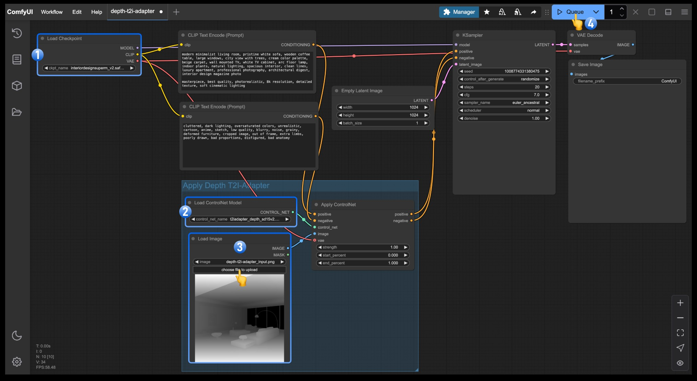

## Введение в T2I Adapter

[T2I-Adapter](https://huggingface.co/TencentARC/T2I-Adapter) представляет собой лёгкий адаптер, разработанный [Tencent ARC Lab](https://github.com/TencentARC) и предназначенный для расширения возможностей структурного, цветового и стилевого управления моделями генерации текста в изображение (такими как Stable Diffusion).
Он работает за счёт согласования внешних условий (например, карт детекции краёв, карт глубины, скетчей или эталонных цветовых изображений) с внутренними признаками модели, обеспечивая высокоточное управление без изменения исходной структуры модели. При всего около 77M параметров (размер примерно 300 МБ) скорость вывода у него примерно в 3 раза выше, чем у [ControlNet](https://github.com/lllyasviel/ControlNet-v1-1-nightly), и он поддерживает комбинирование нескольких условий (например, скетч + цветовая сетка). Сценарии применения включают преобразование линейного рисунка в изображение, перенос цветового стиля, генерацию сцен с множеством элементов и многое другое.

### Сравнение T2I Adapter и ControlNet

Хотя их функции схожи, в реализации и применении есть заметные различия:

1. **Лёгкая конструкция**: у T2I Adapter меньше параметров и меньший объём занимаемой памяти
2. **Скорость вывода**: T2I Adapter обычно примерно в 3 раза быстрее ControlNet
3. **Точность управления**: ControlNet обеспечивает более точное управление в некоторых сценариях, а T2I Adapter лучше подходит для лёгкого управления
4. **Комбинирование нескольких условий**: T2I Adapter показывает более значительное преимущество по ресурсам при объединении нескольких условий

### Основные типы T2I Adapter

T2I Adapter выпускается в нескольких типах, каждый из которых управляет своим аспектом:

- **Глубина**: управляет пространственной структурой и отношениями глубины в изображениях
- **Линейный рисунок (Canny/Sketch)**: управляет краями и линиями изображения
- **Keypose**: управляет позами и действиями персонажей
- **Сегментация (Seg)**: управляет компоновкой сцены через семантическую сегментацию
- **Цвет**: управляет общей цветовой схемой изображений

В ComfyUI использование T2I Adapter по интерфейсу и рабочему процессу похоже на [ControlNet](/ru/tutorials/controlnet/controlnet). В этом примере мы покажем, как использовать T2I Adapter типа Depth для управления интерьерной сценой.


## Ценность применения Depth T2I Adapter

Карты глубины находят несколько важных применений при генерации изображений:

1. **Контроль пространственной компоновки**: точно описывает трёхмерные пространственные структуры, подходит для дизайна интерьеров и архитектурной визуализации
2. **Позиционирование объектов**: управляет относительным положением и размером объектов в сцене, подходит для презентации продуктов и построения сцен
3. **Перспективные соотношения**: сохраняет корректную перспективу и пропорции, подходит для генерации пейзажей и городских сцен
4. **Распределение света и тени**: естественное распределение света и тени на основе информации о глубине, повышающее реалистичность

В качестве примера рассмотрим дизайн интерьеров и покажем, как использовать Depth T2I Adapter, но эти приёмы применимы и к другим сценариям.

## Пример рабочего процесса ComfyUI Depth T2I Adapter: объяснение

### 1. Ассеты рабочего процесса Depth T2I Adapter

Скачайте приведённое ниже изображение рабочего процесса и перетащите его в ComfyUI, чтобы загрузить рабочий процесс:


<Tip>
Изображения с JSON рабочего процесса в метаданных можно напрямую перетащить в ComfyUI или загрузить через меню `Workflows` -> `Open (ctrl+o)`.
Это изображение уже содержит ссылки для скачивания соответствующих моделей, и при перетаскивании в ComfyUI автоматически появится запрос на скачивание.
</Tip>

Скачайте приведённое ниже изображение, оно будет использовано как вход:


### 2. Установка моделей

<Note>
Если ваша сеть не позволяет успешно выполнить автоматическую загрузку соответствующих моделей, попробуйте скачать модели ниже вручную и поместить их в указанные каталоги:
</Note>

- [interiordesignsuperm_v2.safetensors](https://civitai.com/api/download/models/93152?type=Model&format=SafeTensor&size=full&fp=fp16)
- [t2iadapter_depth_sd15v2.pth](https://huggingface.co/TencentARC/T2I-Adapter/blob/main/models/t2iadapter_depth_sd15v2.pth?download=true)

```
ComfyUI/
├── models/
│   ├── checkpoints/
│   │   └── interiordesignsuperm_v2.safetensors
│   └── controlnet/
│       └── t2iadapter_depth_sd15v2.pth
```

### 3. Пошаговое выполнение рабочего процесса



1. Убедитесь, что `Load Checkpoint` может загрузить **interiordesignsuperm_v2.safetensors**
2. Убедитесь, что `Load ControlNet` может загрузить **t2iadapter_depth_sd15v2.pth**
3. Нажмите `Upload` в узле `Load Image`, чтобы загрузить входное изображение, приведённое ранее
4. Нажмите кнопку `Queue` или используйте сочетание клавиш `Ctrl(cmd) + Enter`, чтобы выполнить генерацию изображения

## Общие советы по использованию T2I Adapter

### Оптимизация качества входных изображений

Независимо от сценария применения, качественные входные изображения — залог успешного использования T2I Adapter:

1. **Умеренный контраст**: Управляющие изображения (например, карты глубины, линейный рисунок) должны иметь четкий контраст, но не быть чрезмерно экстремальными.
2. **Четкие границы**: Убедитесь, что основные структуры и границы элементов четко различимы на управляющем изображении.
3. **Контроль шума**: Старайтесь избегать чрезмерного шума на управляющих изображениях, особенно на картах глубины и линейном рисунке.
4. **Разумная компоновка**: Управляющие изображения должны иметь разумную пространственную компоновку и распределение элементов.

## Особенности использования T2I Adapter

Одно из главных преимуществ T2I Adapter заключается в возможности легко объединять несколько условий для сложных эффектов управления:

1. **Глубина + Рёбра**: управление пространственным расположением при сохранении чётких структурных рёбер; подходит для архитектуры и дизайна интерьеров
2. **Линейный рисунок + Цвет**: управление формами с указанием цветовых схем; подходит для дизайна персонажей и иллюстраций
3. **Поза + Сегментация**: управление действиями персонажа с определением областей сцены; подходит для сложных сюжетных сцен

Смешивание разных T2I Adapter или их объединение с другими методами управления (например, ControlNet, региональные промпты и т. д.) может дополнительно расширить творческие возможности. Чтобы добиться смешивания, просто соедините несколько узлов `Apply ControlNet` в цепочку так же, как описано в разделе [Смешивание ControlNet](/ru/tutorials/controlnet/mixing-controlnets).
