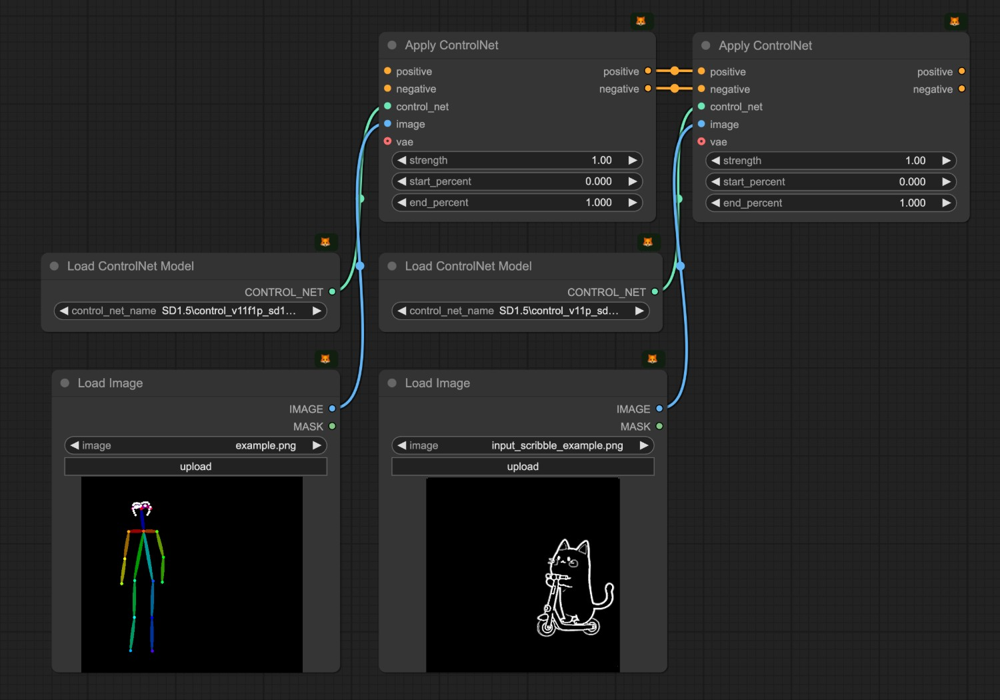
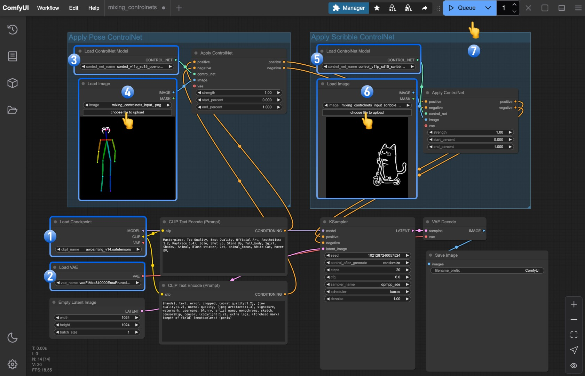

В генерации изображений с помощью ИИ одного условия управления часто недостаточно для сложных сцен. Смешивание нескольких ControlNet позволяет одновременно управлять разными областями или аспектами изображения, обеспечивая более точный контроль над генерацией.

В некоторых сценариях смешивание ControlNet позволяет использовать особенности разных условий управления для более тонкого условного управления:
1. **Сложность сцены**: сложные сцены требуют совместной работы нескольких условий управления
2. **Детальный контроль**: настраивая параметр силы каждого ControlNet, можно точно управлять степенью влияния каждой части
3. **Взаимодополняющий эффект**: разные типы ControlNet могут дополнять друг друга, компенсируя ограничения одиночного управления
4. **Творческое выражение**: сочетание разных управлений позволяет создавать уникальные творческие эффекты

### Как смешивать ControlNet

При смешивании нескольких ControlNet каждый ControlNet влияет на процесс генерации изображения в соответствии с областью применения. ComfyUI позволяет применять несколько условий ControlNet последовательно, послойно, через цепочки подключений в узле `Apply ControlNet`:



## Пример смешивания ControlNet с региональным разделением в ComfyUI

В этом примере мы используем комбинацию **Pose ControlNet** и **Scribble ControlNet**, чтобы сгенерировать сцену с несколькими элементами: персонаж слева управляется Pose ControlNet, а кот на скутере справа управляется Scribble ControlNet.

### 1. Ассеты рабочего процесса смешивания ControlNet

Скачайте изображение рабочего процесса ниже и перетащите его в ComfyUI, чтобы загрузить рабочий процесс:


<Tip>
Это изображение рабочего процесса содержит метаданные, и его можно напрямую перетащить в ComfyUI или загрузить через меню `Workflows` -> `Open (ctrl+o)`. Система автоматически обнаружит и предложит скачать необходимые модели.
</Tip>

Входное изображение позы (управляет позой персонажа слева):


Входное изображение скетча (управляет котом и скутером справа):


### 2. Ручная установка моделей

<Note>
Если ваша сеть не может успешно выполнить автоматическую загрузку соответствующих моделей, попробуйте вручную скачать модели ниже и поместить их в указанные каталоги:
</Note>

- [awpainting_v14.safetensors](https://civitai.com/api/download/models/624939?type=Model&format=SafeTensor&size=full&fp=fp16)
- [control_v11p_sd15_scribble_fp16.safetensors](https://huggingface.co/comfyanonymous/ControlNet-v1-1_fp16_safetensors/blob/main/control_v11p_sd15_scribble_fp16.safetensors?download=true)
- [control_v11p_sd15_openpose_fp16.safetensors](https://huggingface.co/comfyanonymous/ControlNet-v1-1_fp16_safetensors/blob/main/control_v11p_sd15_openpose_fp16.safetensors?download=true)
- [vae-ft-mse-840000-ema-pruned.safetensors](https://huggingface.co/stabilityai/sd-vae-ft-mse-original/blob/main/vae-ft-mse-840000-ema-pruned.safetensors?download=true)

```
ComfyUI/
├── models/
│   ├── checkpoints/
│   │   └── awpainting_v14.safetensors
│   ├── controlnet/
│   │   └── control_v11p_sd15_scribble_fp16.safetensors
│   │   └── control_v11p_sd15_openpose_fp16.safetensors
│   ├── vae/
│   │   └── vae-ft-mse-840000-ema-pruned.safetensors
```

### 3. Пошаговое выполнение рабочего процесса



Выполните следующие шаги в соответствии с пронумерованными метками на изображении:

1. Убедитесь, что `Load Checkpoint` может загрузить **awpainting_v14.safetensors**
2. Убедитесь, что `Load VAE` может загрузить **vae-ft-mse-840000-ema-pruned.safetensors**

Первая группа ControlNet с использованием модели Openpose:
3. Убедитесь, что `Load ControlNet Model` загружает **control_v11p_sd15_openpose_fp16.safetensors**
4. Нажмите `Upload` в узле `Load Image`, чтобы загрузить изображение позы, предоставленное ранее

Вторая группа ControlNet с использованием модели Scribble:
5. Убедитесь, что `Load ControlNet Model` загружает **control_v11p_sd15_scribble_fp16.safetensors**
6. Нажмите `Upload` в узле `Load Image`, чтобы загрузить изображение скетча, предоставленное ранее
7. Нажмите кнопку `Queue` или используйте сочетание клавиш `Ctrl(cmd) + Enter`, чтобы выполнить генерацию изображения

## Объяснение рабочего процесса

#### Баланс силы

При управлении разными областями изображения особенно важно сбалансировать параметры силы:
- Если сила ControlNet для одной области значительно выше, чем для другой, эффект управления в этой области может перевесить и подавить другую область.
- Рекомендуется задавать похожие значения силы для ControlNet, управляющих разными областями, например 1.0 для обеих.

#### Приёмы составления промпта

При смешивании с разделением на области промпт должен содержать описания обеих областей:

```
"A woman in red dress, a cat riding a scooter, detailed background, high quality"
```

Такой промпт охватывает и персонажа, и кота на скутере, поэтому модель уделяет внимание обеим областям управления.

## Многомерное управление одним объектом

Помимо смешивания с разделением на области, показанного в этом примере, есть и другой распространённый подход: применять многомерное управление к одному и тому же объекту. Например:

- **Pose + Depth**: управление позой персонажа и пространственным восприятием
- **Pose + Canny**: управление позой персонажа и деталями краёв
- **Pose + Reference**: управление позой персонажа с опорой на определённый стиль

В таких сценариях референсные изображения для нескольких ControlNet должны быть согласованы с одним и тем же объектом, а их силы нужно настроить так, чтобы обеспечить правильный баланс.

Комбинируя разные типы ControlNet и задавая области их воздействия, вы можете точно управлять элементами изображения.
