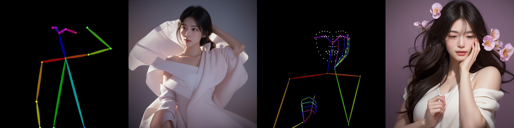
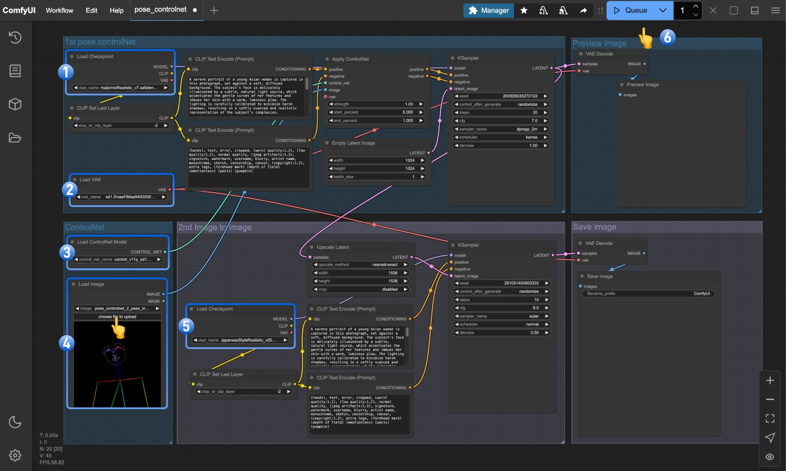

## Введение в OpenPose

[OpenPose](https://github.com/CMU-Perceptual-Computing-Lab/openpose) представляет собой систему оценки позы нескольких людей в реальном времени с открытым исходным кодом, разработанную Carnegie Mellon University (CMU). Это значительный прорыв в области компьютерного зрения. Система может одновременно обнаруживать несколько людей на изображении, фиксируя:

- **Скелет тела**: 18 ключевых точек, включая голову, плечи, локти, запястья, бёдра, колени и лодыжки
- **Выражения лица**: 70 ключевых точек лица для фиксации микровыражений и контуров лица
- **Детали кистей**: 21 ключевая точка кисти для точной передачи положения пальцев и жестов
- **Положение стоп**: 6 ключевых точек стопы, фиксирующих стоячие позы и детали движения



В генерации изображений с помощью ИИ карты структуры скелета, созданные OpenPose, служат условными входами для ControlNet, что позволяет точно управлять позой, действиями и выражениями сгенерированных персонажей. Это даёт возможность создавать реалистичные человеческие фигуры с ожидаемыми позами и действиями, значительно повышая управляемость и практическую ценность содержимого, сгенерированного ИИ.
Особенно для ранних моделей серии Stable Diffusion 1.5 карты скелета, созданные OpenPose, могут эффективно предотвращать проблемы с искажёнными действиями, конечностями и выражениями персонажей.

## Пример использования 2-проходного Pose ControlNet в ComfyUI

### 1. Ассеты рабочего процесса Pose ControlNet

Скачайте изображение рабочего процесса ниже и перетащите его в ComfyUI, чтобы загрузить рабочий процесс:


<Tip>
Изображения с JSON рабочего процесса в метаданных можно напрямую перетаскивать в ComfyUI или загружать через меню `Workflows` -> `Open (ctrl+o)`.
Это изображение уже содержит ссылки для скачивания соответствующих моделей, и при перетаскивании в ComfyUI автоматически появится запрос на загрузку.
</Tip>

Скачайте изображение ниже, которое мы будем использовать как вход:


### 2. Ручная установка моделей

<Note>
Если ваша сеть не может успешно выполнить автоматическую загрузку соответствующих моделей, попробуйте скачать модели ниже вручную и поместить их в указанные каталоги:
</Note>

- [control_v11p_sd15_openpose_fp16.safetensors](https://huggingface.co/comfyanonymous/ControlNet-v1-1_fp16_safetensors/blob/main/control_v11p_sd15_openpose_fp16.safetensors?download=true)
- [majicmixRealistic_v7.safetensors](https://civitai.com/api/download/models/176425?type=Model&format=SafeTensor&size=pruned&fp=fp16)
- [japaneseStyleRealistic_v20.safetensors](https://civitai.com/api/download/models/85426?type=Model&format=SafeTensor&size=pruned&fp=fp16)
- [vae-ft-mse-840000-ema-pruned.safetensors](https://huggingface.co/stabilityai/sd-vae-ft-mse-original/blob/main/vae-ft-mse-840000-ema-pruned.safetensors?download=true)

```
ComfyUI/
├── models/
│   ├── checkpoints/
│   │   └── majicmixRealistic_v7.safetensors
│   │   └── japaneseStyleRealistic_v20.safetensors
│   ├── vae/
│   │   └── vae-ft-mse-840000-ema-pruned.safetensors
│   └── controlnet/
│       └── control_v11p_sd15_openpose_fp16.safetensors
```

### 3. Пошаговое выполнение рабочего процесса



Выполните следующие шаги в соответствии с пронумерованными метками на изображении:

1. Убедитесь, что `Load Checkpoint` может загрузить **majicmixRealistic_v7.safetensors**
2. Убедитесь, что `Load VAE` может загрузить **vae-ft-mse-840000-ema-pruned.safetensors**
3. Убедитесь, что `Load ControlNet Model` может загрузить **control_v11p_sd15_openpose_fp16.safetensors**
4. Нажмите кнопку выбора в узле `Load Image`, чтобы загрузить предоставленное ранее входное изображение позы, или используйте собственную карту скелета OpenPose
5. Убедитесь, что `Load Checkpoint` может загрузить **japaneseStyleRealistic_v20.safetensors**
6. Нажмите кнопку `Queue` или используйте сочетание клавиш `Ctrl(cmd) + Enter`, чтобы выполнить генерацию изображения

## Описание рабочего процесса Pose ControlNet с двумя проходами

В этом рабочем процессе используется подход с двумя проходами: создание изображения делится на два этапа.

### Первый этап: создание базового изображения позы

На первом этапе модель **majicmixRealistic_v7** используется вместе с Pose ControlNet для создания начального изображения позы персонажа:

1. Сначала загрузите модель majicmixRealistic_v7 через узел `Load Checkpoint`
2. Загрузите модель управления позой через узел `Load ControlNet Model`
3. Входное изображение позы подаётся в узел `Apply ControlNet` и объединяется с условиями положительного и отрицательного промптов
4. Первый узел `KSampler` (обычно с 20-30 шагами) создаёт базовое изображение позы персонажа
5. Пиксельное изображение для первого этапа получается с помощью `VAE Decode`

На этом этапе основное внимание уделяется правильной осанке, позе и базовой структуре персонажа, чтобы сгенерированный персонаж соответствовал входной скелетной позе.

### Второй этап: оптимизация стиля и повышение детализации

На втором этапе изображение, полученное на первом этапе, используется в качестве основы, а модель **japaneseStyleRealistic_v20** выполняет стилизацию и повышение детализации:

1. Изображение, сгенерированное на первом этапе, формирует латент большего разрешения через узел `Upscale latent`
2. Второй узел `Load Checkpoint` загружает модель japaneseStyleRealistic_v20, которая ориентирована на детали и стиль
3. Второй узел `KSampler` использует меньшую силу `denoise` (обычно 0.4-0.6) для уточнения, сохраняя базовую структуру с первого этапа
4. Наконец, через второй `VAE Decode` и узел `Save Image` выводится изображение более высокого качества и большего разрешения

На этом этапе основное внимание уделяется согласованности стиля, насыщенности деталями и повышению общего качества изображения.

## Преимущества двухпроходной генерации изображений

По сравнению с однопроходной генерацией метод двухпроходной генерации изображений дает следующие преимущества:

1. **Более высокое разрешение**: двухпроходная обработка позволяет генерировать изображения высокого разрешения, недостижимые при однопроходной генерации
2. **Смешивание стилей**: позволяет объединить преимущества разных моделей, например использовать реалистичную модель на первом этапе и стилизованную модель на втором
3. **Лучшая проработка деталей**: на втором этапе можно сосредоточиться на оптимизации деталей, не беспокоясь об общей структуре
4. **Точный контроль**: после завершения управления позой на первом этапе второй этап может сосредоточиться на доработке стиля и деталей
5. **Сниженная нагрузка на GPU**: генерация в два прохода позволяет получать крупные изображения высокого качества при ограниченных ресурсах GPU

<Tip>
Чтобы узнать больше о методах смешивания нескольких ControlNet, обратитесь к учебнику [Смешивание моделей ControlNet](/ru/tutorials/controlnet/mixing-controlnets).
</Tip>
