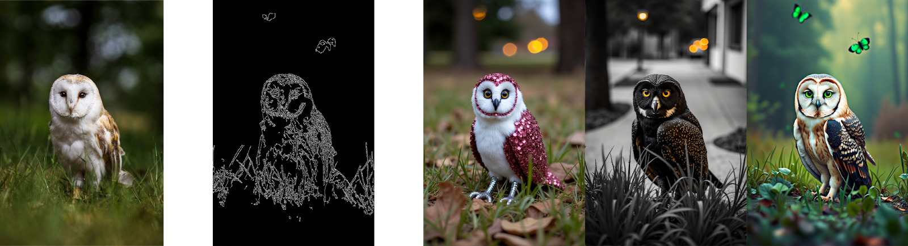
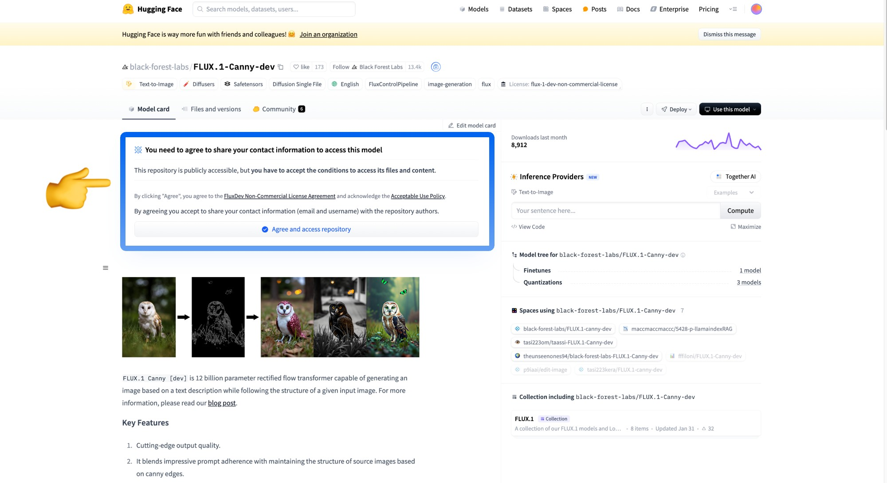
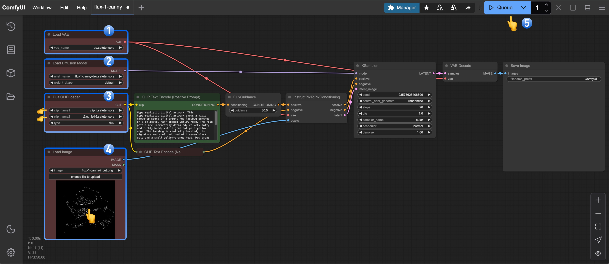
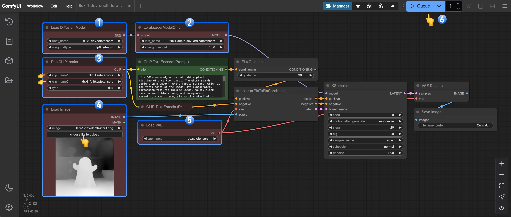

## Введение в модели ControlNet для FLUX.1

FLUX.1 Canny и FLUX.1 Depth: две мощные модели из набора [FLUX.1 Tools](https://blackforestlabs.ai/flux-1-tools/), выпущенного [Black Forest Labs](https://blackforestlabs.ai/). Этот набор инструментов добавляет FLUX.1 возможности управления и направления, позволяя пользователям изменять и пересоздавать реальные или сгенерированные изображения.

**FLUX.1-Depth-dev** и **FLUX.1-Canny-dev**: обе модели представляют собой Rectified Flow Transformer с 12B параметров, которые генерируют изображения по текстовому описанию, сохраняя структурные особенности входного изображения.
Версия Depth сохраняет пространственную структуру исходного изображения с помощью методов извлечения карты глубины, а версия Canny использует методы детекции краёв, чтобы сохранить структурные особенности исходного изображения. Пользователи могут выбрать подходящий метод управления под свои задачи.

Обе модели обладают следующими особенностями:
- Высочайшее качество результата и передача деталей
- Отличное следование промпту при сохранении согласованности с оригинальным изображением
- Обучены с использованием методов направленной дистилляции для повышения эффективности
- Открытые веса для сообщества исследователей
- API-интерфейсы (версия pro) и открытые веса (версия dev)

Кроме того, Black Forest Labs предоставляет версии-адаптеры **FLUX.1-Depth-dev-lora** и **FLUX.1-Canny-dev-lora**, извлечённые из полных моделей.
Их можно применить к базовой модели FLUX.1 [dev], чтобы получить похожий функционал при меньшем размере файла, что особенно удобно в условиях ограниченных ресурсов.

Для примеров рабочих процессов мы используем полную версию **FLUX.1-Canny-dev** и **FLUX.1-Depth-dev-lora**.

<Tip>
Метаданные всех изображений рабочих процессов содержат информацию для скачивания соответствующих моделей. Загрузить рабочие процессы можно так:
- Перетащите их прямо в ComfyUI
- Или через меню `Workflows` -> `Open（ctrl+o）`

Если вы не используете десктопную версию или некоторые модели не скачиваются автоматически, обратитесь к разделам о ручной установке, чтобы сохранить файлы моделей в соответствующую папку.

Для предобработчиков изображений можно использовать следующие пользовательские узлы, чтобы выполнить предобработку изображения. В этом примере мы подадим на вход уже обработанные изображения.
- [ComfyUI-Advanced-ControlNet](https://github.com/Kosinkadink/ComfyUI-Advanced-ControlNet)
- [ComfyUI ControlNet aux](https://github.com/Fannovel16/comfyui_controlnet_aux)
</Tip>

## Полная версия рабочего процесса FLUX.1-Canny-dev

### Модель Flux.1 Canny {#flux_canny_model_example}

Генерируйте изображения по результатам детекции границ с помощью Flux.1 Canny.


<CardGroup cols={2}>
  <Card title="Запустить в Comfy Cloud" icon="cloud" href="https://cloud.comfy.org/?template=flux_canny_model_example&utm_source=docs&utm_medium=referral&utm_campaign=flux-1-controlnet">
    Открыть в Comfy Cloud
  </Card>
  <Card title="Скачать рабочий процесс" icon="download" href="https://github.com/Comfy-Org/workflow_templates/blob/main/templates/flux_canny_model_example.json">
    Скачайте JSON или найдите &quot;Flux.1 Canny&quot; в библиотеке шаблонов
  </Card>
</CardGroup>

**Входные материалы**

Загрузите этот файл в соответствующий узел `LoadImage`:

<CardGroup cols={2}>
  <Card title="flux_canny_model_example_input_image.png" icon="image" href="https://raw.githubusercontent.com/Comfy-Org/workflow_templates/main/input/flux_canny_model_example_input_image.png">
    Узел `LoadImage` 17 · `flux_canny_model_example_input_image.png`
  </Card>
</CardGroup>

<div style={{display: 'grid', gridTemplateColumns: 'repeat(2, minmax(0, 1fr))', gap: '1rem', alignItems: 'start'}}>
  
</div>

### 1. Рабочий процесс и ресурсы

### 2. Ручная установка моделей

<Note>
Если вы ранее использовали [полную версию рабочих процессов, связанных с Flux](/ru/tutorials/flux/flux-1-text-to-image), вам достаточно скачать только файл модели **flux1-canny-dev.safetensors**.
Поскольку сначала необходимо принять условия [black-forest-labs/FLUX.1-Canny-dev](https://huggingface.co/black-forest-labs/FLUX.1-Canny-dev), перейдите на страницу [black-forest-labs/FLUX.1-Canny-dev](https://huggingface.co/black-forest-labs/FLUX.1-Canny-dev) и убедитесь, что вы приняли соответствующие условия, как показано на изображении ниже.

</Note>

Полный список моделей:
- [clip_l.safetensors](https://huggingface.co/comfyanonymous/flux_text_encoders/blob/main/clip_l.safetensors?download=true)
- [t5xxl_fp16.safetensors](https://huggingface.co/comfyanonymous/flux_text_encoders/blob/main/t5xxl_fp16.safetensors?download=true)
- [ae.safetensors](https://huggingface.co/black-forest-labs/FLUX.1-schnell/blob/main/ae.safetensors?download=true)
- [flux1-canny-dev.safetensors](https://huggingface.co/black-forest-labs/FLUX.1-Canny-dev/blob/main/flux1-canny-dev.safetensors?download=true) (Убедитесь, что вы приняли условия соответствующего репозитория)

Расположение файлов:
```
ComfyUI/
├── models/
│   ├── text_encoders/
│   │   ├── clip_l.safetensors
│   │   └── t5xxl_fp16.safetensors
│   ├── vae/
│   │   └── ae.safetensors
│   └── diffusion_models/
│       └── flux1-canny-dev.safetensors
```

### 3. Пошаговое выполнение рабочего процесса



1. Убедитесь, что в узле `Load VAE` загружен `ae.safetensors`
2. Убедитесь, что в узле `Load Diffusion Model` загружен `flux1-canny-dev.safetensors`
3. Убедитесь, что в узле `DualCLIPLoader` загружены следующие модели:
   - clip_name1: t5xxl_fp16.safetensors
   - clip_name2: clip_l.safetensors
4. Загрузите предложенное входное изображение в узле `Load Image`
5. Нажмите кнопку `Queue` или используйте сочетание клавиш `Ctrl(cmd) + Enter`, чтобы запустить рабочий процесс

### 4. Начните экспериментировать

Попробуйте использовать модель [FLUX.1-Depth-dev](https://huggingface.co/black-forest-labs/FLUX.1-Depth-dev), чтобы выполнить версию рабочего процесса для Depth

В качестве входных данных можно использовать изображение ниже


Или используйте следующие пользовательские узлы для предварительной обработки изображения:
- [ComfyUI-Advanced-ControlNet](https://github.com/Kosinkadink/ComfyUI-Advanced-ControlNet)
- [ComfyUI ControlNet aux](https://github.com/Fannovel16/comfyui_controlnet_aux)

## Рабочий процесс FLUX.1-Depth-dev-lora

### Flux.1 Depth LoRA {#flux_depth_lora_example}

Генерируйте изображения, используя информацию о глубине, с помощью LoRA Flux.1.


<CardGroup cols={2}>
  <Card title="Запустить в Comfy Cloud" icon="cloud" href="https://cloud.comfy.org/?template=flux_depth_lora_example&utm_source=docs&utm_medium=referral&utm_campaign=flux-1-controlnet">
    Открыть в Comfy Cloud
  </Card>
  <Card title="Скачать рабочий процесс" icon="download" href="https://github.com/Comfy-Org/workflow_templates/blob/main/templates/flux_depth_lora_example.json">
    Скачайте JSON или найдите &quot;Flux.1 Depth LoRA&quot; в Библиотеке шаблонов
  </Card>
</CardGroup>

**Входные материалы**

Загрузите этот файл в соответствующий узел `LoadImage`:

<CardGroup cols={2}>
  <Card title="flux_depth_lora_example_input_image.png" icon="image" href="https://raw.githubusercontent.com/Comfy-Org/workflow_templates/main/input/flux_depth_lora_example_input_image.png">
    Узел `LoadImage` 17 · `flux_depth_lora_example_input_image.png`
  </Card>
</CardGroup>

<div style={{display: 'grid', gridTemplateColumns: 'repeat(2, minmax(0, 1fr))', gap: '1rem', alignItems: 'start'}}>
  
</div>

### 1. Рабочий процесс и ресурсы

### 2. Ручное скачивание моделей

<Tip>
Если вы ранее использовали [полную версию рабочих процессов Flux](/ru/tutorials/flux/flux-1-text-to-image), то вам нужно скачать только файл модели **flux1-depth-dev-lora.safetensors**.
</Tip>

Полный список моделей:
- [clip_l.safetensors](https://huggingface.co/comfyanonymous/flux_text_encoders/blob/main/clip_l.safetensors?download=true)
- [t5xxl_fp16.safetensors](https://huggingface.co/comfyanonymous/flux_text_encoders/blob/main/t5xxl_fp16.safetensors?download=true)
- [ae.safetensors](https://huggingface.co/black-forest-labs/FLUX.1-schnell/blob/main/ae.safetensors?download=true)
- [flux1-dev.safetensors](https://huggingface.co/black-forest-labs/FLUX.1-dev/blob/main/flux1-dev.safetensors?download=true)
- [flux1-depth-dev-lora.safetensors](https://huggingface.co/black-forest-labs/FLUX.1-Depth-dev-lora/blob/main/flux1-depth-dev-lora.safetensors?download=true)

Расположение файлов:
```
ComfyUI/
├── models/
│   ├── text_encoders/
│   │   ├── clip_l.safetensors
│   │   └── t5xxl_fp16.safetensors
│   ├── vae/
│   │   └── ae.safetensors
│   ├── diffusion_models/
│   │   └── flux1-dev.safetensors
│   └── loras/
│       └── flux1-depth-dev-lora.safetensors
```

### 3. Пошаговое выполнение рабочего процесса



1. Убедитесь, что в узле `Load Diffusion Model` загружен файл `flux1-dev.safetensors`
2. Убедитесь, что в узле `LoraLoaderModelOnly` загружен файл `flux1-depth-dev-lora.safetensors`
3. Убедитесь, что в узле `DualCLIPLoader` загружены следующие модели:
   - clip_name1: t5xxl_fp16.safetensors
   - clip_name2: clip_l.safetensors
4. Загрузите предоставленное входное изображение в узел `Load Image`
5. Убедитесь, что в узле `Load VAE` загружен файл `ae.safetensors`
6. Нажмите кнопку `Queue` или используйте сочетание клавиш `Ctrl(cmd) + Enter`, чтобы запустить рабочий процесс

### 4. Начните экспериментировать

Попробуйте использовать модель [FLUX.1-Canny-dev-lora](https://huggingface.co/black-forest-labs/FLUX.1-Canny-dev-lora), чтобы реализовать версию рабочего процесса с Canny

Используйте [ComfyUI-Advanced-ControlNet](https://github.com/Kosinkadink/ComfyUI-Advanced-ControlNet) или [ComfyUI ControlNet aux](https://github.com/Fannovel16/comfyui_controlnet_aux) для предварительной обработки изображений

## Версии ControlNet для Flux от сообщества

XLab, а также InstantX и Shakker Labs выпустили ControlNet для Flux.

**InstantX:**
- [FLUX.1-dev-Controlnet-Canny](https://huggingface.co/InstantX/FLUX.1-dev-Controlnet-Canny/blob/main/diffusion_pytorch_model.safetensors)
- [FLUX.1-dev-ControlNet-Depth](https://huggingface.co/Shakker-Labs/FLUX.1-dev-ControlNet-Depth/blob/main/diffusion_pytorch_model.safetensors)
- [FLUX.1-dev-ControlNet-Union-Pro](https://huggingface.co/Shakker-Labs/FLUX.1-dev-ControlNet-Union-Pro/blob/main/diffusion_pytorch_model.safetensors)

**XLab**: [flux-controlnet-collections](https://huggingface.co/XLabs-AI/flux-controlnet-collections)

Поместите эти файлы в каталог `ComfyUI/models/controlnet`.

Вы можете открыть [пример ControlNet для Flux](https://raw.githubusercontent.com/comfyanonymous/ComfyUI_examples/refs/heads/master/flux/flux_controlnet_example.png), чтобы получить соответствующее изображение рабочего процесса, а в качестве входного изображения использовать изображение [отсюда](https://raw.githubusercontent.com/comfyanonymous/ComfyUI_examples/refs/heads/master/flux/girl_in_field.png).
