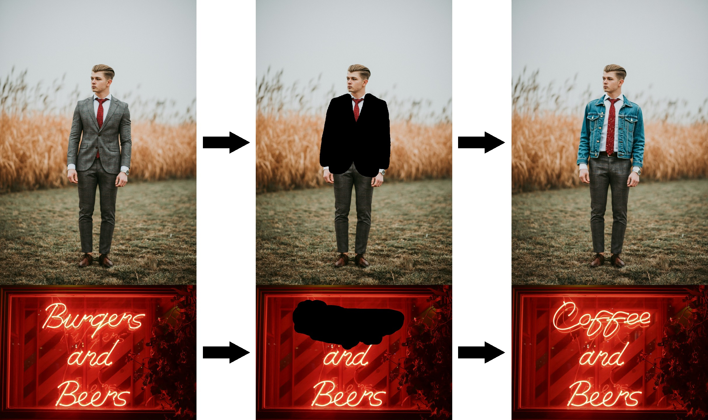
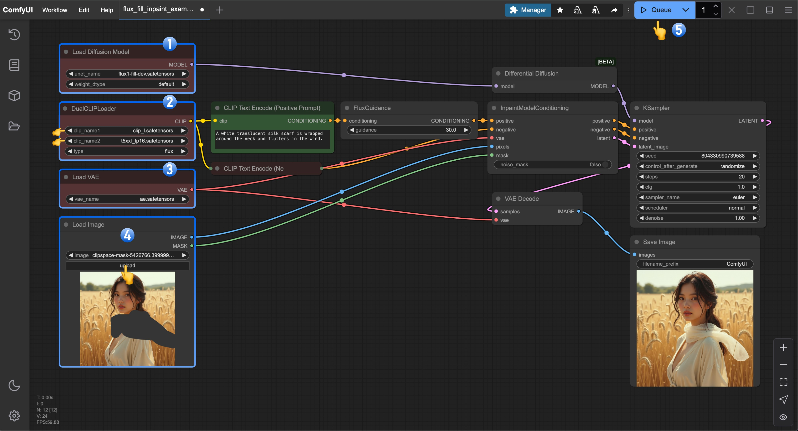
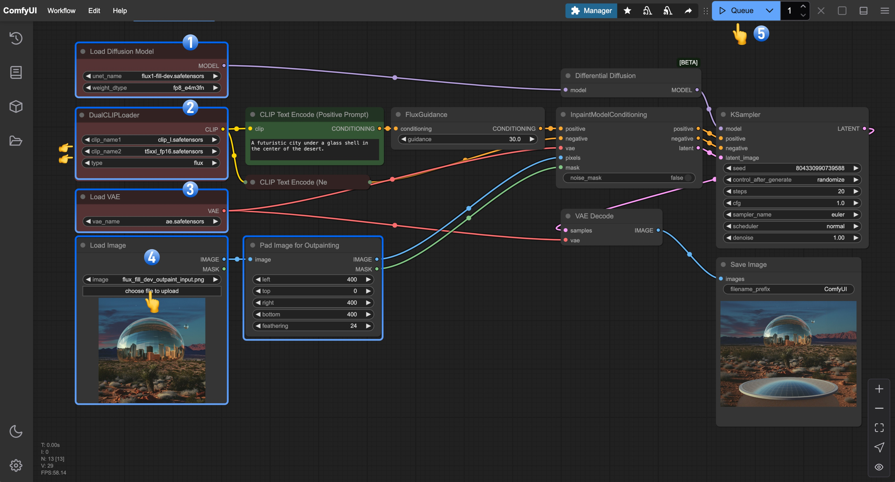

## Введение в модель Flux.1 fill dev

Flux.1 fill dev — один из ключевых инструментов [набора FLUX.1 Tools](https://blackforestlabs.ai/flux-1-tools/), выпущенного [Black Forest Labs](https://blackforestlabs.ai/). Он специально предназначен для инпейтинга и аутпейнтинга изображений.

Ключевые возможности Flux.1 fill dev:
- Мощные возможности инпейтинга и аутпейнтинга изображений: результаты уступают только коммерческой версии FLUX.1 Fill [pro].
- Отличное понимание и соблюдение промпта: модель точно улавливает замысел пользователя и при этом сохраняет высокую согласованность с оригинальным изображением.
- Продвинутая технология обучения с управляемой дистилляцией, которая делает модель эффективнее при сохранении высокого качества результатов.
- Дружественные условия лицензирования: сгенерированные результаты можно использовать в личных, научных и коммерческих целях. Подробности см. в [некоммерческой лицензии FLUX.1 [dev]](https://huggingface.co/black-forest-labs/FLUX.1-dev/blob/main/LICENSE.md).

Репозиторий с открытым исходным кодом: [FLUX.1 [dev]](https://huggingface.co/black-forest-labs/FLUX.1-dev)

В этом руководстве показаны рабочие процессы инпейтинга и аутпейнтинга на основе модели Flux.1 fill dev.
Если вы ещё не знакомы с рабочими процессами инпейтинга и аутпейнтинга, обратитесь к разделам [ComfyUI Layout Inpainting Example](/ru/tutorials/basic/inpaint) и [ComfyUI Image Extension Example](/ru/tutorials/basic/outpaint), где приведены соответствующие пояснения.

## Установка моделей Flux.1 Fill dev

Сначала установим файлы модели Flux.1 Fill dev. Рабочие процессы дорисовки (inpainting) и расширения (outpainting) используют ровно те же файлы моделей.
Если вы уже пользовались полной версией [рабочего процесса Flux.1 «Текст в изображение»](/ru/tutorials/flux/flux-1-text-to-image),
то из этого раздела достаточно скачать только файл **flux1-fill-dev.safetensors**.

Скачивание этой модели требует принятия пользовательского соглашения, поэтому откройте страницу [black-forest-labs/FLUX.1-Fill-dev](https://huggingface.co/black-forest-labs/FLUX.1-Fill-dev) и убедитесь, что соглашение принято, как на рисунке ниже.


Полный список моделей:
|- [clip_l.safetensors](https://huggingface.co/comfyanonymous/flux_text_encoders/blob/main/clip_l.safetensors)
|- [t5xxl_fp16.safetensors](https://huggingface.co/comfyanonymous/flux_text_encoders/blob/main/t5xxl_fp16.safetensors)
|- [ae.safetensors](https://huggingface.co/black-forest-labs/FLUX.1-schnell/blob/main/ae.safetensors)
|- [flux1-fill-dev.safetensors](https://huggingface.co/black-forest-labs/FLUX.1-Fill-dev/blob/main/flux1-fill-dev.safetensors)

Куда сохранить файлы:
```
ComfyUI/
├── models/
│   ├── text_encoders/
│   │    ├── clip_l.safetensors
│   │    └── t5xxl_fp16.safetensors
│   ├── vae/
│   │    └── ae.safetensors
│   └── diffusion_models/
│        └── flux1-fill-dev.safetensors
```
## Рабочий процесс инпейтинга Flux.1 Fill dev

### Инпейтинг Flux.1 {#flux_fill_inpaint_example}

Заполняйте отсутствующие части изображений с помощью инпейтинга Flux.1 Fill.


<CardGroup cols={2}>
  <Card title="Запустить в Comfy Cloud" icon="cloud" href="https://cloud.comfy.org/?template=flux_fill_inpaint_example&utm_source=docs&utm_medium=referral&utm_campaign=flux-1-fill-dev">
    Открыть в Comfy Cloud
  </Card>
  <Card title="Скачать рабочий процесс" icon="download" href="https://github.com/Comfy-Org/workflow_templates/blob/main/templates/flux_fill_inpaint_example.json">
    Скачайте JSON или найдите «Flux.1 Inpaint» в библиотеке шаблонов
  </Card>
</CardGroup>

**Входные материалы**

Загрузите этот файл в соответствующий узел `LoadImage`:

<CardGroup cols={2}>
  <Card title="flux_fill_inpaint_example_input_image.png" icon="image" href="https://raw.githubusercontent.com/Comfy-Org/workflow_templates/main/input/flux_fill_inpaint_example_input_image.png">
    узел `LoadImage` 17 · `flux_fill_inpaint_example_input_image.png`
  </Card>
</CardGroup>

<div style={{display: 'grid', gridTemplateColumns: 'repeat(2, minmax(0, 1fr))', gap: '1rem', alignItems: 'start'}}>
  
</div>

**Пример вывода**

<div style={{display: 'grid', gridTemplateColumns: 'repeat(2, minmax(0, 1fr))', gap: '1rem', alignItems: 'start'}}>
  
  
</div>

### 1. Рабочий процесс инпейтинга и ресурсы

<Note>
Соответствующее изображение уже содержит альфа-канал, поэтому маску не нужно рисовать отдельно.
Если вы хотите нарисовать собственную маску, [нажмите здесь](https://raw.githubusercontent.com/Comfy-Org/example_workflows/main/flux/inpaint/flux_fill_inpaint_input_original.png), чтобы получить изображение без маски, и обратитесь к разделу об использовании редактора масок в [примере инпейтинга компоновки ComfyUI](/ru/tutorials/basic/inpaint#использование-редактора-масок), чтобы узнать, как нарисовать маску в узле `Load Image`.
</Note>

### 2. Шаги запуска рабочего процесса



1. Убедитесь, что в узле `Load Diffusion Model` загружен `flux1-fill-dev.safetensors`.
2. Убедитесь, что в узле `DualCLIPLoader` загружены следующие модели:
   - clip_name1: `t5xxl_fp16.safetensors`
   - clip_name2: `clip_l.safetensors`
3. Убедитесь, что в узле `Load VAE` загружен `ae.safetensors`.
4. Загрузите входное изображение, приведённое в документе, в узел `Load Image`; если вы используете версию без маски, не забудьте дорисовать маску с помощью редактора масок.
5. Нажмите кнопку `Queue` или используйте сочетание клавиш `Ctrl(cmd) + Enter`, чтобы запустить рабочий процесс.

## Рабочий процесс outpainting с Flux.1 Fill dev

### Аутпейнтинг Flux.1  {#flux_fill_outpaint_example}

Расширяйте изображения за пределы границ с помощью outpainting в Flux.1.


<CardGroup cols={2}>
  <Card title="Запустить в Comfy Cloud" icon="cloud" href="https://cloud.comfy.org/?template=flux_fill_outpaint_example&utm_source=docs&utm_medium=referral&utm_campaign=flux-1-fill-dev">
    Открыть в Comfy Cloud
  </Card>
  <Card title="Скачать рабочий процесс" icon="download" href="https://github.com/Comfy-Org/workflow_templates/blob/main/templates/flux_fill_outpaint_example.json">
    Скачать JSON или найдите &quot;Flux.1 Outpaint&quot; в Библиотеке шаблонов
  </Card>
</CardGroup>

**Входные материалы**

Загрузите этот файл в соответствующий узел `LoadImage`:

<CardGroup cols={2}>
  <Card title="flux_fill_outpaint_example_input_image.png" icon="image" href="https://raw.githubusercontent.com/Comfy-Org/workflow_templates/main/input/flux_fill_outpaint_example_input_image.png">
    узел `LoadImage` 17 · `flux_fill_outpaint_example_input_image.png`
  </Card>
</CardGroup>

<div style={{display: 'grid', gridTemplateColumns: 'repeat(2, minmax(0, 1fr))', gap: '1rem', alignItems: 'start'}}>
  
</div>

### 1. Рабочий процесс outpainting и ресурсы

### 2. Шаги запуска рабочего процесса



1. Убедитесь, что в узле `Load Diffusion Model` загружен `flux1-fill-dev.safetensors`.
2. Убедитесь, что в узле `DualCLIPLoader` загружены следующие модели:
   - clip_name1: `t5xxl_fp16.safetensors`
   - clip_name2: `clip_l.safetensors`
3. Убедитесь, что в узле `Load VAE` загружен `ae.safetensors`.
4. Загрузите входное изображение, приведённое в документе, в узел `Load Image`.
5. Нажмите кнопку `Queue` или используйте сочетание клавиш `Ctrl(cmd) + Enter`, чтобы запустить рабочий процесс.
