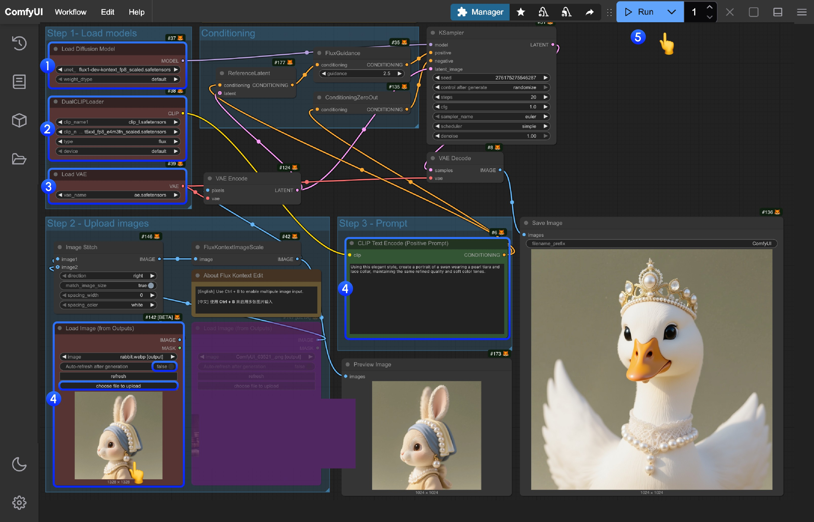

import PromptTechniques from "/snippets/ru/tutorials/flux/prompt-techniques.mdx";
import UpdateReminder from "/snippets/ru/tutorials/update-reminder.mdx"

<iframe
  className="w-full aspect-video rounded-xl"
  src="https://www.youtube.com/embed/Y7L_cbNJHj0?si=zuaRiU3qJYMNW2uv"
  title="ComfyUI Selection Toolbox New Features"
  allow="accelerometer; clipboard-write; encrypted-media; gyroscope; picture-in-picture"
  allowFullScreen
></iframe>

## О FLUX.1 Kontext Dev

FLUX.1 Kontext — прорывная мультимодальная модель редактирования изображений от Black Forest Labs, которая поддерживает одновременный ввод текста и изображений, интеллектуально понимает контекст изображения и выполняет точное редактирование. Её версия для разработчиков представляет собой открытую диффузионную модель на архитектуре трансформера с 12 миллиардами параметров, отличающуюся превосходным пониманием контекста и сохранением согласованности персонажей: ключевые элементы, такие как черты персонажа и композиция кадра, остаются стабильными даже после множества итеративных правок.

Она обладает теми же ключевыми возможностями, что и вся линейка FLUX.1 Kontext:
- Согласованность персонажей: сохраняет уникальные элементы изображений в разных сценах и окружениях, например референсных персонажей или объекты на изображении.
- Редактирование: вносит точечные изменения в конкретные элементы изображения, не затрагивая остальные части.
- Референс стиля: создаёт новые сцены, сохраняя уникальный стиль референсного изображения в соответствии с текстовыми промптами.
- Интерактивная скорость: минимальная задержка при генерации и редактировании изображений.

Ранее выпущенная API-версия обеспечивает максимальную точность и скорость, а FLUX.1 Kontext [Dev] работает полностью на локальных машинах, давая непревзойдённую гибкость разработчикам, исследователям и продвинутым пользователям, которые хотят экспериментировать.

### Информация о версии

- **[FLUX.1 Kontext [pro]** : коммерческая версия, ориентированная на быстрое итеративное редактирование
- **FLUX.1 Kontext [max]** : экспериментальная версия с более точным следованием промпту
- **FLUX.1 Kontext [dev]** : открытая версия (используется в этом руководстве), 12 млрд параметров, в основном для исследований

Сейчас в ComfyUI можно использовать все эти версии: [версии Pro и Max](/tutorials/partner-nodes/black-forest-labs/flux-1-kontext) вызываются через Партнёрские узлы, а для открытой версии Dev смотрите инструкции в этом руководстве.

<UpdateReminder/>

## Загрузка модели

Чтобы успешно запустить рабочие процессы из этого руководства, сначала скачайте перечисленные файлы моделей. Ссылки на загрузку можно взять и из самих рабочих процессов: информация о файлах моделей уже записана в них.

**Модель диффузии**

- [flux1-dev-kontext_fp8_scaled.safetensors](https://huggingface.co/Comfy-Org/flux1-kontext-dev_ComfyUI/blob/main/split_files/diffusion_models/flux1-dev-kontext_fp8_scaled.safetensors)

<Tip>
Если хотите использовать оригинальные веса, возьмите их в соответствующем репозитории Black Forest Labs.
</Tip>

**VAE**
- [ae.safetensors](https://huggingface.co/Comfy-Org/Lumina_Image_2.0_Repackaged/blob/main/split_files/vae/ae.safetensors)

**Текстовый энкодер**
- [clip_l.safetensors](https://huggingface.co/comfyanonymous/flux_text_encoders/blob/main/clip_l.safetensors)
- [t5xxl_fp16.safetensors](https://huggingface.co/comfyanonymous/flux_text_encoders/blob/main/t5xxl_fp16.safetensors) или [t5xxl_fp8_e4m3fn_scaled.safetensors](https://huggingface.co/comfyanonymous/flux_text_encoders/blob/main/t5xxl_fp8_e4m3fn_scaled.safetensors)

Куда сохранить модели

```
📂 ComfyUI/
├── 📂 models/
│   ├── 📂 diffusion_models/
│   │   └── flux1-dev-kontext_fp8_scaled.safetensors
│   ├── 📂 vae/
│   │   └── ae.safetensor
│   └── 📂 text_encoders/
│       ├── clip_l.safetensors
│       └── t5xxl_fp16.safetensors or t5xxl_fp8_e4m3fn_scaled.safetensors
```
## Рабочий процесс FLUX.1 Kontext Dev

### Редактирование изображений с FLUX Kontext Dev {#flux_kontext_dev_basic}

Умное редактирование изображений, которое сохраняет персонажей неизменными, позволяет править отдельные части, не затрагивая остальные, и сохраняет исходные стили.


<CardGroup cols={2}>
  <Card title="Запустить в Comfy Cloud" icon="cloud" href="https://cloud.comfy.org/?template=flux_kontext_dev_basic&utm_source=docs&utm_medium=referral&utm_campaign=flux-1-kontext-dev">
    Открыть в Comfy Cloud
  </Card>
  <Card title="Скачать рабочий процесс" icon="download" href="https://github.com/Comfy-Org/workflow_templates/blob/main/templates/flux_kontext_dev_basic.json">
    Скачайте JSON или найдите «FLUX Kontext Dev» в библиотеке шаблонов
  </Card>
</CardGroup>

**Входные материалы**

Загрузите этот файл в соответствующий узел `LoadImage`:

<CardGroup cols={2}>
  <Card title="flux_kontext_dev_basic_input_image.jpg" icon="image" href="https://raw.githubusercontent.com/Comfy-Org/workflow_templates/main/input/flux_kontext_dev_basic_input_image.jpg">
    Узел `LoadImage` 190 · `flux_kontext_dev_basic_input_image.jpg`
  </Card>
</CardGroup>

<div style={{display: 'grid', gridTemplateColumns: 'repeat(2, minmax(0, 1fr))', gap: '1rem', alignItems: 'start'}}>
  
</div>

**Пример вывода**

<div style={{display: 'grid', gridTemplateColumns: 'repeat(2, minmax(0, 1fr))', gap: '1rem', alignItems: 'start'}}>
  
  
</div>

Этот рабочий процесс использует узел `Load Image(from output)` для загрузки изображения, которое нужно отредактировать, что упрощает доступ к отредактированному изображению для нескольких раундов редактирования.

### 1. Скачивание рабочего процесса и входного изображения

### 2. Выполните рабочий процесс по шагам


Ориентируйтесь на номера на изображении, чтобы выполнить запуск рабочего процесса:

1. В узле `Load Diffusion Model` загрузите модель `flux1-dev-kontext_fp8_scaled.safetensors`
2. В узле `DualCLIP Load` убедитесь, что загружены `clip_l.safetensors` и `t5xxl_fp16.safetensors` или `t5xxl_fp8_e4m3fn_scaled.safetensors`
3. В узле `Load VAE` убедитесь, что загружена модель `ae.safetensors`
4. В узле `Load Image(from output)` загрузите предоставленное входное изображение
5. В узле `CLIP Text Encode` измените промпты, поддерживается только английский язык
6. Нажмите кнопку `Queue` или используйте сочетание клавиш `Ctrl(cmd) + Enter`, чтобы запустить рабочий процесс

<PromptTechniques/>
