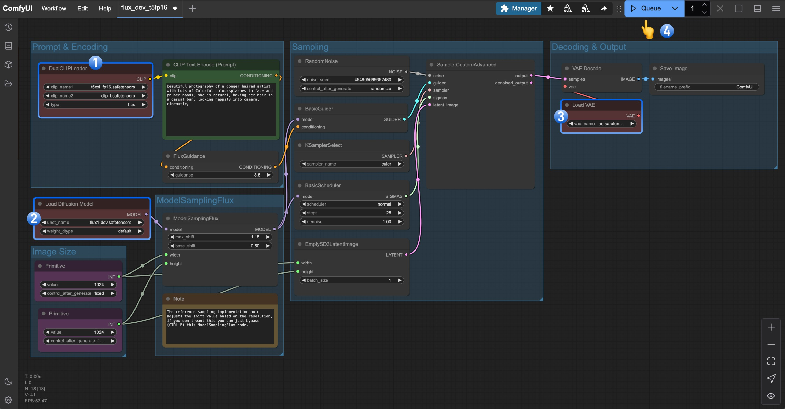
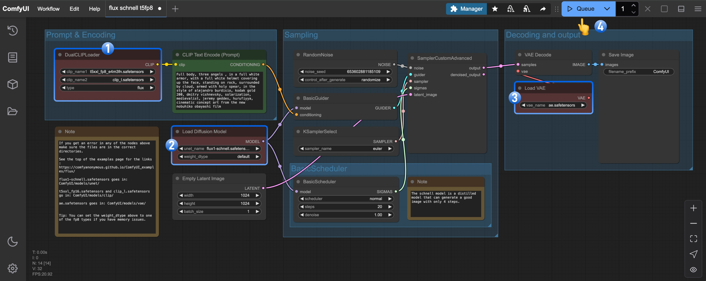

Flux является одной из крупнейших открытых моделей текст-в-изображение: 12 млрд параметров и исходный размер файла около 23 ГБ. Её разработала команда [Black Forest Labs](https://blackforestlabs.ai/), основанная бывшими участниками команды Stable Diffusion.
Flux известна превосходным качеством изображений и гибкостью: она способна генерировать качественные и разнообразные изображения.

На данный момент у модели Flux.1 есть несколько основных версий:
- **Flux.1 Pro:** самая производительная модель, закрытый исходный код, доступна только через вызовы API.
- **[Flux.1 [dev]：](https://huggingface.co/black-forest-labs/FLUX.1-dev)** Открытый исходный код, но только для некоммерческого использования, дистиллирована из версии Pro, качество близко к Pro.
- **[Flux.1 [schnell]：](https://huggingface.co/black-forest-labs/FLUX.1-schnell)** Распространяется по лицензии Apache2.0, требует всего 4 шага для генерации изображений, подходит для маломощного оборудования.

**Особенности модели Flux.1**
- **Гибридная архитектура:** объединяет преимущества сетей Transformer и диффузионных моделей, эффективно совмещает текстовую и визуальную информацию, повышает точность соответствия сгенерированных изображений промптам и отлично следует сложным промптам.
- **Масштаб параметров:** Flux имеет 12 млрд параметров, что позволяет улавливать более сложные закономерности и генерировать более реалистичные и разнообразные изображения.
- **Поддержка множества стилей:** поддерживает разнообразные стили и отлично справляется с изображениями разных типов.

В этом примере мы рассмотрим генерацию изображений по тексту с использованием версий Flux.1 Dev и Flux.1 Schnell, включая полную версию модели и упрощённую версию FP8 Checkpoint.

- **Flux Full Version:** лучшее качество, но требуется больше видеопамяти и установка нескольких файлов моделей.
- **Flux FP8 Checkpoint:** нужен только один файл модели в версии fp8, но качество немного ниже, чем у полной версии.

<Tip>
Метаданные всех изображений рабочих процессов содержат информацию для скачивания соответствующих моделей. Загрузить рабочие процессы можно так:
- Перетащите их прямо в ComfyUI
- Или используйте меню `Workflows` -> `Open（ctrl+o）`

Если вы не используете Desktop-версию или некоторые модели не скачиваются автоматически, обратитесь к разделам ручной установки, чтобы сохранить файлы моделей в соответствующую папку.
Перед началом убедитесь, что ваш ComfyUI обновлён до последней версии.
</Tip>

## Пример «текст в изображение» с полной версией Flux.1

<Note>
Если вы не можете скачать модели из [black-forest-labs/FLUX.1-dev](https://huggingface.co/black-forest-labs/FLUX.1-dev), убедитесь, что вы вошли в Hugging Face и согласились с условиями лицензии соответствующего репозитория.

</Note>

### Flux.1 Dev

### Flux.1 Dev fp8: текст в изображение {#flux_dev_checkpoint_example}

Генерация изображений с помощью квантованной версии Flux.1 Dev fp8. Подходит для устройств с ограниченным объёмом видеопамяти, требует только один файл модели, но качество изображения немного ниже, чем у полной версии.


<CardGroup cols={2}>
  <Card title="Запустить в Comfy Cloud" icon="cloud" href="https://cloud.comfy.org/?template=flux_dev_checkpoint_example&utm_source=docs&utm_medium=referral&utm_campaign=flux-1-text-to-image">
    Запустить этот рабочий процесс в Comfy Cloud
  </Card>
  <Card title="Скачать рабочий процесс" icon="download" href="https://github.com/Comfy-Org/workflow_templates/blob/main/templates/flux_dev_checkpoint_example.json">
    Скачать JSON или найдите &quot;Flux.1 Dev fp8&quot; в библиотеке шаблонов
  </Card>
</CardGroup>

**Пример результата**


#### 1. Файл рабочего процесса

#### 2. Ручная установка моделей

<Note>
- Перед скачиванием файла `flux1-dev.safetensors` через браузер необходимо согласиться с условиями [black-forest-labs/FLUX.1-dev](https://huggingface.co/black-forest-labs/FLUX.1-dev).
- Если у вас мало видеопамяти, можно попробовать использовать [t5xxl_fp8_e4m3fn.safetensors](https://huggingface.co/comfyanonymous/flux_text_encoders/blob/main/t5xxl_fp8_e4m3fn.safetensors?download=true) вместо файла `t5xxl_fp16.safetensors`.
</Note>

Скачайте следующие файлы моделей:
- [clip_l.safetensors](https://huggingface.co/comfyanonymous/flux_text_encoders/blob/main/clip_l.safetensors?download=true)
- [t5xxl_fp16.safetensors](https://huggingface.co/comfyanonymous/flux_text_encoders/blob/main/t5xxl_fp16.safetensors?download=true) Рекомендуется, если объём вашей видеопамяти больше 32 ГБ.
- [ae.safetensors](https://huggingface.co/black-forest-labs/FLUX.1-schnell/blob/main/ae.safetensors?download=true)
- [flux1-dev.safetensors](https://huggingface.co/black-forest-labs/FLUX.1-dev/blob/main/flux1-dev.safetensors) 

Расположение файлов:
```
ComfyUI/
├── models/
│   ├── text_encoders/
│   │   ├── clip_l.safetensors
│   │   └── t5xxl_fp16.safetensors
│   ├── vae/
│   │   └── ae.safetensors
│   └── diffusion_models/
│       └── flux1-dev.safetensors
```

#### 3. Порядок запуска рабочего процесса

Сверьтесь с изображением ниже, чтобы убедиться, что все файлы моделей загружены правильно



1. Убедитесь, что в узле `DualCLIPLoader` загружены следующие модели:
   - clip_name1: t5xxl_fp16.safetensors
   - clip_name2: clip_l.safetensors
2. Убедитесь, что в узле `Load Diffusion Model` загружен `flux1-dev.safetensors`
3. Убедитесь, что в узле `Load VAE` загружен `ae.safetensors`
4. Нажмите кнопку `Queue` или используйте сочетание клавиш `Ctrl(cmd) + Enter`, чтобы запустить рабочий процесс

<Tip>
Благодаря отличной способности Flux следовать промптам негативные промпты нам не нужны
</Tip>
### Flux.1 Schnell

### Flux.1 Schnell FP8 {#flux_schnell}

Быстрая генерация изображений с помощью квантованной версии Flux.1 Schnell fp8. Идеально для маломощного оборудования: для генерации изображений требуется всего 4 шага.


<CardGroup cols={2}>
  <Card title="Запустить в Comfy Cloud" icon="cloud" href="https://cloud.comfy.org/?template=flux_schnell&utm_source=docs&utm_medium=referral&utm_campaign=flux-1-text-to-image">
    Запустить этот рабочий процесс в Comfy Cloud
  </Card>
  <Card title="Скачать рабочий процесс" icon="download" href="https://github.com/Comfy-Org/workflow_templates/blob/main/templates/flux_schnell_full_text_to_image.json">
    Скачать JSON или найдите &quot;Flux.1 Schnell&quot; в библиотеке шаблонов
  </Card>
</CardGroup>

#### 1. Файл рабочего процесса

#### 2. Ручная установка моделей

<Note>
В этом рабочем процессе от версии Flux1 Dev отличаются только два файла моделей. Для t5xxl по-прежнему можно использовать версию fp16 для лучших результатов.
- **t5xxl_fp16.safetensors** -> **t5xxl_fp8.safetensors**
- **flux1-dev.safetensors** -> **flux1-schnell.safetensors** 
</Note>

Полный список файлов моделей:
- [clip_l.safetensors](https://huggingface.co/comfyanonymous/flux_text_encoders/blob/main/clip_l.safetensors?download=true)
- [t5xxl_fp8_e4m3fn.safetensors](https://huggingface.co/comfyanonymous/flux_text_encoders/blob/main/t5xxl_fp8_e4m3fn.safetensors?download=true)
- [ae.safetensors](https://huggingface.co/black-forest-labs/FLUX.1-schnell/blob/main/ae.safetensors?download=true)
- [flux1-schnell.safetensors](https://huggingface.co/black-forest-labs/FLUX.1-schnell/blob/main/flux1-schnell.safetensors) 

Расположение файлов:
```
ComfyUI/
├── models/
│   ├── text_encoders/
│   │   ├── clip_l.safetensors
│   │   └── t5xxl_fp8_e4m3fn.safetensors
│   ├── vae/
│   │   └── ae.safetensors
│   └── diffusion_models/
│       └── flux1-schnell.safetensors
```

#### 3. Порядок запуска рабочего процесса



1. Убедитесь, что в узле `DualCLIPLoader` загружены следующие модели:
   - clip_name1: t5xxl_fp8_e4m3fn.safetensors
   - clip_name2: clip_l.safetensors
2. Убедитесь, что в узле `Load Diffusion Model` загружен `flux1-schnell.safetensors`
3. Убедитесь, что в узле `Load VAE` загружен `ae.safetensors`
4. Нажмите кнопку `Queue` или используйте сочетание клавиш `Ctrl(cmd) + Enter`, чтобы запустить рабочий процесс

## Пример текст в изображение с чекпойнтом Flux.1 FP8

Версия fp8 это квантованная версия оригинальной Flux.1 fp16.
В некоторой степени качество этой версии будет ниже, чем у версии fp16,
но она также требует меньше VRAM, и для попытки запуска достаточно установить только один файл модели.

### Flux.1 Dev

### Flux.1 Dev: текст в изображение {#flux_dev_full_text_to_image}

Генерируйте изображения высокого качества с полной версией Flux Dev. Требует больше VRAM и несколько файлов моделей, но обеспечивает лучшее следование промпту.


<CardGroup cols={2}>
  <Card title="Запустить в Comfy Cloud" icon="cloud" href="https://cloud.comfy.org/?template=flux_dev_full_text_to_image&utm_source=docs&utm_medium=referral&utm_campaign=flux-1-text-to-image">
    Запустите этот рабочий процесс в Comfy Cloud
  </Card>
  <Card title="Скачать рабочий процесс" icon="download" href="https://github.com/Comfy-Org/workflow_templates/blob/main/templates/flux_dev_full_text_to_image.json">
    Скачайте JSON или найдите «Flux.1 Dev FP8» в библиотеке шаблонов
  </Card>
</CardGroup>

**Пример результата**


Скачайте изображение ниже и перетащите его в ComfyUI, чтобы загрузить рабочий процесс.

Скачайте [flux1-dev-fp8.safetensors](https://huggingface.co/Comfy-Org/flux1-dev/blob/main/flux1-dev-fp8.safetensors?download=true) и сохраните его в каталог `ComfyUI/models/checkpoints/`.

Убедитесь, что соответствующий узел `Load Checkpoint` загружает `flux1-dev-fp8.safetensors`, и можно попробовать запустить рабочий процесс.

### Flux.1 Schnell

### Flux.1 Schnell FP8 {#flux_schnell}

Быстро генерируйте изображения с квантованной версией Flux.1 Schnell fp8. Идеально подходит для слабого оборудования, для генерации изображений требуется всего 4 шага.


<CardGroup cols={2}>
  <Card title="Запустить в Comfy Cloud" icon="cloud" href="https://cloud.comfy.org/?template=flux_schnell&utm_source=docs&utm_medium=referral&utm_campaign=flux-1-text-to-image">
    Запустите этот рабочий процесс в Comfy Cloud
  </Card>
  <Card title="Скачать рабочий процесс" icon="download" href="https://github.com/Comfy-Org/workflow_templates/blob/main/templates/flux_schnell.json">
    Скачайте JSON или найдите «Flux.1 Schnell FP8» в библиотеке шаблонов
  </Card>
</CardGroup>

Скачайте изображение ниже и перетащите его в ComfyUI, чтобы загрузить рабочий процесс.

Скачайте [flux1-schnell-fp8.safetensors](https://huggingface.co/Comfy-Org/flux1-schnell/blob/main/flux1-schnell-fp8.safetensors?download=true) и сохраните его в каталог `ComfyUI/models/checkpoints/`.

Убедитесь, что соответствующий узел `Load Checkpoint` загружает `flux1-schnell-fp8.safetensors`, и можно попробовать запустить рабочий процесс.
