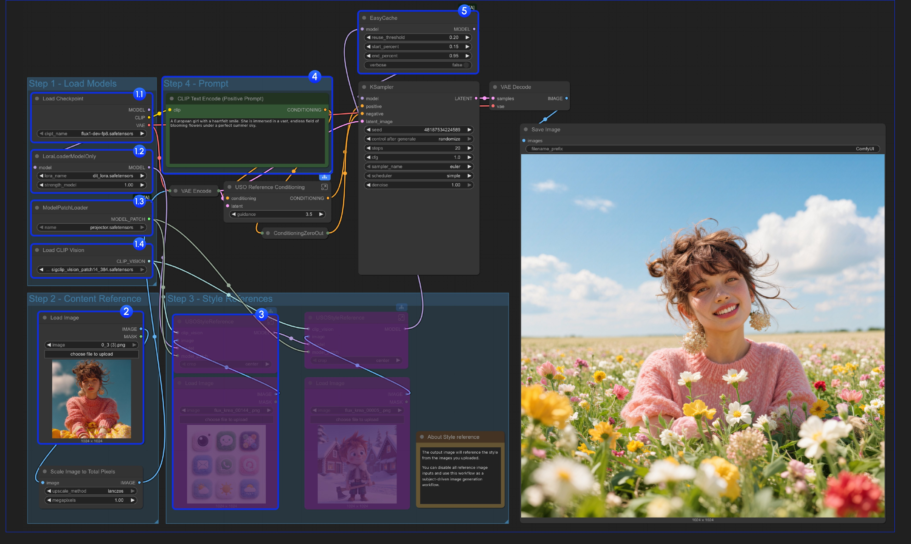
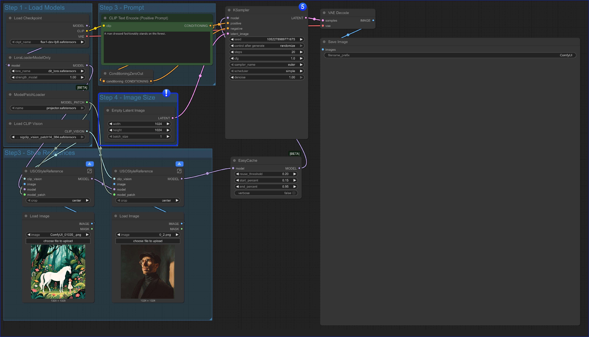

import UpdateReminder from "/snippets/ru/tutorials/update-reminder.mdx"

**USO (Unified Style-Subject Optimized)**: модель, разработанная командой UXO компании ByteDance, которая объединяет задачи генерации по стилю и по субъекту.
Построенная на архитектуре FLUX.1-dev, модель достигает как сходства стиля, так и согласованности субъекта благодаря разделённому обучению (disentangled learning) и обучению со стилевым вознаграждением (SRL).

USO поддерживает три основных подхода:
- **Subject-Driven**: помещает субъектов в новые сцены, сохраняя согласованность идентичности
- **Style-Driven**: применяет художественные стили к новому содержимому на основе референсных изображений
- **Combined**: использует референсы субъекта и стиля одновременно

**Полезные ссылки**
- [Страница проекта](https://bytedance.github.io/USO/)
- [GitHub](https://github.com/bytedance/USO)
- [Веса модели](https://huggingface.co/bytedance-research/USO)

## Нативный рабочий процесс ByteDance USO в ComfyUI

<UpdateReminder/>

### Генерация по референсным изображениям FLUX.1 Dev USO {#flux1_dev_uso_reference_image_gen}

Используйте референсные изображения, чтобы управлять и стилем, и субъектом. Сохраните лицо персонажа, меняя художественный стиль, или применяйте художественные стили к новым сценам.


<CardGroup cols={2}>
  <Card title="Запустить в Comfy Cloud" icon="cloud" href="https://cloud.comfy.org/?template=flux1_dev_uso_reference_image_gen&utm_source=docs&utm_medium=referral&utm_campaign=flux-1-uso">
    Запустите этот рабочий процесс в Comfy Cloud
  </Card>
  <Card title="Скачать рабочий процесс" icon="download" href="https://github.com/Comfy-Org/workflow_templates/blob/main/templates/flux1_dev_uso_reference_image_gen.json">
    Скачайте JSON рабочего процесса и перетащите его в ComfyUI
  </Card>
</CardGroup>

**Входные материалы**

Загрузите этот файл в соответствующий узел `LoadImage`:

<CardGroup cols={2}>
  <Card title="flux1_dev_uso_reference_image_gen_input_image.png" icon="image" href="https://raw.githubusercontent.com/Comfy-Org/workflow_templates/main/input/flux1_dev_uso_reference_image_gen_input_image.png">
    узел `LoadImage` 47 · `flux1_dev_uso_reference_image_gen_input_image.png`
  </Card>
</CardGroup>

<div style={{display: 'grid', gridTemplateColumns: 'repeat(2, minmax(0, 1fr))', gap: '1rem', alignItems: 'start'}}>
  
</div>

**Пример вывода**

<div style={{display: 'grid', gridTemplateColumns: 'repeat(2, minmax(0, 1fr))', gap: '1rem', alignItems: 'start'}}>
  
  
</div>

### 1. Рабочий процесс и входные данные

### 2. Ссылки на модели

**чекпойнты**

- [flux1-dev-fp8.safetensors](https://huggingface.co/Comfy-Org/flux1-dev/blob/main/flux1-dev-fp8.safetensors)

**loras**

- [uso-flux1-dit-lora-v1.safetensors](https://huggingface.co/Comfy-Org/USO_1.0_Repackaged/blob/main/split_files/loras/uso-flux1-dit-lora-v1.safetensors)

**model_patches**

- [uso-flux1-projector-v1.safetensors](https://huggingface.co/Comfy-Org/USO_1.0_Repackaged/blob/main/split_files/model_patches/uso-flux1-projector-v1.safetensors)

**clip_visions**
- [sigclip_vision_patch14_384.safetensors](https://huggingface.co/Comfy-Org/sigclip_vision_384/blob/main/sigclip_vision_patch14_384.safetensors)

Скачайте все модели и поместите их в следующие каталоги:

```
📂 ComfyUI/
├── 📂 models/
│   ├── 📂 checkpoints/
│   │   └── flux1-dev-fp8.safetensors
│   ├── 📂 loras/
│   │   └── uso-flux1-dit-lora-v1.safetensors
│   ├── 📂 model_patches/
│   │   └── uso-flux1-projector-v1.safetensors
│   ├── 📂 clip_visions/
│   │   └── sigclip_vision_patch14_384.safetensors
```

### 3. Инструкции по рабочему процессу



1. Загрузите модели:
    - 1.1 Убедитесь, что в узле `Load Checkpoint` загружен `flux1-dev-fp8.safetensors`
    - 1.2 Убедитесь, что в узле `LoraLoaderModelOnly` загружен `dit_lora.safetensors`
    - 1.3 Убедитесь, что в узле `ModelPatchLoader` загружен `projector.safetensors`
    - 1.4 Убедитесь, что в узле `Load CLIP Vision` загружен `sigclip_vision_patch14_384.safetensors`
2. Референс содержимого:
    - 2.1 Нажмите `Upload`, чтобы загрузить предоставленное нами входное изображение
    - 2.2 Узел `ImageScaleToMaxDimension` масштабирует входное изображение для референса содержимого: 512px лучше сохраняет черты персонажа, но если вы подаёте на вход только голову персонажа, на итоговом изображении персонаж часто занимает слишком много места. Значение 1024px даёт заметно лучшие результаты.
3. В примере мы используем только входное изображение `content reference`. Если вы хотите использовать входное изображение `style reference`, нажмите `Ctrl-B`, чтобы обойти отмеченную группу узлов.
4. Напишите свой промпт или оставьте значение по умолчанию
5. При необходимости задайте размер изображения
6. Узел EasyCache служит для ускорения вывода, но при этом он жертвует частью качества и деталей. Если он вам не нужен, его можно обойти (Ctrl+B).
7. Нажмите кнопку `Run` или используйте сочетание клавиш `Ctrl(Cmd) + Enter`, чтобы запустить рабочий процесс

### 4. Дополнительные примечания

1. Только референс стиля:

Мы также включили в предоставленный рабочий процесс вариант, использующий только референс стиля.


Единственное отличие: мы заменили узел `content reference` и используем только узел `Empty Latent Image`.

2. Вы также можете обойти всю группу `Style Reference` и использовать рабочий процесс как рабочий процесс «текст в изображение»; таким образом, у этого рабочего процесса есть 4 варианта:
- Только референс содержимого (субъекта)
- Только референс стиля
- Смешанный референс содержимого и стиля
- Как рабочий процесс «текст в изображение»