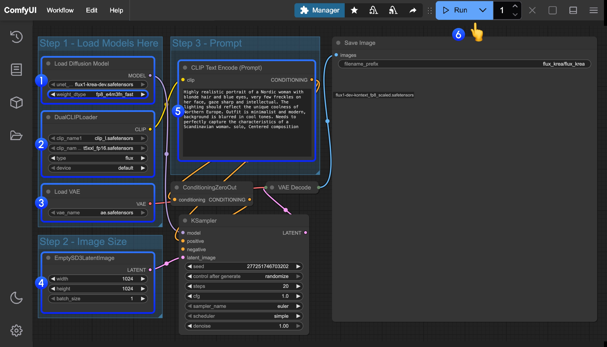

import UpdateReminder from "/snippets/ru/tutorials/update-reminder.mdx"


[FLUX.1 Krea Dev](https://huggingface.co/black-forest-labs/FLUX.1-Krea-dev) это продвинутая модель генерации изображений по тексту, созданная в сотрудничестве Black Forest Labs (BFL) и Krea. На данный момент это лучшая открытая модель FLUX, специально предназначенная для генерации изображений по тексту.

**Особенности модели**

- **Уникальный эстетический стиль**: ориентирована на создание изображений с уникальной эстетикой, избегая типичного «вида ИИ»
- **Естественные детали**: не создаёт пересвеченных участков и сохраняет естественную передачу деталей
- **Исключительный реализм**: обеспечивает выдающийся реализм и качество изображения
- **Полностью совместимая архитектура**: архитектура полностью совместима с FLUX.1 [dev]

**Лицензия модели**
Эта модель выпущена под лицензией [flux-1-dev-non-commercial-license](https://huggingface.co/black-forest-labs/FLUX.1-Krea-dev/blob/main/LICENSE.md)

## Рабочий процесс FLUX.1 Krea Dev в ComfyUI

<UpdateReminder />

### FLUX.1 Krea Dev {#flux1_krea_dev}

Доработанная модель FLUX, доводящая фотореализм до максимума.


<CardGroup cols={2}>
  <Card title="Запустить в Comfy Cloud" icon="cloud" href="https://cloud.comfy.org/?template=flux1_krea_dev&utm_source=docs&utm_medium=referral&utm_campaign=flux1-krea-dev">
    Запустите этот рабочий процесс в Comfy Cloud
  </Card>
  <Card title="Скачать рабочий процесс" icon="download" href="https://github.com/Comfy-Org/workflow_templates/blob/main/templates/flux1_krea_dev.json">
    Скачайте JSON или найдите «FLUX.1 Krea Dev» в библиотеке шаблонов
  </Card>
</CardGroup>

**Пример результата**


#### 1. Файлы рабочего процесса

#### 2. Ручная установка моделей

Скачайте следующие файлы моделей:
**Модель диффузии**

- [flux1-krea-dev_fp8_scaled.safetensors](https://huggingface.co/Comfy-Org/FLUX.1-Krea-dev_ComfyUI/blob/main/split_files/diffusion_models/flux1-krea-dev_fp8_scaled.safetensors)

Если вы хотите получить более высокое качество и у вас достаточно VRAM, можно попробовать оригинальные веса модели

- [flux1-krea-dev.safetensors](https://huggingface.co/black-forest-labs/FLUX.1-Krea-dev/blob/main/flux1-krea-dev.safetensors) 

<Note>
Для загрузки файла `flux1-dev.safetensors` через браузер необходимо сначала принять соглашение [black-forest-labs/FLUX.1-Krea-dev](https://huggingface.co/black-forest-labs/FLUX.1-Krea-dev/).
</Note>

Если вы уже работали с рабочими процессами FLUX, следующие модели те же самые и их не нужно скачивать повторно

**Текстовые энкодеры**
- [clip_l.safetensors](https://huggingface.co/comfyanonymous/flux_text_encoders/blob/main/clip_l.safetensors?download=true)
- [t5xxl_fp16.safetensors](https://huggingface.co/comfyanonymous/flux_text_encoders/blob/main/t5xxl_fp16.safetensors?download=true) Рекомендуется, если объём вашей VRAM больше 32 ГБ.
- [t5xxl_fp8_e4m3fn.safetensors](https://huggingface.co/comfyanonymous/flux_text_encoders/blob/main/t5xxl_fp8_e4m3fn.safetensors)  Для малого объёма VRAM

**VAE**
- [ae.safetensors](https://huggingface.co/black-forest-labs/FLUX.1-schnell/blob/main/ae.safetensors?download=true)

Куда сохранять файлы:
```
ComfyUI/
├── models/
│   ├── diffusion_models/
│   │   └── flux1-krea-dev_fp8_scaled.safetensors or flux1-krea-dev.safetensors
│   ├── text_encoders/
│   │   ├── clip_l.safetensors
│   │   └── t5xxl_fp16.safetensors or t5xxl_fp8_e4m3fn.safetensors
│   ├── vae/
│   │   └── ae.safetensors

```

#### 3. Пошаговая проверка правильной работы рабочего процесса

<Tip>
    Если у вас мало VRAM, эта модель может работать на вашем устройстве нестабильно. Можно дождаться, пока сообщество выпустит версию FP8 или GGUF.
</Tip>

Сверьтесь с изображением ниже, чтобы убедиться, что все файлы моделей загружены правильно



1. Убедитесь, что в узле `Load Diffusion Model` загружен `flux1-krea-dev_fp8_scaled.safetensors` или `flux1-krea-dev.safetensors`
    - `flux1-krea-dev_fp8_scaled.safetensors` рекомендуется пользователям с небольшим объёмом VRAM
    - `flux1-krea-dev.safetensors` это оригинальные веса. Если у вас достаточно VRAM, например 24 ГБ, их можно использовать для лучшего качества
2. Убедитесь, что в узле `DualCLIPLoader` загружены следующие модели:
   - clip_name1: t5xxl_fp16.safetensors или t5xxl_fp8_e4m3fn.safetensors
   - clip_name2: clip_l.safetensors
3. Убедитесь, что в узле `Load VAE` загружен `ae.safetensors`
4. Нажмите кнопку `Queue` или используйте сочетание клавиш `Ctrl(cmd) + Enter`, чтобы запустить рабочий процесс