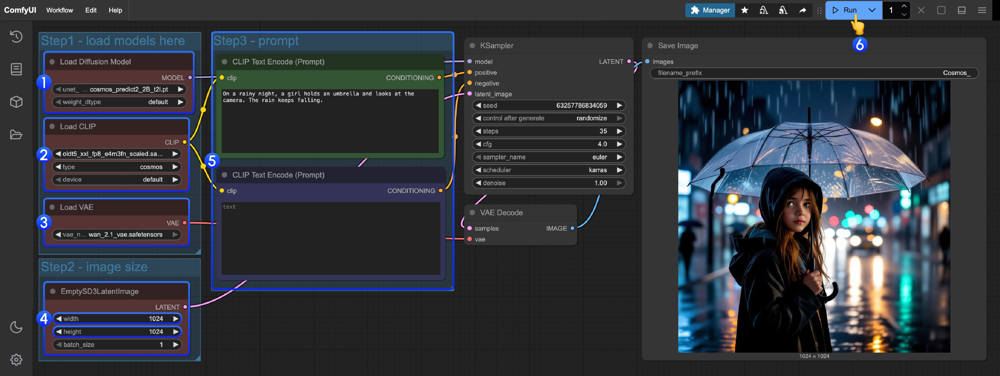

import UpdateReminder from "/snippets/ru/tutorials/update-reminder.mdx"

Cosmos-Predict2 — это фундаментальная модель физического мира нового поколения от NVIDIA, специально разработанная для задач высококачественной визуальной генерации и прогнозирования в сценариях физического ИИ.
Модель обладает исключительной физической точностью, интерактивностью с окружающей средой и способностью воспроизводить детали, что позволяет реалистично моделировать сложные физические явления и динамические сцены.

Cosmos-Predict2 поддерживает различные методы генерации, включая текст в изображение (Text2Image) и видео в мир (Video2World), и широко применяется в промышленном моделировании, автономном вождении, городском планировании, научных исследованиях и других областях.

GitHub:[Cosmos-predict2](https://github.com/nvidia-cosmos/cosmos-predict2)
huggingface: [Cosmos-Predict2](https://huggingface.co/collections/nvidia/cosmos-predict2-68028efc052239369a0f2959)

В этом руководстве вы шаг за шагом выполните рабочий процесс **текст в изображение** в ComfyUI.

Раздел о генерации видео смотрите в следующей части:

<Card title="Генерация видео с Cosmos Predict2" icon="book" href="/ru/tutorials/video/cosmos/cosmos-predict2-video2world">
  Использование Cosmos-Predict2 для генерации видео
</Card>

<UpdateReminder/>
{/* 
## Рабочий процесс Cosmos Predict2 Video2World

При тестировании версия 2B показала, что использует около 16 ГБ видеопамяти.

### 1. Файл рабочего процесса

Скачайте изображение ниже и перетащите его в ComfyUI, чтобы загрузить рабочий процесс. В рабочий процесс уже встроены ссылки на скачивание моделей.


### 2. Установить модели вручную

Если скачать модели не удалось, вы можете попробовать скачать их вручную в этом разделе.

**Модель диффузии**

- [cosmos_predict2_2B_t2i.safetensors](https://huggingface.co/Comfy-Org/Cosmos_Predict2_repackaged/blob/main/cosmos_predict2_2B_t2i.safetensors)

Другие веса можно скачать на странице [Cosmos_Predict2_repackaged](https://huggingface.co/Comfy-Org/Cosmos_Predict2_repackaged)

**Текстовый энкодер**

[oldt5_xxl_fp8_e4m3fn_scaled.safetensors](https://huggingface.co/comfyanonymous/cosmos_1.0_text_encoder_and_VAE_ComfyUI/blob/main/text_encoders/oldt5_xxl_fp8_e4m3fn_scaled.safetensors)

**VAE**

[wan_2.1_vae.safetensors](https://huggingface.co/Comfy-Org/Wan_2.1_ComfyUI_repackaged/blob/main/split_files/vae/wan_2.1_vae.safetensors)

Расположение файлов
```
📂 ComfyUI/
├──📂 models/
│   ├── 📂 diffusion_models/
│   │   └─── cosmos_predict2_2B_t2i.safetensors
│   ├── 📂 text_encoders/
│   │   └─── oldt5_xxl_fp8_e4m3fn_scaled.safetensors
│   └── 📂 vae/
│       └──  wan_2.1_vae.safetensors
```

### 3. Выполнить рабочий процесс по шагам



Следуйте шагам на изображении, чтобы запустить рабочий процесс:

1. Убедитесь, что узел `Загрузить модель диффузии` загрузил `cosmos_predict2_2B_t2i.safetensors`
2. Убедитесь, что узел `Загрузить CLIP` загрузил `oldt5_xxl_fp8_e4m3fn_scaled.safetensors`
3. Убедитесь, что узел `Загрузить VAE` загрузил `wan_2.1_vae.safetensors`
4. Задайте размер изображения в узле `Пустой SD3LatentImage`
5. Измените промпты в узле `ClipTextEncode`
6. Нажмите кнопку `Run` или используйте сочетание клавиш `Ctrl(cmd) + Enter`, чтобы запустить рабочий процесс
7. После завершения генерации изображение автоматически сохранится в каталог `ComfyUI/output/`. Вы также можете просмотреть его в узле `Сохранить изображение`. */}