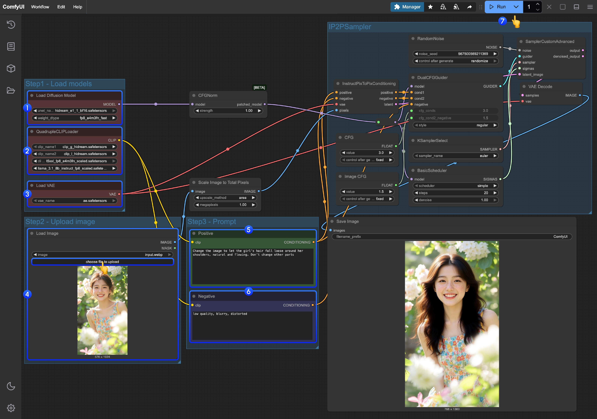
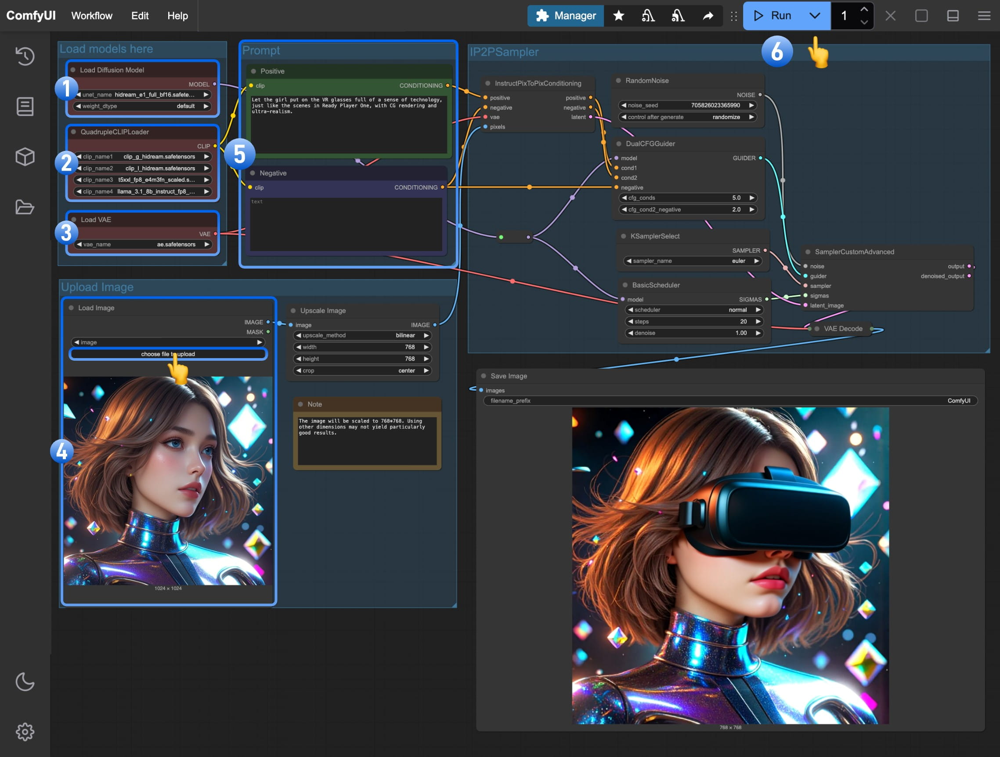

import UpdateReminder from '/snippets/ru/tutorials/update-reminder.mdx'


HiDream-E1 представляет собой интерактивную большую модель редактирования изображений, официально открытую HiDream-ai и построенную на основе HiDream-I1.

Она позволяет редактировать изображения с помощью естественного языка. Модель распространяется по [лицензии MIT](https://github.com/HiDream-ai/HiDream-E1?tab=MIT-1-ov-file) и поддерживает использование в личных проектах, научных исследованиях и коммерческих приложениях.
В сочетании с ранее выпущенной [HiDream-I1](/ru/tutorials/image/hidream/hidream-i1) она открывает **творческие возможности от генерации изображений до их редактирования**.

| Название              | Дата обновления        | Шаги вывода | Разрешение             | Репозиторий HuggingFace         |
|-------------------|-------------------|-----------------|------------------------|-------------------------------|
| HiDream-E1-Full   | 2025-4-28         | 28              | 768x768                | 🤗 [HiDream-E1-Full](https://huggingface.co/HiDream-ai/HiDream-E1-Full)        |
| HiDream-E1.1      | 2025-7-16         | 28              | Динамическое (1 мегапиксель)  | 🤗 [HiDream-E1.1](https://huggingface.co/HiDream-ai/HiDream-E1-1)           |

[HiDream E1 на GitHub](https://github.com/HiDream-ai/HiDream-E1)

<UpdateReminder/>

## Модели для рабочих процессов HiDream E1 и E1.1

Все модели из этого руководства собраны [здесь](https://huggingface.co/Comfy-Org/HiDream-I1_ComfyUI/tree/main/split_files). Кроме модели диффузии, E1 и E1.1 используют одинаковые модели.
Файлы рабочих процессов тоже содержат информацию о моделях. Можно скачать и сохранить модели вручную или следовать подсказкам рабочего процесса после его загрузки. Рекомендуется использовать E1.1.

Для запуска этой модели требуется много видеопамяти. Конкретные требования смотрите в соответствующих разделах.

**Модель диффузии**

Скачивать обе модели не нужно. Поскольку E1.1 это итерационная версия на основе E1, наши тесты показывают заметно лучшее качество и производительность по сравнению с E1.
- [hidream_e1_1_bf16.safetensors (рекомендуется)](https://huggingface.co/Comfy-Org/HiDream-I1_ComfyUI/blob/main/split_files/diffusion_models/hidream_e1_1_bf16.safetensors) 34.2GB
- [hidream_e1_full_bf16.safetensors](https://huggingface.co/Comfy-Org/HiDream-I1_ComfyUI/blob/main/split_files/diffusion_models/hidream_e1_full_bf16.safetensors) 34.2GB

**Текстовый энкодер**:

- [clip_l_hidream.safetensors](https://huggingface.co/Comfy-Org/HiDream-I1_ComfyUI/blob/main/split_files/text_encoders/clip_l_hidream.safetensors) 236.12MB
- [clip_g_hidream.safetensors](https://huggingface.co/Comfy-Org/HiDream-I1_ComfyUI/blob/main/split_files/text_encoders/clip_g_hidream.safetensors) 1.29GB
- [t5xxl_fp8_e4m3fn_scaled.safetensors](https://huggingface.co/Comfy-Org/HiDream-I1_ComfyUI/blob/main/split_files/text_encoders/t5xxl_fp8_e4m3fn_scaled.safetensors) 4.8GB
- [llama_3.1_8b_instruct_fp8_scaled.safetensors](https://huggingface.co/Comfy-Org/HiDream-I1_ComfyUI/blob/main/split_files/text_encoders/llama_3.1_8b_instruct_fp8_scaled.safetensors) 8.46GB

**VAE**
- [ae.safetensors](https://huggingface.co/Comfy-Org/HiDream-I1_ComfyUI/blob/main/split_files/vae/ae.safetensors) 319.77MB
> Это VAE модели FLUX. Если вы уже работали с рабочим процессом FLUX, возможно, этот файл у вас уже есть.

Куда сохранить модели

```
📂 ComfyUI/
├── 📂 models/
│   ├── 📂 text_encoders/
│   │   ├─── clip_l_hidream.safetensors
│   │   ├─── clip_g_hidream.safetensors
│   │   ├─── t5xxl_fp8_e4m3fn_scaled.safetensors
│   │   └─── llama_3.1_8b_instruct_fp8_scaled.safetensors
│   └── 📂 vae/
│   │   └── ae.safetensors
│   └── 📂 diffusion_models/
│       ├── hidream_e1_1_bf16.safetensors
│       └── hidream_e1_full_bf16.safetensors
```

## Пример нативного рабочего процесса HiDream E1.1 в ComfyUI

### Редактирование изображений с HiDream E1.1 {#hidream_e1_1}

Редактируйте изображения с помощью HiDream E1.1. Более высокое качество изображений и точность редактирования по сравнению с HiDream-E1-Full.


<CardGroup cols={2}>
  <Card title="Запустить в Comfy Cloud" icon="cloud" href="https://cloud.comfy.org/?template=hidream_e1_1&utm_source=docs&utm_medium=referral&utm_campaign=hidream-e1">
    Открыть в Comfy Cloud
  </Card>
  <Card title="Скачать рабочий процесс" icon="download" href="https://github.com/Comfy-Org/workflow_templates/blob/main/templates/hidream_e1_1.json">
    Скачайте JSON или найдите «HiDream E1.1» в Библиотеке шаблонов
  </Card>
</CardGroup>

**Входные материалы**

Загрузите этот файл в соответствующий узел `LoadImage`:

<CardGroup cols={2}>
  <Card title="hidream_e1_1_input_image.jpg" icon="image" href="https://raw.githubusercontent.com/Comfy-Org/workflow_templates/main/input/hidream_e1_1_input_image.jpg">
    Узел `LoadImage` 13 · `hidream_e1_1_input_image.jpg`
  </Card>
</CardGroup>

<div style={{display: 'grid', gridTemplateColumns: 'repeat(2, minmax(0, 1fr))', gap: '1rem', alignItems: 'start'}}>
  
</div>

### 1. Рабочий процесс HiDream E1.1 и связанные материалы

Скачайте изображение ниже и перетащите его в ComfyUI, предварительно загрузив соответствующий рабочий процесс и модели:


Скачайте изображение ниже как вход:


### 2. Пошаговое руководство по запуску рабочего процесса HiDream-e1


Выполните следующие шаги, чтобы запустить рабочий процесс:
1. Убедитесь, что узел `Load Diffusion Model` загружает модель `hidream_e1_1_bf16.safetensors`.
2. Убедитесь, что четыре соответствующих текстовых энкодера в `QuadrupleCLIPLoader` загружены правильно:
    - clip_l_hidream.safetensors
    - clip_g_hidream.safetensors
    - t5xxl_fp8_e4m3fn_scaled.safetensors
    - llama_3.1_8b_instruct_fp8_scaled.safetensors
3. Убедитесь, что узел `Load VAE` использует файл `ae.safetensors`.
4. В узле `Load Image` загрузите предоставленное входное изображение или изображение на ваш выбор.
5. В узле `Empty Text Encoder(Positive)` введите **изменения, которые вы хотите внести в изображение**.
6. В узле `Empty Text Encoder(Negative)` введите **содержимое, которое не должно присутствовать на изображении**.
7. Нажмите кнопку `Run` или используйте сочетание клавиш `Ctrl(cmd) + Enter`, чтобы выполнить генерацию изображения.

### 3. Дополнительные примечания к рабочему процессу

- Поскольку HiDream E1.1 поддерживает динамический ввод с общим количеством до 1 миллиона пикселей, в рабочем процессе используется `Scale Image to Total Pixels` для обработки и преобразования всех входных изображений, из-за чего соотношение сторон может отличаться от исходного входного изображения.
- При использовании версии модели fp16 в реальных тестах полной версии не хватало памяти как на A100 40GB, так и на 4090D 24GB, поэтому рабочий процесс по умолчанию настроен на использование `fp8_e4m3fn_fast` для вывода.

## Пример нативного рабочего процесса HiDream E1 в ComfyUI

### Редактирование изображений HiDream E1 {#hidream_e1_full}

Редактируйте изображения с помощью HiDream E1. Профессиональная модель редактирования изображений с помощью естественного языка.


<CardGroup cols={2}>
  <Card title="Запустить в Comfy Cloud" icon="cloud" href="https://cloud.comfy.org/?template=hidream_e1_full&utm_source=docs&utm_medium=referral&utm_campaign=hidream-e1">
    Открыть в Comfy Cloud
  </Card>
  <Card title="Скачать рабочий процесс" icon="download" href="https://github.com/Comfy-Org/workflow_templates/blob/main/templates/hidream_e1_full.json">
    Скачать JSON или найти «HiDream E1 Full» в Библиотеке шаблонов
  </Card>
</CardGroup>

**Входные материалы**

Загрузите этот файл в соответствующий узел `LoadImage`:

<CardGroup cols={2}>
  <Card title="hidream_e1_full_input_image.jpg" icon="image" href="https://raw.githubusercontent.com/Comfy-Org/workflow_templates/main/input/hidream_e1_full_input_image.jpg">
    Узел `LoadImage` 13 · `hidream_e1_full_input_image.jpg`
  </Card>
</CardGroup>

<div style={{display: 'grid', gridTemplateColumns: 'repeat(2, minmax(0, 1fr))', gap: '1rem', alignItems: 'start'}}>
  
</div>

**Пример выходного результата**

<div style={{display: 'grid', gridTemplateColumns: 'repeat(2, minmax(0, 1fr))', gap: '1rem', alignItems: 'start'}}>
  
</div>

E1: модель, выпущенная 28 апреля 2025 года.

<Tip>
Для справки: этот рабочий процесс занимает около 500 с при первом запуске и 370 с при втором запуске с 28 шагами выборки на Google Colab L4 с 22.5 ГБ видеопамяти.
</Tip>

### 1. Рабочий процесс HiDream-e1

Скачайте изображение ниже и перетащите его в ComfyUI. Рабочий процесс уже содержит информацию о загрузке моделей, и после загрузки появится запрос на скачивание соответствующих моделей.


Скачайте это изображение ниже как входные данные:


### 2. Выполнить рабочий процесс HiDream-e1 по шагам



Чтобы завершить рабочий процесс, выполните следующие шаги:
1. Убедитесь, что в узле `Load Diffusion Model` загружена модель `hidream_e1_full_bf16.safetensors`
2. Убедитесь, что в `QuadrupleCLIPLoader` правильно загружены четыре соответствующих текстовых энкодера:
    - clip_l_hidream.safetensors
    - clip_g_hidream.safetensors
    - t5xxl_fp8_e4m3fn_scaled.safetensors
    - llama_3.1_8b_instruct_fp8_scaled.safetensors
3. Убедитесь, что узел `Load VAE` использует файл `ae.safetensors`
4. Загрузите входное изображение, скачанное ранее, в узле `Load Image`
5. (Важно) Введите **промпт, описывающий, как вы хотите изменить изображение**, в узле `Empty Text Encoder(Positive)`
6. Нажмите кнопку `Run` или используйте сочетание клавиш `Ctrl(cmd) + Enter`, чтобы сгенерировать изображение

### Дополнительные замечания о рабочем процессе ComfyUI HiDream-e1

- Возможно, вам придётся несколько раз изменять промпт или выполнять генерацию несколько раз, чтобы получить лучшие результаты.
- Эта модель плохо сохраняет согласованность при изменении стиля изображения, поэтому старайтесь делать промпты как можно более полными.
- Поскольку модель поддерживает разрешение 768*768, при тестировании с другими размерами качество изображения низкое, а при других размерах результат может даже заметно отличаться.
