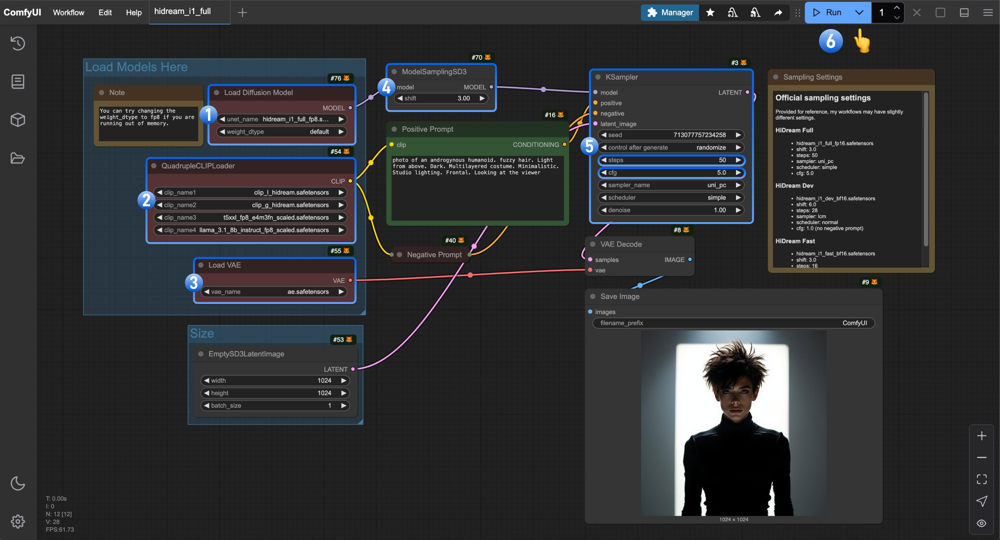
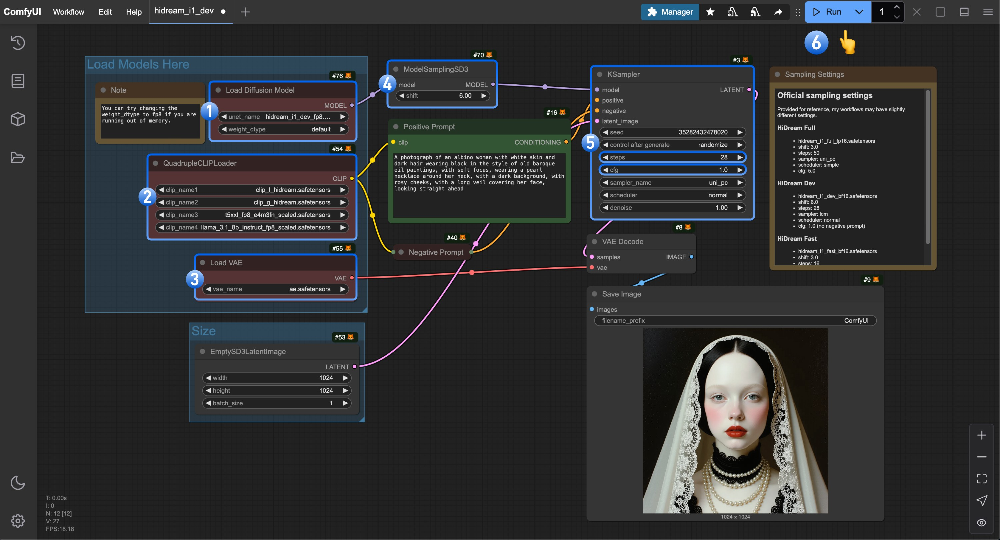
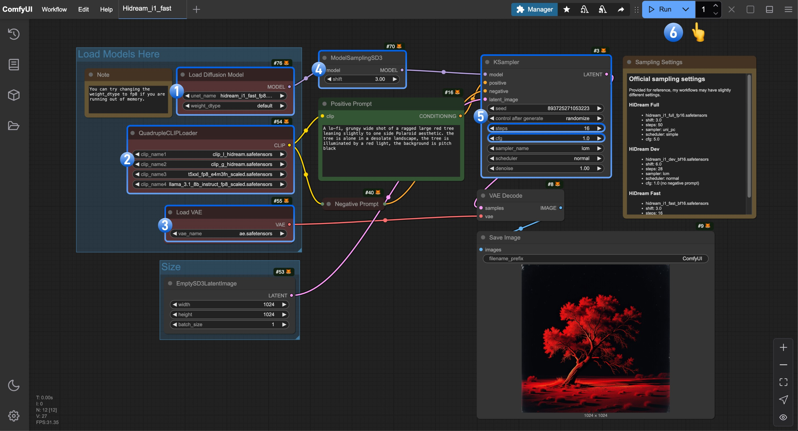

HiDream-I1 представляет собой модель текст в изображение, официально опубликованную с открытым исходным кодом компанией HiDream-ai 7 апреля 2025 года. Модель насчитывает 17B параметров и выпущена под [лицензией MIT](https://github.com/HiDream-ai/HiDream-I1/blob/main/LICENSE), что допускает использование в личных проектах, научных исследованиях и коммерческих целях. Сейчас она показывает отличные результаты в нескольких бенчмарках.

## Возможности модели

**Гибридная архитектура**
Комбинация архитектур Diffusion Transformer (DiT) и Mixture of Experts (MoE):
- На основе Diffusion Transformer (DiT): двухпоточные модули MMDiT обрабатывают мультимодальную информацию, а однопоточные модули DiT оптимизируют глобальную согласованность.
- Механизм динамической маршрутизации гибко распределяет вычислительные ресурсы, расширяя возможности обработки сложных сцен и обеспечивая превосходную производительность при восстановлении цветов, обработке краёв и других деталях.

**Интеграция мультимодальных текстовых энкодеров**
Объединяет четыре текстовых энкодера:
- OpenCLIP ViT-bigG, OpenAI CLIP ViT-L (визуально-семантическое выравнивание)
- T5-XXL (разбор длинного текста)
- Llama-3.1-8B-Instruct (понимание инструкций)
Такая комбинация обеспечивает производительность уровня SOTA при сложном семантическом разборе цветов, количеств, пространственных отношений и т. д., а поддержка промптов на китайском языке значительно превосходит аналогичные модели с открытым исходным кодом.

**Оригинальные версии модели**

HiDream-ai предлагает три версии модели HiDream-I1 для разных задач. Ниже приведены ссылки на оригинальные репозитории моделей:

| Имя модели      | Описание    | Шаги вывода | Ссылка на репозиторий                                                        |
|-----------------|----------------|-----------------|------------------------------------------------------------------------|
| HiDream-I1-Full | Полная версия   | 50              | [🤗 HiDream-I1-Full](https://huggingface.co/HiDream-ai/HiDream-I1-Full)|
| HiDream-I1-Dev  | Дистиллированная версия dev  | 28              | [🤗 HiDream-I1-Dev](https://huggingface.co/HiDream-ai/HiDream-I1-Dev)  |
| HiDream-I1-Fast | Дистиллированная версия fast | 16              | [🤗 HiDream-I1-Fast](https://huggingface.co/HiDream-ai/HiDream-I1-Fast)|

## Об этом примере рабочего процесса

В этом примере мы будем использовать перепакованную версию от ComfyOrg. Все файлы моделей, которые понадобятся в этом примере, можно найти в репозитории [HiDream-I1_ComfyUI](https://huggingface.co/Comfy-Org/HiDream-I1_ComfyUI/).

<Tip>
Перед началом работы обновите ComfyUI до версии, которая как минимум новее этого [коммита](https://github.com/Comfy-Org/ComfyUI/commit/9ad792f92706e2179c58b2e5348164acafa69288), чтобы ваш ComfyUI имел нативную поддержку HiDream.
</Tip>

## Рабочий процесс HiDream-I1

Требования к моделям у разных нативных рабочих процессов HiDream-I1 в ComfyUI почти одинаковы: отличаются только файлы [моделей диффузии](https://huggingface.co/Comfy-Org/HiDream-I1_ComfyUI/tree/main/split_files/diffusion_models).

Если не знаете, какой вариант выбрать, ориентируйтесь на подсказки:

- **HiDream-I1-Full** даёт изображения наивысшего качества
- **HiDream-I1-Dev** уравновешивает качество и скорость генерации
- **HiDream-I1-Fast** генерирует изображение всего за 16 шагов, подходит для задач с быстрыми итерациями

Для версий **dev** и **fast** негативный промпт не нужен, поэтому при сэмплировании задайте параметру `cfg` значение `1.0`. Нужные настройки мы отметили в соответствующих рабочих процессах.

<Tip>
Полные версии всех трёх вариантов требуют очень много видеопамяти: для плавной работы может понадобиться больше 27 ГБ. В руководствах по рабочим процессам
мы показываем вариант **fp8**, чтобы большинство пользователей могло запустить его без проблем.
При этом ссылки на разные версии модели в примерах остаются, и вы можете выбрать файл под свой объём видеопамяти.
</Tip>

### Установка моделей

Перечисленные ниже файлы моделей общие для всех вариантов.
Пройдите по ссылкам и сохраните файлы согласно указанному расположению.
Модели диффузии мы будем скачивать отдельно в каждом рабочем процессе.

**text_encoders**：

- [clip_l_hidream.safetensors](https://huggingface.co/Comfy-Org/HiDream-I1_ComfyUI/blob/main/split_files/text_encoders/clip_l_hidream.safetensors)
- [clip_g_hidream.safetensors](https://huggingface.co/Comfy-Org/HiDream-I1_ComfyUI/blob/main/split_files/text_encoders/clip_g_hidream.safetensors)
- [t5xxl_fp8_e4m3fn_scaled.safetensors](https://huggingface.co/Comfy-Org/HiDream-I1_ComfyUI/blob/main/split_files/text_encoders/t5xxl_fp8_e4m3fn_scaled.safetensors) Эта модель используется во многих рабочих процессах, возможно, файл у вас уже есть.
- [llama_3.1_8b_instruct_fp8_scaled.safetensors](https://huggingface.co/Comfy-Org/HiDream-I1_ComfyUI/blob/main/split_files/text_encoders/llama_3.1_8b_instruct_fp8_scaled.safetensors)

**VAE**
-  [ae.safetensors](https://huggingface.co/Comfy-Org/HiDream-I1_ComfyUI/blob/main/split_files/vae/ae.safetensors) Это VAE модели Flux. Если вы уже работали с рабочим процессом Flux, возможно, файл у вас уже есть.

**diffusion models**
Соответствующие файлы моделей мы скачаем отдельно в каждом рабочем процессе.

Куда сохранить файлы моделей
```
📂 ComfyUI/
├── 📂 models/
│   ├── 📂 text_encoders/
│   │   ├─── clip_l_hidream.safetensors
│   │   ├─── clip_g_hidream.safetensors
│   │   ├─── t5xxl_fp8_e4m3fn_scaled.safetensors
│   │   └─── llama_3.1_8b_instruct_fp8_scaled.safetensors
│   └── 📂 vae/
│   │   └── ae.safetensors
│   └── 📂 diffusion_models/
│       └── ...               # We will guide you to install in the corresponding version workflow       
```
### Рабочий процесс HiDream I1 Full

### HiDream I1 Full {#hidream_i1_full}

Генерируйте изображения с HiDream I1 Full. Полная версия с 50 шагами вывода для максимального качества.


<CardGroup cols={2}>
  <Card title="Запустить в Comfy Cloud" icon="cloud" href="https://cloud.comfy.org/?template=hidream_i1_full&utm_source=docs&utm_medium=referral&utm_campaign=hidream-i1">
    Запустите этот рабочий процесс в Comfy Cloud без какой-либо настройки
  </Card>
  <Card title="Скачать рабочий процесс" icon="download" href="https://github.com/Comfy-Org/workflow_templates/blob/main/templates/hidream_i1_full.json">
    Скачайте JSON-файл рабочего процесса
  </Card>
</CardGroup>

**Пример результата**


#### 1. Загрузка файлов моделей

Выберите подходящий вариант под своё железо. Пройдите по ссылке и сохраните файл модели в папку `ComfyUI/models/diffusion_models/`.

- Вариант FP8: [hidream_i1_full_fp8.safetensors](https://huggingface.co/Comfy-Org/HiDream-I1_ComfyUI/blob/main/split_files/diffusion_models/hidream_i1_full_fp8.safetensors?download=true) требует больше 16 ГБ видеопамяти
- Полная версия: [hidream_i1_full_f16.safetensors](https://huggingface.co/Comfy-Org/HiDream-I1_ComfyUI/blob/main/split_files/diffusion_models/hidream_i1_full_fp16.safetensors?download=true) требует больше 27 ГБ видеопамяти

#### 2. Загрузка файла рабочего процесса

Скачайте изображение ниже и перетащите его в ComfyUI, чтобы загрузить соответствующий рабочий процесс


#### 3. Пройти рабочий процесс шаг за шагом



Пройдите выполнение рабочего процесса шаг за шагом
1. Убедитесь, что в узле `Load Diffusion Model` выбран файл `hidream_i1_full_fp8.safetensors`
2. Убедитесь, что в `QuadrupleCLIPLoader` правильно загружены четыре текстовых энкодера
    - clip_l_hidream.safetensors
    - clip_g_hidream.safetensors
    - t5xxl_fp8_e4m3fn_scaled.safetensors
    - llama_3.1_8b_instruct_fp8_scaled.safetensors
3. Убедитесь, что в узле `Load VAE` выбран файл `ae.safetensors`
4. Для **полной** версии задайте параметру `shift` в `ModelSamplingSD3` значение `3.0`
5. В узле `Ksampler` нужно выставить следующие настройки
    - Установите `steps` в `50`
    - Установите `cfg` в `5.0`
    - (Необязательно) Установите `sampler` в `lcm`
    - (Необязательно) Установите `scheduler` в `normal`
6. Нажмите кнопку `Run` или используйте сочетание клавиш `Ctrl(cmd) + Enter`, чтобы запустить генерацию изображения

### Рабочий процесс HiDream I1 Dev

### HiDream I1 Dev {#hidream_i1_dev}

Генерируйте изображения с HiDream I1 Dev. Сбалансированная версия с 28 шагами вывода, подходит для железа среднего уровня.


<CardGroup cols={2}>
  <Card title="Запустить в Comfy Cloud" icon="cloud" href="https://cloud.comfy.org/?template=hidream_i1_dev&utm_source=docs&utm_medium=referral&utm_campaign=hidream-i1">
    Запустите этот рабочий процесс в Comfy Cloud без какой-либо настройки
  </Card>
  <Card title="Скачать рабочий процесс" icon="download" href="https://github.com/Comfy-Org/workflow_templates/blob/main/templates/hidream_i1_dev.json">
    Скачайте JSON-файл рабочего процесса
  </Card>
</CardGroup>

**Пример результата**


#### 1. Загрузка файлов моделей
Выберите подходящий вариант под своё железо, пройдите по ссылке и сохраните файл модели в папку `ComfyUI/models/diffusion_models/`.

- Вариант FP8: [hidream_i1_dev_fp8.safetensors](https://huggingface.co/Comfy-Org/HiDream-I1_ComfyUI/blob/main/split_files/diffusion_models/hidream_i1_dev_fp8.safetensors?download=true) требует больше 16 ГБ видеопамяти
- Полная версия: [hidream_i1_dev_bf16.safetensors](https://huggingface.co/Comfy-Org/HiDream-I1_ComfyUI/blob/main/split_files/diffusion_models/hidream_i1_dev_bf16.safetensors?download=true) требует больше 27 ГБ видеопамяти

#### 2. Загрузка файла рабочего процесса
Скачайте изображение ниже и перетащите его в ComfyUI, чтобы загрузить соответствующий рабочий процесс


#### 3. Пройти рабочий процесс шаг за шагом


Пройдите выполнение рабочего процесса шаг за шагом
1. Убедитесь, что в узле `Load Diffusion Model` выбран файл `hidream_i1_dev_fp8.safetensors`
2. Убедитесь, что в `QuadrupleCLIPLoader` правильно загружены четыре текстовых энкодера
    - clip_l_hidream.safetensors
    - clip_g_hidream.safetensors
    - t5xxl_fp8_e4m3fn_scaled.safetensors
    - llama_3.1_8b_instruct_fp8_scaled.safetensors
3. Убедитесь, что в узле `Load VAE` выбран файл `ae.safetensors`
4. Для версии **dev** задайте параметру `shift` в `ModelSamplingSD3` значение `6.0`
5. В узле `Ksampler` нужно выставить следующие настройки
    - Установите `steps` в `28`
    - (Важно) Установите `cfg` в `1.0`
    - (Необязательно) Установите `sampler` в `lcm`
    - (Необязательно) Установите `scheduler` в `normal`
6. Нажмите кнопку `Run` или используйте сочетание клавиш `Ctrl(cmd) + Enter`, чтобы запустить генерацию изображения

### Рабочий процесс HiDream I1 Fast

### HiDream I1 Fast {#hidream_i1_fast}

Быстро генерируйте изображения с HiDream I1 Fast. Облегчённая версия с 16 шагами вывода, идеальна для быстрых превью на слабом железе.


<CardGroup cols={2}>
  <Card title="Запустить в Comfy Cloud" icon="cloud" href="https://cloud.comfy.org/?template=hidream_i1_fast&utm_source=docs&utm_medium=referral&utm_campaign=hidream-i1">
    Запустите этот рабочий процесс в Comfy Cloud без какой-либо настройки
  </Card>
  <Card title="Скачать рабочий процесс" icon="download" href="https://github.com/Comfy-Org/workflow_templates/blob/main/templates/hidream_i1_fast.json">
    Скачайте JSON-файл рабочего процесса
  </Card>
</CardGroup>

**Пример результата**


#### 1. Загрузка файлов моделей
Выберите подходящий вариант под своё железо, пройдите по ссылке и сохраните файл модели в папку `ComfyUI/models/diffusion_models/`.

- Вариант FP8: [hidream_i1_fast_fp8.safetensors](https://huggingface.co/Comfy-Org/HiDream-I1_ComfyUI/blob/main/split_files/diffusion_models/hidream_i1_fast_fp8.safetensors?download=true) требует больше 16 ГБ видеопамяти
- Полная версия: [hidream_i1_fast_bf16.safetensors](https://huggingface.co/Comfy-Org/HiDream-I1_ComfyUI/blob/main/split_files/diffusion_models/hidream_i1_fast_bf16.safetensors?download=true) требует больше 27 ГБ видеопамяти

#### 2. Загрузка файла рабочего процесса
Скачайте изображение ниже и перетащите его в ComfyUI, чтобы загрузить соответствующий рабочий процесс


#### 3. Пройти рабочий процесс шаг за шагом



Пройдите выполнение рабочего процесса шаг за шагом
1. Убедитесь, что в узле `Load Diffusion Model` выбран файл `hidream_i1_fast_fp8.safetensors`
2. Убедитесь, что в `QuadrupleCLIPLoader` правильно загружены четыре текстовых энкодера
    - clip_l_hidream.safetensors
    - clip_g_hidream.safetensors
    - t5xxl_fp8_e4m3fn_scaled.safetensors
    - llama_3.1_8b_instruct_fp8_scaled.safetensors
3. Убедитесь, что в узле `Load VAE` выбран файл `ae.safetensors`
4. Для версии **fast** задайте параметру `shift` в `ModelSamplingSD3` значение `3.0`
5. В узле `Ksampler` нужно выставить следующие настройки
    - Установите `steps` в `16`
    - (Важно) Установите `cfg` в `1.0`
    - (Необязательно) Установите `sampler` в `lcm`
    - (Необязательно) Установите `scheduler` в `normal`
6. Нажмите кнопку `Run` или используйте сочетание клавиш `Ctrl(cmd) + Enter`, чтобы запустить генерацию изображения

## Другие связанные ресурсы

### Модели версии GGUF

- [HiDream-I1-Full-gguf](https://huggingface.co/city96/HiDream-I1-Full-gguf) 
- [HiDream-I1-Dev-gguf](https://huggingface.co/city96/HiDream-I1-Dev-gguf) 

Чтобы заменить узел `Load Diffusion Model`, используйте узел `Unet Loader (GGUF)` из [ComfyUI-GGUF](https://github.com/city96/ComfyUI-GGUF) от City96.

### Модели версии NF4
- [HiDream-I1-nf4](https://github.com/hykilpikonna/HiDream-I1-nf4) 
- Для работы с моделью версии NF4 используйте узел [ComfyUI-HiDream-Sampler](https://github.com/SanDiegoDude/ComfyUI-HiDream-Sampler).
