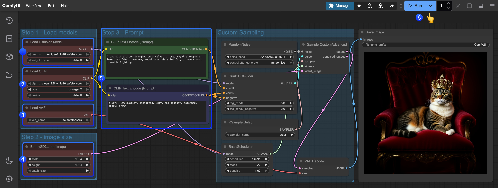
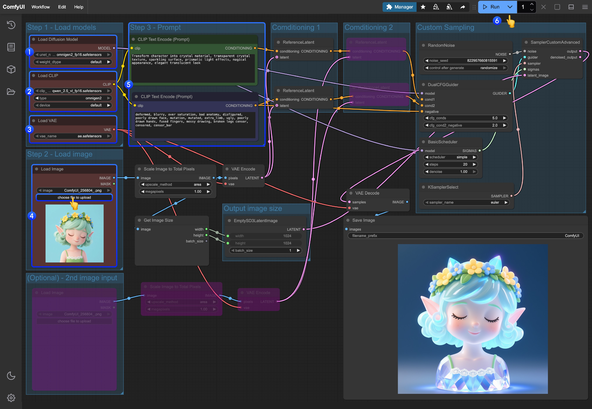

import UpdateReminder from "/snippets/ru/tutorials/update-reminder.mdx"

OmniGen2 представляет собой открытую унифицированную мультимодальную модель генерации от исследовательской команды [VectorSpaceLab](https://github.com/VectorSpaceLab/OmniGen2). Один набор весов решает задачи генерации изображений по тексту, редактирования изображений по инструкциям и генерации в контексте с опорой на заданный объект. ComfyUI поддерживает OmniGen2 нативно, поэтому все три задачи выполняются локально через официальные примеры рабочих процессов.

Модель объединяет замороженную визуально-языковую модель Qwen2.5-VL на 3B параметров с отдельным 4B diffusion transformer, всего около 7B параметров. Визуально-языковая модель читает ваши референсные изображения и письменные инструкции, а diffusion transformer превращает это понимание в пиксели. Поскольку оба пути сохраняют собственные параметры и собственный image tokenizer, OmniGen2 сохраняет способность к визуальному пониманию и при этом поддерживает высокое качество изображений.

ComfyUI поставляет для модели два официальных рабочих процесса: текст в изображение и редактирование изображений по инструкциям на естественном языке, например «измени цвет платья на синий». Рабочий процесс редактирования изображений также поддерживает композицию из нескольких изображений, объединяя людей, референсные объекты и сцены с нескольких входных изображений.

<UpdateReminder/>

**Ключевые возможности модели**:

- **Визуальное понимание**: читает и анализирует содержимое изображений с помощью базовой модели Qwen2.5-VL
- **Генерация по тексту**: создаёт изображения высокой точности по текстовым промптам
- **Редактирование изображений по инструкциям**: применяет сложные правки по инструкциям на естественном языке
- **Генерация в контексте**: объединяет людей, референсные объекты и сцены из нескольких входов в новые изображения

**Технические особенности**:

- **Двухпутевая архитектура**: текстовая модель Qwen2.5-VL на 3B плюс независимый 4B diffusion transformer
- **Позиционное кодирование Omni-RoPE**: пространственное позиционирование нескольких изображений и различение идентичностей
- **Развязывание параметров**: не даёт авторегрессивной генерации текста ухудшать качество изображений
- **Текст внутри изображения**: генерирует читаемый текст внутри сгенерированного изображения

## Загрузка модели OmniGen2

Поскольку статья охватывает несколько рабочих процессов, ниже приведены соответствующие файлы моделей и места их установки. Информация для скачивания также приводится в описании каждого рабочего процесса:

**Диффузионные модели**
- [omnigen2_fp16.safetensors](https://huggingface.co/Comfy-Org/Omnigen2_ComfyUI_repackaged/blob/main/split_files/diffusion_models/omnigen2_fp16.safetensors)

**VAE**
- [ae.safetensors](https://huggingface.co/Comfy-Org/Lumina_Image_2.0_Repackaged/blob/main/split_files/vae/ae.safetensors)

**Текстовые энкодеры**
- [qwen_2.5_vl_fp16.safetensors](https://huggingface.co/Comfy-Org/Omnigen2_ComfyUI_repackaged/blob/main/split_files/text_encoders/qwen_2.5_vl_fp16.safetensors)

Путь сохранения файлов:
```
📂 ComfyUI/
├── 📂 models/
│   ├── 📂 diffusion_models/
│   │   └── omnigen2_fp16.safetensors
│   ├── 📂 vae/
│   │   └── ae.safetensors
│   └── 📂 text_encoders/
│       └── qwen_2.5_vl_fp16.safetensors
```

## Рабочий процесс текст в изображение OmniGen2 в ComfyUI

### OmniGen2: текст в изображение {#image_omnigen2_t2i}

Создавайте изображения высокого качества по текстовым промптам с помощью унифицированной мультимодальной модели OmniGen2 на 7B с двупутевой архитектурой.


<CardGroup cols={2}>
  <Card title="Запустить в Comfy Cloud" icon="cloud" href="https://cloud.comfy.org/?template=image_omnigen2_t2i&utm_source=docs&utm_medium=referral&utm_campaign=omnigen2">
    Откройте и запустите этот рабочий процесс прямо в Comfy Cloud
  </Card>
  <Card title="Скачать рабочий процесс" icon="download" href="https://github.com/Comfy-Org/workflow_templates/blob/main/templates/image_omnigen2_t2i.json">
    Скачайте JSON или найдите &quot;OmniGen2&quot; в библиотеке шаблонов
  </Card>
</CardGroup>

**Пример результата**


### 1. Скачать файл рабочего процесса

### 2. Выполнить рабочий процесс шаг за шагом



Следуйте пронумерованным шагам на изображении, чтобы шаг за шагом проверить настройки и обеспечить корректную работу соответствующего рабочего процесса:

1. **Загрузите основную модель**: убедитесь, что узел `Load Diffusion Model` загружает `omnigen2_fp16.safetensors`
2. **Загрузите текстовый энкодер**: убедитесь, что узел `Load CLIP` загружает `qwen_2.5_vl_fp16.safetensors`
3. **Загрузите VAE**: убедитесь, что узел `Load VAE` загружает `ae.safetensors`
4. **Задайте размеры изображения**: задайте размеры сгенерированного изображения в узле `EmptySD3LatentImage` (рекомендуется 1024x1024)
5. **Введите промпты**:
    - Введите положительные промпты в первый узел `CLipTextEncode` (содержимое, которое вы хотите видеть на изображении)
    - Введите негативные промпты во второй узел `CLipTextEncode` (содержимое, которое вы не хотите видеть на изображении)
6. **Запустите генерацию**: нажмите кнопку `Queue Prompt` или используйте сочетание клавиш `Ctrl(cmd) + Enter`, чтобы выполнить генерацию изображения по тексту
7. **Просмотрите результаты**: после завершения генерации соответствующие изображения будут автоматически сохранены в каталог `ComfyUI/output/`, а также вы можете просмотреть их в узле `SaveImage`

## Рабочий процесс редактирования изображений OmniGen2 в ComfyUI

OmniGen2 обладает богатыми возможностями редактирования изображений и поддерживает добавление текста на изображения.

### Редактирование изображений OmniGen2 {#image_omnigen2_image_edit}

Редактируйте изображения с помощью инструкций на естественном языке, используя продвинутые возможности редактирования изображений OmniGen2 и поддержку рендеринга текста.


<CardGroup cols={2}>
  <Card title="Запустить в Comfy Cloud" icon="cloud" href="https://cloud.comfy.org/?template=image_omnigen2_image_edit&utm_source=docs&utm_medium=referral&utm_campaign=omnigen2">
    Откройте и запустите этот рабочий процесс напрямую в Comfy Cloud
  </Card>
  <Card title="Скачать рабочий процесс" icon="download" href="https://github.com/Comfy-Org/workflow_templates/blob/main/templates/image_omnigen2_image_edit.json">
    Скачайте JSON или найдите «OmniGen2 Image Edit» в библиотеке шаблонов
  </Card>
</CardGroup>

**Входные материалы**

Загрузите этот файл в соответствующий узел `LoadImage`:

<CardGroup cols={2}>
  <Card title="image_omnigen2_image_edit_input_image.png" icon="image" href="https://raw.githubusercontent.com/Comfy-Org/workflow_templates/main/input/image_omnigen2_image_edit_input_image.png">
    Узел `LoadImage` 16 · `image_omnigen2_image_edit_input_image.png`
  </Card>
</CardGroup>

<div style={{display: 'grid', gridTemplateColumns: 'repeat(2, minmax(0, 1fr))', gap: '1rem', alignItems: 'start'}}>
  
</div>

**Пример результата**

<div style={{display: 'grid', gridTemplateColumns: 'repeat(2, minmax(0, 1fr))', gap: '1rem', alignItems: 'start'}}>
  
  
</div>

### 1. Скачать файл рабочего процесса

### 2. Выполнить рабочий процесс по шагам



1. **Загрузить основную модель**: убедитесь, что узел `Load Diffusion Model` загружает `omnigen2_fp16.safetensors`
2. **Загрузить текстовый энкодер**: убедитесь, что узел `Load CLIP` загружает `qwen_2.5_vl_fp16.safetensors`
3. **Загрузить VAE**: убедитесь, что узел `Load VAE` загружает `ae.safetensors`
4. **Загрузить изображение**: загрузите предоставленное изображение в узле `Load Image`
5. **Ввести промпты**:
    - Введите положительные промпты в первом узле `CLipTextEncode` (содержимое, которое должно появиться на изображении)
    - Введите отрицательные промпты во втором узле `CLipTextEncode` (содержимое, которое не должно появиться на изображении)
6. **Запустить генерацию**: нажмите кнопку `Queue Prompt` или используйте сочетание клавиш `Ctrl(cmd) + Enter`, чтобы выполнить генерацию изображения из текста
7. **Просмотреть результаты**: после завершения генерации соответствующие изображения автоматически сохраняются в каталог `ComfyUI/output/`, а также вы можете просмотреть их в узле `SaveImage`

### 3. Дополнительные инструкции по рабочему процессу

- Если вы хотите включить второй вход изображения, можно использовать сочетание клавиш **Ctrl + B**, чтобы включить соответствующие входы узлов, которые находятся в розовом/фиолетовом состоянии в рабочем процессе
- Если вы хотите настроить размеры, можно удалить узел `Get image size`, связанный с узлом `EmptySD3LatentImage`, и ввести собственные размеры
