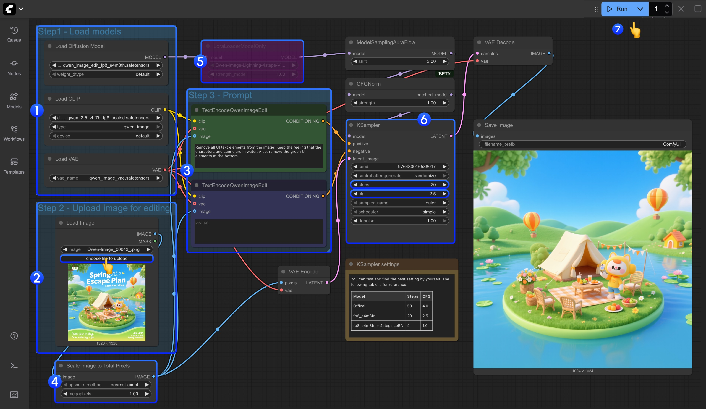

import UpdateReminder from "/snippets/ru/tutorials/update-reminder.mdx"

**Qwen-Image-Edit** представляет собой версию Qwen-Image для редактирования изображений. Она дополнительно обучена на основе 20B-модели Qwen-Image, что позволило перенести уникальные возможности Qwen-Image по рендерингу текста на задачи редактирования и обеспечить точное редактирование текста. Кроме того, Qwen-Image-Edit подаёт входное изображение одновременно в Qwen2.5-VL (для управления визуальной семантикой) и в VAE Encoder (для управления внешним видом), что обеспечивает одновременное редактирование семантики и внешнего вида.

**Особенности модели**

К возможностям относятся:
- Точное редактирование текста: Qwen-Image-Edit поддерживает редактирование текста на двух языках (китайском и английском), позволяя напрямую добавлять, удалять и изменять текст на изображениях, сохраняя исходный размер, шрифт и стиль текста.
- Редактирование семантики и внешнего вида: Qwen-Image-Edit поддерживает не только низкоуровневое редактирование внешнего вида (например, перенос стиля, добавление, удаление, изменение и т. д.), но и высокоуровневое редактирование визуальной семантики (например, создание IP, поворот объекта и т. д.).
- Высокие результаты на разных бенчмарках: оценки на нескольких публичных бенчмарках показывают, что Qwen-Image-Edit достигает SOTA в задачах редактирования, что делает её мощной базовой моделью для генерации изображений.

**Официальные ссылки**:
- [Репозиторий GitHub](https://github.com/QwenLM/Qwen-Image)
- [Hugging Face](https://huggingface.co/Qwen/Qwen-Image-Edit)
- [ModelScope](https://modelscope.cn/models/qwen/Qwen-Image-Edit)

## Прямой эфир ComfyOrg о Qwen-Image-Edit

<iframe
  className="w-full aspect-video rounded-xl"
 src="https://www.youtube.com/embed/TZIijn-tvoc?si=Vb-ZNwTvJC67_UEE" 
 title="Qwen-Image Edit in ComfyUI - Image Editing Model / August 19th, 2025" frameborder="0" 
 allow="accelerometer; clipboard-write; encrypted-media; gyroscope; picture-in-picture; web-share" 
 referrerpolicy="strict-origin-when-cross-origin" 
 allowfullscreen>
 </iframe>

## Пример нативного рабочего процесса Qwen-Image-Edit в ComfyUI

<UpdateReminder />

### Редактирование изображений в Qwen Image Edit {#image_qwen_image_edit}

Редактируйте изображения с помощью 20B-модели MMDiT Qwen-Image-Edit: точное двуязычное редактирование текста и одновременная работа со смыслом и внешним видом.


<CardGroup cols={2}>
  <Card title="Запустить в Comfy Cloud" icon="cloud" href="https://cloud.comfy.org/?template=image_qwen_image_edit&utm_source=docs&utm_medium=referral&utm_campaign=qwen-image-edit">
    Запустите этот рабочий процесс на облачных GPU без какой-либо настройки
  </Card>
  <Card title="Скачать рабочий процесс" icon="download" href="https://github.com/Comfy-Org/workflow_templates/blob/main/templates/image_qwen_image_edit.json">
    Скачайте JSON или найдите «Qwen Image Edit» в библиотеке шаблонов
  </Card>
</CardGroup>

**Входные материалы**

Загрузите этот файл в соответствующий узел `LoadImage`:

<CardGroup cols={2}>
  <Card title="image_qwen_image_edit_input_image.png" icon="image" href="https://raw.githubusercontent.com/Comfy-Org/workflow_templates/main/input/image_qwen_image_edit_input_image.png">
    Узел `LoadImage` 78 · `image_qwen_image_edit_input_image.png`
  </Card>
</CardGroup>

<div style={{display: 'grid', gridTemplateColumns: 'repeat(2, minmax(0, 1fr))', gap: '1rem', alignItems: 'start'}}>
  
</div>

**Пример результата**

<div style={{display: 'grid', gridTemplateColumns: 'repeat(2, minmax(0, 1fr))', gap: '1rem', alignItems: 'start'}}>
  
  
</div>

### 1. Файл рабочего процесса

### 2. Загрузка моделей

Все модели можно найти в [Comfy-Org/Qwen-Image_ComfyUI](https://huggingface.co/Comfy-Org/Qwen-Image_ComfyUI/tree/main) или в [Comfy-Org/Qwen-Image-Edit_ComfyUI](https://huggingface.co/Comfy-Org/Qwen-Image-Edit_ComfyUI)

**Модель диффузии**

- [qwen_image_edit_fp8_e4m3fn.safetensors](https://huggingface.co/Comfy-Org/Qwen-Image-Edit_ComfyUI/blob/main/split_files/diffusion_models/qwen_image_edit_fp8_e4m3fn.safetensors)

**LoRA**

- [Qwen-Image-Lightning-4steps-V1.0.safetensors](https://huggingface.co/lightx2v/Qwen-Image-Lightning/blob/main/Qwen-Image-Lightning-4steps-V1.0.safetensors)

**Текстовый энкодер**

- [qwen_2.5_vl_7b_fp8_scaled.safetensors](https://huggingface.co/Comfy-Org/Qwen-Image_ComfyUI/blob/main/split_files/text_encoders/qwen_2.5_vl_7b_fp8_scaled.safetensors)

**VAE**

- [qwen_image_vae.safetensors](https://huggingface.co/Comfy-Org/Qwen-Image_ComfyUI/blob/main/split_files/vae/qwen_image_vae.safetensors)

Расположение моделей на диске

```
📂 ComfyUI/
├── 📂 models/
│   ├── 📂 diffusion_models/
│   │   └── qwen_image_edit_fp8_e4m3fn.safetensors
│   ├── 📂 loras/
│   │   └── Qwen-Image-Lightning-4steps-V1.0.safetensors
│   ├── 📂 vae/
│   │   └── qwen_image_vae.safetensors
│   └── 📂 text_encoders/
│       └── qwen_2.5_vl_7b_fp8_scaled.safetensors
```

### 3. Выполните шаги, чтобы завершить рабочий процесс



1. Загрузка моделей
    - Убедитесь, что узел `Load Diffusion Model` загружает `qwen_image_edit_fp8_e4m3fn.safetensors`
    - Убедитесь, что узел `Load CLIP` загружает `qwen_2.5_vl_7b_fp8_scaled.safetensors`
    - Убедитесь, что узел `Load VAE` загружает `qwen_image_vae.safetensors`
2. Загрузка изображения
    - Убедитесь, что узел `Load Image` загружает изображение для редактирования
3. Установка промпта
    - Задайте промпт в узле `CLIP Text Encoder`
4. Узел Scale Image to Total Pixels масштабирует входное изображение до общего количества в один миллион пикселей,
    - в основном чтобы избежать потери качества выходных изображений из-за слишком больших входных изображений, например 2048x2048
    - если вы знаете размер своего входного изображения, можете обойти этот узел с помощью `Ctrl+B`
5. Если вы хотите использовать 4-шаговую Lightning LoRA для ускорения генерации изображений, выберите узел `LoraLoaderModelOnly` и нажмите `Ctrl+B`, чтобы включить его
6. Для настроек `steps` и `cfg` узла KSampler мы добавили примечание под узлом, где можно подобрать оптимальные параметры
7. Нажмите кнопку `Queue` или используйте сочетание клавиш `Ctrl(cmd) + Enter`, чтобы запустить рабочий процесс

## Qwen Image Edit 2509 {#image_qwen_image_edit_2509}

Qwen-Image-Edit-2509 это следующая итерация Qwen-Image-Edit. Она сохраняет точное двуязычное редактирование текста исходной модели и добавляет приём нескольких изображений, более согласованные правки в серии изображений и поддержку ControlNet, поэтому можно редактировать одно изображение, ориентируясь на другие.


<CardGroup cols={2}>
  <Card title="Запустить в Comfy Cloud" icon="cloud" href="https://cloud.comfy.org/?template=image_qwen_image_edit_2509&utm_source=docs&utm_medium=referral&utm_campaign=qwen-image-edit">
    Открыть в Comfy Cloud
  </Card>
  <Card title="Скачать рабочий процесс" icon="download" href="https://github.com/Comfy-Org/workflow_templates/blob/main/templates/image_qwen_image_edit_2509.json">
    Скачайте JSON или найдите &quot;Qwen Image Edit 2509&quot; в Библиотеке шаблонов
  </Card>
</CardGroup>

**Входные материалы**

Загрузите этот файл в соответствующий узел `LoadImage`:

<CardGroup cols={2}>
  <Card title="image_qwen_image_edit_2509_input_image.png" icon="image" href="https://raw.githubusercontent.com/Comfy-Org/workflow_templates/main/input/image_qwen_image_edit_2509_input_image.png">
    Узел `LoadImage` 78 · `image_qwen_image_edit_2509_input_image.png`
  </Card>
</CardGroup>

### Загрузка моделей

**Диффузионная модель**

- [qwen_image_edit_2509_fp8_e4m3fn.safetensors](https://huggingface.co/Comfy-Org/Qwen-Image-Edit_ComfyUI/blob/main/split_files/diffusion_models/qwen_image_edit_2509_fp8_e4m3fn.safetensors)

**LoRA (необязательно, для ускорения за 4 шага через Lightning)**

- [Qwen-Image-Edit-2509-Lightning-4steps-V1.0-bf16.safetensors](https://huggingface.co/lightx2v/Qwen-Image-Lightning/blob/main/Qwen-Image-Edit-2509/Qwen-Image-Edit-2509-Lightning-4steps-V1.0-bf16.safetensors)

**Текстовый энкодер**

- [qwen_2.5_vl_7b_fp8_scaled.safetensors](https://huggingface.co/Comfy-Org/Qwen-Image_ComfyUI/blob/main/split_files/text_encoders/qwen_2.5_vl_7b_fp8_scaled.safetensors)

**VAE**

- [qwen_image_vae.safetensors](https://huggingface.co/Comfy-Org/Qwen-Image_ComfyUI/blob/main/split_files/vae/qwen_image_vae.safetensors)

**Расположение моделей**

```
📂 ComfyUI/
├── 📂 models/
│   ├── 📂 diffusion_models/
│   │   └── qwen_image_edit_2509_fp8_e4m3fn.safetensors
│   ├── 📂 loras/
│   │   └── Qwen-Image-Edit-2509-Lightning-4steps-V1.0-bf16.safetensors
│   ├── 📂 vae/
│   │   └── qwen_image_vae.safetensors
│   └── 📂 text_encoders/
│       └── qwen_2.5_vl_7b_fp8_scaled.safetensors
```
