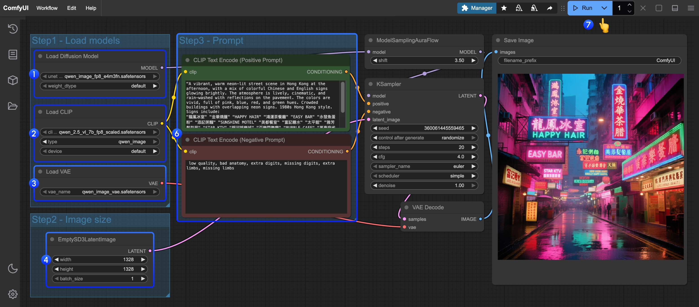
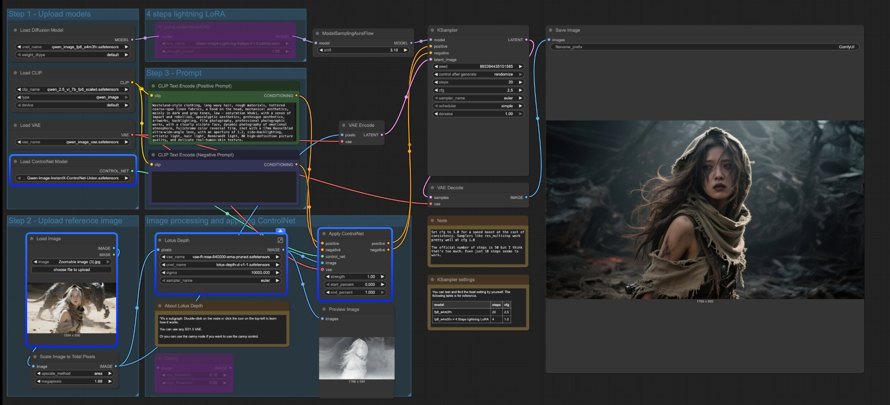
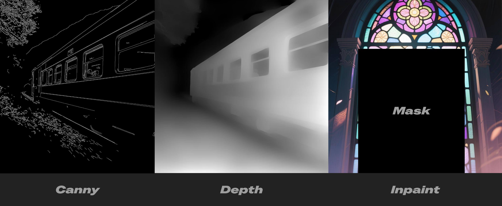
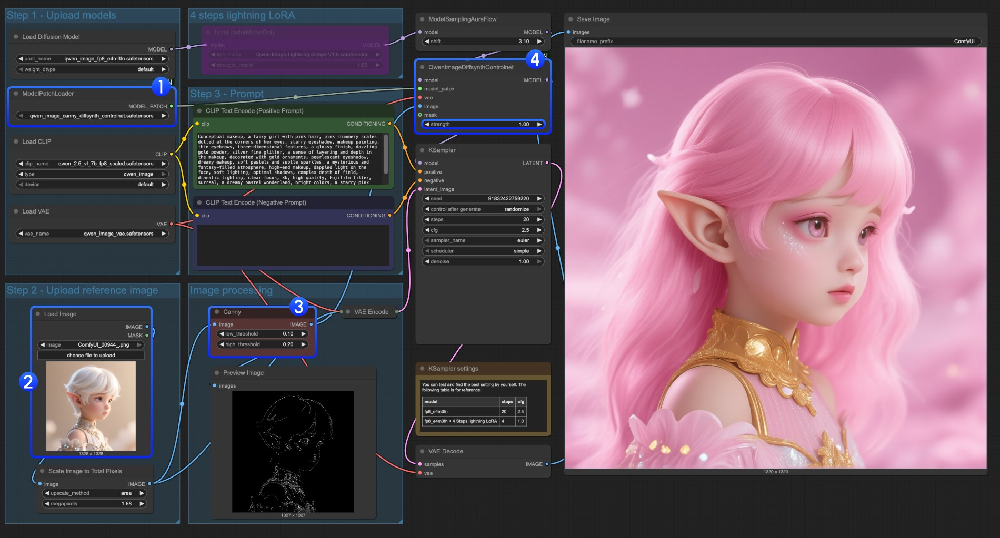
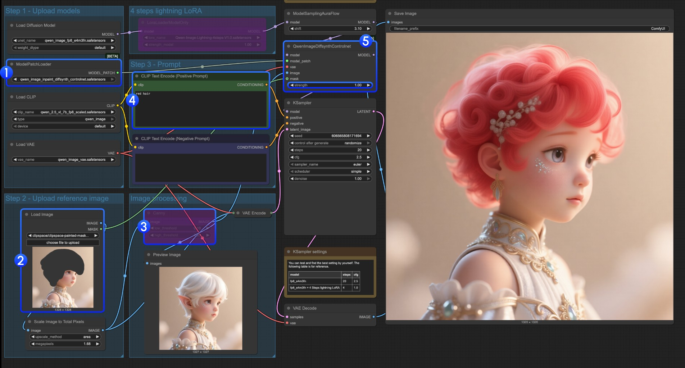
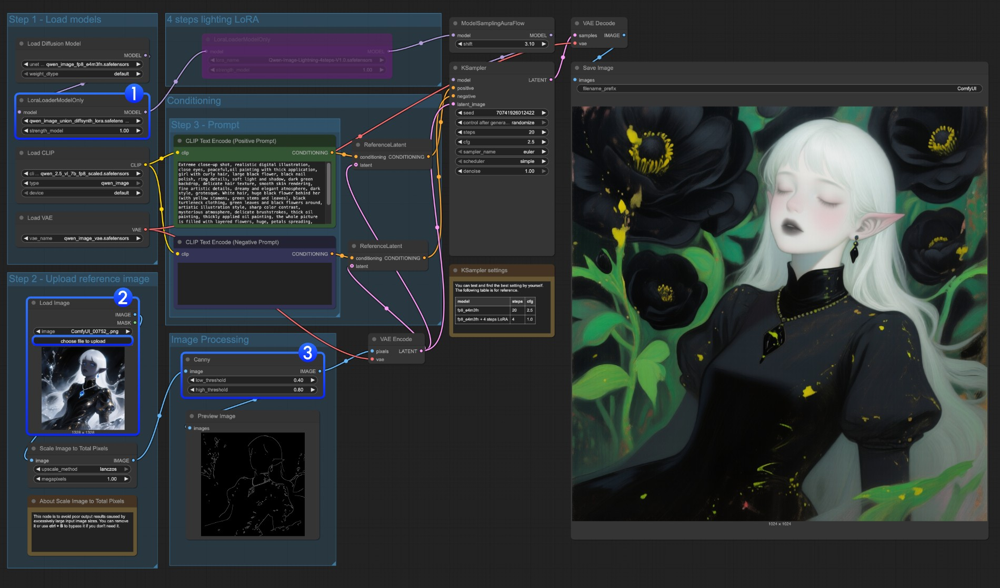

import UpdateReminder from "/snippets/ru/tutorials/update-reminder.mdx"

**Qwen-Image** — первая базовая модель генерации изображений, выпущенная командой Qwen из Alibaba. Это модель MMDiT (Multimodal Diffusion Transformer, мультимодальный диффузионный трансформер) с 20 млрд параметров, открытая под лицензией Apache 2.0. Модель добилась значительного прогресса в **сложном рендеринге текста** и **точном редактировании изображений**, обеспечивая высокоточный вывод для многих языков, включая английский и китайский.

**Ключевые особенности модели**:
- **Отличный многоязычный рендеринг текста**: поддерживает высокоточную генерацию текста на многих языках, включая английский, китайский, корейский и японский, сохраняя детали шрифта и единообразие вёрстки
- **Разнообразные художественные стили**: от фотореалистичных сцен до импрессионистских полотен, от аниме-эстетики до минималистичного дизайна, гибко подстраиваясь под самые разные творческие промпты

**Связанные ссылки**:
 - [GitHub](https://github.com/QwenLM/Qwen-Image)
 - [Hugging Face](https://huggingface.co/Qwen/Qwen-Image)
 - [ModelScope](https://modelscope.cn/models/qwen/Qwen-Image)

В настоящее время для Qwen-Image доступно несколько вариантов поддержки ControlNet:
- [Qwen-Image-DiffSynth-ControlNets/model_patches](https://huggingface.co/Comfy-Org/Qwen-Image-DiffSynth-ControlNets/tree/main/split_files/model_patches): включает модели canny, depth и inpaint
- [qwen_image_union_diffsynth_lora.safetensors](https://huggingface.co/Comfy-Org/Qwen-Image-DiffSynth-ControlNets/blob/main/split_files/loras/qwen_image_union_diffsynth_lora.safetensors): LoRA управления структурой изображения с поддержкой canny, depth, pose, lineart, softedge, normal, openpose
- InstantX ControlNet: будет обновлено

## Прямой эфир ComfyOrg по Qwen-Image

**Qwen-Image в ComfyUI: Lightning и LoRA**
<iframe
  className="w-full aspect-video rounded-xl"
  src="https://www.youtube.com/embed/WBFHwrpYRtY?si=uREGRhBDryTJBIry"
  title="Qwen-Image in ComfyUI - Lightning & LoRAs / August 15th, 2025"
  allow="accelerometer; clipboard-write; encrypted-media; gyroscope; picture-in-picture"
  allowFullScreen
></iframe>

**Qwen-Image ControlNet в ComfyUI: DiffSynth**

<iframe
  className="w-full aspect-video rounded-xl"
  src="https://www.youtube.com/embed/bXMClHfEFn4?si=dcaNdqOMSwvu3t8x"
  title="Qwen-Image ControlNet in ComfyUI - DiffSynth / August 26th, 2025"
  allow="accelerometer; clipboard-write; encrypted-media; gyroscope; picture-in-picture"
  allowFullScreen
></iframe>

## Пример нативного рабочего процесса Qwen-Image

<UpdateReminder />

### Qwen-Image: текст в изображение {#image_qwen_image}

Генерируйте изображения с выдающимися возможностями многоязычного рендеринга и редактирования текста с помощью 20B-модели MMDiT Qwen-Image.


<CardGroup cols={2}>
  <Card title="Запустить в Comfy Cloud" icon="cloud" href="https://cloud.comfy.org/?template=image_qwen_image&utm_source=docs&utm_medium=referral&utm_campaign=qwen-image">
    Открыть в Comfy Cloud
  </Card>
  <Card title="Скачать рабочий процесс" icon="download" href="https://github.com/Comfy-Org/workflow_templates/blob/main/templates/image_qwen_image.json">
    Скачать JSON или найти &quot;Qwen-Image&quot; в библиотеке шаблонов
  </Card>
</CardGroup>

**Пример результата**


В рабочем процессе, приложенном к этому документу, используются три разные модели:
1. Оригинальная модель Qwen-Image fp8_e4m3fn
2. Ускоренная 8-шаговая версия: оригинальная модель Qwen-Image fp8_e4m3fn с 8-шаговой LoRA lightx2v
3. Дистиллированная версия: дистиллированная модель Qwen-Image fp8_e4m3fn

**Справочник по использованию VRAM**
GPU: RTX4090D 24GB

| Используемая модель                              | Использование VRAM | Первая генерация | Вторая генерация |
| --------------------------------------- | ---------- | --------------- | ---------------- |
| fp8_e4m3fn                              | 86%        | ≈ 94s           | ≈ 71s            |
| fp8_e4m3fn с 8-шаговой LoRA lightx2v    | 86%        | ≈ 55s           | ≈ 34s            |
| Дистиллированная fp8_e4m3fn             | 86%        | ≈ 69s           | ≈ 36s            |

### 1. Файл рабочего процесса

После обновления ComfyUI файл рабочего процесса можно найти в шаблонах или перетащить приведённый ниже рабочий процесс в ComfyUI, чтобы загрузить его.


Дистиллированная версия
<Card title="Скачать рабочий процесс для дистиллированной модели" icon="download" href="https://github.com/Comfy-Org/example_workflows/blob/main/image/qwen/image_qwen_image_distill.json">
    Скачать рабочий процесс в формате JSON
  </Card>
### 2. Загрузка моделей

**Доступные модели в ComfyUI**

- Qwen-Image_bf16 (40.9 GB)
- Qwen-Image_fp8 (20.4 GB)
- Дистиллированные версии (неофициальные, требуют всего 15 шагов)

Все модели доступны на [Huggingface](https://huggingface.co/Comfy-Org/Qwen-Image_ComfyUI/tree/main) и [Modelscope](https://modelscope.cn/models/Comfy-Org/Qwen-Image_ComfyUI/files)

**Модель диффузии**

- [qwen_image_fp8_e4m3fn.safetensors](https://huggingface.co/Comfy-Org/Qwen-Image_ComfyUI/blob/main/split_files/diffusion_models/qwen_image_fp8_e4m3fn.safetensors)

Qwen_image_distill

- [qwen_image_distill_full_fp8_e4m3fn.safetensors](https://huggingface.co/Comfy-Org/Qwen-Image_ComfyUI/blob/main/non_official/diffusion_models/qwen_image_distill_full_fp8_e4m3fn.safetensors)
- [qwen_image_distill_full_bf16.safetensors](https://huggingface.co/Comfy-Org/Qwen-Image_ComfyUI/blob/main/non_official/diffusion_models/qwen_image_distill_full_bf16.safetensors)

<Note>
- Оригинальный автор дистиллированной версии рекомендует использовать 15 шагов с cfg 1.0.
- Согласно тестам, эта дистиллированная версия также хорошо показывает себя при 10 шагах с cfg 1.0. Можно выбрать euler или res_multistep в зависимости от желаемого типа изображения.
</Note>

**LoRA**

- [Qwen-Image-Lightning-8steps-V1.0.safetensors](https://huggingface.co/lightx2v/Qwen-Image-Lightning/blob/main/Qwen-Image-Lightning-8steps-V1.0.safetensors)

**Текстовый энкодер**

- [qwen_2.5_vl_7b_fp8_scaled.safetensors](https://huggingface.co/Comfy-Org/Qwen-Image_ComfyUI/blob/main/split_files/text_encoders/qwen_2.5_vl_7b_fp8_scaled.safetensors)

**VAE**

[qwen_image_vae.safetensors](https://huggingface.co/Comfy-Org/Qwen-Image_ComfyUI/blob/main/split_files/vae/qwen_image_vae.safetensors)

**Расположение моделей**

```
📂 ComfyUI/
├── 📂 models/
│   ├── 📂 diffusion_models/
│   │   ├── qwen_image_fp8_e4m3fn.safetensors
│   │   └── qwen_image_distill_full_fp8_e4m3fn.safetensors ## Дистиллированная версия
│   ├── 📂 loras/
│   │   └── Qwen-Image-Lightning-8steps-V1.0.safetensors   ## 8-шаговая ускоренная LoRA-модель
│   ├── 📂 vae/
│   │   └── qwen_image_vae.safetensors
│   └── 📂 text_encoders/
│       └── qwen_2.5_vl_7b_fp8_scaled.safetensors
```

### 3. Инструкции по рабочему процессу



1. Убедитесь, что в узле `Load Diffusion Model` загружен `qwen_image_fp8_e4m3fn.safetensors`
2. Убедитесь, что в узле `Load CLIP` загружен `qwen_2.5_vl_7b_fp8_scaled.safetensors`
3. Убедитесь, что в узле `Load VAE` загружен `qwen_image_vae.safetensors`
4. Убедитесь, что в узле `EmptySD3LatentImage` заданы правильные размеры изображения
5. Задайте промпт в узле `CLIP Text Encoder`. Сейчас он поддерживает как минимум английский, китайский, корейский, японский, итальянский и другие языки.
6. Если вы хотите включить 8-шаговую LoRA для ускорения от lightx2v, выберите узел и нажмите `Ctrl + B`, чтобы включить её, а затем измените настройки KSampler, как описано в шаге 8
7. Нажмите кнопку `Queue` или используйте сочетание клавиш `Ctrl(cmd) + Enter`, чтобы запустить рабочий процесс
8. Для разных версий моделей и рабочих процессов настройте параметры KSampler соответствующим образом

<Note>
 Дистиллированная модель и 8-шаговая LoRA для ускорения от lightx2v, по-видимому, несовместимы при одновременном использовании. Вы можете поэкспериментировать с разными комбинациями, чтобы проверить, можно ли использовать их вместе.
</Note>

## Рабочий процесс Qwen Image InstantX ControlNet

Это модель ControlNet, поэтому её можно использовать как обычный ControlNet.

### Qwen-Image InstantX Union ControlNet {#image_qwen_image_instantx_controlnet}

Генерируйте изображения с помощью Qwen-Image InstantX ControlNet с поддержкой canny, soft edge, depth и pose.


<CardGroup cols={2}>
  <Card title="Запустить в Comfy Cloud" icon="cloud" href="https://cloud.comfy.org/?template=image_qwen_image_instantx_controlnet&utm_source=docs&utm_medium=referral&utm_campaign=qwen-image">
    Открыть в Comfy Cloud
  </Card>
  <Card title="Скачать рабочий процесс" icon="download" href="https://github.com/Comfy-Org/workflow_templates/blob/main/templates/image_qwen_image_instantx_controlnet.json">
    Скачайте JSON или найдите «Qwen-Image InstantX ControlNet» в Библиотеке шаблонов
  </Card>
</CardGroup>

**Входные материалы**

Загрузите этот файл в соответствующий узел `LoadImage`:

<CardGroup cols={2}>
  <Card title="image_qwen_image_instantx_controlnet_input_image.jpg" icon="image" href="https://raw.githubusercontent.com/Comfy-Org/workflow_templates/main/input/image_qwen_image_instantx_controlnet_input_image.jpg">
    Узел `LoadImage` 71 · `image_qwen_image_instantx_controlnet_input_image.jpg`
  </Card>
</CardGroup>

<div style={{display: 'grid', gridTemplateColumns: 'repeat(2, minmax(0, 1fr))', gap: '1rem', alignItems: 'start'}}>
  
</div>

## 1. Рабочий процесс и входные изображения
### 2. Ссылки на модели

1. InstantX Controlnet

Скачайте [Qwen-Image-InstantX-ControlNet-Union.safetensors](https://huggingface.co/Comfy-Org/Qwen-Image-InstantX-ControlNets/blob/main/split_files/controlnet/Qwen-Image-InstantX-ControlNet-Union.safetensors) и сохраните его в папку `ComfyUI/models/controlnet/`

2. **Модель Lotus Depth**

Эта модель будет использоваться для генерации карты глубины изображения. Нужно скачать две следующие модели:

**Диффузионная модель**

- [lotus-depth-d-v1-1.safetensors](https://huggingface.co/Comfy-Org/lotus/blob/main/lotus-depth-d-v1-1.safetensors) 

**Модель VAE**

- [vae-ft-mse-840000-ema-pruned.safetensors](https://huggingface.co/stabilityai/sd-vae-ft-mse-original/blob/main/vae-ft-mse-840000-ema-pruned.safetensors)  или любой VAE для SD1.5

```
ComfyUI/
├── models/
│   ├── diffusion_models/
│   │   └─── lotus-depth-d-v1-1.safetensors
│   └── vae/
│       └──  lvae-ft-mse-840000-ema-pruned.safetensors
```

> Вы также можете использовать пользовательские узлы, например [comfyui_controlnet_aux](https://github.com/Fannovel16/comfyui_controlnet_aux), для генерации карты глубины.

### 3. Инструкции по рабочему процессу



1. Убедитесь, что узел `Load ControlNet Model` правильно загружает модель `Qwen-Image-InstantX-ControlNet-Union.safetensors`.
2. Загрузите входное изображение.
3. Этот подграф использует модель Lotus Depth. Вы можете найти его в шаблонах или отредактировать подграф, чтобы изучить его подробнее. Убедитесь, что все модели загружены правильно.
4. Нажмите кнопку `Run` или используйте сочетание клавиш `Ctrl(cmd) + Enter`, чтобы запустить рабочий процесс.

## Рабочий процесс с патчами моделей Qwen Image ControlNet DiffSynth-ControlNets

### Патч модели Qwen-Image ControlNet {#image_qwen_image_controlnet_patch}

Управляйте генерацией изображений с помощью моделей Qwen-Image ControlNet. Поддерживается управление по canny, глубине и инпейтингу через патчинг модели.


<CardGroup cols={2}>
  <Card title="Запустить в Comfy Cloud" icon="cloud" href="https://cloud.comfy.org/?template=image_qwen_image_controlnet_patch&utm_source=docs&utm_medium=referral&utm_campaign=qwen-image">
    Открыть в Comfy Cloud
  </Card>
  <Card title="Скачать рабочий процесс" icon="download" href="https://github.com/Comfy-Org/workflow_templates/blob/main/templates/image_qwen_image_controlnet_patch.json">
    Скачать JSON или найти «Qwen-Image ControlNet Patch» в библиотеке шаблонов
  </Card>
</CardGroup>

**Входные материалы**

Загрузите этот файл в соответствующий узел `LoadImage`:

<CardGroup cols={2}>
  <Card title="image_qwen_image_controlnet_patch_input_image.png" icon="image" href="https://raw.githubusercontent.com/Comfy-Org/workflow_templates/main/input/image_qwen_image_controlnet_patch_input_image.png">
    узел `LoadImage` 71 · `image_qwen_image_controlnet_patch_input_image.png`
  </Card>
</CardGroup>

<div style={{display: 'grid', gridTemplateColumns: 'repeat(2, minmax(0, 1fr))', gap: '1rem', alignItems: 'start'}}>
  
</div>

### 1. Рабочий процесс и входные изображения

После обновления ComfyUI файл рабочего процесса можно найти в шаблонах или перетащить приведённый выше предпросмотр рабочего процесса в ComfyUI, чтобы загрузить его.

### 2. Ссылки на модели

Остальные модели совпадают с базовым рабочим процессом Qwen-Image. Нужно только скачать модели ниже и сохранить их в папку `ComfyUI/models/model_patches`

- [qwen_image_canny_diffsynth_controlnet.safetensors](https://huggingface.co/Comfy-Org/Qwen-Image-DiffSynth-ControlNets/blob/main/split_files/model_patches/qwen_image_canny_diffsynth_controlnet.safetensors)
- [qwen_image_depth_diffsynth_controlnet.safetensors](https://huggingface.co/Comfy-Org/Qwen-Image-DiffSynth-ControlNets/blob/main/split_files/model_patches/qwen_image_depth_diffsynth_controlnet.safetensors)
- [qwen_image_inpaint_diffsynth_controlnet.safetensors](https://huggingface.co/Comfy-Org/Qwen-Image-DiffSynth-ControlNets/blob/main/split_files/model_patches/qwen_image_inpaint_diffsynth_controlnet.safetensors)

### 3. Инструкции по использованию рабочего процесса

На данный момент в diffsynth есть три патч-модели: Canny, Depth и Inpaint.

Если вы впервые работаете с рабочими процессами, связанными с ControlNet, важно понимать, что управляющие изображения нужно предварительно обработать в поддерживаемые форматы, прежде чем модель сможет их использовать и распознать.



- Canny: обработанные границы canny, контуры линейного рисунка
- Depth: предварительно обработанная карта глубины, показывающая пространственные соотношения
- Inpaint: требуется использовать маску, чтобы отметить области, которые нужно перерисовать

Поскольку этот патч разделён на три разные модели, при подаче изображения нужно выбрать правильный тип предварительной обработки, чтобы изображение было обработано корректно.

**Инструкции по использованию ControlNet с моделью Canny**


1. Убедитесь, что загружена модель `qwen_image_canny_diffsynth_controlnet.safetensors`
2. Загрузите входное изображение для последующей обработки
3. Узел Canny представляет собой нативный узел предварительной обработки: он обрабатывает входное изображение согласно заданным параметрам, управляя генерацией
4. При необходимости можно изменить `strength` в узле `QwenImageDiffsynthControlnet`, чтобы регулировать интенсивность управления линейным рисунком
5. Нажмите кнопку `Run` или используйте сочетание клавиш `Ctrl(cmd) + Enter`, чтобы запустить рабочий процесс

> Для использования qwen_image_depth_diffsynth_controlnet.safetensors нужно предварительно преобразовать изображение в карту глубины и заменить часть `image processing`. Об этом способе использования см. метод обработки InstantX в этом документе. Остальные шаги аналогичны использованию модели Canny.

**Инструкции по использованию ControlNet с моделью Inpaint**


Для модели Inpaint требуется нарисовать маску с помощью [Редактора масок](/ru/interface/maskeditor) и использовать её как входное условие управления.

1. Убедитесь, что `ModelPatchLoader` загружает модель `qwen_image_inpaint_diffsynth_controlnet.safetensors`
2. Загрузите изображение и нарисуйте маску с помощью [Редактора масок](/ru/interface/maskeditor). Нужно подключить выход `mask` соответствующего узла `Load Image` ко входу `mask` узла `QwenImageDiffsynthControlnet`, чтобы загружалась нужная маска
3. Используйте сочетание клавиш `Ctrl-B`, чтобы перевести исходный узел Canny в рабочем процессе в режим обхода, отключив обработку в соответствующем узле Canny
4. В `CLIP Text Encoder` введите, на что нужно заменить содержимое области под маской
5. При необходимости можно изменить `strength` в узле `QwenImageDiffsynthControlnet`, чтобы регулировать соответствующую интенсивность управления
6. Нажмите кнопку `Run` или используйте сочетание клавиш `Ctrl(cmd) + Enter`, чтобы запустить рабочий процесс

## Рабочий процесс Qwen Image Union ControlNet LoRA

### Qwen-Image Union Control {#image_qwen_image_union_control_lora}

Генерируйте изображения с точным структурным контролем с помощью унифицированного ControlNet LoRA от Qwen-Image. Поддерживаются несколько типов контроля, включая canny, depth, lineart, softedge, normal и openpose.


<CardGroup cols={2}>
  <Card title="Запустить в Comfy Cloud" icon="cloud" href="https://cloud.comfy.org/?template=image_qwen_image_union_control_lora&utm_source=docs&utm_medium=referral&utm_campaign=qwen-image">
    Открыть в Comfy Cloud
  </Card>
  <Card title="Скачать рабочий процесс" icon="download" href="https://github.com/Comfy-Org/workflow_templates/blob/main/templates/image_qwen_image_union_control_lora.json">
    Скачать JSON или найти &quot;Qwen-Image Union Control&quot; в библиотеке шаблонов
  </Card>
</CardGroup>

**Входные материалы**

Загрузите этот файл в соответствующий узел `LoadImage`:

<CardGroup cols={2}>
  <Card title="image_qwen_image_union_control_lora_input_image.png" icon="image" href="https://raw.githubusercontent.com/Comfy-Org/workflow_templates/main/input/image_qwen_image_union_control_lora_input_image.png">
    Узел `LoadImage` 73 · `image_qwen_image_union_control_lora_input_image.png`
  </Card>
</CardGroup>

<div style={{display: 'grid', gridTemplateColumns: 'repeat(2, minmax(0, 1fr))', gap: '1rem', alignItems: 'start'}}>
  
</div>

**Пример результата**

<div style={{display: 'grid', gridTemplateColumns: 'repeat(2, minmax(0, 1fr))', gap: '1rem', alignItems: 'start'}}>
  
  
</div>

Адрес оригинальной модели: [DiffSynth-Studio/Qwen-Image-In-Context-Control-Union](https://www.modelscope.cn/models/DiffSynth-Studio/Qwen-Image-In-Context-Control-Union/)
Адрес размещения от Comfy Org: [qwen_image_union_diffsynth_lora.safetensors](https://huggingface.co/Comfy-Org/Qwen-Image-DiffSynth-ControlNets/blob/main/split_files/loras/qwen_image_union_diffsynth_lora.safetensors): LoRA управления структурой изображения с поддержкой canny, depth, pose, lineart, softedge, normal, openpose

### 1. Рабочий процесс и входные изображения

После обновления ComfyUI файл рабочего процесса можно найти в шаблонах, а также перетащить предпросмотр рабочего процесса выше в ComfyUI, чтобы загрузить его.

### 2. Ссылки на модели

Скачайте модель ниже. Так как это LoRA-модель, её нужно сохранить в папку `ComfyUI/models/loras/`
-  [qwen_image_union_diffsynth_lora.safetensors](https://huggingface.co/Comfy-Org/Qwen-Image-DiffSynth-ControlNets/blob/main/split_files/loras/qwen_image_union_diffsynth_lora.safetensors): LoRA управления структурой изображения с поддержкой canny, depth, pose, lineart, softedge, normal, openpose

### 3. Инструкции по рабочему процессу

Эта модель представляет собой унифицированный LoRA управления, поддерживающий canny, depth, pose, lineart, softedge, normal, openpose. Поскольку многие нативные узлы предобработки изображений поддерживаются не полностью, для дополнительной предобработки изображений следует использовать что-то вроде [comfyui_controlnet_aux](https://github.com/Fannovel16/comfyui_controlnet_aux).



1. Убедитесь, что `LoraLoaderModelOnly` корректно загружает модель `qwen_image_union_diffsynth_lora.safetensors`.
2. Загрузите входное изображение.
3. При необходимости можно настроить параметры узла `Canny`. Поскольку для разных входных изображений требуются разные значения параметров для более качественной предобработки, попробуйте изменить соответствующие значения, чтобы получить больше или меньше деталей.
4. Нажмите кнопку `Run` или используйте сочетание клавиш `Ctrl(cmd) + Enter`, чтобы запустить рабочий процесс.

> Для других типов контроля также потребуется заменить часть обработки изображений.
