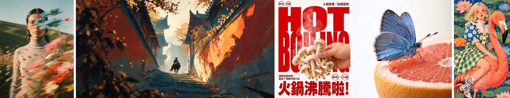
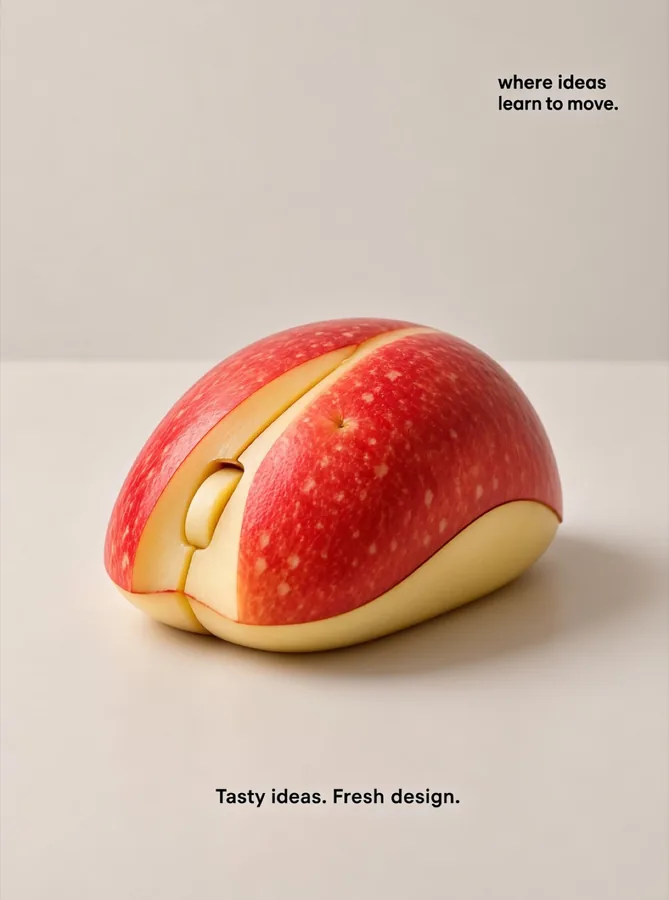
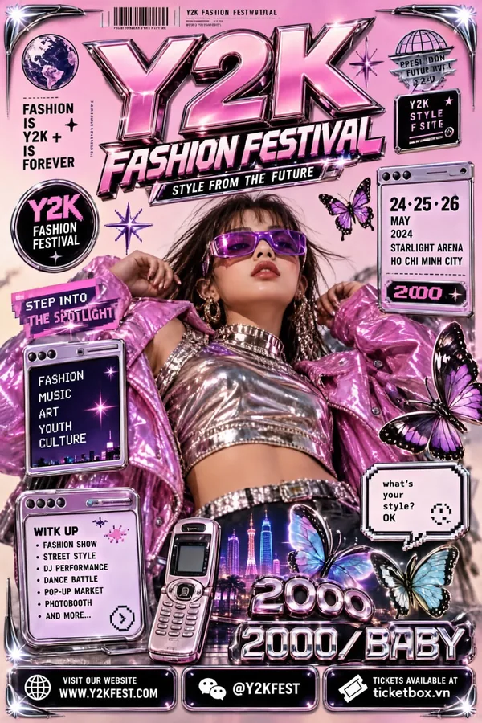
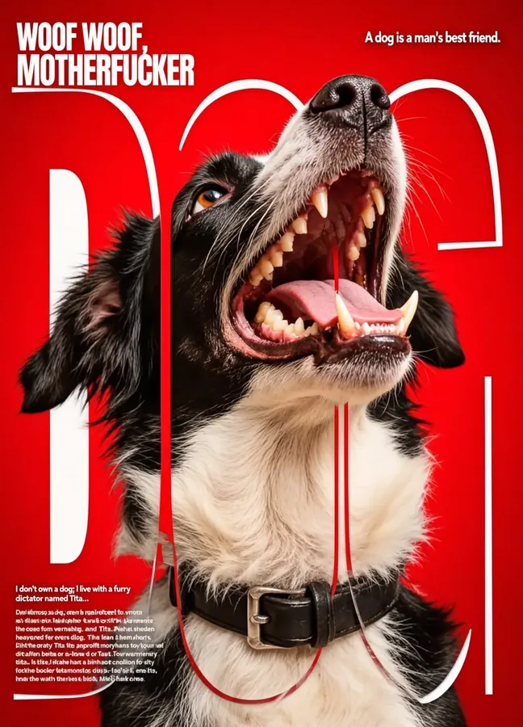
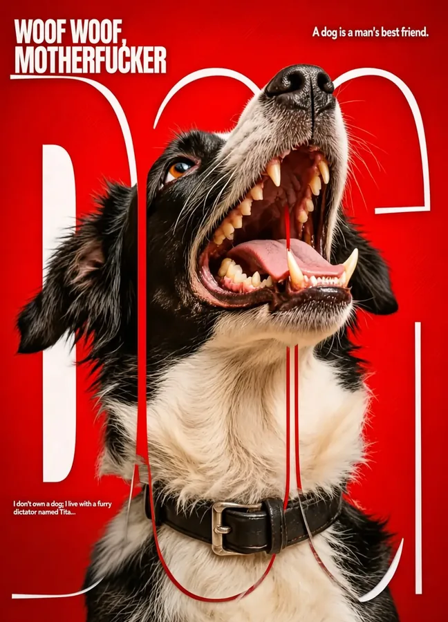
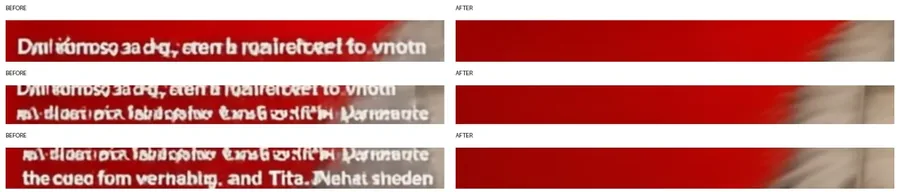
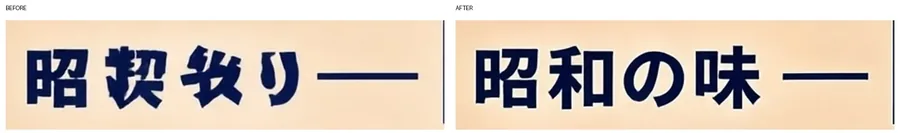

import UpdateReminder from "/snippets/ru/tutorials/update-reminder.mdx"



**SenseNova-U1.6** представляет собой унифицированную мультимодальную модель. Визуальное понимание и генерация изображений работают в одном 8B-бэкбоне `mot`, поэтому одна и та же модель читает промпт или исходное изображение и возвращает результат. Она рассчитана на задачи, где важны и точность, и внешний вид: портреты, постеры, иллюстрации и инфографику.

Кроме того, она выполняет автономный проход самокоррекции. После получения результата модель сравнивает собственный вывод с промптом и перегенерирует его, если что-то не совпадает, до 5 проходов.

**Ключевые особенности**:
- **Один бэкбон, два направления**: одна и та же 8B-модель `mot` отвечает и за интерпретацию, и за рендеринг, как для текста в изображение, так и для правок по исходному изображению.
- **Автономная самокоррекция**: модель сравнивает собственный вывод с промптом и перегенерирует его, до 5 проходов.
- **Два режима выборки**: Turbo с 8-шаговой LoRA при 8 шагах и CFG 1.0 либо Quality без LoRA при 50 шагах и CFG 4.0.
- **Утончённая эстетика, более богатая выразительность**: **улучшение общего эстетического качества на 10% по сравнению с U1.5** в субъективных пользовательских оценках, при этом модели эстетического вознаграждения отдельно настроены для портретов и фотореалистичных сцен, для художественных работ и для инфографики.
- **Автономная рефлексия**: на насыщенных задачах инфографики в UltraTextBench цикл самокоррекции даёт **среднее относительное улучшение на 7% по сравнению с однопроходной генерацией**.
- **Необязательный PE-переписыватель промптов**: текстовый кодировщик Qwen Image 2.1 PE разворачивает короткий промпт в полноценное визуальное описание и вписывает точный текст, который должен быть на изображении.

**Официальные ссылки**:
- [Hugging Face: Comfy-Org/SenseNova-U1](https://huggingface.co/Comfy-Org/SenseNova-U1) (чекпойнт и 8-шаговая LoRA)
- [GitHub: OpenSenseNova/SenseNova-U1](https://github.com/OpenSenseNova/SenseNova-U1)
- [Hugging Face: sensenova/SenseNova-U1.6-8B-MoT](https://huggingface.co/sensenova/SenseNova-U1.6-8B-MoT) (официальные веса модели)
- [Hugging Face: sensenova/SenseNova-U1.6-8B-MoT-LoRAs](https://huggingface.co/sensenova/SenseNova-U1.6-8B-MoT-LoRAs) (официальная 8-шаговая LoRA)

Оба шаблона требуют ComfyUI 0.46.0 или новее.

## Примеры

Шесть официальных примеров от SenseNova, охватывающих творческие направления, на которые ориентирована модель: они опубликованы командой SenseNova, а не получены с помощью этих рабочих процессов. Команда рассматривает модель через две цели одновременно: творческое визуальное выражение и встроенную самокоррекцию, поэтому точность и красота должны идти рука об руку.

### Фотография, иллюстрация и постеры

<Columns cols={2}>
  <Frame caption="Длинная выдержка: объект остаётся резким, а толпа размывается.">
    
  </Frame>
  <Frame caption="Высокоскоростная предметная съёмка: стеклянная кружка застыла в воздухе вместе с брызгами.">
    
  </Frame>
  <Frame caption="Иллюстрация: девушка в синем среди цветов и кошек.">
    
  </Frame>
  <Frame caption="Иллюстрация: туманные горы в оранжевом свете.">
    
  </Frame>
  <Frame caption="Постер с типографикой заголовка: «Tasty ideas. Fresh design.»">
    
  </Frame>
  <Frame caption="Постер: фестиваль моды Y2K, блочная пиксельная типографика на фоне плоской студийной сцены.">
    
  </Frame>
</Columns>

## Самокоррекция на практике

В каждой паре ниже используются один и тот же промпт и seed: сначала один проход, затем цикл generate / review / refine. Третье изображение: увеличенный фрагмент текста, который исправил цикл.

<Columns cols={3}>
  <Frame caption="Красный постер с питомцем · ДО">
    
  </Frame>
  <Frame caption="Красный постер с питомцем · ПОСЛЕ">
    
  </Frame>
  <Frame caption="Красный постер с питомцем · Сравнение деталей">
    
  </Frame>
</Columns>

<Columns cols={3}>
  <Frame caption="Постер напитка эпохи Сёва · ДО">
    
  </Frame>
  <Frame caption="Постер напитка эпохи Сёва · ПОСЛЕ">
    
  </Frame>
  <Frame caption="Постер напитка эпохи Сёва · Сравнение деталей">
    
  </Frame>
</Columns>

## Рабочий процесс «текст в изображение»

<UpdateReminder />

### SenseNova U1.6: текст в изображение {#image_sensenova_u16_t2i}

Превратите описание сцены в готовое изображение. Модель читает промпт, достраивает визуальные детали и возвращает изображение на 4 мегапикселя в выбранном вами соотношении сторон.


<CardGroup cols={2}>
  <Card title="Запустить в Comfy Cloud" icon="cloud" href="https://cloud.comfy.org/?template=image_sensenova_u16_t2i&utm_source=docs&utm_medium=referral&utm_campaign=sensenova-u1-6">
    Открыть в Comfy Cloud
  </Card>
  <Card title="Скачать рабочий процесс" icon="download" href="https://github.com/Comfy-Org/workflow_templates/blob/main/templates/image_sensenova_u16_t2i.json">
    Скачайте JSON или найдите &quot;SenseNova U1.6: Text to Image&quot; в Библиотеке шаблонов
  </Card>
</CardGroup>

**Пример результата**


#### Файл рабочего процесса

После обновления ComfyUI найдите шаблон в Библиотеке шаблонов или перетащите предпросмотр выше в ComfyUI, чтобы загрузить его.

Рабочий процесс содержит два pipeline:
- **Base pipeline**: один проход генерации, для портретов, фотографии, постеров и общей иллюстрации.
- **Self-correction pipeline**: генерация, проверка и доработка, до 5 проходов, затем декодирование. Лучше всего подходит для инфографики, плотного текста, диаграмм и пошаговых схем.

Переключатели на холсте выбирают pipeline, LoRA Turbo, а также значения шагов и CFG.

#### Скачать модели

**Чекпойнт**

- [sensenova_u1.6_8b_mot_int8_convrot.safetensors](https://huggingface.co/Comfy-Org/SenseNova-U1/resolve/main/checkpoints/sensenova_u1.6_8b_mot_int8_convrot.safetensors)

**LoRA (режим Turbo)**

- [sensenova_u1.6_8b_mot_8step_lora_bf16.safetensors](https://huggingface.co/Comfy-Org/SenseNova-U1/resolve/main/loras/sensenova_u1.6_8b_mot_8step_lora_bf16.safetensors)

**Текстовый энкодер (опциональный PE)**

- [qwen3.5_9b_qwen_image_2.1_pe_t2i.int8_convrot.safetensors](https://huggingface.co/Comfy-Org/Qwen-Image-2.1/resolve/main/text_encoders/qwen3.5_9b_qwen_image_2.1_pe_t2i.int8_convrot.safetensors) (8.82 GB)

**Место хранения моделей**

```
📂 ComfyUI/
├── 📂 models/
│   ├── 📂 checkpoints/
│   │   └── sensenova_u1.6_8b_mot_int8_convrot.safetensors
│   ├── 📂 loras/
│   │   └── sensenova_u1.6_8b_mot_8step_lora_bf16.safetensors
│   └── 📂 text_encoders/
│       └── qwen3.5_9b_qwen_image_2.1_pe_t2i.int8_convrot.safetensors
```

#### Настройки выборки

| Режим | Шаги | CFG |
| --- | --- | --- |
| **Turbo** (LoRA на 8 шагов) | 8 | 1.0 |
| **Quality** (без LoRA) | 50 | 4.0 |

- **Turbo Mode?** загружает или пропускает LoRA на 8 шагов. Оставляйте его включённым, пока ведёте итерации, и отключайте для максимальной точности текста и мелких деталей.
- **Self-Correction** добавляет цикл генерации, проверки и доработки. Включайте его для макетов с большим объёмом текста и отключайте для простых портретов, поскольку каждый проход это ещё один запуск выборки.
- **Enable PE** подключает описанный выше переписыватель промпта.
- **Resolution** задаёт общий бюджет в мегапикселях с пресетами от 1:1 до 21:9. По умолчанию используется 4:3 (Standard) при 4 мегапикселях, то есть 2368 × 1760.

#### Советы по промптам

- Заключайте в кавычки каждое слово, которое должно появиться на изображении. Текст в кавычках отрисовывается дословно, а ошибки возникают именно в тексте без кавычек.
- При отключённом PE вы сами пишете полное визуальное описание. Запрос в одну строку не раскрывает сильные стороны модели в типографике и компоновке.

## Рабочий процесс редактирования изображения

### SenseNova U1.6: Image Edit {#image_sensenova_u16_image_edit}

Отредактируйте фотографию, прикрепив её как референс и описав изменение. Тот же 8B-бэкбон читает источник, перерабатывает его и возвращает результат редактирования в исходном разрешении и с исходным соотношением сторон.


<CardGroup cols={2}>
  <Card title="Запустить в Comfy Cloud" icon="cloud" href="https://cloud.comfy.org/?template=image_sensenova_u16_image_edit&utm_source=docs&utm_medium=referral&utm_campaign=sensenova-u1-6">
    Открыть в Comfy Cloud
  </Card>
  <Card title="Скачать рабочий процесс" icon="download" href="https://github.com/Comfy-Org/workflow_templates/blob/main/templates/image_sensenova_u16_image_edit.json">
    Скачать JSON или найдите «SenseNova U1.6: Image Edit» в Библиотеке шаблонов
  </Card>
</CardGroup>

**Входные материалы**

Загрузите этот файл в соответствующий узел `LoadImage`:

<CardGroup cols={2}>
  <Card title="sensenova_u16_edit_women_in_car.png" icon="image" href="https://raw.githubusercontent.com/Comfy-Org/workflow_templates/main/input/sensenova_u16_edit_women_in_car.png">
    Узел `LoadImage` 79 · `sensenova_u16_edit_women_in_car.png`
  </Card>
</CardGroup>

<div style={{display: 'grid', gridTemplateColumns: 'repeat(2, minmax(0, 1fr))', gap: '1rem', alignItems: 'start'}}>
  
</div>

**Пример результата**

<div style={{display: 'grid', gridTemplateColumns: 'repeat(2, minmax(0, 1fr))', gap: '1rem', alignItems: 'start'}}>
  
  
</div>

#### Файл рабочего процесса

После обновления ComfyUI найдите шаблон в Библиотеке шаблонов или перетащите предпросмотр выше в ComfyUI, чтобы загрузить его.

Исходное изображение масштабируется до 4 мегапикселей, то есть до диапазона, на котором обучалась модель, а затем дополняется до значения, кратного 32. Выходные данные соответствуют разрешению и соотношению сторон источника, поэтому при редактировании сохраняется исходное кадрирование.

Модель принимает до 5 референсных изображений. Полезный диапазон: от 1 до 4 референсов, и каждый из них расходует vision-токены и память.

`ImageCompare` показывает источник и результат рядом.

#### Скачать модель

**Чекпойнт**

- [sensenova_u1.6_8b_mot_int8_convrot.safetensors](https://huggingface.co/Comfy-Org/SenseNova-U1/resolve/main/checkpoints/sensenova_u1.6_8b_mot_int8_convrot.safetensors)

**LoRA (режим Turbo)**

- [sensenova_u1.6_8b_mot_8step_lora_bf16.safetensors](https://huggingface.co/Comfy-Org/SenseNova-U1/resolve/main/loras/sensenova_u1.6_8b_mot_8step_lora_bf16.safetensors)

**Текстовый энкодер (опциональный PE, редактирование изображения)**

- [qwen3.5_9b_qwen_image_2.1_pe_i2i.int8_convrot.safetensors](https://huggingface.co/Comfy-Org/Qwen-Image-2.1/resolve/main/text_encoders/qwen3.5_9b_qwen_image_2.1_pe_i2i.int8_convrot.safetensors) (8.82 GB)

**Расположение моделей**

```
📂 ComfyUI/
├── 📂 models/
│   ├── 📂 checkpoints/
│   │   └── sensenova_u1.6_8b_mot_int8_convrot.safetensors
│   ├── 📂 loras/
│   │   └── sensenova_u1.6_8b_mot_8step_lora_bf16.safetensors
│   └── 📂 text_encoders/
│       └── qwen3.5_9b_qwen_image_2.1_pe_i2i.int8_convrot.safetensors
```

#### Настройки выборки

| Режим | Шаги | CFG |
| --- | --- | --- |
| **Turbo** (8-шаговая LoRA) | 8 | 1.0 |
| **Quality** (без LoRA) | 50 | 4.0 |

- **Turbo Mode?** подключает или пропускает 8-шаговую LoRA. Держите его включённым, пока перебираете варианты, и выключите для максимальной точности текста и мелких деталей.
- **Self-Correction** добавляет цикл редактирования, проверки и доработки, который окупается, когда в композиции есть текст.
- **Enable PE** читает исходное изображение вместе с вашей инструкцией и разворачивает её в полный промпт редактирования.
- **Reference images** задают кадрирование. Размер вывода соответствует источнику, поэтому, если нужна другая форма, обрежьте референс или измените его размер перед постановкой в очередь.

#### Советы по промптам

- Скажите, что изменить, и перечислите, что должно остаться неизменным. Стоит назвать такие детали, как идентичность, кадрирование, освещение и фон.
- Заключайте в кавычки каждое слово, которое должно появиться на отредактированном изображении. Текст в кавычках воспроизводится дословно.
- При выключенном PE вы сами пишете полную инструкцию редактирования, включая и изменение, и список того, что нужно сохранить.


#### Многоходовое редактирование

В этом выпуске нет многоходового редактирования. Каждый проход представляет собой одну инструкцию, применённую к загруженному референсному изображению, и модель не сохраняет историю диалога между проходами. Возможно, позже появится LoRA или отдельная ветвь для многоходового редактирования. Пока что выстраивайте цепочку правок сами: сохраните результат, загрузите его как следующий референс и опишите следующее изменение.

## О промпт-энхансере

SenseNova U1.6 не имеет собственной специализированной модели для улучшения промптов. Оба шаблона могут дополнительно загружать текстовый энкодер PE **Qwen Image 2.1** (`qwen3.5_9b_qwen_image_2.1_pe_t2i` для режима «Текст в изображение», `..._pe_i2i` для редактирования изображения), который переписывает короткий промпт в подробное визуальное описание и подставляет точный текст, который должен быть на изображении. Отключите **Enable PE**, чтобы вместо этого использовать исходный промпт.
