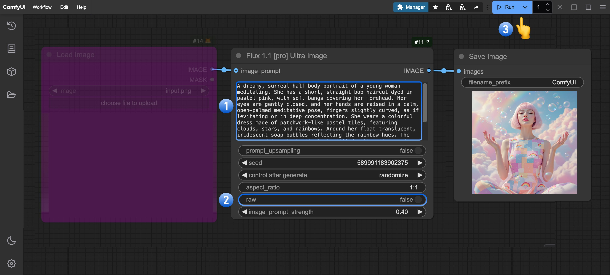
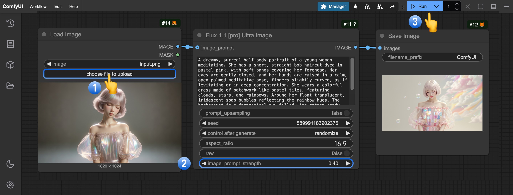
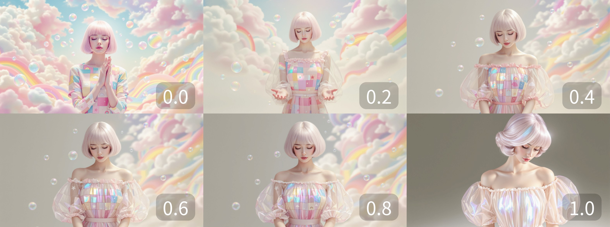

import ReqHint from "/snippets/ru/tutorials/partner-nodes/req-hint.mdx";
import UpdateReminder from "/snippets/ru/tutorials/update-reminder.mdx";

FLUX 1.1 Pro Ultra — это высокопроизводительный инструмент генерации изображений с помощью ИИ от BlackForestLabs, отличающийся сверхвысоким разрешением и эффективной генерацией. Он поддерживает разрешение до 4 Мп (в 4 раза больше стандартной версии), при этом генерация одного изображения занимает менее 10 секунд, что в 2,5 раза быстрее аналогичных моделей высокого разрешения.

Инструмент предлагает два основных режима:
- **Ultra Mode**: создан для задач с высоким разрешением, идеально подходит для рекламы и электронной коммерции, где важна детализация. Он точно следует промптам, сохраняя скорость генерации.
- **Raw Mode**: ориентирован на естественный реализм, оптимизирует оттенки кожи, освещение и детали пейзажей. Снижает «эффект ИИ» и идеально подходит для фотографии и создания реалистичного стиля.

## Для чего подходит FLUX 1.1 Pro Ultra Image

- **Сверхвысокое разрешение**: генерирует изображения до 4MP, что в 4 раза превышает разрешение стандартной версии
- **Быстрая генерация**: время генерации одного изображения остаётся менее 10 секунд, что в 2.5 раза быстрее аналогичных моделей высокого разрешения
- **Точность промптов при масштабировании**: Ultra Mode точно передаёт промпты, сохраняя скорость генерации, и подходит для рекламы и электронной коммерции
- **Естественный реализм**: Raw Mode оптимизирует оттенки кожи, освещение и детали пейзажа, чтобы снизить «эффект ИИ»
- **Смешивание в режиме изображение в изображение**: вход `image_prompt` смешивает особенности входного изображения, а `image_prompt_strength` управляет соотношением смешивания

## Примеры результатов

Генерация в режиме текст в изображение с помощью узла Flux 1.1 [pro] Ultra Image:

Ремикс в режиме изображение в изображение: перенос особенностей входного изображения в результат:

## Использовать

<Card title="Вызвать из кода" icon="code" href="/development/comfy-router/models/black-forest-labs/flux-1-1-pro-ultra-image/code">
  Вызывайте по HTTP через Comfy Router с готовыми к копированию и вставке фрагментами на Python, TypeScript, Swift и cURL
</Card>

Этот вызов выполняется в той же учётной записи Comfy и оплачивается теми же кредитами, что и запуск в ComfyUI ниже. Тарифы для каждой модели см. в разделе [Кредиты партнёрских узлов](/tutorials/partner-nodes/pricing), а о том, сколько запросов можно выполнять одновременно, читайте в разделе [Ограничения параллельных запросов](/ru/tutorials/partner-nodes/concurrency-limits).

<ReqHint/>
<UpdateReminder/>

## Документация узла FLUX 1.1 Pro Ultra Image

Подробные настройки параметров узла смотрите в следующей документации:

- [FLUX 1.1 Pro Ultra Image](/images/built-in-nodes/api_nodes/bfl/flux-1-1-pro-ultra-image.jpg)

## Руководство по генерации изображений из текста с FLUX 1.1 [pro]

### 1. Скачать файл рабочего процесса

Скачайте следующий файл и перетащите его в ComfyUI, чтобы загрузить рабочий процесс:

### 2. Выполнить шаги рабочего процесса

Выполните шаги по порядку, чтобы пройти базовый рабочий процесс:

1. (Необязательно) Измените промпт в узле `Flux 1.1 [pro] Ultra Image`
2. (Необязательно) Установите параметр `raw` в значение `false` для более реалистичного результата
3. Нажмите `Run` или используйте сочетание клавиш `Ctrl(cmd) + Enter`, чтобы сгенерировать изображение
4. После того как API вернёт результаты, просмотрите сгенерированное изображение в узле `Save Image`. Изображения сохраняются в каталог `ComfyUI/output/`

## Руководство по FLUX 1.1[pro] в режиме изображение в изображение

Если добавить `image_prompt` во вход узла, результат будет совмещать черты входного изображения (Remix). Значение `image_prompt_strength` влияет на соотношение смешивания: чем выше значение, тем больше результат похож на входное изображение.

### 1. Скачать файл рабочего процесса

Скачайте следующий файл и перетащите его в ComfyUI либо щёлкните правой кнопкой мыши по фиолетовому узлу в рабочем процессе «текст в изображение» и установите `mode` в `always`, чтобы включить вход `image_prompt`:

В качестве входного изображения мы будем использовать это изображение:

### 2. Выполнить шаги рабочего процесса

Выполните шаги по порядку:
1. Нажмите **Upload** на узле `Load Image`, чтобы загрузить входное изображение
2. (Необязательно) Настройте `image_prompt_strength` в `Flux 1.1 [pro] Ultra Image`, чтобы изменить соотношение смешивания
3. Нажмите `Run` или используйте сочетание клавиш `Ctrl(cmd) + Enter`, чтобы сгенерировать изображение
4. После того как API вернёт результаты, просмотрите сгенерированное изображение в узле `Save Image`. Изображения сохраняются в каталог `ComfyUI/output/`

Ниже приведено сравнение результатов с разными значениями `image_prompt_strength`:

