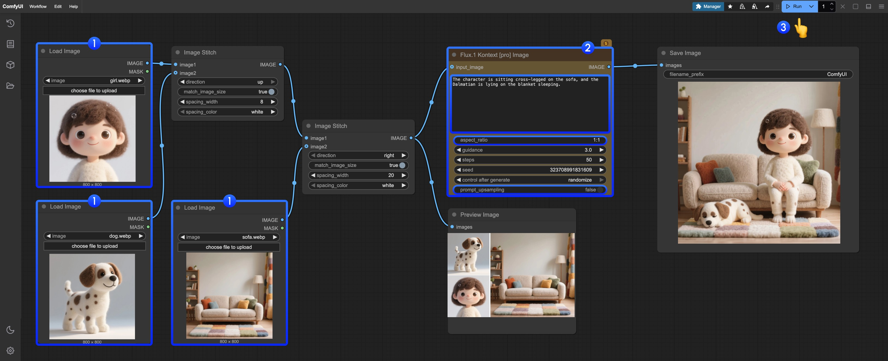
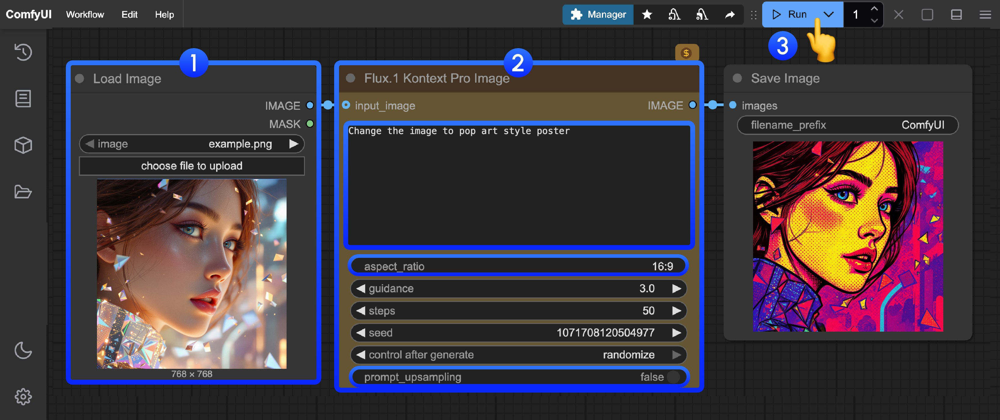
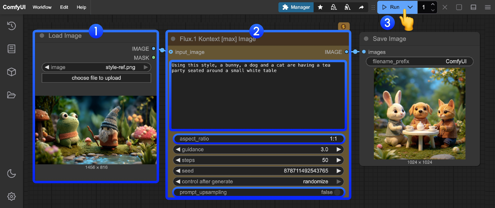

import ReqHint from "/snippets/ru/tutorials/partner-nodes/req-hint.mdx";
import PromptTechniques from "/snippets/ru/tutorials/flux/prompt-techniques.mdx";
import UpdateReminder from "/snippets/ru/tutorials/update-reminder.mdx";

FLUX.1 Kontext это профессиональная модель редактирования «изображение в изображение», разработанная Black Forest Labs, с акцентом на интеллектуальном понимании контекста изображения и точном редактировании.
Она выполняет различные задачи редактирования без сложных описаний, включая изменение объектов, перенос стиля, замену фона, редактирование с сохранением согласованности персонажа и редактирование текста.
Главное преимущество Kontext заключается в превосходной способности понимать контекст и сохранять согласованность персонажа: ключевые элементы, такие как черты персонажа и композиция кадра, остаются стабильными даже после нескольких итераций редактирования.

В настоящее время ComfyUI поддерживает две модели FLUX.1 Kontext:

* **Kontext Pro** идеально подходит для редактирования, компоновки и ремикса.
* **Kontext Max** расширяет границы типографики, точности промпта и скорости.

## В чём сильные стороны FLUX.1 Kontext

- **Универсальное редактирование без сложных описаний**: изменение объектов, перенос стиля, замена фона, редактирование с сохранением персонажа и редактирование текста
- **Понимание контекста**: интеллектуальное понимание контекста изображения позволяет вносить точные, целенаправленные правки
- **Согласованность персонажа**: черты персонажа и композиция остаются стабильными даже после нескольких итераций редактирования
- **Ввод нескольких изображений**: узел `Image Stitch` объединяет несколько изображений в одно для редактирования с помощью FLUX.1 Kontext
- **Два уровня моделей**: Kontext Pro для редактирования, компоновки и ремикса; Kontext Max для типографики, точности промпта и скорости

## Примеры выходов

Редактирование составного входа из нескольких изображений (девушка, собака и диван, объединённые в одну сцену):

Редактирование изображений с помощью Kontext Pro идеально подходит для правки, композитинга и ремикса:

Редактирование изображений с помощью Kontext Max, который раздвигает пределы типографики, точности промпта и скорости:

## Использовать

<Card title="Вызов из кода" icon="code" href="/ru/development/comfy-router/models/black-forest-labs/flux-1-kontext/code">
  Вызов Kontext Pro или Max по HTTP через Comfy Router с готовыми фрагментами для Python, TypeScript, Swift и cURL
</Card>

Это работает в той же учётной записи Comfy и оплачивается теми же кредитами, что и запуск в ComfyUI ниже. Тарифы по моделям смотрите на странице [Кредиты партнёрских узлов](/ru/tutorials/partner-nodes/pricing), а ограничения на количество одновременных запросов на странице [Лимиты параллельных запросов](/ru/tutorials/partner-nodes/concurrency-limits).

<ReqHint/>
<UpdateReminder/>

## Рабочий процесс FLUX.1 Kontext с несколькими входными изображениями

Мы недавно добавили поддержку рабочих процессов с несколькими входными изображениями. С помощью нового узла `Image Stitch` можно склеить несколько изображений в одно и отредактировать его с помощью FLUX.1 Kontext.

### 1. Скачать файл рабочего процесса

`metadata` приведённых ниже изображений содержит информацию о рабочем процессе. Скачайте их и перетащите в ComfyUI, чтобы загрузить соответствующий рабочий процесс.

Скачайте следующие изображения для входа или используйте свои:

### 2. Выполните рабочий процесс по шагам

Вы можете следовать пронумерованным шагам на изображении, чтобы выполнить рабочий процесс:

1. Загрузите предоставленные изображения в узле `Load image`
2. Измените необходимые параметры в `Flux.1 Kontext Pro Image`:
    - `prompt` Введите промпт для изображения, которое хотите отредактировать
    - `aspect_ratio` Задайте соотношение сторон исходного изображения, оно должно быть в диапазоне от 1:4 до 4:1
    - `prompt_upsampling` Укажите, использовать ли апсемплинг промпта. Если включено, промпт будет автоматически изменён для получения более богатых результатов, но результаты не воспроизводимы
3. Нажмите кнопку `Run` или используйте сочетание клавиш `Ctrl(cmd) + Enter`, чтобы выполнить редактирование изображения
4. После того как API вернёт результаты, вы можете просмотреть отредактированное изображение в узле `Save Image`, а соответствующее изображение также будет сохранено в каталог `ComfyUI/output/`

<Tip>
   Два последующих рабочих процесса отличаются только используемыми Партнёрскими узлами. Фактически вам нужно лишь внести изменения на основе рабочего процесса с несколькими входными изображениями, значительных отличий нет
</Tip>

## Рабочий процесс с партнёрскими узлами FLUX.1 Kontext Pro Image

### 1. Скачать файл рабочего процесса

`metadata` изображения ниже содержит информацию о рабочем процессе. Скачайте изображение и перетащите его в ComfyUI, чтобы загрузить соответствующий рабочий процесс.

Скачайте изображение ниже для использования в качестве входного или используйте собственное изображение:

### 2. Выполнить рабочий процесс шаг за шагом

Вы можете выполнить рабочий процесс, следуя пронумерованным шагам на изображении:
1. Загрузите изображение, которое хотите отредактировать, в узле `Load Image`
2. (Необязательно) Измените необходимые параметры в `Flux.1 Kontext Pro Image`
3. Нажмите кнопку `Run` или используйте сочетание клавиш `Ctrl(cmd) + Enter`, чтобы выполнить редактирование изображения
4. После ожидания ответа API вы можете просмотреть отредактированное изображение в узле `Save Image`, а соответствующее изображение также будет сохранено в каталог `ComfyUI/output/`

## Рабочий процесс с партнёрскими узлами FLUX.1 Kontext Max Image

### 1. Скачать файл рабочего процесса

`metadata` изображения ниже содержит информацию о рабочем процессе. Скачайте изображение и перетащите его в ComfyUI, чтобы загрузить соответствующий рабочий процесс.

Скачайте изображение ниже в качестве входного или используйте собственное изображение для демонстрации:

### 2. Выполнить рабочий процесс по шагам

Чтобы выполнить рабочий процесс, следуйте пронумерованным шагам на изображении:
1. Загрузите изображение, которое хотите отредактировать, в узле `Load Image`.
2. (Необязательно) Измените необходимые параметры в узле `Flux.1 Kontext Max Image`.
3. Нажмите кнопку `Run` или используйте сочетание клавиш `Ctrl(cmd) + Enter`, чтобы выполнить редактирование изображения.
4. После того как API вернёт результаты, вы можете просмотреть отредактированное изображение в узле `Save Image`, а соответствующее изображение также будет сохранено в каталог `ComfyUI/output/`.

<PromptTechniques/>
