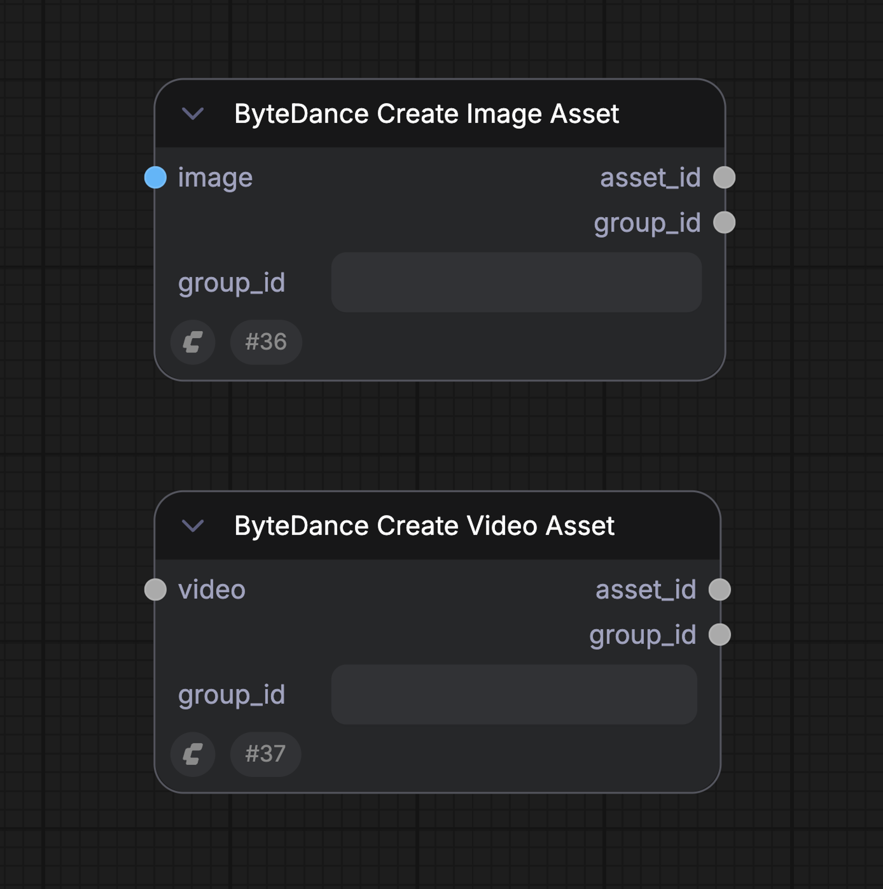
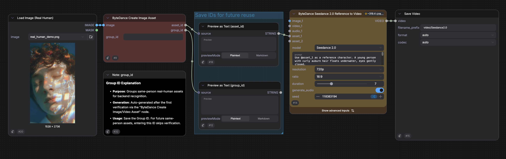
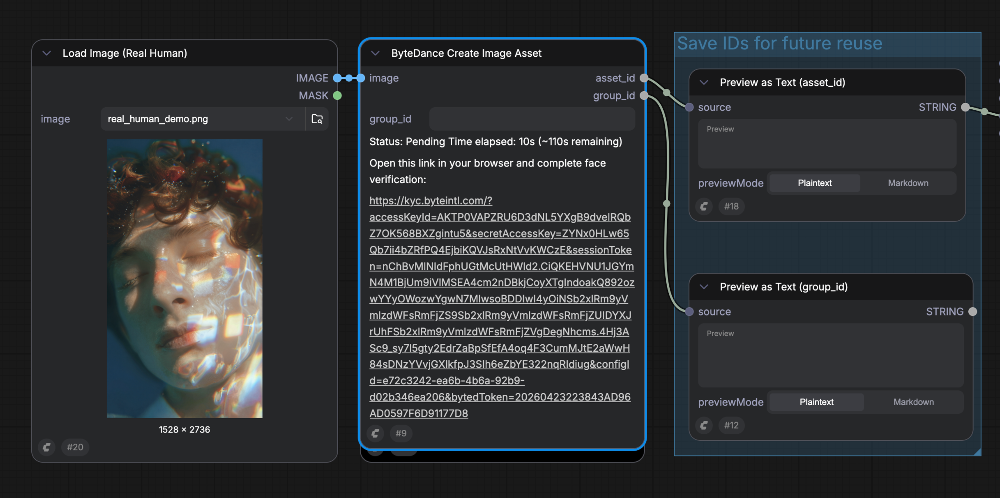
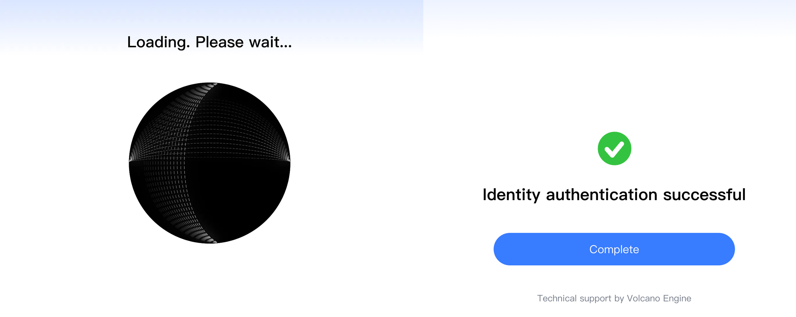
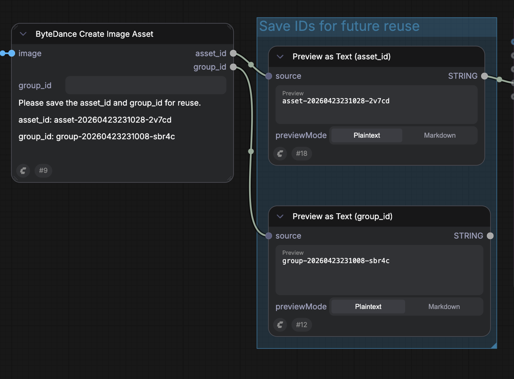
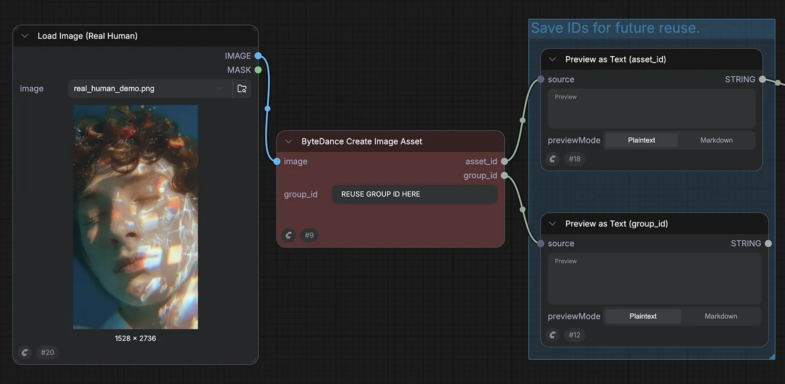

import ReqHint from "/snippets/ru/tutorials/partner-nodes/req-hint.mdx";
import UpdateReminder from "/snippets/ru/tutorials/update-reminder.mdx";

**Seedance 2.0 Real Human** доступен прямо в ComfyUI. Вы можете загрузить портрет через рабочий процесс ComfyUI, один раз пройти верификацию, а затем генерировать видео с этим реальным человеком, с устойчивой идентичностью и достоверной мимикой, не покидая ComfyUI.

С поддержкой Real Human в ComfyUI вы больше не ограничены виртуальными персонажами. Управляемость Seedance 2.0 и встроенная синхронизация аудио и видео теперь распространяются и на реальных людей: идентичность и игра сохраняются на протяжении всего клипа, а используются те же рабочие процессы на основе узлов, которые вы уже применяете для других генераций Seedance 2.0.

## Что умеет Seedance 2.0 Real Human

- **Реалистичные люди, кинематографичный контроль**: управляйте движением камеры, освещением и сменой сцен, сохраняя достоверность персонажа
- **Согласованность персонажа**: черты лица и общий внешний вид остаются стабильными при движении, перемещениях камеры и переходах
- **Нативная синхронизация видео и аудио**: видео и аудио (диалоги, окружение, музыка) генерируются вместе, обеспечивая более надёжную синхронизацию губ и выразительность мимики
- **Режиссура с несколькими референсами**: комбинируйте текст с **9 изображениями**, **3 видео** и **3 аудиоклипами**, чтобы зафиксировать внешний вид, движение и ритм

<ReqHint/>
<UpdateReminder/>

## Видеоруководство

Посмотрите полный обзор, в котором показаны верификация и оба рабочих процесса Seedance 2.0 Real Human от начала до конца в ComfyUI.

<video
  controls
  className="w-full aspect-video"
  src="https://raw.githubusercontent.com/Comfy-Org/docs/refs/heads/main/images/tutorial/api_nodes/bytedance/seedance2_0/guide.mp4"
></video>

## Как работает верификация в ComfyUI

Верификация обязательна, прежде чем какое-либо реальное лицо сможет появиться в генерации Seedance 2.0. Она предотвращает подмену личности и несанкционированное использование чьей-либо внешности, а выполняет её ByteDance, соблюдающая новые нормы прозрачности ИИ. Весь процесс управляется из ComfyUI через узел **ByteDance Create Image/Video Asset**: вам нужно лишь ненадолго покинуть ComfyUI, чтобы пройти проверку живости на телефоне или в браузере.

### Первый запуск (требуется верификация)

1. В ComfyUI добавьте узел **ByteDance Create Image/Video Asset** в рабочий процесс и загрузите портретное изображение
2. Запустите рабочий процесс: ComfyUI вернёт ссылку на верификацию от ByteDance
3. Откройте ссылку на телефоне или в браузере и пройдите проверку живости (менее 1 минуты)
4. После успешной верификации вернитесь в ComfyUI: выход узла теперь содержит проверенный актив

#### Скриншоты процесса верификации

**Шаг 1: Загрузите изображение и запустите процесс, чтобы начать верификацию**

**Шаг 2: Получите ссылку на верификацию**

**Шаг 3: Пройдите проверку живости на странице H5**

**Шаг 4: Вернитесь в ComfyUI и сохраните ID (без дополнительных кредитов)**

После успешной верификации реального человека узел выдаёт два ID, которые можно использовать в узлах генерации видео Seedance 2.0:

- **Group ID**: представляет проверенного человека. Сохраните его, чтобы позже повторно использовать ту же личность без повторной верификации
- **Asset ID**: представляет это конкретное изображение. Подключите его к узлу генерации видео Seedance 2.0, чтобы получить видео с проверенным человеком; его можно повторно использовать в нескольких рабочих процессах

### Последующие загрузки (без верификации)

1. В ComfyUI загрузите новое фото или видео того же человека с помощью узла **ByteDance Create Image/Video Asset**
2. Укажите в узле сохранённый **Group ID**
3. При запуске ByteDance сравнивает черты лица с исходной верификацией
4. Если совпадение есть, новый актив активируется автоматически и возвращается в ComfyUI, готовый к передаче в генерацию видео Seedance 2.0

#### Пропуск верификации с существующим Group ID

Если вы уже проходили верификацию хотя бы раз, для новых загрузок того же человека часто можно пропустить проверку живости, указав существующий **Group ID**. Если ByteDance распознаёт новое изображение как того же человека, верификация обходится.

## Доступные рабочие процессы

В ComfyUI доступны два готовых шаблона Seedance 2.0 Real Human. В обоих узел **ByteDance Create Image/Video Asset** подключён к узлу генерации видео Seedance 2.0, поэтому проверка и генерация выполняются за один запуск.

### Seedance 2.0 Real Human reference-to-video

Используйте проверенный портрет (а также при необходимости дополнительные референсные изображения, видео или аудио), чтобы создать видео Seedance 2.0 с неизменной внешностью реального человека.

<CardGroup cols={2}>
  <Card title="Запустить Seedance 2.0 Real Human R2V в Comfy Cloud" icon="cloud" href="https://cloud.comfy.org/?template=api_seedance2_0_r2v_real_human&utm_source=docs&utm_medium=referral&utm_campaign=seedance-2-0-real-human">
    Попробуйте рабочий процесс Seedance 2.0 Real Human Reference-to-Video прямо в Comfy Cloud.
  </Card>
  <Card title="Рабочий процесс Seedance 2.0 Real Human R2V" icon="download" href="https://github.com/Comfy-Org/workflow_templates/blob/main/templates/api_seedance2_0_r2v_real_human.json">
    Скачайте файл рабочего процесса Seedance 2.0 Real Human Reference-to-Video.
  </Card>
</CardGroup>

Входные материалы

Скачайте этот пример входного изображения, чтобы попробовать рабочий процесс:

<CardGroup cols={1}>
  <Card title="Референсный портрет" icon="image" href="https://raw.githubusercontent.com/Comfy-Org/workflow_templates/main/input/real_human_demo.png">
    Скачать образец портрета для проверки
  </Card>
</CardGroup>

### Seedance 2.0 Real Human first-last-frame to video

Укажите проверенные начальный и конечный кадры, чтобы сгенерировать видео между ними, сохранив внешность реального человека.

<CardGroup cols={2}>
  <Card title="Запустить Seedance 2.0 Real Human FLF2V в Comfy Cloud" icon="cloud" href="https://cloud.comfy.org/?template=api_seedance2_0_flf2v_real_human&utm_source=docs&utm_medium=referral&utm_campaign=seedance-2-0-real-human">
    Попробуйте рабочий процесс Seedance 2.0 Real Human First-Last-Frame-to-Video прямо в Comfy Cloud.
  </Card>
  <Card title="Рабочий процесс Seedance 2.0 Real Human FLF2V" icon="download" href="https://github.com/Comfy-Org/workflow_templates/blob/main/templates/api_seedance2_0_flf2v_real_human.json">
    Скачайте файл рабочего процесса Seedance 2.0 Real Human First-Last-Frame-to-Video.
  </Card>
</CardGroup>

Входные материалы

Скачайте эти примеры входных изображений, чтобы попробовать рабочий процесс:

<CardGroup cols={2}>
  <Card title="Первый кадр" icon="image" href="https://raw.githubusercontent.com/Comfy-Org/workflow_templates/main/input/flf2v_demo_first_frame.png">
    Скачать образец первого кадра
  </Card>
  <Card title="Последний кадр" icon="image" href="https://raw.githubusercontent.com/Comfy-Org/workflow_templates/main/input/flf2v_demo_last_frame.png">
    Скачать образец последнего кадра
  </Card>
</CardGroup>

