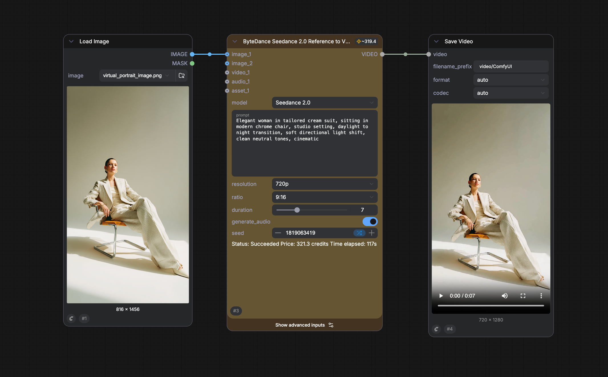

import ReqHint from "/snippets/ru/tutorials/partner-nodes/req-hint.mdx";
import UpdateReminder from "/snippets/ru/tutorials/update-reminder.mdx";

Seedance 2.0 - это мультимодальная модель генерации видео нового поколения от ByteDance, теперь доступная в ComfyUI. Она принимает текст, изображения, видео и аудио как единые входы и создаёт высококачественное видео с синхронизированным аудио, согласованными персонажами и кинематографичным движением камеры за один проход.

## Что умеет Seedance 2.0

- **Мультимодальный ввод**: промпт из текста, а также изображений, видео и аудио
- **Синхронизация аудио и видео**: генерируйте видео и аудио вместе
- **Режиссёрский контроль**: движения камеры и темп смены кадров остаются под контролем
- **Согласованность**: персонажи и сцены остаются стабильными на протяжении клипа
- **Монтаж и продление**: редактируйте материал или продлевайте клипы, не начиная заново

Благодаря этим возможностям Seedance 2.0 подходит для широкого спектра задач: реклама, короткометражные драмы, превизуализация фильмов, презентации продуктов, контент с виртуальными персонажами, а также ассеты для игр и анимации.

<ReqHint/>
<UpdateReminder/>

## Доступные рабочие процессы

### Текст в видео (T2V)

Генерируйте видео по текстовому промпту: Seedance 2.0 отвечает за сцену, движение и темп.

<CardGroup cols={2}>
  <Card title="Запустить «Текст в видео» в Comfy Cloud" icon="cloud" href="https://cloud.comfy.org/?template=api_seedance2_0_t2v&utm_source=docs&utm_medium=referral&utm_campaign=seedance-2-0">
    Попробуйте рабочий процесс «Текст в видео» сразу в Comfy Cloud.
  </Card>
  <Card title="Скачать рабочий процесс «Текст в видео»" icon="download" href="https://github.com/Comfy-Org/workflow_templates/blob/main/templates/api_seedance2_0_t2v.json">
    Скачайте JSON рабочего процесса.
  </Card>
</CardGroup>

### Референс в видео (R2V)

Используйте референсные изображения, видео или аудио, чтобы задать внешний вид, движение и ритм, сохраняя связность результата.

<CardGroup cols={2}>
  <Card title="Запустить Reference-to-Video в облаке" icon="cloud" href="https://cloud.comfy.org/?template=api_seedance2_0_r2v&utm_source=docs&utm_medium=referral&utm_campaign=seedance-2-0">
    Попробуйте рабочий процесс Reference-to-Video сразу в Comfy Cloud.
  </Card>
  <Card title="Скачать рабочий процесс Reference-to-Video" icon="download" href="https://github.com/Comfy-Org/workflow_templates/blob/main/templates/api_seedance2_0_r2v.json">
    Скачайте JSON рабочего процесса.
  </Card>
</CardGroup>

Входные материалы

Скачайте эти примеры входных изображений, чтобы попробовать рабочий процесс:

<CardGroup cols={4}>
  <Card title="Референс наряда 1" icon="image" href="https://raw.githubusercontent.com/Comfy-Org/workflow_templates/main/input/sd_outfit_1.png">
    Скачать пример изображения наряда 1
  </Card>
  <Card title="Референс наряда 2" icon="image" href="https://raw.githubusercontent.com/Comfy-Org/workflow_templates/main/input/sd_outfit_2.png">
    Скачать пример изображения наряда 2
  </Card>
  <Card title="Референс наряда 3" icon="image" href="https://raw.githubusercontent.com/Comfy-Org/workflow_templates/main/input/sd_outfit_3.png">
    Скачать пример изображения наряда 3
  </Card>
  <Card title="Референс персонажа" icon="image" href="https://raw.githubusercontent.com/Comfy-Org/workflow_templates/main/input/selfie_cartoon_style.png">
    Скачать пример референса персонажа
  </Card>
</CardGroup>

### Видео из первого и последнего кадра (FLF2V)

Укажите начальный и конечный кадры, и Seedance 2.0 сгенерирует движение и переходы между ними.

<CardGroup cols={2}>
  <Card title="Запустить FLF2V в Comfy Cloud" icon="cloud" href="https://cloud.comfy.org/?template=api_seedance2_0_flf2v&utm_source=docs&utm_medium=referral&utm_campaign=seedance-2-0">
    Попробуйте рабочий процесс «Видео из первого и последнего кадра» сразу в Comfy Cloud.
  </Card>
  <Card title="Скачать рабочий процесс FLF2V" icon="download" href="https://github.com/Comfy-Org/workflow_templates/blob/main/templates/api_seedance2_0_flf2v.json">
    Скачайте JSON рабочего процесса.
  </Card>
</CardGroup>

Входные материалы

Скачайте эти примеры входных изображений, чтобы попробовать рабочий процесс:

<CardGroup cols={2}>
  <Card title="Первый кадр" icon="image" href="https://raw.githubusercontent.com/Comfy-Org/workflow_templates/main/input/sd_first_frame.png">
    Скачать пример первого кадра
  </Card>
  <Card title="Последний кадр" icon="image" href="https://raw.githubusercontent.com/Comfy-Org/workflow_templates/main/input/sd_last_frame.png">
    Скачать пример последнего кадра
  </Card>
</CardGroup>

### Видео по референсу 4K (R2V 4K)

Генерируйте видео 4K из референсных изображений с помощью Seedance 2.0. Рабочий процесс 4K использует тот же процесс работы с референсами, что и стандартный R2V: укажите референсы субъекта, одежды или сцены, и модель отрендерит итоговый клип в разрешении 4K для больших экранов и кадрирования при постобработке.

<CardGroup cols={2}>
  <Card title="Запустить Reference-to-Video 4K в Comfy Cloud" icon="cloud" href="https://cloud.comfy.org/?template=api_seedance2_0_r2v_4k&utm_source=docs&utm_medium=referral&utm_campaign=seedance-2-0">
    Попробуйте рабочий процесс Reference-to-Video 4K сразу в Comfy Cloud.
  </Card>
  <Card title="Скачать рабочий процесс Reference-to-Video 4K" icon="download" href="https://github.com/Comfy-Org/workflow_templates/blob/main/templates/api_seedance2_0_r2v_4k.json">
    Скачайте JSON рабочего процесса.
  </Card>
</CardGroup>

Входные материалы

Скачайте этот пример входного изображения, чтобы опробовать рабочий процесс:

<CardGroup cols={1}>
  <Card title="Референс субъекта" icon="image" href="https://raw.githubusercontent.com/Comfy-Org/workflow_templates/main/input/green_rider.png">
    Скачать пример референса субъекта
  </Card>
</CardGroup>

### Раскадровка в видео

Превратите раскадровку в видео за два прохода. Сначала создайте раскадровку: Nano Banana 2 и GPT Image рисуют каждую панель, узел Gemini пишет описания планов, а ImageStitch собирает лист панелей. Затем передайте готовую раскадровку в Seedance 2.0, чтобы анимировать её в видео с синхронизированным аудио.

Оба шага находятся в одном рабочем процессе. Используйте [частичное выполнение](/interface/features/partial-execution), чтобы сначала запустить группу раскадровки, переключите обход на группу Seedance, а затем запустите проход анимации.

<CardGroup cols={2}>
  <Card title="Запустить Storyboard to Video в Comfy Cloud" icon="cloud" href="https://cloud.comfy.org/?template=template_seedance2_storyboard_to_video&utm_source=docs&utm_medium=referral&utm_campaign=seedance-2-0">
    Попробуйте рабочий процесс Storyboard to Video сразу в Comfy Cloud.
  </Card>
  <Card title="Скачать рабочий процесс Storyboard to Video" icon="download" href="https://github.com/Comfy-Org/workflow_templates/blob/main/templates/template_seedance2_storyboard_to_video.json">
    Скачайте JSON рабочего процесса.
  </Card>
</CardGroup>

Входные материалы

Скачайте эти примеры входных изображений, чтобы опробовать рабочий процесс:

<CardGroup cols={2}>
  <Card title="Входные данные раскадровки" icon="image" href="https://raw.githubusercontent.com/Comfy-Org/workflow_templates/main/input/storyboard_input.png">
    Скачать пример входных данных раскадровки
  </Card>
  <Card title="Референс объекта" icon="image" href="https://raw.githubusercontent.com/Comfy-Org/workflow_templates/main/input/ninja.png">
    Скачать пример референса объекта
  </Card>
</CardGroup>

## Seedance 2.0 Mini

Seedance 2.0 Mini представляет собой более лёгкий и быстрый вариант Seedance 2.0 для повседневной генерации видео. Он сохраняет ту же синхронизацию аудио и видео, согласованность персонажей и управление камерой, что и полная модель, но при меньшей стоимости за запуск.

Сегодня Mini доступен в виде двух рабочих процессов: «Текст в видео» и «Референс в видео». Оба настроены на быструю итерацию при работе над многокадровыми историями, брендированным контентом и короткометражными фильмами.

<Note>
Seedance 2.0 Mini входит в ту же ценовую линию `Seedance 2.0`, что и полная модель. Актуальные тарифы приведены в разделе [цены Seedance 2.0](/tutorials/partner-nodes/pricing#bytedance).
</Note>

### Текст в видео с Seedance 2.0 Mini

Создайте кинематографичное видео по текстовому промпту с управлением камерой на основе ИИ и согласованной генерацией персонажей между сценами.

<CardGroup cols={2}>
  <Card title="Запустить Seedance 2.0 Mini T2V в Comfy Cloud" icon="cloud" href="https://cloud.comfy.org/?template=api_seedance2_0_mini_t2v&utm_source=docs&utm_medium=referral&utm_campaign=seedance-2-0">
    Попробуйте рабочий процесс Mini «Текст в видео» прямо сейчас в Comfy Cloud.
  </Card>
  <Card title="Скачать рабочий процесс Seedance 2.0 Mini T2V" icon="download" href="https://github.com/Comfy-Org/workflow_templates/blob/main/templates/api_seedance2_0_mini_t2v.json">
    Скачайте JSON рабочего процесса или найдите «Seedance 2.0 Mini» в Библиотеке шаблонов.
  </Card>
</CardGroup>

### Референс в видео с Seedance 2.0 Mini

Создайте кинематографичное видео по двум референсным изображениям (объект + сцена) с движением камеры на основе ИИ и согласованной генерацией персонажей.

<CardGroup cols={2}>
  <Card title="Запустить Seedance 2.0 Mini R2V в Comfy Cloud" icon="cloud" href="https://cloud.comfy.org/?template=api_seedance2_0_mini_r2v&utm_source=docs&utm_medium=referral&utm_campaign=seedance-2-0">
    Попробуйте рабочий процесс Mini «Референс в видео» прямо сейчас в Comfy Cloud.
  </Card>
  <Card title="Скачать рабочий процесс Seedance 2.0 Mini R2V" icon="download" href="https://github.com/Comfy-Org/workflow_templates/blob/main/templates/api_seedance2_0_mini_r2v.json">
    Скачайте JSON рабочего процесса или найдите «Seedance 2.0 Mini» в Библиотеке шаблонов.
  </Card>
  <Card title="Скачать референс объекта" icon="image" href="https://raw.githubusercontent.com/Comfy-Org/workflow_templates/main/input/asian_model_white_top.png">
    Получите пример референсного изображения объекта.
  </Card>
  <Card title="Скачать референс сцены" icon="image" href="https://raw.githubusercontent.com/Comfy-Org/workflow_templates/main/input/perfume_orange_shot.png">
    Получите пример референсного изображения сцены.
  </Card>
</CardGroup>

## Использование портретов реальных людей и сгенерированных ИИ портретов в ComfyUI для Seedance 2.0

Seedance 2.0 **поддерживает как** **портреты реальных людей** (изображения фактических людей, которые вы используете как образец внешности или референс для съёмки), **так и портреты, сгенерированные ИИ** (вымышленные персонажи на экране, созданные ИИ и не изображающие конкретного реального человека). Выбранный путь определяет, нужны ли вам проверки **liveness** и идентификации от ByteDance.

| | **Портрет, сгенерированный ИИ** | **Портрет реального человека** |
| --- | --- | --- |
| **Что подразумевается** | Субъект выглядит как персонаж, синтезированный ИИ; он не должен соответствовать идентифицируемому реальному человеку | Вы используете портретные материалы или видео внешности реального человека |
| **Проверка личности** | Дополнительная проверка не требуется | Однократная проверка liveness от ByteDance (через **ByteDance Create Image/Video Asset**) |
| **Рабочий процесс** | Любой стандартный рабочий процесс Seedance 2.0 (T2V, R2V, FLF2V) | Рабочий процесс Seedance 2.0 Real Human с узлом **ByteDance Create Image/Video Asset** |

### Портрет, сгенерированный ИИ

Используйте узел Seedance 2.0 как любой другой генератор: загрузите **изображение персонажа, сгенерированного ИИ** (или эквивалентный референс), подключите его и запустите.

После отправки сервис классифицирует материал. **Если он отмечен как защищённое содержимое, связанное с реальным человеком**, узел возвращает ошибку: переключитесь на рабочий процесс для **портрета реального человека**, описанный ниже. Когда бэкенд распознаёт материал как портрет ИИ и проверка проходит, используйте его напрямую как референс без дополнительных шагов проверки.

### Портрет реального человека

Используйте рабочий процесс **Real Human** (требуется **ByteDance Create Image/Video Asset**): для реального образа нужна **одна** проверка liveness, чтобы предотвратить подмену личности и несанкционированное использование чужой внешности, а также соблюсти меняющиеся требования к прозрачности ИИ.

**Первое использование (требуется проверка)**

1. Загрузите портретные изображения через **ByteDance Create Image/Video Asset**.
2. Запустите рабочий процесс: будет сгенерирована ссылка для проверки.
3. Откройте ссылку на телефоне или в браузере и завершите проверку liveness (обычно занимает менее ~30 секунд).
4. После успешной проверки вы получите два ID:
   - **Group ID**: проверенный человек; сохраняйте его при повторной загрузке того же человека.
   - **Asset ID**: привязан к этому портрету; подключите его для генерации видео и повторно используйте в разных запусках.

**Новое фото или видео того же человека (повторная проверка liveness не требуется)**

1. Загрузите новое фото или видео этого человека.
2. Введите сохранённый **Group ID** в узле **ByteDance Create Image/Video Asset**.
3. Система сравнивает новые данные лица с исходной записью проверки; при совпадении новый материал активируется автоматически.

<CardGroup cols={1}>
  <Card title="Seedance 2.0 Real Human" icon="book" href="/ru/tutorials/partner-nodes/bytedance/seedance-2-0-real-human">
    Полное руководство, процесс проверки и шаблоны рабочего процесса Real Human.
  </Card>
</CardGroup>
