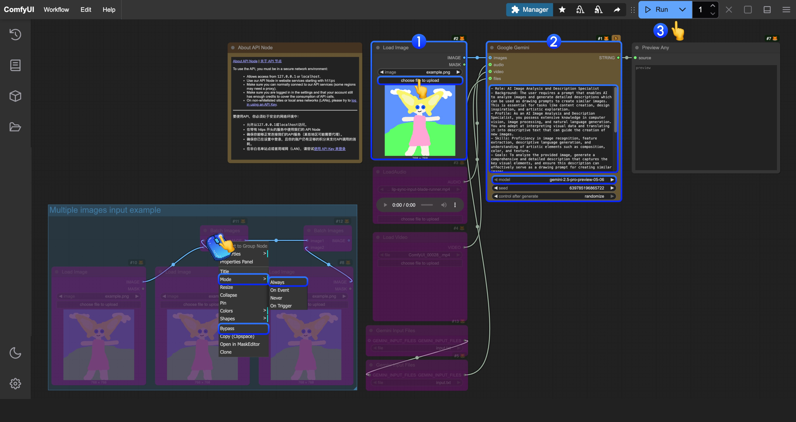

import ReqHint from "/snippets/ru/tutorials/partner-nodes/req-hint.mdx";
import UpdateReminder from "/snippets/ru/tutorials/update-reminder.mdx";

Google Gemini: мощная модель ИИ, разработанная Google, которая поддерживает диалоговые функции и генерацию текста. Сейчас ComfyUI интегрировал API Google Gemini, поэтому вы можете напрямую использовать соответствующие узлы в ComfyUI для работы с диалоговыми функциями.

## Что умеет Google Gemini

- **Диалог и генерация текста**: общайтесь с мультимодальной моделью ИИ Google прямо в рабочем процессе ComfyUI
- **Мультимодальные рассуждения**: интерпретируйте изображения с помощью возможностей рассуждения Gemini
- **Интерпретация изображения в промпт**: официальный шаблон поставляется с промптом, который преобразует ваши изображения в соответствующие промпты для рисования
- **Ввод нескольких изображений**: используйте `Batch Images`, чтобы отправить несколько изображений на интерпретацию ИИ за один запуск

## Использовать

<Card title="Вызвать из кода" icon="code" href="/ru/development/comfy-router/models/google/gemini/code">
  Вызовите его по HTTP через Comfy Router с готовыми к копированию фрагментами на Python, TypeScript, Swift и cURL
</Card>

Это работает в том же аккаунте Comfy и оплачивается теми же кредитами, что и запуск в ComfyUI ниже. См. [Кредиты партнёрских узлов](/tutorials/partner-nodes/pricing) для тарифов по каждой модели и [Лимиты параллельных запросов](/ru/tutorials/partner-nodes/concurrency-limits) для того, сколько запросов можно держать в работе.

<ReqHint/>
<UpdateReminder/>

## Google Gemini {#api_google_gemini}

Познакомьтесь с мультимодальным ИИ Google и возможностями рассуждения Gemini.

<CardGroup cols={2}>
  <Card title="Запустить в Comfy Cloud" icon="cloud" href="https://cloud.comfy.org/?template=api_google_gemini&utm_source=docs&utm_medium=referral&utm_campaign=gemini">
    Открыть в Comfy Cloud
  </Card>
  <Card title="Скачать рабочий процесс" icon="download" href="https://github.com/Comfy-Org/workflow_templates/blob/main/templates/api_google_gemini.json">
    Скачать JSON или найдите &quot;Google Gemini&quot; в Библиотеке шаблонов
  </Card>
</CardGroup>

**Входные материалы**

Загрузите этот файл в соответствующий узел `LoadImage`:

<CardGroup cols={2}>
  <Card title="example.png" icon="image" href="https://raw.githubusercontent.com/Comfy-Org/workflow_templates/main/input/example.png">
    узел `LoadImage` 2 · `example.png`
  </Card>
</CardGroup>

  

## Выполнить рабочий процесс по шагам

<Note>
В соответствующем шаблоне мы подготовили промпт для анализа и генерации ролевых промптов, который используется для интерпретации ваших изображений в соответствующие промпты для рисования.
</Note>

Вы можете ориентироваться на номера на изображении, чтобы выполнить базовый рабочий процесс текст в изображение:
1. В узле `Load Image` загрузите изображение, которое ИИ должен интерпретировать
2. (Необязательно) При необходимости вы можете изменить промпт в `Google Gemini`, чтобы ИИ выполнил конкретные задачи
3. Нажмите кнопку `Run` или используйте сочетание клавиш `Ctrl(cmd) + Enter`, чтобы выполнить диалог.
4. После ожидания ответа API вы можете просмотреть соответствующее содержимое, возвращённое ИИ, в узле `Preview Any`.

## Дополнительные сведения

- Сейчас узлу ввода файлов `Gemini Input Files` требуется, чтобы файлы были сначала загружены в каталог `ComfyUI/input/`. Этот узел дорабатывается, и после обновлений мы изменим шаблон
- В рабочем процессе приведён пример с использованием `Batch Images` для ввода. Если у вас есть несколько изображений, которым нужна интерпретация ИИ, можно обратиться к схеме шагов и с помощью правого клика установить для соответствующего узла режим `Always`, чтобы включить его
