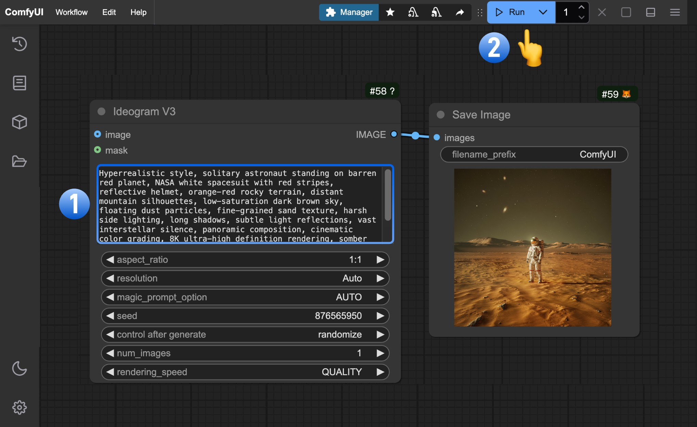

import ReqHint from "/snippets/ru/tutorials/partner-nodes/req-hint.mdx";
import UpdateReminder from "/snippets/ru/tutorials/update-reminder.mdx";

Ideogram 3.0 представляет собой мощную модель текст в изображение от Ideogram, известную фотореалистичным качеством, точной передачей текста и стабильным контролем стиля.

Узел Ideogram V3 сейчас поддерживает два режима:
- Режим текст в изображение
- Режим редактирования изображения (когда указаны оба входа: image и mask)

<ReqHint/>
<UpdateReminder/>

## Режим текст в изображение партнёрских узлов Ideogram 3.0

Если использовать Ideogram V3 без входов image и mask, узел работает в режиме «текст в изображение».

### 1. Скачать файл рабочего процесса

Скачайте следующий файл и перетащите его в ComfyUI, чтобы загрузить рабочий процесс:

### 2. Выполнить шаги рабочего процесса

Выполните шаги по порядку, чтобы пройти базовый рабочий процесс:
1. Введите описание изображения в поле `prompt` узла `Ideogram V3`
2. Нажмите `Run` или используйте сочетание клавиш `Ctrl(cmd) + Enter`, чтобы сгенерировать изображение
3. После того как API вернёт результаты, просмотрите сгенерированное изображение в узле `Save Image`. Изображения сохраняются в каталог `ComfyUI/output/`

## Режим редактирования изображения партнёрских узлов Ideogram 3.0

Подключите оба входа `image` и `mask` узла `Ideogram V3`, чтобы переключить его в режим редактирования изображения. Узел заново генерирует область маски по вашему промпту, а остальную часть изображения оставляет без изменений.

1. Загрузите изображение, которое хотите отредактировать, с помощью узла `Load Image` и подключите его к входу `image` узла `Ideogram V3`
2. Щёлкните правой кнопкой мыши по загруженному изображению, выберите **Open in MaskEditor** и закрасьте область, которую хотите изменить
3. Подключите выход маски к входу `mask` узла `Ideogram V3`. Закрашенные (белые) области заменяются, а всё за пределами маски остаётся без изменений
4. Введите инструкцию для редактирования в поле `prompt`, описав, что должно появиться внутри области маски
5. Нажмите `Run` или используйте сочетание клавиш `Ctrl(cmd) + Enter`, чтобы сгенерировать отредактированное изображение
6. Просмотрите результат в узле `Save Image`. Отредактированное изображение также сохраняется в каталог `ComfyUI/output/`

<Note>
Узел использует режим редактирования только когда подключены оба входа `image` и `mask`. Если подключить лишь один из них, узел работает в режиме текст в изображение.
</Note>